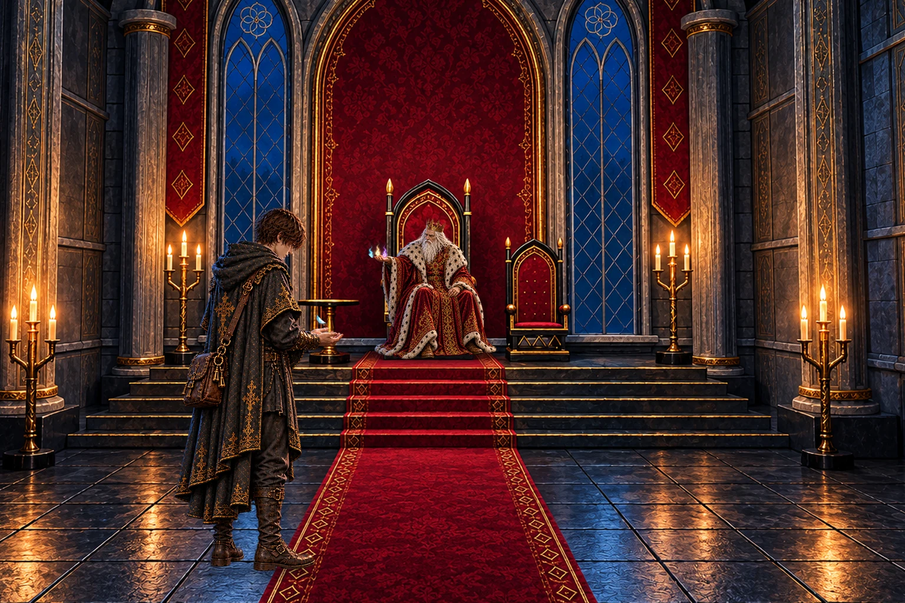
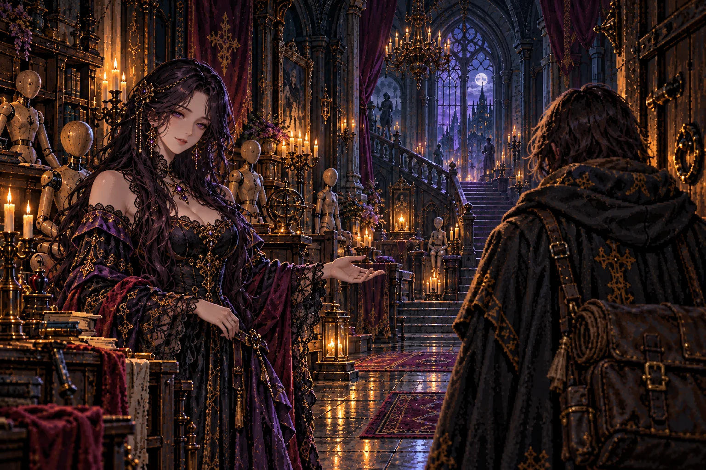
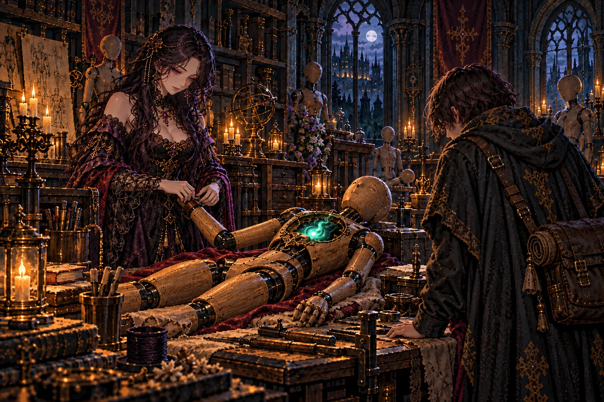
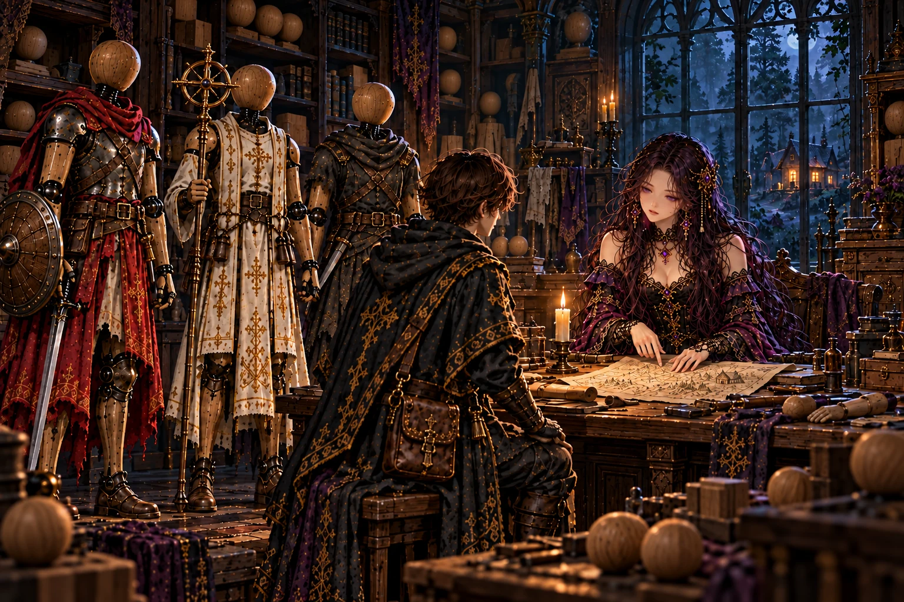
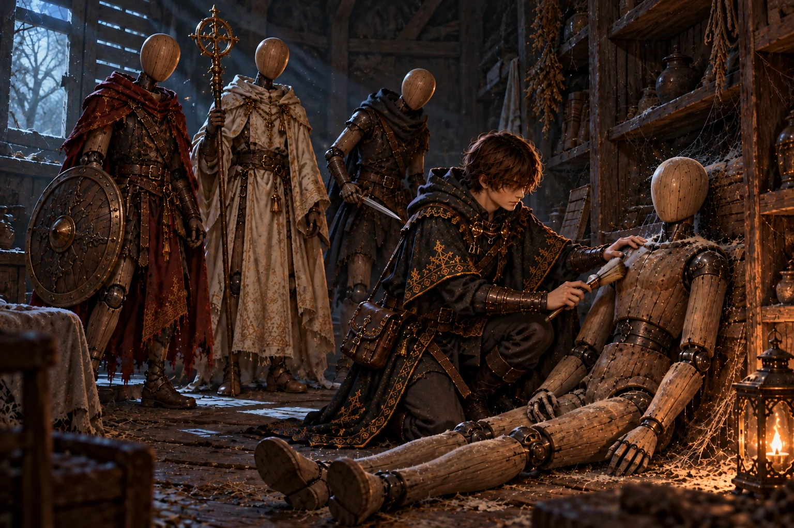
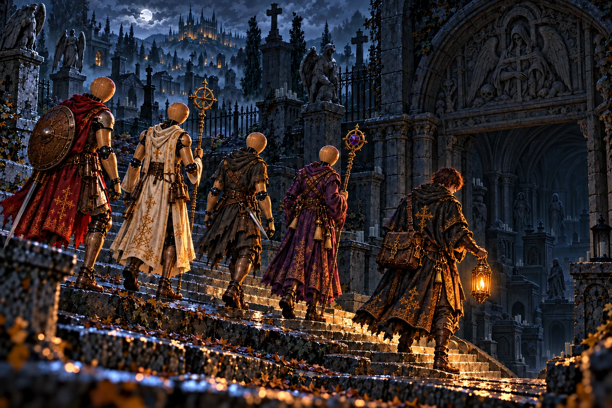
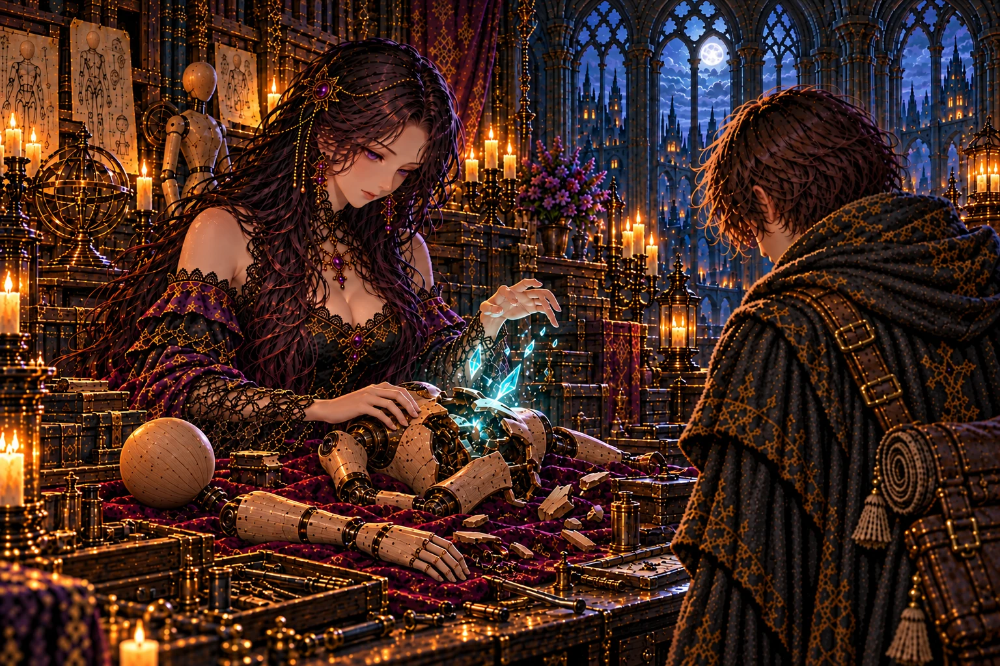

# 序章 の絵

書き出し: `node tools/storyart/review.mjs` (手で直さない)。絵は出荷する WebP、まだ無ければ原画。
ゲームで小さく出た時の見え方 (384×256): [chapter0-small.jpg](chapter0-small.jpg)

## opening「師のいない街へ」 ── 出荷済み

**ストーリー一覧の本文**

> ロアダルへ向かう道で、弟子は何度も腰の空いた場所に手をやった。そこにはいつも、師の荷から預かった小さな灯があった。今は何もない。
>
> 操霊師オルドが迷宮へ降りてから、一年。届いたのは、出立前に師が預けていった手紙だった。一年戻らなければ弟子へ渡すよう、封に書かれていた。ロアダルへ来て、館の灯を守れという。
>
> 街の屋根を越えて、墓所の門が見えた。死者の魂を宿す器なら、その向こうへ進める。教わった技を使う理由を、弟子は初めて自分で選ぼうとしていた。
>
> 師が戻らなかった道を歩く。足跡を拾い、声を探し、今度こそ一緒に地上へ帰るために。

## arrival「玉座から託された三つの魂」 ── 出荷済み (任意の修正あり)

**ストーリー一覧の本文**

> ロアダルの離宮の玉座の間は、外の街よりも静かだった。弟子が名を告げると、王はその名を繰り返し、顔ではなく、その手を見た。オルドから何を受け継いだのか、そこに答えを探すように。
>
> 差し出された三つの魂は、それぞれ違う色で揺れた。刃を取る者、祈る者、闇を読む者。まだ名前も器もない、小さな光だった。
>
> 王が望んだのは、まず三体の人業を目覚めさせること。迷宮へ進む許しは、そのあとに与えられる。師の留守を預かる館なら、器を仕立てられるという。
>
> 弟子は光を抱えて玉座を離れた。王が師を思う時の長い沈黙を、問いただす言葉はまだ持っていなかった。

**修正 (任意)**

- 授かる三つの魂の色を職業の色に: 戦士 = 赤、僧侶 = 金、盗賊 = 緑 (紫は後で授かる魔導士の色なので外す)

## irene_meeting「イレーヌとの出会い」 ── 出荷済み

**ストーリー一覧の本文**

> 館の扉を押すと、木の匂いとろうの温かさが流れてきた。奥には人の形をした器が並び、その間を黒い髪の女が歩いてくる。紫の衣の裾が、床を静かに滑った。
>
> イレーヌは、師から弟子の名を聞いていた。{弟子名:様}ですね、と確かめる声にうなずくと、彼女は館へ迎え入れてくれた。
>
> 言葉は丁寧で、少し距離があった。それでも扉はすぐに閉じられず、旅の荷を置く場所と、濡れた外套を掛ける場所が用意された。
>
> 主の帰らない家で、待つことをやめなかった人。その日の弟子にとって、イレーヌはまだ、それ以上でも以下でもなかった。

## irene_lamp「一年を越えた灯」 ── 出荷済み (任意の修正あり)

**ストーリー一覧の本文**

> イレーヌが案内したのは、館のいちばん奥にある燭台だった。細い火が、誰も座っていない椅子を照らしている。
>
> それは師の魂に結ばれた灯だという。芯が短くなれば整え、ろうが減れば足す。師が姿を消したあとも、彼女は毎日その仕事を続けていた。
>
> 灯は師の居場所を教えてくれない。声も届けない。ただ、まだ消えていないという事実だけが、この館と迷宮の奥をつないでいた。
>
> 弟子は火に手を近づけた。探しに行く者と、帰る場所を守る者。二人の仕事が、同じ小さな明かりから始まった。

**修正 (任意)**

- 弟子を燭台の近くに。本文「弟子は火に手を近づけた」

## first_vessel「最初の名前」 ── 出荷済み

**ストーリー一覧の本文**

> 台に寝かされた人業には、まだ目の光がなかった。イレーヌが継ぎ目を確かめる間、弟子は宿す魂を両手で包んで待った。
>
> 魂が胸へ沈むと、木の指が一本ずつ動いた。教えられた手順は覚えていた。それでも、こちらを見返す目が開いた瞬間、弟子は息を止めた。
>
> 名を与える声は、思ったより小さかった。生まれた人業は聞き逃さず、呼ばれた名に顔を上げる。イレーヌはその様子を見届けてから、台の留め具を外した。
>
> 器を仕立てることと、誰かを旅へ連れていくことは同じではない。師の教えは、その日から手の中に重さを持った。

## three「森の古屋への頼み」 ── 出荷済み

**ストーリー一覧の本文**

> 戦士、僧侶、盗賊。王から授かった三つの魂を宿し、三体の人業が目を開けた。
>
> イレーヌは、近くの森の古屋に残してきた人業を連れ帰ってほしいと頼んだ。
>
> 弟子は三体の顔を見渡し、頼みを引き受けた。森の先で待っている人業を、そろって館へ連れ帰ろう。

## forest_doll「ほこりの下で待つ人業」 ── 出荷済み

**ストーリー一覧の本文**

> 三体と歩いた森の先に、屋根の傾いた古屋があった。小さな虫が枯葉を鳴らすほかに、動くものはない。
>
> 棚の下で眠る人業の肩を払うと、ほこりの下からなめらかな木肌が現れた。長く使われていないだけで、手も足もそろっている。
>
> 弟子は人業を抱き上げた。館へ戻れば、この静かな胸にもまた魂の灯をともせる。三体の足音が、帰り道を先導した。

**ゲーム内 (師の手がかり STORY_CELLS.forest_doll)**

> 森の奥の古屋。棚にもたれ、ほこりをかぶった人業が座っていた。
>
> 継ぎ目はしっかりしている。イレーヌのもとへ連れ帰ろう。

**指示書 (4章)**

- 修正: 人業4体の頭を `docs/art/story-refs/dolls.png` の目鼻・口・耳のない丸い木の頭にそろえ、盗賊の短剣を右手で柄を握る形に直す。(済)
- 要点: 三体と森を進み、古屋でしばらく使われていない人業を発見する。人業にはまだ魂の灯がなく、壊れていない。
- 描くもの: 森の奥の古屋の室内 / 棚にもたれる、ほこりをかぶった木と黒鉄の人業 / 戦士・僧侶・盗賊の三体 / 弟子。
- 描かないもの: 騎士・魔導士・司教、イレーヌ、宝箱、死体、罠。

## departure「四つの足音、ひとつの行き先」 ── 出荷済み

**ストーリー一覧の本文**

> 四体目が目を覚ますと、館の床に隊の影がそろった。弟子は魔導士を仲間に迎え、まだ新しい留め具を確かめた。
>
> 王は支度のための金貨を渡し、地下墓地の死者が騒ぐ原因を調べてほしいと頼んだ。そこは遠い戦場ではない。ロアダルで暮らした人々が眠る、街の足元だった。
>
> 帰りを待つイレーヌへ、弟子は短く頭を下げた。大げさな約束は口にしなかった。四つの足音を、そのまま館へ戻すつもりだった。

## irene_repair「砕けても、名は消えない」 ── 出荷済み

**ストーリー一覧の本文**

> 動かなくなった仲間を前に、弟子は名を呼ぶことしかできなかった。イレーヌは器を受け取り、傷んだ場所と魂の状態を確かめた。
>
> 宿で休ませるだけでは戻らない。器の内で砕けた魂を、館で繕う必要がある。迷宮に残った器なら、連れ帰られるのを待たなければならない。
>
> 直せると分かった安堵は、失った時の重さを消さなかった。弟子は次の隊列を考え直した。仕立てた日に付けた名を、ただ何度でも呼べばよいわけではない。

