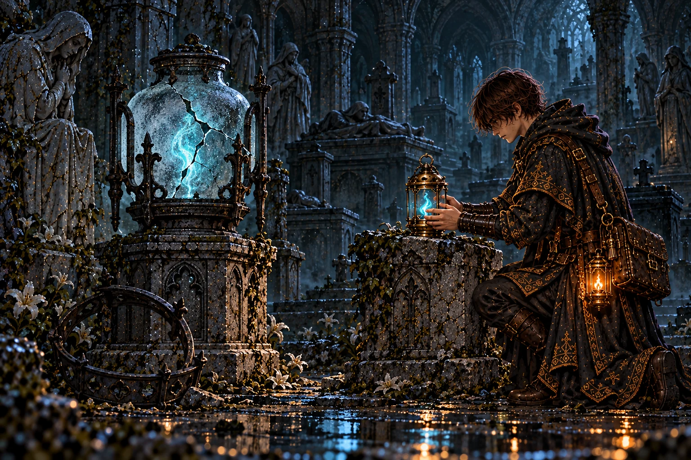
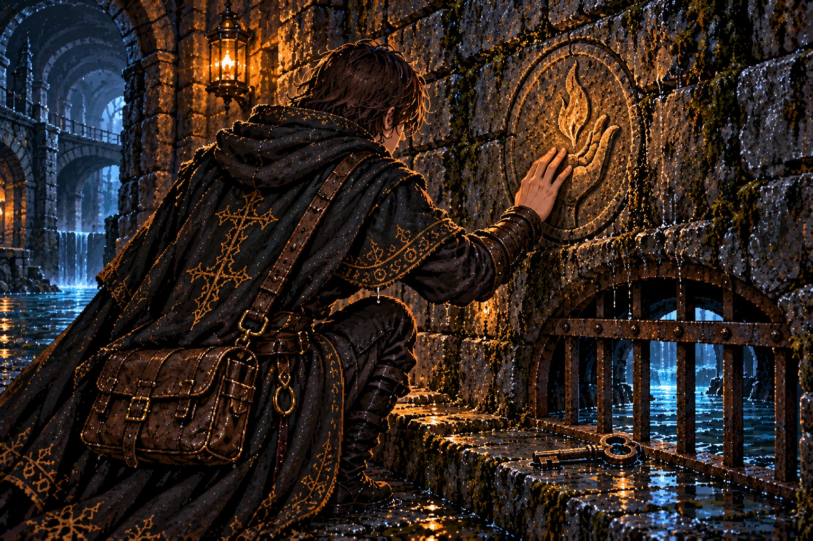
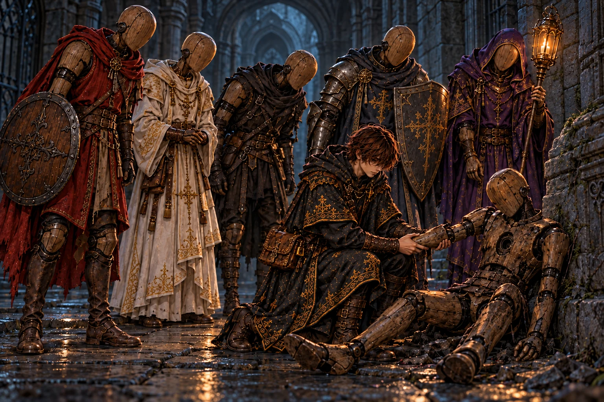
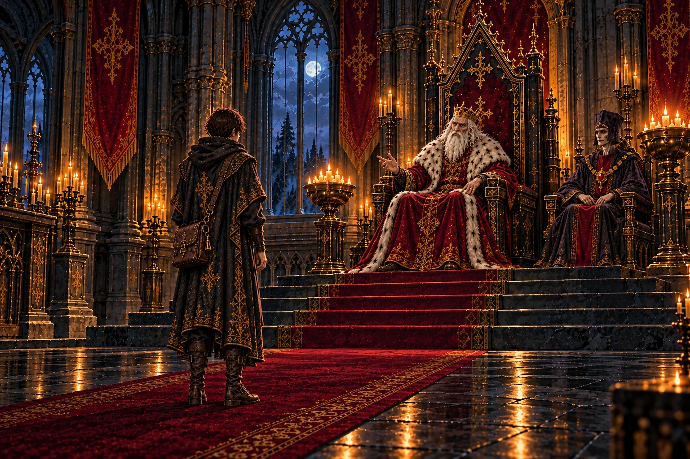
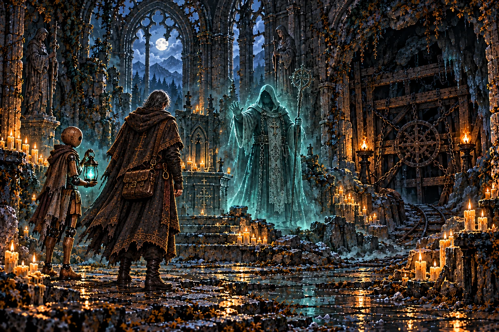
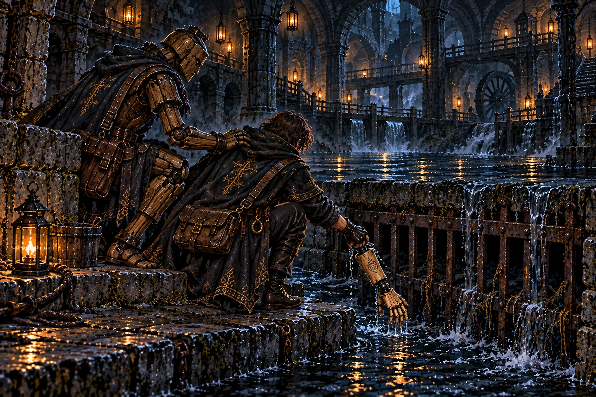
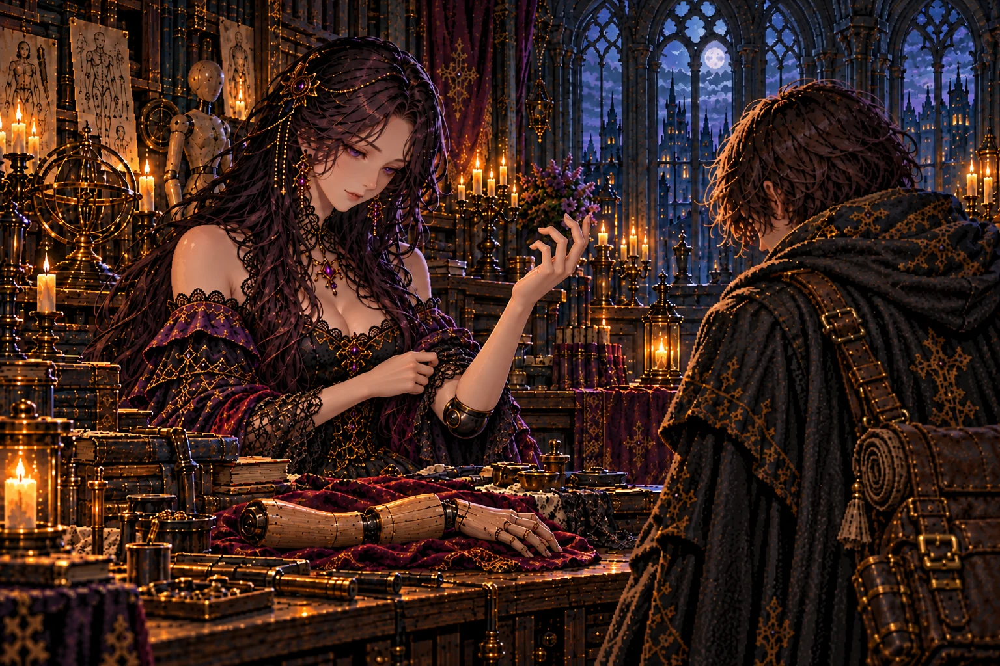
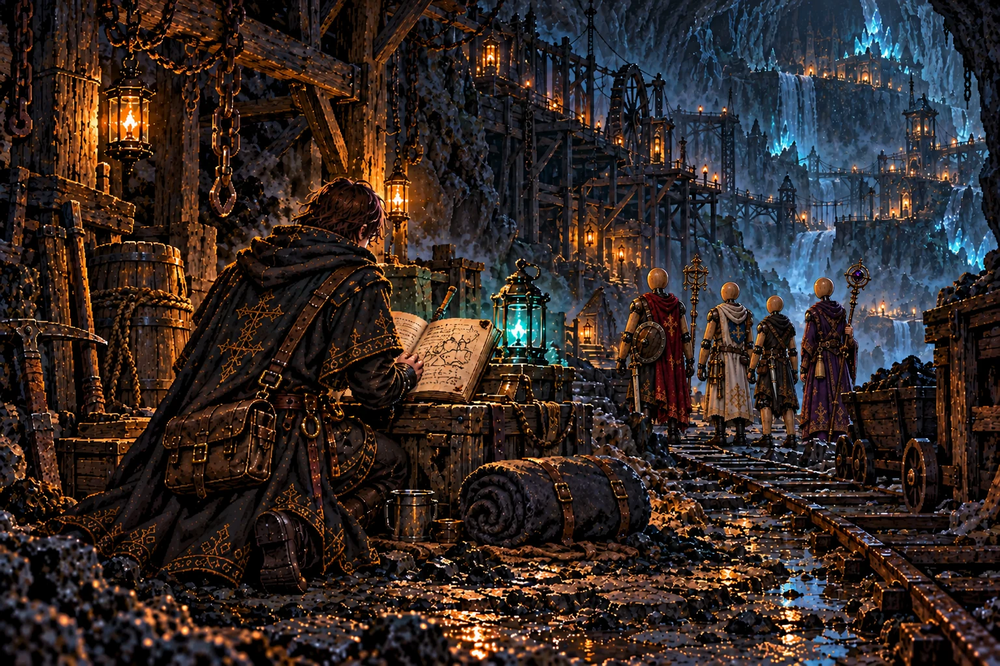
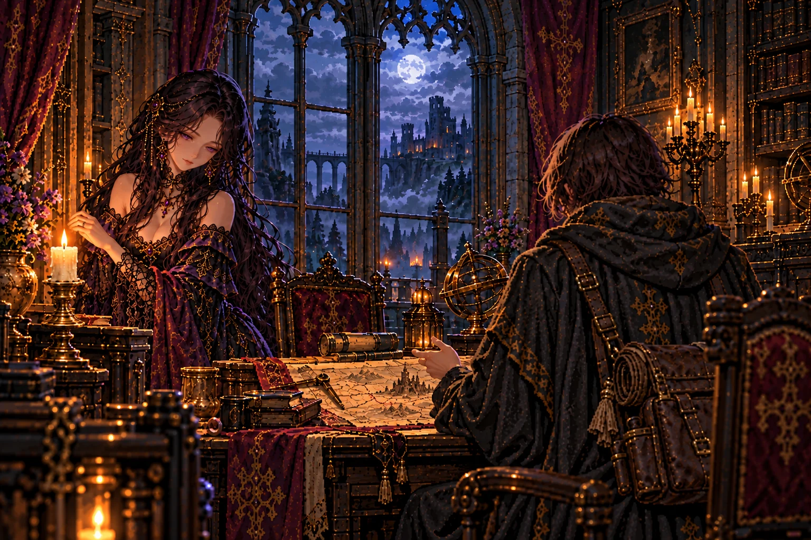
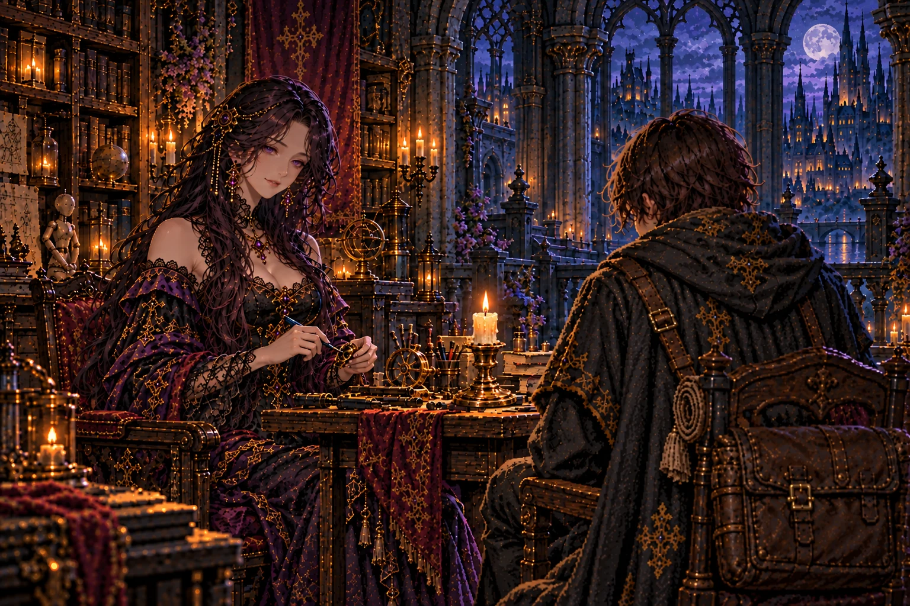

# 第1章「師の灯」 の絵

書き出し: `node tools/storyart/review.mjs` (手で直さない)。絵は出荷する WebP、まだ無ければ原画。
ゲームで小さく出た時の見え方 (384×256): [chapter1-small.jpg](chapter1-small.jpg)

## irene_boons「手がかりの恵み」 ── 出荷済み

**ストーリー一覧の本文**

> 持ち帰った手がかりを、イレーヌは燭台のそばに並べ直した。師の書き残したものには、進む道を知らせる言葉だけでなく、後から来る者の手助けも残されていた。
>
> 一つずつ調べた彼女は、館や旅の支度に役立つことを教えてくれた。迷宮から持ち帰った紙の端にも、師の仕事はまだ続いていた。
>
> これからも見つけたものを持ち帰ってほしい、と彼女は頼んだ。師を追うための手がかりが、そのまま、次に潜る隊を支えるものになる。

**ゲーム内 (館の語り IRENE_BEATS.irene_boons)**

> イレーヌ「これまで持ち帰ってくださった手がかりを、もう一度よく調べてみました。」
>
> イレーヌ「オルド様は、手がかりのひとつひとつに、後から来る人への手助けを残していたのです。」
>
> ── ほこりをかぶった人業: 館で四体目に魂を宿せる
>
> ── 壊れた人業: 館でイレーヌに見せられる
>
> ── 流れ着いた腕: 継ぎ目の技 ― 師の継ぎ目を手本に、館での人業の修復の費用が 10%安くなる
>
> ── 独房の頭: セラの囁き ― セラの声が迷宮の魂を呼び寄せる。職業の魂を拾った時、5%でもう一つ拾える
>
> ── 根に抱かれた胴: 胸の扉の覚え書き ― 師の書き残した器の整え方で、人業の全員の回避率が 1%上がる
>
> ── 水槽の底の脚: セラの体がそろえば ― 館で、セラが目を覚まし、隊に加わる
>
> ── 焼かれた人業の殻: 師の札 ― セラの器の継ぎ目を締め直せる (館に持ち帰ると、セラの魂のランクが上がる)
>
> ── 霊薬の帳面: 魂を使わない霊薬 ― 商会に霊薬 (命の泉の水・満月の井戸水・霊薬エリクシル) がいつも並ぶ
>
> ── 極光の書きつけ: 残火の掘り出し方 ― 死体から魂の残火を拾った時、10%でその数が倍になる
>
> ── 一門の印の器: 器の継ぎ方 ― 館で語りを聞くと、セラの魂 (灯守) のランクが上がる
>
> ── 毒消しの書きつけ: 毒消しの薬 ― 毒の沼・汚泥・胞子など、毒を含む床で受けるダメージが半分になる
>
> ── 雷よけの書きつけ: 雷よけの巻き方 ― 隊の全員のブレス耐性 +5% (装備と合わせて上限 50%)
>
> ── 灯番の子の寝床: 最初の人形 ― 館で語りを聞くと、セラの魂 (灯守) のランクが上がる
>
> ── 暗がりの目: 暗がりの目 ― 隊の全員の物理の命中 +2% (外れる率が2ポイント下がる)
>
> ── 吹きかけの灯籠: 眠り灯の吹き方 ― 全滅した時、砕けた人業が館に届くまでの時 (連れ帰り) が1割短くなる
>
> イレーヌ「これからも、手がかりを見つけたら持ち帰ってください。きっと、何かが残されています。」

**指示書 (4章)**

- 要点: 旧セーブへの案内。燭台の横で紙束と手記を調べ、残された手助けを示すイレーヌ。進行度に関係なく使えるよう、特定の後半章の品や秘密は描かない。
- 描かないもの: 読める文字・後の章の秘密・本文にない幻影。

## w01_lantern「墓石の上の青い火」 ── 出荷済み

**ストーリー一覧の本文**

> ひび割れた鎮魂灯が魂の声を増幅し、死者の眠りを乱していた。灯を静めると、その傍らに見覚えのある金具が光っていた。弟子は隊を止め、墓石の上のランタンを両手で拾った。師が旅のたびに提げていたものだった。
>
> 火の消えたガラスの奥に、魂の光が残っている。底に刻まれた文字は、地下を巡る水の行方へ注意を向けていた。ここが師の旅の終わりではない。
>
> 弟子はランタンを荷に納めた。持ち主のいない道具を見つけた悲しさよりも、同じ道を歩いているという確かさが、今は強かった。

**ゲーム内 (師の手がかり STORY_CELLS.w01_lantern)**

> 最深部の鎮魂灯に、ひびが入っていた。死者を鎮めるはずの灯が、地下の魂の声を増幅している。
>
> 灯を支える古い輪を外すと、青白い光が静まった。棺をかく音も、ようやく止む。
>
> その傍らの墓石に、真ちゅうのランタンが置かれていた。
>
> 師オルドが、いつも腰に提げていたものだ。
>
> 火は消えている──だがガラスの内側で、青白い魂火がひとつ、かすかに揺れている。
>
> 底の金具に、爪で刻んだ文字があった。
>
> ──『水は下へ流れる。答えは、さらに下に』

## report_w01「鎮魂灯と眠っていた人業」 ── 出荷済み

**ストーリー一覧の本文**

> 死者を鎮めるはずの鎮魂灯が傷み、逆に地下の魂の声を呼び寄せていた。弟子は灯を静め、傍らに残された師のランタンを王に見せた。
>
> 王は墓地に静けさが戻ったことを喜び、王宮の倉庫に放置されていた人業を褒美に渡した。館のイレーヌに見せるように、と言い添えて。
>
> 弟子は師のランタンを大切に収め、眠っている人業を抱えて館へ向かった。また一つ、共に歩く灯が増えるかもしれない。

**ゲーム内 (王への報告 REPORTS.w01)**

> 「鎮魂灯が傷み、死者を呼び寄せておったのか。これで墓所にも静けさが戻ろう。よくやった、{弟子名}。」
>
> 「その傍らにオルドのランタンが……魂火は、まだ消えておらぬのだな。」
>
> 「褒美に、王宮の倉庫で眠っていた人業を授けよう。イレーヌのところへ持ってゆけ。」

## w02_sigil「水音の向こうへ」 ── 出荷済み

**ストーリー一覧の本文**

> 壁に残る手の印を見つけた時、弟子は自分の指でその形をなぞった。師が仕事の終わりに刻む印。その下の鉄格子には、錠に鍵が挿さったまま残っていた。
>
> 隙間から上がる湿った風に、地上の匂いはない。取水口へ通じる道だと分かったが、師の短い書きつけは、その名をイレーヌに知らせないよう求めていた。
>
> なぜ館で待つ人を遠ざけたのか。答えを急いで決めることはできなかった。弟子は鍵を取った。その先へ進む時も、引き返す時も、自分で選べるように。

**ゲーム内 (師の手がかり STORY_CELLS.w02_sigil)**

> 回廊の壁に、見覚えのある印が刻まれていた──灯を掌に載せた手。
>
> 師が仕事の跡に残す印だ。刻み目はまだ新しい。
>
> 印の下には、さびた鉄格子。その向こうから、湿った風と水の音が吹き上げてくる。
>
> 格子の錠には、鍵が挿さったままだった。結ばれた札に、一言。
>
> ──『取水口。イレーヌには言うな』
>
> 水音の奥には、回廊よりも深い闇がある。
>
> ── 「黒水の取水口」へ続く道を記録した (寄り道の迷宮・推奨Lv18〜21)。隊の支度を整えてから向かおう。

## w02_broken_doll「回廊の果ての六体目」 ── 出荷済み

**ストーリー一覧の本文**

> 回廊のいちばん奥で、五体の人業が足を止めた。壁にもたれた人業の胸には灯がなく、継ぎ目には長い旅の傷が刻まれている。
>
> どこの誰と歩いてきたのか、今は聞くこともできない。それでも、折れたところを確かめる指先は、人業を置いていく気にはなれなかった。
>
> 弟子は壊れた人業を連れ帰ることにした。館のイレーヌなら、この旅の続きをつなげられるかもしれない。

**ゲーム内 (師の手がかり STORY_CELLS.w02_broken_doll)**

> 回廊の最深部に、壊れた人業が倒れていた。
>
> 胸には魂の灯がない。継ぎ目の傷をかばい、街へ連れ帰ることにした。

**指示書 (4章)**

- 要点: 五体の隊が回廊最深部で壊れた人業を発見し、館へ連れ帰ろうとする。以前の操霊師の素性は不明。セラではない。
- 描くもの: 静かな石の回廊 / 継ぎ目が傷んで壁にもたれた、灯のない人業 / 弟子と戦士・僧侶・盗賊・騎士・魔導士の五体。
- 描かないもの: 司教、イレーヌ、セラ、師オルド、死体、宝箱、読める文字。

## report_w02「祈りの終わらない場所」 ── 出荷済み (任意の修正あり)

**ストーリー一覧の本文**

> 師の印の話を聞いた王は、次に修道院長の名を挙げた。回廊の果てで祈り続ける者なら、そこを通った人の姿を覚えているという。
>
> 墓地の奥に回廊があり、その果てに修道院がある。地図の線は少しずつ増えたが、師が何を探したのかは、まだ空白だった。
>
> 弟子は今すぐ答えを求める代わりに、次の足跡を追うことにした。師を見た者に会う。生きた人でなくても、その魂が残っているのなら。

**ゲーム内 (王への報告 REPORTS.w02)**

> 「灯を掌に載せた手、か。……オルドの印だ。回廊の壁に刻んでおったとはな。」
>
> 「取水口の鍵まで置いていったか。あの男は昔から、黙って一人で先へ行く。」
>
> 「回廊の果てには、骸の修道院がある。死者を弔い続けた修道士どもの成れの果てよ。」
>
> 「修道院長は、通る者をすべて見ておる。……オルドの姿も、見たはずだ。」

**修正 (任意)**

- 窓の外の地上の修道院の廃墟を消す (修道院は地下)

## mem_w03「止められても進んだ人」 ── 出荷済み

**ストーリー一覧の本文**

> 修道院長を鎮めたあと、弟子の目に、自分が見たことのない祭壇が映った。そこに立っていたのは、一年前の師だった。
>
> 坑の底へ進むことを止められても、師は引き返さなかった。死者が帰れない理由を断つために、封じられた道の所在を求めていた。傍らには、人業が灯を抱えて立っている。
>
> 記憶が薄れた時、祭壇の前には弟子の隊だけが残った。師の目的を初めて知った。それは誰か一人を助ける仕事よりも、ずっと広く、危ういものだった。

**ゲーム内 (主の記憶 BOSS_MEMORIES.w03)**

> 主が崩れ落ちると、骸から淡い魂がほどけ、記憶の断片が流れ込んできた──
>
> ……あれは一年前の晩。祭壇の前に、旅の汚れの染みた外套の男が立った。
>
> ──『坑口はどこだ』
>
> わしは止めた。坑の底には、掘り当ててはならぬものがある。先代の王が自ら封じたのだ、と。
>
> 男は笑った。──『だから行くのだ。あれを断たねば、魂はいつまでも還れない』
>
> 男の後ろには木の人業がひとり、灯を抱いて従っていた……

## report_w03「封じた者の沈黙」 ── 出荷済み

**ストーリー一覧の本文**

> 修道院長の記憶を伝えると、王の目が宰相から離れた。古い坑口は王家が封じた場所だという。師は、その封の向こうを探していた。
>
> 何を恐れて閉じたのか。王は詳しく語らず、宰相も問いを受けなかった。報告を聞く二人の間に、弟子の知らない過去があった。
>
> 迷宮に残る記憶の方が、地上の言葉よりも率直なのかもしれない。弟子はその考えを口にせず、次の支度へ戻った。

**ゲーム内 (王への報告 REPORTS.w03)**

> 「……その顔。修道院長の魂から、何かを見たな。」
>
> 「坑口、か。……あの坑を封じたのは、余だ。オルドめ、あれを開ける気でおったか。」
>
> 「そなたはもう通行証を持っておったな。支度を整え、師の足跡を追うがよい。」
>
> 宰相が、王の横顔を盗み見た。

## w04_arm「黒い流れが返したもの」 ── 出荷済み

**ストーリー一覧の本文**

> 格子に引っかかっていた腕は、冷たい水の中でも指の形を失っていなかった。弟子は流れに足を取られないよう、隊に支えられて引き上げた。
>
> 黒鉄の継ぎ目の内側に、師の印がある。人業だ。それも、師が自分の手で仕立てたものだった。
>
> 誰の腕なのかも、どこで失われたのかも分からない。弟子は布に包み、館へ持ち帰ることにした。あの家なら、この小さな刻み目を知る人がいる。

**ゲーム内 (師の手がかり STORY_CELLS.w04_arm)**

> 取水口の格子に、木の腕が一本、引っかかっていた。
>
> 人業の腕だ。黒鉄の継ぎ目、指の一本一本まで彫り込まれた、見事な仕事。
>
> 手首の内側に、小さな刻印──回廊の壁で見たのと同じ、師の印。
>
> ……師の作った人業が、黒い水に流されてきたのだ。
>
> 館の主に見せなければならない。そんな気がした。

## irene_reveal「レースの下の継ぎ目」 ── 出荷済み

**ストーリー一覧の本文**

> 腕を見せると、イレーヌの手が止まった。返ってきた名はセラ。師が彼女より先に作り、ともに迷宮へ連れていった人業だった。
>
> イレーヌは黒いレースの袖口を、自分の指で肘までめくり上げた。のぞいた白い手首の先に、腕と同じ黒鉄の肘の継ぎ目が見える。館を預かり、器を作り、灯を守る彼女自身も、師の作った人業だった。
>
> 取水口の札に残された、イレーヌには言うな、という一言を伝えると、彼女は困ったように目を伏せた。セラが流されたと知れば、自分が灯を置いて捜しに出てしまう。師はそう案じたのだろう、と。そのうえで彼女は、セラより深くへ進んだかもしれない師を、見つけてほしいと願った。
>
> 人業という名は、旅の仲間だけを指すものではなくなった。帰る場所で待つ人の肘にも、同じ継ぎ目があった。

**ゲーム内 (館の語り IRENE_BEATS.irene_reveal)**

> イレーヌ「……その腕を、どこで見つけたのですか。」
>
> 取水口の鍵に結ばれていた札のことを話すと、イレーヌは腕を受け取ったまま、継ぎ目を指でなぞった。
>
> イレーヌ「『イレーヌには言うな』……。あの方らしいですね。この子が流されたと知れば、わたしが灯を置いて捜しに行くと思ったのでしょう。」
>
> イレーヌ「セラの腕です。……独房から連れ帰ってくださった、あの子の。」
>
> 彼女は袖口の黒いレースをめくった。白い手首の先に、黒鉄の継ぎ目が光っていた。
>
> イレーヌ「……隠すつもりはありませんでした。わたしも、人業です。」
>
> イレーヌ「オルド様に作られ、オルド様の灯を守るために、ここにいます。」
>
> イレーヌ「セラが流されてきたのなら、あの方は水よりも深い所へ行ったのでしょう。……お願いします。見つけてください。」

## report_w04「答えを飲み込んだ王」 ── 出荷済み

**ストーリー一覧の本文**

> 取水口で見た流れを伝えると、王はその先が王都の中心へ向かうことを認めた。水は地下を巡り、遠い場所同士を結んでいる。
>
> 何を運ぶのかという問いに、王の答えは続かなかった。宰相が名を呼ぶと、話は褒美へ移った。弟子の手には金貨が残り、問いは宙に浮いたままだった。
>
> 地図に書けることと、口にしてよいことは違うらしい。その境目を、師はすでに越えていたのだろうか。

**ゲーム内 (王への報告 REPORTS.w04)**

> 「黒い水が、どこへ流れていたか。……見てきたのであろう。」
>
> 「このロアダルから遠く、王都の中心へ、地の底をくぐって流れ込んでおる。何を運んでいるのかは──まあ、よい。」
>
> 「オルドの人業の腕が、格子に流れ着いておったか。……館の主には、見せてやったか。」
>
> 宰相「陛下。」
>
> 宰相は、微笑んだまま王を見ていた。
>
> 「分かっておる。……褒美だ、持ってゆけ。」

## minePass「三つの宝と古い封」 ── 出荷済み

**ストーリー一覧の本文**

> 宝物庫へ納めた三種類の品は、迷宮を歩いた確かな証になった。王はその働きに、古い坑口の通行証を渡した。
>
> 封を越える許しは、安全を約束しなかった。弟子の隊がまだ届かない闇かもしれないと、王は警告した。師の名が、そのあとに小さく添えられた。
>
> 弟子は証をしまい、隊の支度を思い浮かべた。道が開いたことと、今すぐ進めることは違う。師を追うためにも、仲間を使い切るわけにはいかなかった。

**ゲーム内 (坑口の通行証 MINE_PASS)**

> 「宝を三種、納めたそうだな。王家への尽力、しかと見た。」
>
> 「褒美に、これを授ける。先代の王が封じた坑口の通行証だ。」
>
> 「ただし言うておく。あの坑は、そなたの人業がいまだ歩ける場所ではないかもしれぬ。」
>
> 「死にに行くのも、そなたの自由だ。……オルドもそうであった。」
>
> ── 新たな迷宮「鎖の垂れる坑口」が地図に記された。

## mem_w05「師が残した帰り道」 ── 出荷済み (任意の修正あり)

**ストーリー一覧の本文**

> 坑道の主が倒れた先に、焚き火の跡と畳まれた寝袋があった。師はここで休み、それからまた下へ進んだのだ。弟子は革の手記を開いた。
>
> 百の迷宮から魂を吸い上げ、王都へ送る魂脈。師が追っていたものに、ようやく名が付いた。イレーヌへ灯を守るよう頼む文字のあとには、弟子への言葉もあった。
>
> 危険だから来るなという思いと、それでも追ってくるだろうという思い。両方を読み取って、弟子は手記を閉じた。
>
> 師はすべてを語らなかったが、足跡は残していた。次に向かう場所は、国境で見捨てられた砦の地下だった。

**ゲーム内 (主の記憶 BOSS_MEMORIES.w05)**

> 坑道の主が砕けた奥に、古い野営の跡があった。
>
> 冷えた焚き火の輪。畳まれた寝袋。そして、革表紙の手記。
>
> ──『イレーヌへ。灯を絶やすな。私は「魂脈」を見つけた』
>
> ──『百の迷宮から魂を吸い上げ、王都へ運ぶ魂脈だ。これを断つまで、私は戻れない』
>
> ──『{弟子名:師}よ。お前がこれを読んでいるなら──館の灯を頼むとは書いたが、ここまで来いとは書かなかったはずだ。……いや、お前は来るのだろうな』
>
> ──『坑の底の、さらに下。国境の捨て砦の地下へ』
>
> 最後のページには師の印がひとつ。強く押しつけた筆の跡が、紙を破りかけていた。

**修正 (任意)**

- 冷えた焚き火の輪を足す。手記の脇のランタンを消す (師の物に見える)

## report_w05「捨て砦の門が開く」 ── 出荷済み

**ストーリー一覧の本文**

> 手記を読み終えた王は、長く火を見つめた。魂脈という言葉を、初めて聞いた顔ではなかった。それから、師がこの暗がりを自分の足で歩いていたことに気づいて、低くうめいた。生身で迷宮へ入るなと王に説いたのは、ほかならぬ師だったのだ。王は宰相の言葉を退け、砦の封を解くと告げた。
>
> 百年前に王都が見捨てた国境の砦。師はそこへ向かっていた。王の語る過去は短かったが、短い言葉ほど重く玉座の間に残った。
>
> 弟子は新たな道を受け取った。師を探す旅は、王国が忘れたことを拾う旅にもなり始めていた。

**ゲーム内 (王への報告 REPORTS.w05)**

> 「オルドの手記を見つけたそうだな。……見せよ。」
>
> 王は手記を読み終えると、玉座の肘掛けを握ったまま、しばらく動かなかった。
>
> 「『魂脈』か。……あの男は、そこまでたどり着いたか。」
>
> 宰相「陛下、その手記は、宰相府でお預かりいたしましょう。」
>
> 「下がれ、宰相。」
>
> 「……オルドは、生身で降りたのだな。人業だけを遣わせと余に説いたのは、あの男だというのに。」
>
> 「……捨て砦の封を解かせよう。国境の砦だ。王都が百年前に見捨てた、な。」
>
> 「{弟子名}よ。そなたの師は、生きておる。……少なくとも、まだ。」

## irene_fort「待つ者の願い」 ── 出荷済み

**ストーリー一覧の本文**

> 砦への道が開いたと聞いても、イレーヌは灯の手入れを止めなかった。見捨てられた守備隊の魂は、今も持ち場を離れられないという。
>
> 帰る場所を失った魂と、館を守り続ける人業。似たところがあるのだと、彼女は静かに語った。弟子には、それが同じだとは思えなかった。ここには、帰りを願う相手がいる。
>
> 師の帰りを待つ燭台は、一つのまま燃えていた。弟子は、その灯が指す足跡を探す支度を整えた。

**ゲーム内 (館の語り IRENE_BEATS.irene_fort)**

> イレーヌ「捨て砦の封が解かれたと、王宮から報せがありました。」
>
> イレーヌは、燭台の灯から目を離さずに言った。
>
> イレーヌ「百年前に見捨てられた砦。死んだ守備隊の魂は、いまも還れずにいると聞きます。」
>
> イレーヌ「器に宿りそこねた魂は、行き場を失うと、持ち場にしがみつくのです。……人業と、同じですね。」
>
> イレーヌ「坑の底の、さらに下。あの方の足取りは、きっとあの砦の地下にあるはずです。」
>
> イレーヌ「セラの残りも、どこかにあるはずです。……気をつけてください。」

## ch1_end「灯を置いて、先へ」 ── 出荷済み (任意の修正あり)

**ストーリー一覧の本文**

> 墓地から回廊、修道院、そして坑へ。散らばっていた足跡は、師が何を求めて進んだのかを示す一本の道になった。
>
> 灯を守る仕事はイレーヌが続ける。弟子はその明かりを背に、砦へ向かう。二人は同じ場所には立てないが、同じ人の帰りを願っていた。
>
> 国境の向こうに雲が重なっている。まだ姿の見えない師へ近づくために、今度は百年前の夜を歩かなければならなかった。

**ゲーム内 (章の結び CHAPTER_END[1])**

> その夜、館の燭台の灯は低く、長く燃えて、机に置いた師の手記の最後のページを照らしていた。
>
> 来いとは書かなかったと言いながら、師は行く先々に目印を残していた。墓地のランタン、回廊の印、坑の底の野営跡。
>
> 師は生きている。王都へ魂を運ぶ「魂脈」を追って、国境の捨て砦の地下へ。
>
> 弟子は手記を閉じた。灯の揺れが、行け、と言っているように見えた。
>
> ── 物語は第二章「捨て砦」へ続く。

**修正 (任意)**

- 人業を大人の背丈、頭は何も彫られていない丸い木

## irene_familiar「名で呼べる距離」 ── 出荷済み

**ストーリー一覧の本文**

> 館を訪れるたびに、イレーヌの言葉は少しずつ短くなった。弟子が何を探し、何を抱えて戻るのかを、最初から説明する必要がなくなっていた。
>
> ある日、彼女は堅い呼び方をやめてよいと告げた。弟子が名を呼ぶと、道具を並べる手が一瞬だけ止まった。返ってきた声は、いつもより近かった。
>
> 師の弟子と、師の留守を預かる人。二人はその役目のままで、少しずつ互いの帰りと訪れを待つようになった。

