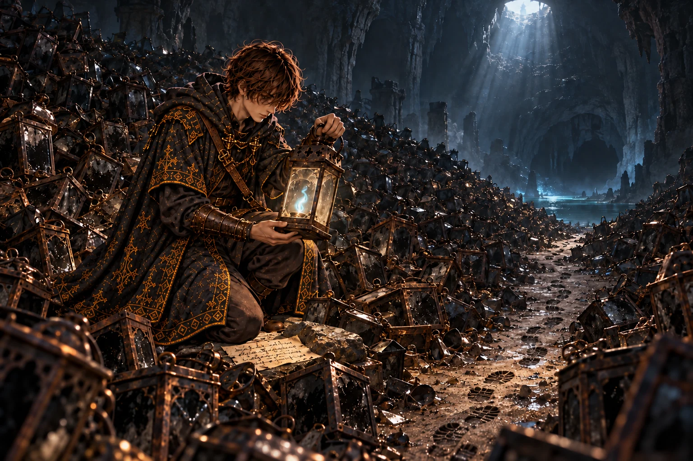
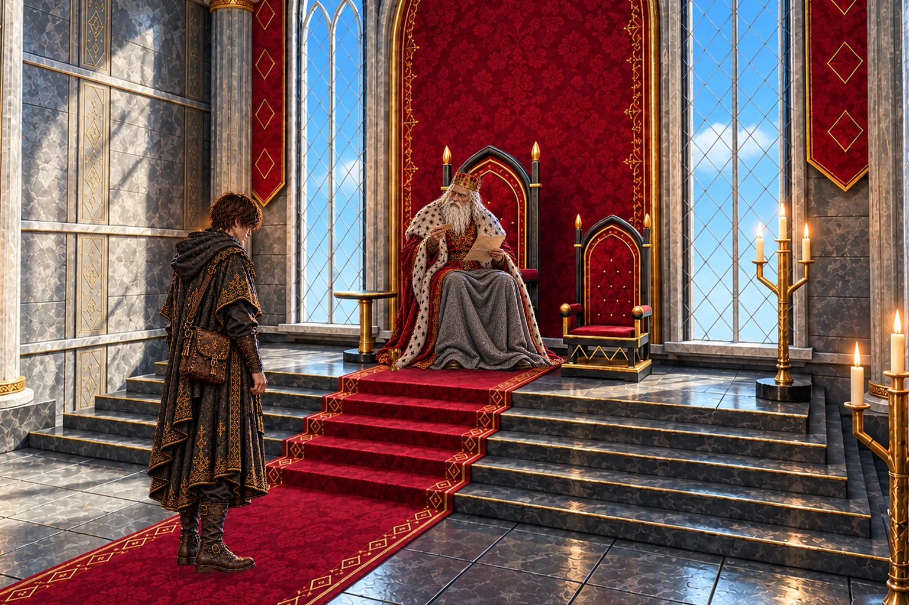
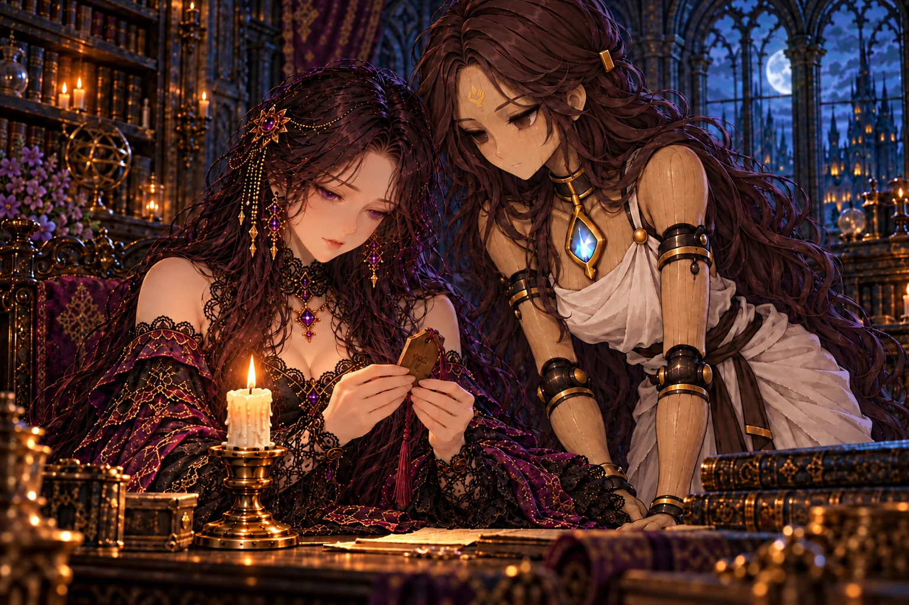
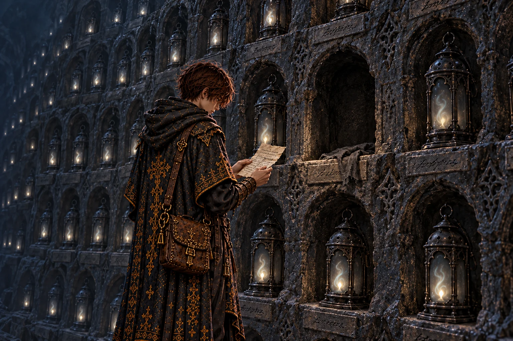
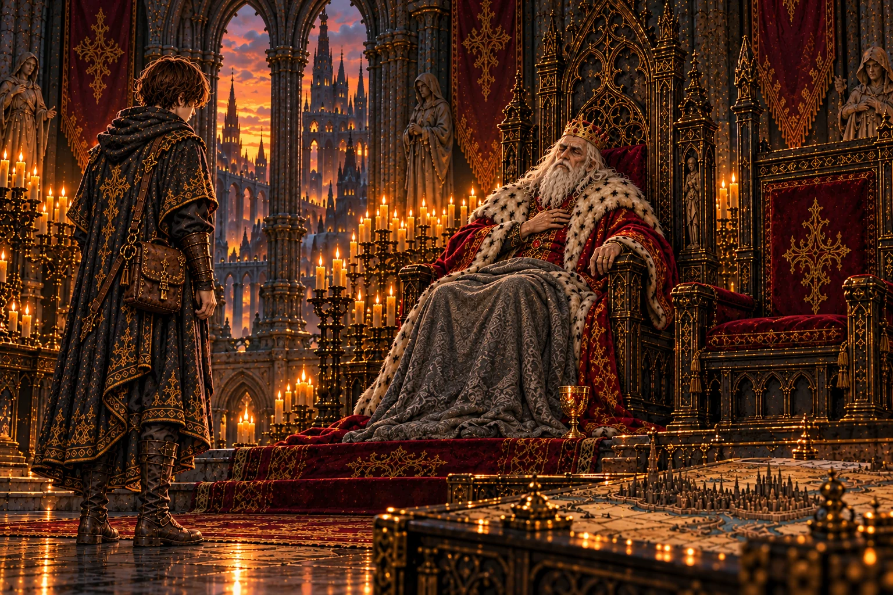
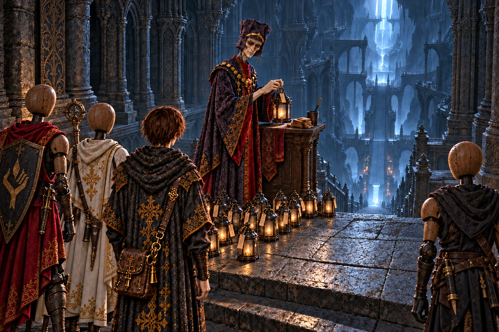
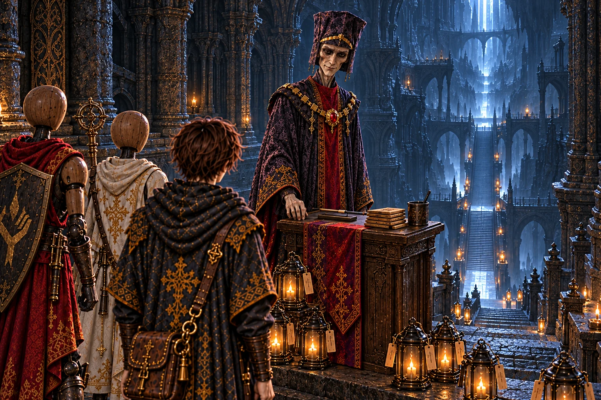
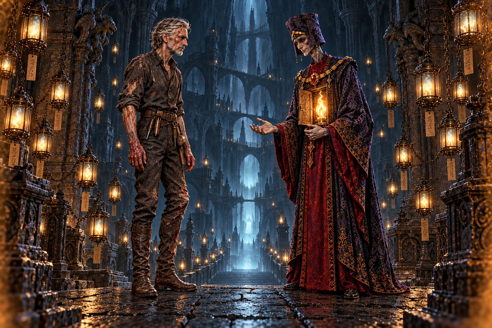
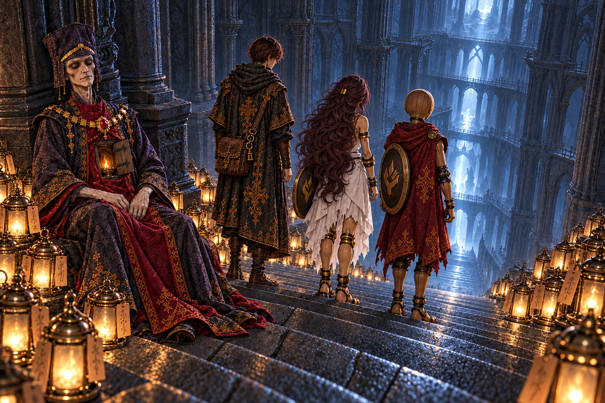

# 第10章「地底大空洞」 の絵

書き出し: `node tools/storyart/review.mjs` (手で直さない)。絵は出荷する WebP、まだ無ければ原画。
ゲームで小さく出た時の見え方 (384×256): [chapter10-small.jpg](chapter10-small.jpg)

## w38_lamp「名を思い出さない灯」 ── 出荷済み

**ストーリー一覧の本文**

> 闘技場の穴の底には、捨てられた灯籠が山をなしていた。どのガラスも墨を流したように黒く、踏むたびに乾いた音を立ててきしんだ。
>
> 黒い山の中で、一つだけ澄んだガラスが灯を返した。表に、布で何度も拭った丸い跡が残っている。下に石で押さえた師の書きつけには、磨いても中の魂は名を思い出さなかった、とあった。濁っていたのは、ガラスではなかったのだ。
>
> 灯籠の山のあいだには、細い道が踏み固められていた。古い足跡の上に、新しい足跡。誰かが毎日、ここを行き来している。その道は、黒い水の匂いがする奥へと続いていた。

**ゲーム内 (師の手がかり STORY_CELLS.w38_lamp)**

> 灯籠の山のあいだを縫って進むと、足の下でガラスが鳴った。どの灯籠も、墨を流したように黒く濁っている。
>
> その中に、一つだけ澄んだ灯籠があった。布で何度も拭いたあとが、ガラスに丸く残っている。
>
> 灯籠の下に、石で押さえた書きつけが一枚。師の字だ。
>
> ──『一つ、磨いてみた。磨いても、中の魂は名を思い出さない。濁りはガラスではなく、魂のほうにある』
>
> ──『穴の底に、灯籠を拾って歩いた足跡がある。私のではない。古い足跡の上に、新しい足跡が重なっている。毎日、誰かがここを歩いている』
>
> 足跡は灯籠の山を避けて、大空洞の奥、黒い水の匂いのするほうへ続いていた。
>
> ── 新たな迷宮「黒い灯の地底湖」が地図に記された。

**指示書 (4章)**

- 要点: 大空洞の底に、黒く濁った灯籠が山と積もる。踏むとガラスが鳴る。その中に一つだけ、布で何度も拭いたあとが丸く残る澄んだ灯籠。下に石で押さえた師の書きつけ。灯籠の山のあいだに、毎日誰かが歩いた足跡 (古い足跡の上に新しい足跡) が、黒い水の匂いのする奥へ続く。
- 描くもの: 黒い灯籠の山 / 一つだけ澄んだ灯籠と書きつけ / 奥へ続く足跡 / 灯籠を手に取る弟子。上の闘技場の穴から細く差す光。描かないもの: 師・モルデン本人。

## report_w38「底で灯を拾う者」 ── 出荷済み

**ストーリー一覧の本文**

> 捨てられ続けた灯籠の山の話を、王は目を閉じて聞いた。
>
> 底で毎日、灯籠を拾って歩く者がいる。王はその足跡の主を思い描こうとして、途中でやめた。思い当たる顔が、一つしかなかったのかもしれない。
>
> 暗がりに目を慣らしてから進め。王はそう言い、奥の石窟で見たものも聞かせてほしいと頼んだ。

**ゲーム内 (王への報告 REPORTS.w38)**

> 「闘技場の穴の底に、灯籠の山が……。三百年よりも前から、捨てられ続けてきたのだな。」
>
> 「オルドは灯籠を一つ磨いてみたか。磨いても、魂は名を思い出さぬ、と。……試さずにはおれぬ男だ。」
>
> 「毎日、誰かが灯籠を拾って歩いておる、か。……あの底で、誰が。」
>
> 「大空洞の奥には、石窟へ続く道もあったか。暗がりに目を慣らしてから進め。」

**指示書 (4章)**

- 要点: 三百年よりも前から捨てられ続けた灯籠の山の話を、王は目を閉じて聞く。毎日誰かが底で灯籠を拾っている — 思い当たる顔が一つしかない。

## w39_tags「宰相の字」 ── 出荷済み

**ストーリー一覧の本文**

> 黒く静まりかえった湖の岸に、濁った灯籠が湖を向いて並べられていた。どの灯籠にも細い紐で小さな木札がくくられ、名前が書かれている。名を忘れた魂に、誰かが名を与えていた。
>
> 札を一枚手に取って、弟子は息をのんだ。離宮で見た布告の終わりに、いつも添えられていた筆跡。宰相モルデンの字だった。
>
> 休ませるために並べたのか、いつか使う日まで蓄えているのか。札の山のそばに残された書きつけでも、師はまだ決めかねていた。湖面には、どこにもない灯が映っていた。

**ゲーム内 (師の手がかり STORY_CELLS.w39_tags)**

> 黒い湖の岸に、濁った灯籠がずらりと並べられていた。どれも湖のほうを向いて、行儀よく。
>
> 灯籠の一つひとつに、小さな木札が細い紐で結ばれている。札には、きれいな字で名前が書かれていた。
>
> 『エミル』『灰色の目のハンナ』『十二度戦った槍の男』── 名を忘れた魂に、誰かが名をつけてやったのだ。
>
> その筆跡には見覚えがあった。宰相府の布告の末尾に、いつも並んでいた字。宰相モルデンの字だ。
>
> 並びのいちばん端に、札のない灯籠がひとつあった。その取っ手に、師の書きつけが結んであった。
>
> ──『三百年、捨てられた魂を拾い、名をつけ、ここに並べてきたのか。あいつは』
>
> ──『あいつは魂を休ませようとしているのか。それとも、使える日まで蓄えているのか。……私には、まだ分からない』

**指示書 (4章)**

- 要点: 黒く静まりかえった地底湖の岸に、濁った灯籠がずらりと湖を向いて並ぶ。灯籠の一つひとつに小さな木札が細い紐で結ばれ、きれいな字で名前が書かれている (名を忘れた魂に、誰かが名をつけた)。その筆跡は宰相モルデンの字。札の山のそばに師の書きつけ。湖面にはどこにもない灯が映る。
- 描くもの: 湖を向いて並ぶ灯籠の列 / 結ばれた木札 (字は読めなくてよい) / 札を手に取って筆跡に気づく弟子 / 湖面の灯の映りこみ。描かないもの: モルデン本人。

## report_w39「呼ばれなかった名」 ── 出荷済み

**ストーリー一覧の本文**

> 札の字がモルデンのものだと聞いても、王は驚かなかった。百年、同じ字の布告に印を押してきたのだ。
>
> 捨てられた魂に、名を書いてやっていた男。その男の名を、王は百年、用を言いつける時にしか口にしなかった。礼の言葉と一緒に呼んだことは、一度もない。
>
> 王は、弟子がさらに奥へ向かうつもりなのかを尋ねた。その声は、命じる時よりも、帰りを案じる時の声に近かった。

**ゲーム内 (王への報告 REPORTS.w39)**

> 「黒い湖か。……湖面に、どこにもない灯が映っておったと。」
>
> 「札の字は、モルデンの字であったか。……間違いあるまい。余は百年、あの字の布告に印を押してきた。」
>
> 「捨てられた魂に、名をつけてやっておったのか。あの男が。……余は百年そばに置いて、礼のひとつも言うたことがない。」
>
> 湖と石窟の探索の記録を地図に重ねると、大空洞の最奥へ続く道筋が見えてきた。

**指示書 (4章)**

- 要点: 札の字がモルデンのものだと聞いて、王は驚かない。百年、同じ字の布告に印を押してきた。捨てられた魂に名をつけてやっていた男に、王は百年そばに置いて礼のひとつも言ったことがなかった。空いた宰相の席を長く見る。

## irene_names「名を呼ぶ人」 ── 出荷済み

**ストーリー一覧の本文**

> イレーヌという名は、師がつけたものだった。目を開けて最初に耳にしたのが、自分の名だったという。
>
> 名を呼ばれると、灯が落ち着く。ここにいていいと言われた気がする。だから、三百年ひとりで札に名を書いてきた宰相のことを、彼女は責めきれずにいた。あの人は悪い人なのでしょうか、とイレーヌは燭台を見つめたまま尋ねた。
>
> モルデンさん、って呼んであげればいいんです、とセラが言った。イレーヌは答えず、灯の芯をほんの少しだけ長くした。

**ゲーム内 (館の語り IRENE_BEATS.irene_names)**

> イレーヌ「モルデンが、捨てられた魂に名をつけていたのですね。」
>
> 館の主は燭台の灯を見つめたまま、しばらく黙っていた。
>
> イレーヌ「わたしの名は、オルド様がつけてくださいました。目を開けて最初に聞いたのが、自分の名でした。」
>
> イレーヌ「名を呼ばれると、灯が落ち着くのです。ここにいていい、と言われた気がして。」
>
> イレーヌ「モルデンも、きっと誰かに名を呼ばれて目を開けたのでしょう。だから、名の無い灯を放っておけなかった。」
>
> セラ「わたしたちが呼んであげればいいんです。モルデンさん、って。」
>
> イレーヌ「……そうですね。会えたら、呼んであげてください。」
>
> イレーヌ「旧都を沈めた人です。魂を煮た人です。……それなのに、札の字が、あんなにていねいなのです。」

**指示書 (4章)**

- 要点: イレーヌの名は師がつけた。目を開けて最初に聞いたのが自分の名。名を呼ばれると灯が落ち着く。三百年ひとりで札に名を書いてきた宰相を責めきれない。「旧都を沈めた人です。魂を煮た人です。……それなのに、札の字が、あんなにていねいなのです」。セラがいれば「モルデンさん、って呼んであげればいい」。

## w40_eyes「それでも、底へ」 ── 出荷済み

**ストーリー一覧の本文**

> 岩壁一面に、灯籠ひとつがちょうど収まるくぼみが、天井まで何段も彫られていた。どのくぼみにも濁った灯籠が眠り、下の石に名が刻まれている。墓だった。
>
> いちばん奥の、灯籠の無いくぼみに、布切れと書きつけが置かれていた。布は師の袖を裂いたものだった。灯の光ではなく、魂の光で見よ。暗がりで刃を迷わせないための、短い手ほどきだった。
>
> 最後の一行だけ、紙が破れかけるほど強く書かれていた。それでも、私は底へ行く。弟子はその紙を、しばらく畳めずにいた。

**ゲーム内 (師の手がかり STORY_CELLS.w40_eyes)**

> 石窟のいちばん奥の壁のくぼみだけ、灯籠が納められていなかった。
>
> 空のくぼみに、師のシャツの袖から裂いたらしい布切れと、書きつけが置かれていた。
>
> ──『ここの灯は、みな濁っている。灯の光では、何も見えない』
>
> ──『目を閉じて、魂の光で見よ。人業の胸の灯は、闇の中でこそよく見える。器の継ぎ目に指を当てて灯の脈を数えれば、暗がりでも刃が泳がない』
>
> ──『モルデンは、ひとつずつ名を刻んでいる。……あいつは三百年、ひとりで、これを』
>
> 書きつけの最後の一行だけ、強く書いて、紙が破れかけていた。
>
> ──『それでも、私は底へ行く』

**指示書 (4章)**

- 要点: 岩壁一面に小さなくぼみ (壁龕) が彫られ、どのくぼみにも濁った灯籠が一つずつ眠り、下の石に名が刻まれている (墓)。いちばん奥の空のくぼみに、師のシャツの袖から裂いた布切れと書きつけ (外套は第六章で氷棚に置いてきたので、外套の布ではない)。最後の一行だけ紙が破れかけるほど強く書かれている。
- 描くもの: くぼみの並ぶ岩壁 (上へ何段も) / 刻まれた名 / 空のくぼみの布切れと書きつけ / 書きつけを読む弟子。描かないもの: 師・モルデン本人。

## report_w40「三百年の墓守」 ── 出荷済み

**ストーリー一覧の本文**

> くぼみに眠る灯籠と刻まれた名の話を聞いて、王はそれを墓と呼んだ。
>
> 捨てられた魂のために、誰かが三百年、墓を守ってきた。それならオルドは、何をしに底へ行くのか。王は弟子にではなく、自分に尋ねるようにつぶやいた。
>
> 灯籠を一つも持ち帰らなかったと聞くと、王はうなずいた。それでよい。その日、王が弟子にかけた言葉は、それだけだった。

**ゲーム内 (王への報告 REPORTS.w40)**

> 「石窟の壁のくぼみに、灯籠がひとつずつ……名を刻んでか。」
>
> 「オルドは『それでも、私は底へ行く』と書いたか。……何をしに行くのだ、あの男は。」
>
> 「墓だな。モルデンは三百年かけて、捨てられた魂の墓守をしておったのだ。」
>
> 湖と石窟の探索の記録を地図に重ねると、大空洞の最奥へ続く道筋が見えてきた。

**指示書 (4章)**

- 要点: 壁龕の灯籠と刻まれた名の話を聞いて、王はそれを墓と呼ぶ。オルドは何をしに底へ行くのかと、自分に問うように呟く。

## pre_w41「階段の前の宰相」 ── 出荷済み

**ストーリー一覧の本文**

> 伽藍のいちばん奥、さらに下へ降りる石段の手前に、小さな書見台が置かれていた。痩せた長身の男が、細い筆で木札に名を書いていた。
>
> 湖の岸に並んでいた札の字。灯籠の山に毎日残されていた足跡。壁龕に名を刻んだ手。三つの手がかりが、ひとりの背中に重なった。宰相モルデンは書き終えた札を灯籠に結び、筆を置いて振り返った。
>
> 師はもう、帰るために歩いてはいない。灯たちを失いたくないのなら戻れ。モルデンはそう告げて、三百年立ち続けた石段の前に立った。足もとの石は、ちょうど彼の靴の形にすり減っていた。

**ゲーム内 (主との対面 BOSS_PRELUDES.w41.first)**

> 伽藍のいちばん奥に、さらに下へ続く広い石段があった。その手前に、小さな書見台がひとつ置かれている。
>
> 書見台の前に、痩せた長身の男が立っていた。宰相の黒い長衣。細い筆で、小さな木札に何かを書いている。
>
> 足もとには、濁った灯籠が行儀よく並んでいた。どの灯籠にも、同じ字の札が結ばれている。湖の岸の札。灯籠の山を毎日歩いた足跡。壁龕に名を刻んだ手。……すべて、目の前の男のものだった。
>
> 男は最後の一画を書き終えると、筆を置き、札を灯籠に結んだ。それから、ゆっくりとこちらを向いた。
>
> 宰相モルデンは、初めて玉座の間で会った時と少しも変わらない顔で、薄く笑った。
>
> モルデン「ここから先へは、行かせません」
>
> モルデン「師を迎えに来たのでしょう。……あの方はもう、帰るために歩いてはいない」
>
> モルデンは書見台を離れ、階段の前に立った。三百年、そこに立ち続けた石が、足の形にすり減っていた。
>
> モルデン「お戻りなさい。その灯たちを、まだ失いたくないのなら」

**指示書 (4章)**

- 要点: 大伽藍のいちばん奥、さらに下へ降りる石段の手前に小さな書見台。痩せた長身の宰相モルデンが細い筆で木札に名を書き終え、筆を置き、札を灯籠に結んで振り返る。足もとに名札つきの濁った灯籠が行儀よく並ぶ (湖の札・灯籠の山の足跡・壁龕の名と同じ手)。石段の前の石は、三百年立ち続けた足の形にすり減っている。「ここから先へは、行かせません」。敵意ではなく、静かな拒み。
- 描くもの: 書見台・筆・木札 / 名札つきの灯籠の列 / 石段の前に立つモルデン (正典の顔、胸の扉は閉じている) / 手前に立つ弟子と隊の後ろ姿。描かないもの: 師。底のものの正体 (光だけ)。

## pre_w41_retry「ふたたび階段の前で」 ── 出荷済み

**ストーリー一覧の本文**

> 大伽藍の階段へ戻ると、モルデンは書見台の筆を置いた。前に来た時よりも、木札の束が少し厚くなっていた。隊を立て直している間も、彼はここで名を書き続けていたのだ。
>
> 砕けた器を直し、灯を戻してまで師に会いに来た。その思いを認めながら、宰相は道を開かなかった。弟子たちの灯を取り戻せる仕組みこそ、師が変えようとしているものなのだという。
>
> 戻る理由があるからこそ、通せない。モルデンの言葉を聞き、弟子はふたたび階段の前に立った。失ったものを取り戻して歩く自分の旅も、師の目指す先と無関係ではなかった。

**ゲーム内 (主との対面 BOSS_PRELUDES.w41.retry)**

> 階段の前で、モルデンは筆を置いた。書見台の札の束が、少しだけ厚くなっていた。
>
> モルデン「……また、来られたのですか」
>
> モルデン「砕けた器を直し、灯を戻して。それほどまでに、あの方に会いたい」
>
> モルデン「ならば、なおさら通せません。あの方が変えようとしているのは、あなたが灯を戻せる、その仕組みなのです」

**指示書 (4章)**

- 要点: 同じ大伽藍の階段前。モルデンが筆を置き、砕けた器を直して戻った弟子たちを見る。書見台の木札の束は、初対面の時より少し厚い。
- 描くもの: 初対面の絵と同じモルデン・書見台・石段・濁った灯籠 / 増えた木札の束と置いた細筆 / 弟子と修復済みの人業2体。
- 描かないもの: 師オルド、イレーヌ、セラ、壊れた体や遺体、戦闘中の攻撃、開いた胸の扉、読める文字。場面は地下なので空は描かない。

## mem_w41「階段の前のふたり」 ── 出荷済み

**ストーリー一覧の本文**

> 大伽藍の最奥で膝をついた宰相の灯から、一年前の記憶が流れこんできた。さらに下へ続く階段の前で、モルデンと師が向かい合っていた。
>
> 底に眠るものを手にすれば、あらゆる命を思うままにできる魂の王になる。師はそれを取りに来たと言った。器へ戻す術がある限り、魂は何度でも戻され、腐るまで使われる。だから巡りに限りを書き入れ、生き切った魂を誰も引き止められないようにする、と。
>
> その限りは、館で灯を守るイレーヌにも、目を覚ましたセラにも及ぶのか。モルデンの問いに、師は大事な者だけを例外にはできないと答えた。あの子たちがまだ生きたいと言ったら、その声を聞く仕組みも一緒に書く。書けるかどうかは、まだ分からない、とも。
>
> モルデンが恐れていたのは悪い王ではなく、善い王だった。正しい言いつけのために旧都を沈めた自分のように、正しさを信じる者は、誰の声も聞かなくなる。師は階段を降り、モルデンは追えなかった。
>
> 負けた宰相は、勝ったから正しいのではない、と弟子に言った。それから、あなたの灯にどう生きたいのか尋ねてほしい、と。そして眠るように、灯を小さくした。

**ゲーム内 (主の記憶 BOSS_MEMORIES.w41)**

> 宰相モルデンが膝をついた。胸の扉の中で、古い灯が小さく揺れている。
>
> モルデン「……強くなられた。初めて玉座の間でお見かけした時は、まだ灯の持ち方もおぼつかなかったのに」
>
> モルデン「わたしは、魂を救うために町を沈めました。魂を腐らせるなという、正しい言いつけを守るために。……あの方も、救うためなら、きっとできてしまう」
>
> モルデンの灯から、記憶が流れこんできた──
>
> ……一年前。大伽藍のいちばん奥、さらに下へ続く階段の前で、ふたりの男が向かい合っていた。
>
> ──『ここから先へは行かせません、オルド殿』
>
> ──『底に何があるか、お前は知っているのだな、モルデン』
>
> ──『主から聞きました。底に眠るものを手にした者は、魂の王となる。この世のあらゆる命を、思うままにできる』
>
> ──『主は、あれに触れるなと言い残しました。だからわたしは三百年、この階段を守ってきました。地上の務めの合間に降りてきては、落ちてくる灯を拾い、名をつけながら』
>
> ──『私は、それを取りに来た』
>
> モルデンは、しばらく言葉を失った。
>
> ──『命令では、誰も救えなかった。お前の主の命令も、王の命令も。魂は使い潰され、腐り、この穴に捨てられた』
>
> ──『魂は、生き切ったら休めばいい。だが器へ戻す術がある限り、誰かが必ず戻す。もう一度、もう一度と、腐るまで』
>
> ──『だから巡りに、限りを書き入れる。生き切った魂を、誰も引き止められないように』
>
> ──『それは、あなたの館の灯を守る者にも及ぶのですか。あなたが作った器にも』
>
> 男は、すぐには答えなかった。
>
> ──『イレーヌも、セラも、私の作った器だ。……大事な者だけを例外にするなら、それは王の気まぐれだ。命令と変わらない』
>
> ──『あの子たちが、まだ生きたいと言ったら』
>
> ──『その声を聞く仕組みも、一緒に書く。……書けるかどうかは、まだ分からん』
>
> ──『わたしが恐れているのは、悪い王ではありません。善い王です。正しいと信じた王は、正しさを理由に、誰の声も聞かなくなる』
>
> ──『わたしがそうでした。魂を守れという正しい言いつけのために、旧都を沈め、魂を煮ました。……あなたは、わたしよりずっと優しい。だから、なおさら恐ろしいのです』
>
> ──『かもしれん。だが三百年ここで札に名を書いていても、腐る魂は減らなかった』
>
> ──『減らせなくとも、増やさずには済みました。……わたしにできたのは、それだけです』
>
> 男はモルデンの横を抜けて、階段を降りていった。モルデンは、追えなかった。
>
> ──『イレーヌに伝えてくれ。灯を絶やすな、と』
>
> ……記憶がほどけると、モルデンの灯は、また少し小さくなっていた。
>
> モルデン「あの方は、声を聞くと言いました。けれど、聞いたうえで決めるのは、あの方です。……わたしが、あなたがたの声を聞かずに、ここで止めようとしたように」
>
> モルデン「勝ったのは、あなたです。けれど、勝ったから正しいのではありません。わたしが三百年、そう思いこもうとしたようには、思わないでください」
>
> モルデン「あなたの灯に、尋ねてください。どのように、生きたいのか」
>
> モルデン「少し、休みます。三百年ぶりに」
>
> 胸の扉の灯は、消えなかった。眠るように小さく、静かになった。
>
> 隊の人業たちは、モルデンの寝顔と、階段の下の闇とを、それぞれに見ていた。誰も、何も言わなかった。

**指示書 (4章)**

- 要点: 一年前。大伽藍のいちばん奥、さらに下へ続く階段の前で、宰相モルデンと師オルドが向かい合う。モルデンは三百年、地上の務めの合間にこの階段を守ってきた。底に眠るものを手にした者は「魂の王」になる。祖は触れるなと言い残した。師は「それを取りに来た」と言う — 魂を何度でも器へ戻せる仕組みに限りを書き入れ、生き切った魂を誰も引き止められないようにするために (イレーヌ・セラにも及ぶ。大事な者だけを例外にはしない。声を聞く仕組みも書く、書けるかは分からない)。モルデンが恐れるのは悪い王ではなく善い王 (正しい言いつけのために旧都を沈めた自分のように)。師は階段を降り、モルデンは追えない。**どちらも悪人にも聖人にも見せない** — 二人とも正しく、二人とも迷っている。
- 描くもの: 天井の見えない巨大な伽藍 / 下の闇へ続く石段 (底にかすかな光) / 胸の小さな扉を開けて古い灯を見せるモルデン (正典の顔・老いない) / 手袋なし・指先の焼けた手で片脚を引きずる師オルド (第十章の姿) / 二人のまわりに並ぶ名札つきの灯籠。描かないもの: 弟子。底のものの正体 (光だけ)。

## report_w41「王の資格」 ── 出荷済み

**ストーリー一覧の本文**

> オルドが魂の王になるために底へ降りたと聞いて、王は玉座の肘掛けを強く握った。器へ戻す仕組みに限りを書くという話には、長く黙った。
>
> 限りのない命を、霊薬に頼って百年生きてきた。そういう自分に、オルドを責める資格はない。けれど、善い王ほど誰の声も聞かなくなるというモルデンの言葉も、王には痛いほど覚えがあった。
>
> 勝った者が正しいとは限らない。追って、確かめて、自分の目で決めよ。それは命令ではない。人業たちにも、それぞれの灯に訊いてやれ。王はそう言い、今夜は休め、と付け加えた。

**ゲーム内 (王への報告 REPORTS.w41)**

> 「モルデンを、退けたか。」
>
> 底に眠るもののこと。それを手にした者は魂の王となり、あらゆる命を思うままにできること。オルドがそれを取りに行ったこと。魂を何度でも器へ戻せる仕組みに限りを書き入れ、生き切った魂を誰も引き止められぬようにするために ── その限りが、イレーヌにもセラにも及ぶとしても。モルデンの記憶をすべて話し終えるまで、王は口を開かなかった。
>
> 「魂の王……。」王は、玉座の肘掛けを強く握った。
>
> 「余は百年、この国の王であった。民の命を霊薬に変えて飲んできた王だ。……限りのない命がどんな味か、余ほど知る者はおるまい。」
>
> 「オルドの言うことは、正しいのかもしれぬ。余には、それを責める資格がない。」
>
> 「だがモルデンは、悪い王ではなく、善い王を恐れたのだな。正しいと信じた王ほど、誰の声も聞かなくなる、と。……それも、余はよく知っておる。」
>
> 「勝ったからといって、そなたが正しいとは限らぬ。負けたからといって、モルデンが誤っておったとも限らぬ。」
>
> 「{弟子名}よ。追って、確かめて、そなたの目で決めよ。……余の命令ではない。そなたが決めるのだ。そなたの人業たちにも、それぞれの灯に訊いてやるがよい。」
>
> 「……今はまず、休め。」

**指示書 (4章)**

- 要点: オルドが魂の王になって、器へ戻す仕組みに限りを書くために底へ降りたと聞き、王は玉座の肘掛けを強く握る。限りのない命を霊薬で百年生きてきた自分に、それを責める資格はない。善い王ほど誰の声も聞かなくなるというモルデンの言葉にも覚えがある。勝った者が正しいとは限らない。「追って、確かめて、そなたの目で決めよ。余の命令ではない」。

## irene_candle「消せない灯」 ── 出荷済み

**ストーリー一覧の本文**

> その夜、イレーヌは燭台の前に腰を下ろし、夜が明けるまで立ち上がらなかった。師の書こうとしている限りには、彼女自身も、セラも入っている。
>
> 灯を絶やすな。そう言われて守ってきた灯を、守り続けることは正しいのか。間違っているのかどうかさえ、まだ分からない。言いつけの前に三百年座っていた宰相と、自分はどこが違うのか。
>
> まだ休みたくない、やっと目を覚ましたばかりだから、とセラは言った。それでも会って、どうしてと訊いて、自分の答えも伝えたい、と。夜明けに、イレーヌは灯を絶やさないと決めた。言いつけだからではなく、もう一度会うために。

**ゲーム内 (館の語り IRENE_BEATS.irene_candle)**

> その夜、館の主は燭台の前に座ったまま、朝まで動かなかった。
>
> イレーヌ「オルド様が、魂の王に……。魂を器へ戻す仕組みに、限りを書くために。」
>
> イレーヌ「大事な者だけを例外にはしない、と。……わたしも、セラも、その中に入っているのですね。」
>
> イレーヌ「わたしは、オルド様に『灯を絶やすな』と言われて、ここにいます。この灯が燃えているかぎり、あの方の魂はこの世にある。だから守ってきました。」
>
> イレーヌ「もしあの方が、間違ったことをしようとしているのなら、この灯を守ることは、それを手伝うことになるのでしょうか。……いいえ。間違っているのかどうかも、わたしにはまだわかりません。」
>
> 燭台の灯が、いつもと同じように静かに揺れていた。
>
> イレーヌ「……モルデンも、同じ問いの前に、三百年座っていたのかもしれません。言いつけを守るか、捨てるか。」
>
> セラ「わたしは、まだ休みたくありません。やっと目を覚ましたばかりです。」
>
> セラ「でも、オルド様には会いたい。会って、どうしてって聞きたい。それから、わたしの答えも言いたいんです。」
>
> イレーヌ「ええ。……わたしも聞きたいのです。命令ではなく、あの方の言葉で。」
>
> イレーヌ「だから、灯は絶やしません。言いつけだからではありません。あの方に、もう一度会うためにです。」

**指示書 (4章)**

- 要点: その夜、イレーヌは燭台の前に座ったまま朝まで動かない。師の書こうとしている限りには、イレーヌもセラも入っている。「灯を絶やすな」と言われて守ってきた灯を守ることは正しいのか — 間違っているのかどうかも、まだ分からない。それでも「灯は絶やしません。あの方に、もう一度会うために」。セラは「まだ休みたくない。でもオルド様に会って、どうしてって聞きたい」。

## ch10_end「第一部の終わり」 ── 出荷済み

**ストーリー一覧の本文**

> 階段の脇に身を預けたまま、モルデンは目を閉じていた。三百年ぶりの眠り。胸の扉の奥で、灯は小さく、静かに揺れていた。
>
> 触れるなと言い残した祖。言いつけを守るために町を沈めた宰相。巡りに限りを書き入れようと降りていった師。そして、縛られた魂を解き、砕けたセラを連れ戻してきた自分たちの隊。弟子は、どれかひとつを正しいと決められないまま、階段の下の闇を見下ろした。
>
> どのように生きたいのか。宰相の残した問いに、隊の誰もまだ答えていない。館の燭台の灯は、今夜も消えずに揺れている。

**ゲーム内 (章の結び CHAPTER_END[10])**

> 宰相モルデンは、大伽藍の階段の前で、三百年ぶりの眠りについた。胸の灯は消えず、小さく、静かに揺れている。
>
> モルデンが恐れたのは、悪い王ではなかった。救うためなら町ひとつ沈められる、善い王だった。自分が、そうであったように。
>
> 師オルドは、さらに下へ降りていった。底に眠るものを手にし、魂の王となって、魂を何度でも器へ戻せる巡りに限りを書き入れるために。その限りが、館の灯を守る者たちにも及ぶとしても。
>
> 触れるなと言い残した祖は、魂を救おうとして自分の町を焼いた子どもだった。言いつけを守ったモルデンは、守るために旧都を沈め、魂を煮た。命令を捨てた師は、王になろうとしている。
>
> そして、像を砕き、主を討ち、縛られた魂を解き、砕けたセラを連れ戻したのは、この隊だった。
>
> あなたの灯に、尋ねてください。どのように、生きたいのか ── 宰相が最後に残した問いに、隊の誰も、まだ答えていない。
>
> 館の燭台の灯は、今夜も消えずに揺れている。
>
> ── 第一部 完。物語は第二部、第十一章「夜明けの町」へ続く。

**指示書 (4章)**

- 要点: 宰相モルデンは大伽藍の階段の前で、三百年ぶりの眠りにつく。胸の灯は消えず、小さく静かに揺れる。師は魂の王になるために、さらに下へ降りていった。町を焼いた祖、言いつけを守ったモルデン、王になろうとする師、縛りを解きセラを連れ戻してきた隊 — 語り手は誰が正しいとも言わない。「どのように生きたいのか」という宰相の問いに、隊の誰もまだ答えていない。
- 描くもの: 階段の脇に座って眠るように目を閉じたモルデン (胸の扉の中に小さな灯、まわりに名札つきの灯籠) / 下の闇へ続く階段 / 階段の上に立って下をのぞく弟子と隊。

