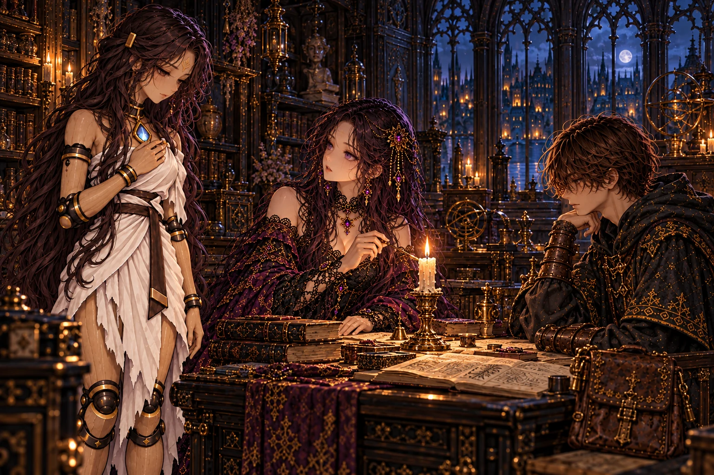
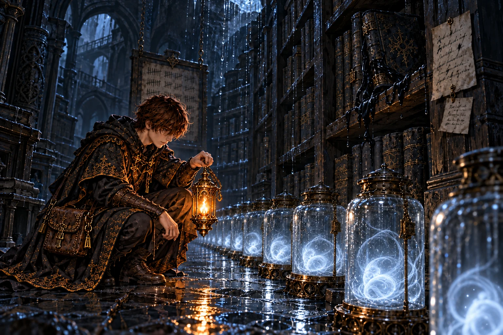
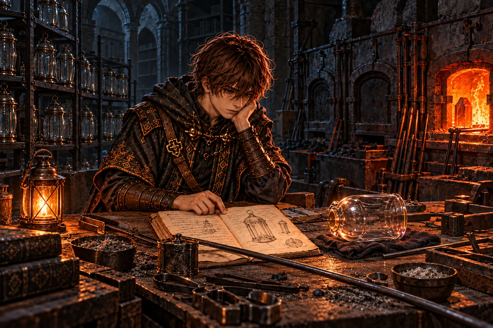
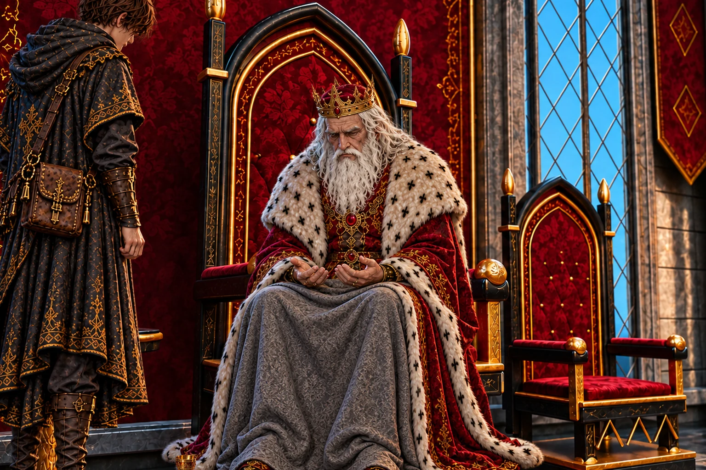
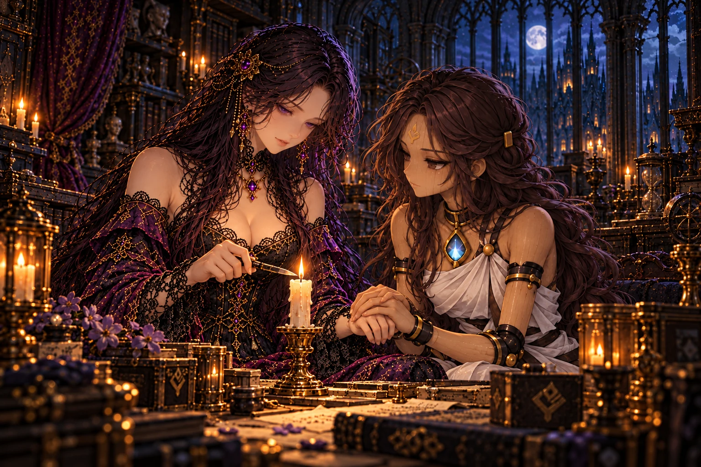
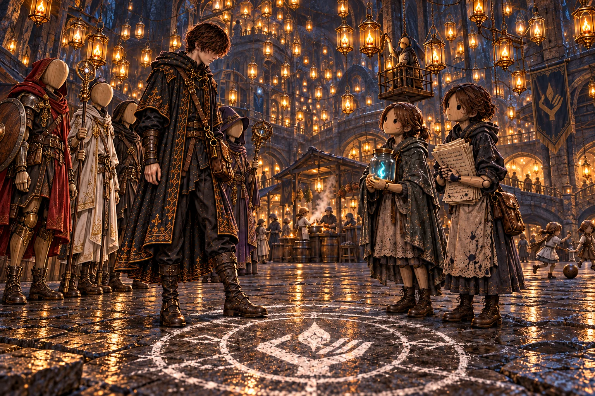

# 第11章「夜明けの町」 の絵

書き出し: `node tools/storyart/review.mjs` (手で直さない)。絵は出荷する WebP、まだ無ければ原画。
ゲームで小さく出た時の見え方 (384×256): [chapter11-small.jpg](chapter11-small.jpg)

## w42_dawn「夜明けの町」 ── 出荷済み

**ストーリー一覧の本文**

> 長い階段を降りきった時、足もとに影がなかった。光は、空からではなく岩の天井から降っていた。古い鉄の吊り枠いっぱいに、澄んだ灯籠が何千と吊るされ、朝の窓のような色に光っていた。
>
> 灯の下には、崩れた書庫を住まいにした町があった。洗濯物が揺れ、台所から湯気が立ち、通りの人業たちは誰に命じられることもなく、それぞれの用事に向かっていた。
>
> 駆けてきた小さな人業が、オルド先生のお弟子さんかと尋ねた。天蓋守のアデーレは、先生があなたの話ばかりしていた、と言った。眠り灯の中で休む雨の魂のこと。休ませ方を教えてくれた師のこと。三月前、師が大書庫の底の扉から下へ降りたこと。
>
> 広場には、館の燭台へ通じる帰り道の陣が描かれていた。弟子が来たら、これで帰らせろ。帰りぎわ、ピムが隊の人業に、どうしてその人について歩いているのかと尋ねた。弟子は答えかけて、やめた。訊かれたのは、自分ではなかったから。

**ゲーム内 (師の手がかり STORY_CELLS.w42_dawn)**

> 長い階段の最後の段を降りた時、足もとに、自分たちの影がなかった。
>
> 光は上から降っていた。見上げると、岩の天井いっぱいに古い鉄の吊り枠が張りめぐらされ、何千もの澄んだ灯籠が吊るされている。灯籠のひとつひとつが、朝の窓のような白金色に光っていた。
>
> 空ではない。太陽も雲もなく、灯の向こうには黒い岩があるだけだ。それでも、ここは朝の明るさだった。
>
> 灯の下に、町があった。崩れた書庫の閲覧室を家にして、書架の板を戸口にしている。軒先に洗濯物が揺れ、どこかの台所から、煮炊きの湯気が流れてくる。
>
> 通りを行くのは、みな人業だった。荷を運ぶ者、店先に硝子を並べる者、腰を下ろして何もしていない者。命じる声は、どこからも聞こえない。
>
> 子どもの姿に作られた小さな人業が、隊を見つけて駆けてきた。
>
> ピム「上から来たの？ ……もしかして、オルド先生のお弟子さん？」
>
> うなずくと、後ろから歩いてきた婦人の姿の人業が、灯籠を見上げる時のように目を細めた。
>
> アデーレ「よかった。先生、あなたの話ばかりしていたんですよ。弟子は灯の持ち方がまだ危なっかしい、でも必ずここまで来る、と」
>
> アデーレは、天井の灯籠 ── 眠り灯の世話をまとめる天蓋守だという。駆けてきた小さな人業は、ピムと呼ばれていた。
>
> アデーレ「眠り灯の中では、上から雨と一緒に流れてくる、くたびれた魂が眠っています。休んでいる灯は、ああして明るくなるのです」
>
> アデーレ「ここに暮らすのは、主をなくした人業ばかりです。わたしの主は、王家の操霊師でした。……処刑された、と聞かされました」
>
> 奈落の氷の柱のこと。凍っていた十一人の魂が、ようやく還っていったこと。話し終えると、アデーレは長いあいだ眠り灯を見上げていた。
>
> アデーレ「……そうでしたか。還れたのなら、それでいいのです」
>
> アデーレ「先生が来るまで、わたしたちは暗がりで雨の魂を瓶に受けるだけでした。休ませ方を知らず、自分たちの灯まで休ませずに働かせて、濁らせていました」
>
> アデーレ「先生は器の継ぎ目を直し、魂を休ませることを教えてくれました。書庫の古い記録から眠り灯の作り方を読み解いて、最初のひとつを吊るした朝のことを、町の者はみな覚えています。……だから、ここは夜明けの町なのです」
>
> アデーレ「先生は三月ほど前、大書庫の底の扉から、さらに下へ降りていきました。用が済んだら戻る、と言って」
>
> 広場の石畳に、白墨で大きな陣が描かれていた。縁に一門の印。そばの柱に、師の書きつけが打ちつけてある。
>
> ──『館の燭台を目印にした帰り道だ。燭台の灯が燃えている限り、この陣は館へ通じる。弟子が来たら、これで帰らせろ』
>
> 帰りぎわ、ピムが、隊の人業の袖を引いた。
>
> ピム「ねえ。あなたは、どうしてその人について歩いているの？」
>
> 答えかけて、口を閉じた。訊かれたのは、自分ではなかった。
>
> 人業たちは、それぞれに黙っていた。胸の灯に手を当てる者。こちらを振り返る者。ただ、小さな頭に手を置く者。
>
> ピム「ふうん。……わかったら、教えてね」
>
> ── 戻り灯の陣で、夜明けの町とロアダルの館を行き来できるようになった。
>
> ── 新たな迷宮「雨垂れの書庫」が地図に記された。

**指示書 (4章)**

- 要点: 長い階段の最後の段を降りると、足もとに影が無い。光は岩の天井いっぱいの眠り灯から降る — 空ではない。灯の下に、崩れた書庫を住まいにした町。洗濯物、台所の湯気、自分の用事に向かう人業たち。駆けてくる小さな人業ピムと、後ろから歩いてくる婦人の人業アデーレ。広場に白墨で描かれた戻り灯の陣 (縁に一門の印)。
- 描くもの: 手前に暗い階段の最後の段と弟子・隊の後ろ姿 / 下に広がる光の町と眠り灯の天井 (吊り枠と鉄鎖が見えて、空ではないと分かること) / 駆けてくるピム / 広場の白墨の陣。描かないもの: 師。太陽・青空・雲。

## report_w42「命令の届かぬ所」 ── 出荷済み

**ストーリー一覧の本文**

> 主をなくした人業たちが、自分の暮らしを選んでいる町。その多くが王家の操霊師の器だったと聞いて、王は長いあいだ目を伏せた。百年、その主たちを牢へ送ってきたのは自分だった。
>
> オルドが救い主と呼ばれていると聞くと、王は少しだけ笑った。助けた相手の名はみな覚えているくせに、礼を言われると逃げ出す男だ、と。
>
> その町では客であれ。あの者たちの暮らしは、あの者たちのものだ。それが、その日の王の言葉だった。

**ゲーム内 (王への報告 REPORTS.w42)**

> 「階段の下に、町が……。人業だけが暮らす町か。」
>
> 灯籠の天井のこと。主をなくした人業たちが、主を持つかどうかも、何をして暮らすかも、自分で決めていること。弟子の話を、王は身を乗り出して聞いた。
>
> 「王家の操霊師の人業たちが……。余は百年、あの者たちの主を、牢へ送ってきた。」
>
> 「その人業たちが、余の命令の届かぬ所で、ようやく自分の暮らしを選んでおるのだな。」
>
> 「オルドは、そこで救い主と呼ばれておるのか。」王は少しだけ笑った。「あの男らしい。助けた相手の名は全部覚えておるくせに、礼を言われると逃げ出す。」
>
> 「戻り灯の陣で行き来できるか。……オルドは、そなたを帰らせる道だけは、残していったのだな。」
>
> 「行け。だが、その町では客であれ。あの者たちの暮らしは、あの者たちのものだ。」
>
> 「雨垂れの書庫で見たものも、聞かせてくれ。」

**指示書 (4章)**

- 要点: 主をなくした人業たちが自分の暮らしを選ぶ町 — その多くが王家の操霊師の器だったと聞き、王は長く目を伏せる (百年、その主たちを牢へ送ってきたのは自分)。オルドが救い主と呼ばれていると聞いて少し笑う。「その町では客であれ」。

## irene_why「ついて歩く理由」 ── 出荷済み

**ストーリー一覧の本文**

> ピムの問いを持ち帰ると、イレーヌは燭台の芯へ伸ばした手を止めた。自分は主を選んだことがない。目を開けた時から、師の人業だったから、と。
>
> 答えたのは、セラだった。最初は師を捜すためだった。でも今は、名前を呼ばれて一緒に迷宮へ降り、一緒に帰ってくる、そうして生きていたいからだ、と。命令ではなく、自分で選んだことだと師に言う、と。
>
> 待つことも選んでいたのかもしれない、とイレーヌは言った。帰ってくる人の顔を見たいから。隊の人業たちにも、いつか訊いてほしい。ただし、あなたが代わりに答えてはいけない、と。

**ゲーム内 (館の語り IRENE_BEATS.irene_why)**

> 夜明けの町の話を、イレーヌは最後まで黙って聞いていた。
>
> イレーヌ「主を持つかどうかを、自分で決める人業たちの町……。」
>
> イレーヌ「わたしは、決めたことがありません。目を開けた時から、オルド様の人業でしたから。」
>
> 小さな人業の問いを伝えると、館の主は、燭台の芯へ伸ばしかけた手を止めた。
>
> セラ「わたしが答えます。……訊かれたのは、わたしたちですから。」
>
> セラ「最初は、オルド様を捜すためでした。でも、今はそれだけじゃありません。名前を呼ばれて、一緒に迷宮へ降りて、一緒に帰ってくる。……わたしは、そうやって生きていたいんです。」
>
> セラ「オルド様に会ったら、そう言います。命令じゃなくて、わたしが選んだことだって。」
>
> イレーヌ「わたしは、ついて歩いてはいません。ここで待っています。」
>
> イレーヌ「……でも、待つことも、選んでいたのかもしれません。灯を絶やすなと言われたからではなく、帰ってくる人の顔を見たいから。」
>
> イレーヌ「隊の人業たちにも、いつか訊いてみてください。答えは、ひとりずつ違うはずです。……{弟子名:様}が代わりに答えては、いけませんよ。」

**指示書 (4章)**

- 要点: ピムの問い「どうしてその人について歩いているの？」を持ち帰る。イレーヌは主を選んだことがないと言う。答えるのはセラ — 「名前を呼ばれて、一緒に迷宮へ降りて、一緒に帰ってくる。そうやって生きていたい」。イレーヌは「待つことも、選んでいたのかもしれません」。「あなたが代わりに答えてはいけませんよ」。

## w43_jars「今日の瓶」 ── 出荷済み

**ストーリー一覧の本文**

> 書架のあいだの岩の割れ目から、雨が細い糸になって落ちていた。その下に並ぶ硝子の瓶の中で、疲れきった小さな魂がひとつずつ丸くなっていた。眠り灯の空きは、無い。
>
> 眠り灯に入れられなかった魂は、濡れた本にしみこんで墨になる。棚の柱には師の書きつけがあった。灯籠を吹く手も番をする手も足りない。巡りが変わらない限り、瓶はいつまでも足りない、と。
>
> その下に、別の手で小さく書き足されていた。それでも、今日の瓶は今日満たす。名前は、ミラ。

**ゲーム内 (師の手がかり STORY_CELLS.w43_jars)**

> 書架のあいだの岩の割れ目から、雨が細い糸になって落ちていた。その下に、硝子の瓶がずらりと並べられている。
>
> 瓶の中で、青白い小さな光がひとつずつ丸くなっていた。雨と一緒に流れてきた魂だ。どれも、ひどく疲れて見えた。
>
> 列の端に、字のにじんだ板が掛けてある。『眠り灯の空き なし』。その下に、日付と数が何列も書き足されていた。
>
> そばの書架の一冊が、黒くにじんでふくらんでいた。頁のあいだから、墨のようなものがゆっくりと這い出してくる。眠り灯に入れてもらえなかった魂の、なれの果てだ。
>
> 棚の柱に、師の書きつけが打ちつけてあった。
>
> ──『塔から解かれた魂は、雨になって降る。沼へ落ちれば腐る。ここへ流れ着けば、眠れるかもしれない。……間に合えば、だ』
>
> ──『灯籠を吹く手も、番をする手も足りない。足りないものを数えていると、いつも同じ問いに戻ってくる。なぜ、こんなに多くの魂が、休む前に使い果たされるのか』
>
> ──『巡りが変わらない限り、瓶はいつまでも足りない』
>
> 書きつけの下に、別の手で小さく書き足してあった。
>
> ──『それでも、今日の瓶は今日満たす。 ミラ』

**指示書 (4章)**

- 要点: 濡れた書架のあいだの岩の割れ目から、雨が細い糸になって落ちる。下に硝子の瓶がずらりと並び、中で疲れた小さな魂が丸くなっている。字のにじんだ板 (眠り灯の空き無し、日付と数)。黒くふくらんだ一冊から墨が這い出す。柱に師の書きつけと、その下に別の手の書き足し。
- 描くもの: 割れ目から落ちる雨の糸 / 並ぶ瓶と中の青白い光 / 濡れた書架と墨のにじむ本 / 柱の二枚の書きつけ (読めない走り書き) / 瓶を見る弟子。描かないもの: 師・ミラ本人。

## report_w43「晴れた空の雨」 ── 出荷済み

**ストーリー一覧の本文**

> 塔の上で鎖を解いた魂も、雨になってあの町へ流れ着いているのかもしれない。王はそう言って、窓の外の青空を見上げた。
>
> 解いたことを悔やむな。縛られたまま腐るより、眠れる場所を探して流れてくるほうがいい。王の声は、弟子よりも自分に言い聞かせているようだった。
>
> 瓶は足りないと書いた師と、今日の瓶は今日満たすと書き足した町の人業。どちらも耳の痛い言葉だ、と王は言った。

**ゲーム内 (王への報告 REPORTS.w43)**

> 「雨の魂が、その町へ流れ着いておるか。」
>
> 「塔の上でそなたが鎖を解いた魂も、その中におるのかもしれぬな。」王は窓の外の青空を見た。
>
> 「余は百年、あの空が晴れるのを見なかった。晴れた空から降る雨がどこへ行くのかも、考えたことがなかった。」
>
> 「解いたことを悔やむでないぞ。縛られたまま腐るより、眠れる場所を探して流れてくるほうが、よほどよい。」
>
> 「オルドは、巡りが変わらぬ限り瓶は足りぬと書いたか。……その下に、今日の瓶は今日満たす、と書き足した者がおる。どちらも、余には耳の痛い言葉だ。」
>
> 雨垂れの書庫と工房の探索の記録を地図に重ねると、町の下に広がる大書庫への道筋が見えてきた。

**指示書 (4章)**

- 要点: 塔の上で鎖を解いた魂も、雨になってあの町へ流れ着いているのかもしれない。王は窓の外の青空を見上げる。「解いたことを悔やむな。縛られたまま腐るより、眠れる場所を探して流れてくるほうがよい」。

## w44_glass「一度だけ」 ── 出荷済み

**ストーリー一覧の本文**

> 冷えた炉の並ぶ工房で、ひとつの炉だけが温かかった。作業台には吹きかけの灯籠と、師の帳面が開いたまま残されていた。
>
> 眠り灯の吹き方。眠らせた魂の数と、休み終えて光になり、還っていった魂の数。その中に一行だけ、器を渡した魂の名があった。雨受けの番をしたいと願ったミラに、師は一度だけだと言い、次は休めと言った。
>
> 二度目を望む声を、聞かずに済ませられるのか。眠らせることは救いになる。だが、誰が眠りを決めるのか。帳面の最後の頁で、師は自分に問いかけていた。

**ゲーム内 (師の手がかり STORY_CELLS.w44_glass)**

> 冷えきった炉の並ぶ工房の奥で、ひとつだけ、炉に温もりが残っていた。誰かの手で、火が入れ直されている。
>
> 作業台に、吹きかけの澄んだ灯籠と細い吹き竿。その脇に、師の字の帳面が一冊、開いたまま置かれていた。
>
> 前半は眠り灯の吹き方だった。硝子に混ぜる灰の量、炉の熱、冷まし方。古い記録を読み解いた写しに、何度も線を引いて直した跡がある。
>
> 後半には数が並んでいた。眠り灯に入れた魂の数と、休み終えて光になり、還っていった魂の数。
>
> その中に一行だけ、書き方のちがう行があった。
>
> ──『器を渡した魂、一。名をミラという。雨受けの番をしたいと願い出た。一度だけだ、と言った。次は休め、と』
>
> ──『一度だけと言ったのは私だ。二度目を望む声を、私は聞かずに済ませられるのか』
>
> 帳面の最後の頁に、灯籠の絵が描かれていた。器へ戻すための灯籠ではない。ただ眠らせるための灯籠。その下に、一行。
>
> ──『眠らせることは、救いになる。……だが、誰が眠りを決める』

**指示書 (4章)**

- 要点: 冷えた炉の並ぶ古い硝子工房で、ひとつの炉だけが温かい (師が火を入れ直した)。作業台に吹きかけの澄んだ灯籠と細い吹き竿、開いたままの師の帳面 (眠り灯の吹き方・数・一行だけの名前、最後の頁に眠らせるための灯籠の絵)。
- 描くもの: 冷えた炉の列とひとつだけ赤い炉 / 吹きかけの灯籠・吹き竿 / 開いた帳面 (絵と読めない走り書き) / 帳面を読む弟子。描かないもの: 師・ミラ本人。

## irene_onlyonce「決めるのは」 ── 出荷済み

**ストーリー一覧の本文**

> 帳面の写しの一行を、イレーヌは指でなぞった。師は、器へ戻す数に限りを書こうとしている。自分たちのような器にも。
>
> セラを戻したのは、わたしたちだ。戻してくれてありがとうと、セラは言った。あれが間違いだと言われたら、たぶん初めて怒る、とセラは笑った。イレーヌは、あの子を連れ戻したことを間違いだとは思わない、と言った。
>
> それでも、眠らせることは救いになるという言葉も分かる。いつか眠りたいと思う日が来るのかもしれない。その日を決めるのが、自分であってほしい。今言えるのは、それだけだった。

**ゲーム内 (館の語り IRENE_BEATS.irene_onlyonce)**

> イレーヌ「一度だけ……。」
>
> 館の主は、帳面の写しの一行を、指でなぞった。
>
> イレーヌ「オルド様は、器へ戻す数に、限りを書こうとしているのですね。わたしたちのような器にも。」
>
> イレーヌ「わたしの灯も、セラの灯も、オルド様が器に宿した魂です。……そしてセラを戻したのは、わたしたちです。」
>
> セラ「戻してくれてありがとうって、わたしは言いました。今でもそう思っています。」
>
> セラ「もしオルド様が、あれは間違いだったと言ったら。……わたし、怒ります。たぶん、初めて。」
>
> イレーヌは、小さく笑った。
>
> イレーヌ「セラを連れ戻したことを、わたしは間違いだったとは思いません。あの子は目を開けて、ありがとうと言ったのですから。」
>
> イレーヌ「それでも、帳面の言葉もわかる気がするのです。眠らせることは、救いになる。……わたしにも、いつか眠りたいと思う日が来るのかもしれません。」
>
> イレーヌ「その日を決めるのが、わたしであってほしい。……今は、それしか言えません。」

**指示書 (4章)**

- 要点: 帳面の写しの「一度だけ」の一行を、イレーヌが指でなぞる。師は器へ戻す数に限りを書こうとしている — 自分たちのような器にも。セラ「戻してくれてありがとうって、わたしは言いました」。イレーヌはセラを連れ戻したことを間違いだとは思わない。「いつか眠りたいと思う日が来ても、その日を決めるのがわたしであってほしい」。

## report_w44「一度だけ、と言える者」 ── 出荷済み

**ストーリー一覧の本文**

> 雨の魂に器を渡し、二度目は無いと言った師の話を、王は自分の手のしわを見ながら聞いた。
>
> 二度目どころか、百年、他人の魂で生き延びてきた。一度だけと言える者が少しうらやましい、と王は言った。
>
> 王が決めれば命令になる。誰も決めなければ、灯は使い潰される。オルドはその真ん中で迷っている。迷っているうちは、まだ話が通じるかもしれない、と。

**ゲーム内 (王への報告 REPORTS.w44)**

> 「眠り灯を吹く工房か。冷えた炉の中に、ひとつだけ火が入っておった、と。」
>
> 「一度だけ、か。……オルドは、雨の魂に器を渡し、二度目は無いと言うたのだな。」
>
> 「余は、二度目どころか、百年、他人の魂で生き延びてきた。……一度だけと言える者が、余は少しうらやましい。」
>
> 「誰が眠りを決めるのか、とも書いておったか。王が決めれば、それは命令だ。だが誰も決めねば、灯は使い潰される。……あの男は、その真ん中で迷うておる。」
>
> 雨垂れの書庫と工房の探索の記録を地図に重ねると、町の下に広がる大書庫への道筋が見えてきた。

**指示書 (4章)**

- 要点: 雨の魂に器を渡し二度目は無いと言った師の話を、王は自分の手のしわを見ながら聞く。「一度だけと言える者が、少しうらやましい」。王が決めれば命令、誰も決めねば使い潰される — オルドはその真ん中で迷っている。

## mem_w45「終わりの頁」 ── 出荷済み

**ストーリー一覧の本文**

> 崩れた大書庫の主の器から、小さな灯が転がり出た。司書は、まだ読み終えていないという理由だけで、器が朽ちるたびに自分の魂を新しい器へ移し、そのたびに少しずつ濁っていった。
>
> 数か月前、長机の向かいに、片脚を引きずる男が座っていた。町の人業たちが運ぶ椀を脇へ寄せたまま、男は古い記録を読み続け、いちばん古い一冊の余白に書いた。ここに書かれた術には、終わりの頁がない。
>
> 終わりを書かれたら、もう読めないのか。濁った目の司書の問いに、男は長く黙り、まだ読みたいのだなと言った。答えを書けたら、最初に見せる。そう言い残して、男は底の扉の向こうへ降りていった。
>
> 隊は司書の灯を灯籠に入れて、町へ持ち帰った。目を覚ますかどうかは、この灯が決めればいい。アデーレはそう言って、天井のいちばん静かな場所に灯籠を吊るした。

**ゲーム内 (主の記憶 BOSS_MEMORIES.w45)**

> 大書庫の主の器が、乾いた音を立てて崩れた。頁の山の上に、小さな灯がひとつ転がり出て、消えずに揺れている──
>
> ……ずっと昔。若い司書が、書庫の長机で本を読んでいた。読み終えると次の本を、その次の本を。書架は、果てしなかった。
>
> 器が朽ちると、司書は自分の魂を新しい器へ移した。まだ読み終えていない。それだけの理由で、何度でも。
>
> 移すたびに、灯は少しずつ濁った。いつのまにか、自分が誰に本を貸していたのかも、思い出せなくなっていた。
>
> ……数か月前。長机の向かいに、片脚を引きずる男が座っていた。町の人業たちが毎日、湯気の立つ椀を運んできた。男は椀を脇へ寄せたまま、古い記録を読み続けた。
>
> 男は、書庫でいちばん古い一冊を閉じ、その余白に書きこんだ。
>
> ──『ここに書かれた術には、終わりの頁がない』
>
> ──『魂を器へ戻す術だ。いつ、誰が、何度まで戻してよいか、どこにも書いていない。だから誰もが、何度でも戻す。腐るまで』
>
> 司書は、濁った目で男を見た。
>
> ──『終わりを書かれたら、わたしは、もう読めないのか』
>
> 男は、長いあいだ答えなかった。
>
> ──『……あなたは、まだ読みたいのだな』
>
> ──『まだ、一冊も読み終えていない気がする』
>
> 男は帳面を閉じて立ち上がった。書庫のいちばん奥、さらに下へ降りる扉の前で、一度だけ振り返った。
>
> ──『答えを書けたら、あなたに最初に見せる』
>
> 扉は閉じた。司書は長机に戻り、次の本を開いた。……それが誰の書いた本なのかも、もう分からなかった。
>
> 記憶がほどけても、頁の山の上の小さな灯は、まだ揺れていた。
>
> 隊は灯を空いた灯籠に入れて、町へ持ち帰った。アデーレは天井の吊り枠のいちばん静かな場所に、それを吊るした。
>
> アデーレ「目を覚ますかどうかは、この灯が決めればいいのです。……ここでは、そうしています」

**指示書 (4章)**

- 要点: 記憶の場面。大書庫の長机。読み続けるために器が朽ちるたび自分の魂を新しい器へ移し、そのたびに濁っていった老司書 (痩せたローブの屍のような姿、濁った目、読みかけの本を抱える)。向かいに、片脚を引きずる師オルド (第十章と同じ姿: 外套なし・暗い灰色のシャツ・手袋なし・指先の焼けた手) が古い記録を読み、余白に書きこむ。脇に町の人業が運んだ湯気の立つ椀 (手つかず)。奥に、さらに下へ降りる暗い扉。**悪人にも聖人にも見せない** — 司書の「まだ読みたい」と、師の答えられない沈黙。
- 描くもの: 長机・積まれた古い本・余白に書きこむ師 / 向かいの老司書 / 手つかずの椀 / 奥の扉。描かないもの: 弟子。扉の先のもの。

## report_w45「余の終わりの頁」 ── 出荷済み

**ストーリー一覧の本文**

> 終わりの頁がない術の話を聞いて、王は自分の百年にも終わりの頁がなかったと言った。
>
> 終わりがあれば、とうに死んでいた。それが正しかったのだろう。だが、それを決めるのは自分自身であってほしかった。そう思うのはわがままか、と王は弟子に尋ねた。
>
> オルドはまだ答えを書けていない。救われた者の声も、不安な者の声も持って、追え。オルドが何を書こうとしているのか、そなたの目で読んでこい。

**ゲーム内 (王への報告 REPORTS.w45)**

> 「大書庫の主を、鎮めたか。」
>
> 何度でも自分を器へ戻して、読み続けた司書のこと。濁って誰の顔も分からなくなっても、まだ読みたいと言ったこと。いちばん古い一冊の余白に、オルドが書いた言葉のこと。王は目を閉じて聞いていた。
>
> 「終わりの頁がない術、か。……余の百年にも、終わりの頁がなかった。」
>
> 「終わりがあれば、余はとうに死んでおった。それが正しかったのだろう。……だが、それを決めるのは余自身であってほしかった。そう思うのは、わがままか。」
>
> 「オルドは、答えを書けたら司書に最初に見せると言うたか。……あの男は、まだ書けておらぬのだな。」
>
> 「町の者たちは、オルドを待っておる。救われた者も、不安を抱く者も。」
>
> 「{弟子名}よ。追え。オルドが何を書こうとしておるのか、そなたの目で読んでこい。……町の者たちの声を、忘れずに持ってな。」

**指示書 (4章)**

- 要点: 終わりの頁がない術の話を聞き、王は自分の百年にも終わりの頁がなかったと言う。終わりがあれば、とうに死んでいた — それが正しかったのだろう。だが、決めるのは自分であってほしかった。「追え。オルドが何を書こうとしておるのか、そなたの目で読んでこい」。

## irene_lastpage「両方を持って」 ── 出荷済み

**ストーリー一覧の本文**

> 燭台の灯が消える日を、イレーヌは一度も考えたことがなかった。消えないでほしいと思うのは、師を引き止めることなのだろうか。
>
> 大切な人だから、いつか休ませてあげたい。大切な人だから、もう一度会いたい。どちらも本当で、どちらかを捨てなければならないのなら、まだ選べない。
>
> 選ばなくていい、両方を持って会いに行こう、とセラは言った。イレーヌはうなずき、両方を持って行ってほしい、自分はここで灯を守る、と答えた。

**ゲーム内 (館の語り IRENE_BEATS.irene_lastpage)**

> その夜、館の主は燭台の芯を整えながら、いつもより長く灯を見ていた。
>
> イレーヌ「終わりの頁のない術……。わたしは、この灯が消える日を、一度も考えたことがありませんでした。」
>
> イレーヌ「消えないでほしいと思うのは、オルド様を引き止めることなのでしょうか。」
>
> イレーヌ「大切な人だから、いつか休ませてあげたい。大切な人だから、もう一度会いたい。どちらも本当で、どちらかを捨てなければいけないのなら、わたしはまだ選べません。」
>
> セラ「選ばなくていいと思います。両方持って、オルド様に会いに行きましょう。」
>
> イレーヌ「……ええ。両方持って、行ってください。わたしは、ここで灯を守ります。」

**指示書 (4章)**

- 要点: 燭台の灯が消える日を、イレーヌは一度も考えたことがなかった。大切な人だから、いつか休ませてあげたい。大切な人だから、もう一度会いたい。まだ選べない。セラ「選ばなくていい。両方持って、会いに行きましょう」。

## ch11_end「同じ天井の下で」 ── 出荷済み

**ストーリー一覧の本文**

> 司書の灯は、天井の吊り枠のいちばん静かな場所で揺れている。目を覚ますかどうかは、その灯が決める。
>
> 戻り灯の陣のそばで、ミラは言った。師がいなければ沼の底で腐っていた。一度だけで十分だ。師が王になるなら信じる、と。ヨルクは言った。眠り灯の中の友だちが、もう一度目を覚ましたいとささやく。師は命の恩人だ。でも、生き切ったと誰が決めるのか、と。
>
> ふたりは言い争わなかった。同じ天井の灯の下、同じ町で暮らしている。台所の湯気と、小さな人業たちの声が、広場を渡っていった。
>
> 師を迎えに行くのではない。師が何を書こうとしているのかを、自分の目で確かめに行く。弟子は戻り灯の陣の白墨の線を、靴の先でそっとなぞった。

**ゲーム内 (章の結び CHAPTER_END[11])**

> 大書庫の主の灯は、天井の吊り枠のいちばん静かな場所で、眠り灯の中に揺れている。目を覚ますかどうかは、その灯が決める。
>
> 広場の戻り灯の陣のそばで、ふたりの人業が弟子を待っていた。
>
> ミラ「わたしは、雨と一緒にここへ流れてきました。先生がいなければ、沼の底で腐っていたはずです。……一度だけだ、と言われました。わたしには、それで十分です」
>
> ミラ「先生が王になるのなら、わたしは信じます。もう誰も、わたしみたいに、休む前に使い果たされなくて済むように」
>
> ヨルク「おれの友だちの灯が、眠り灯の中でささやくんだ。もう一度、目を覚ましたいって」
>
> ヨルク「先生の決まりでは、休んだ魂は、もう器へ戻さない。……先生のことは好きだ。命の恩人だ。でも、生き切ったって、誰が決めるんだ」
>
> ふたりは顔を見合わせ、それ以上は言い争わなかった。同じ天井の灯の下で、同じ町に暮らしている。台所から湯気が流れ、子どもの姿の人業たちの声が、広場の向こうで響いていた。
>
> 大書庫の底の扉は、閉じたままだ。その向こうへ、師は降りていった。答えを書けたら、最初に見せると言い残して。
>
> 師を迎えに行くのではない。師が何を書こうとしているのかを、自分の目で確かめに行く。弟子は、戻り灯の陣の白墨の線を、靴の先でそっとなぞった。
>
> 館の燭台の灯は、今夜も消えずに揺れている。
>
> ── 物語は第十二章へ続く (現在制作中)。これまでの迷宮と無限迷宮には、何度でも挑めます。

**指示書 (4章)**

- 要点: 司書の灯は眠り灯の天井のいちばん静かな所に吊るされた。広場の戻り灯の陣のそばで、師に救われたミラ (「一度だけで十分。先生を信じる」) と、師の決まりに不安を持つヨルク (「生き切ったって、誰が決めるんだ」) が弟子を待つ。ふたりは言い争わず、同じ灯の下で暮らしている。弟子は師が何を書こうとしているのか確かめに行くと決め、陣の白墨の線を靴の先でなぞる。
- 描くもの: 眠り灯の天井 (いちばん静かな所に吊るされる灯籠ひとつ) / 広場の陣 / ミラ (濡れた外套・瓶) とヨルク (インクの指・紙束) / 弟子と隊 / 遠くの台所の湯気と小さな人業たち。描かないもの: 師。

