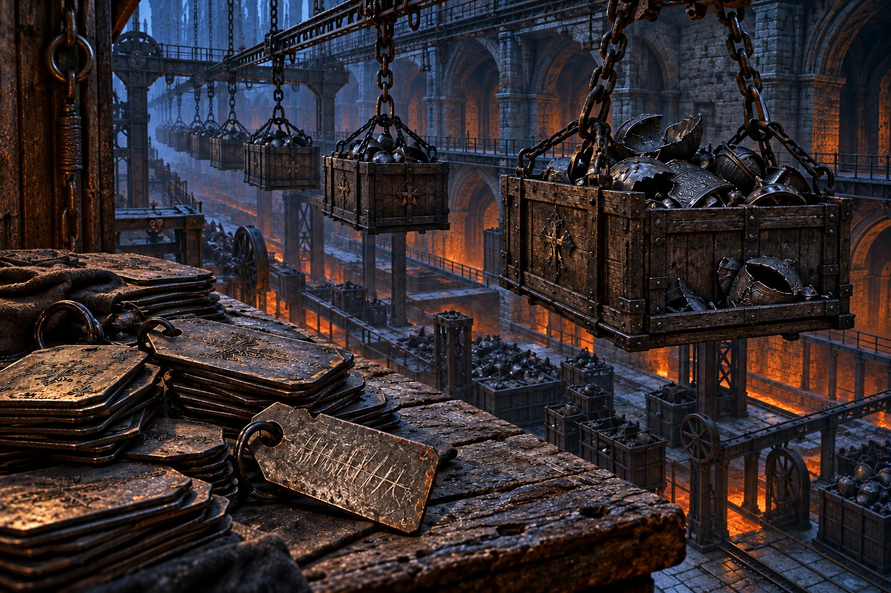
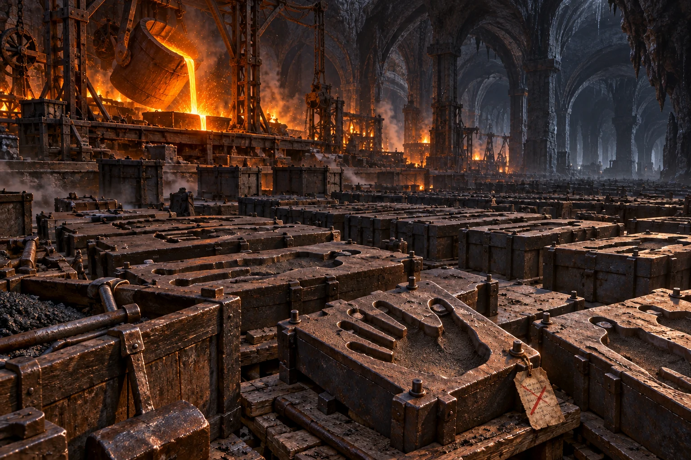
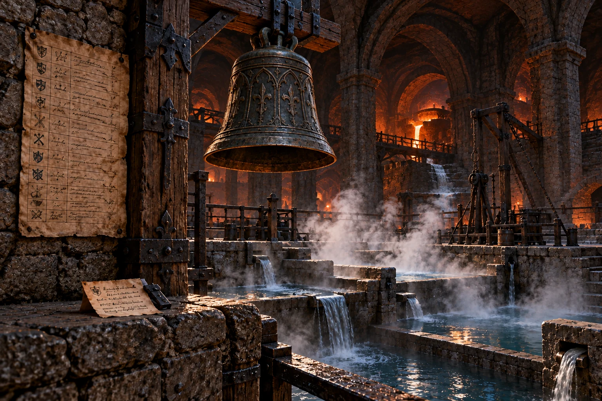
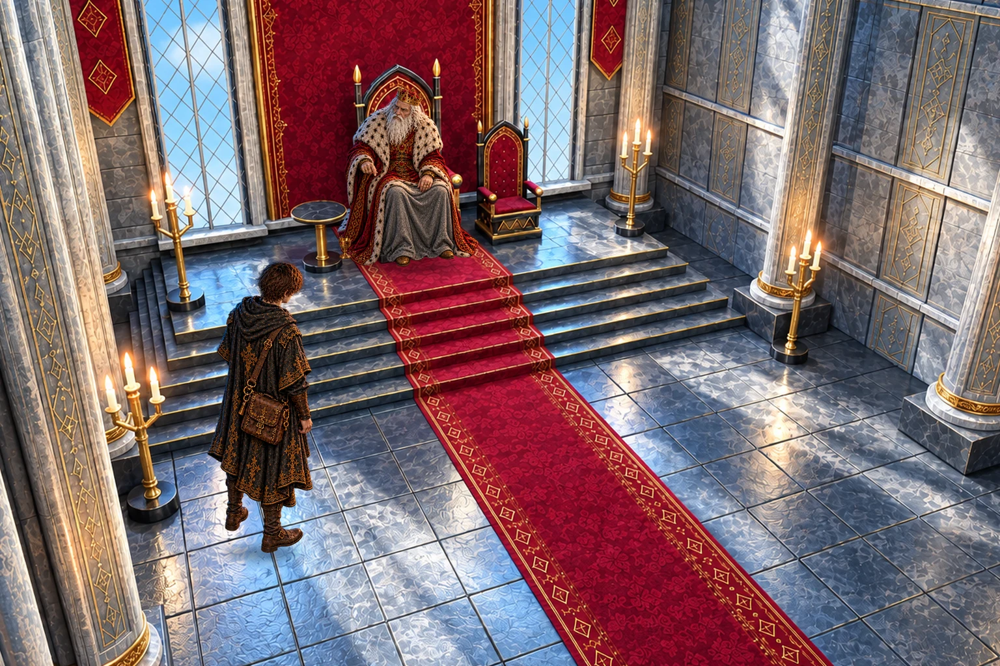
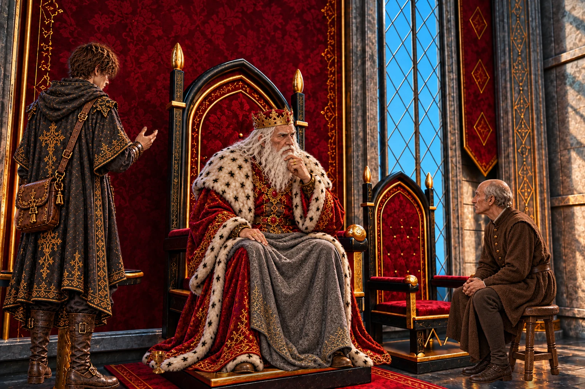
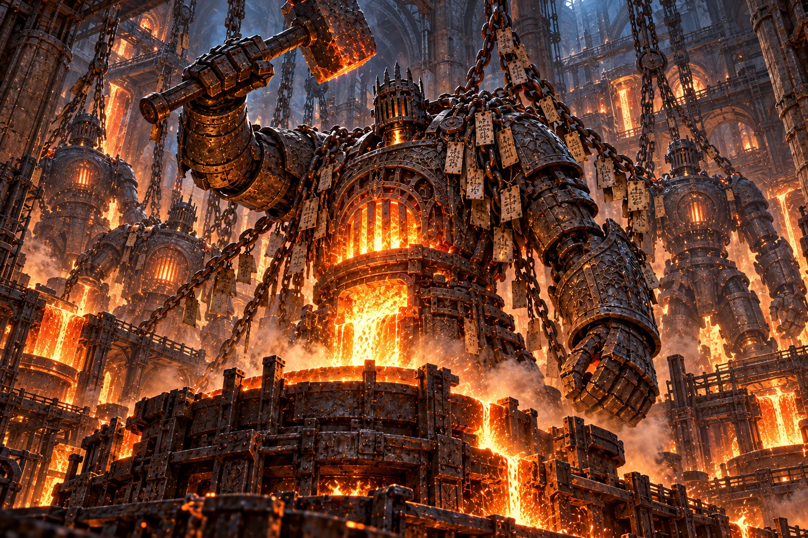
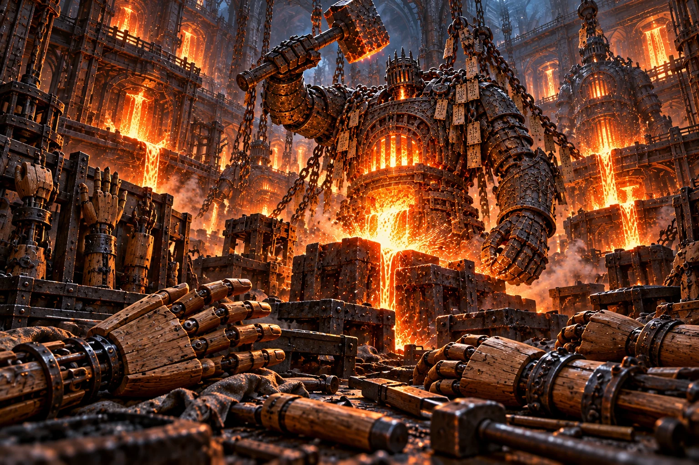
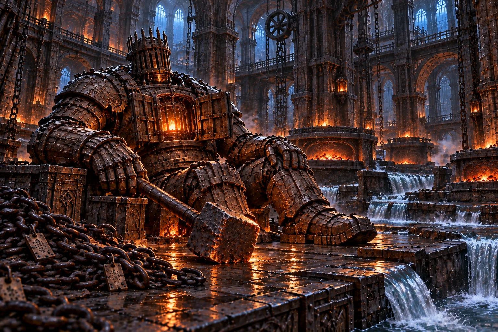
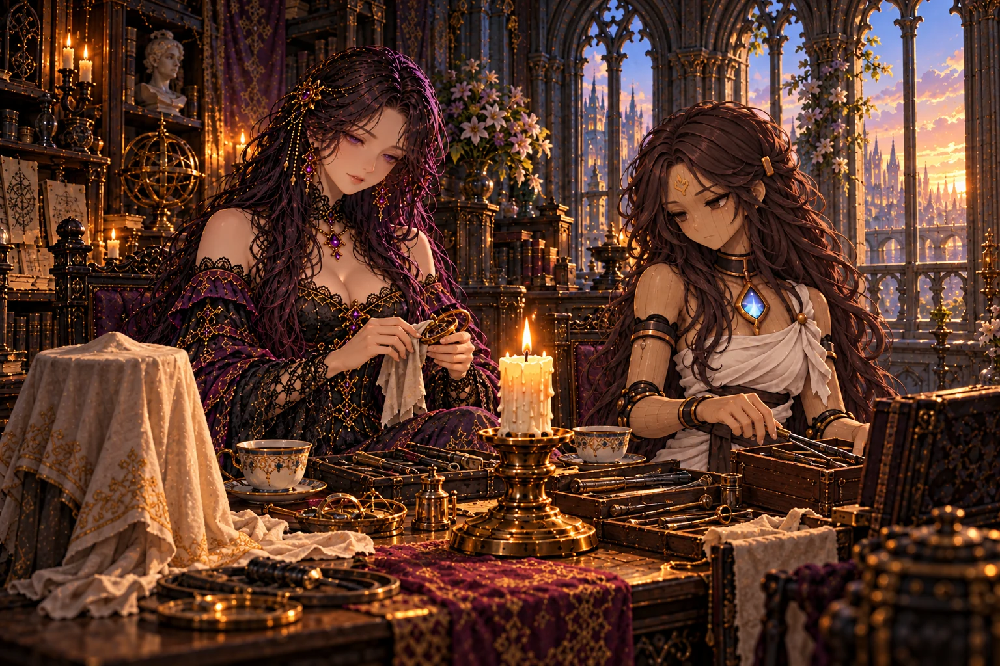
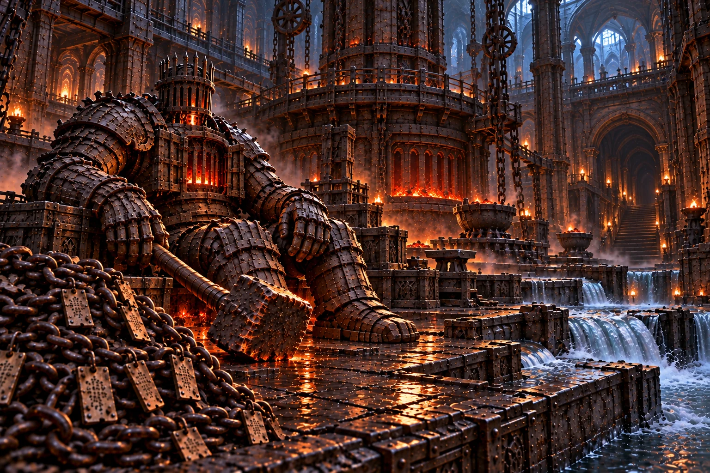

# 第13章「溶鉄炉」 の絵

書き出し: `node tools/storyart/review.mjs` (手で直さない)。絵は出荷する WebP、まだ無ければ原画。
ゲームで小さく出た時の見え方 (384×256): [chapter13-small.jpg](chapter13-small.jpg)

## w50_orders「器を待つ名」 ── 出荷済み

**ストーリー一覧の本文**

> 鉄板の表には仕事の名が打たれ、裏には針仕事をしたいという願いが刻まれていた。荷運びの腕と、その人の手は、同じ注文ではなかった。
>
> 廟の世話を続けるために育った鉄の工房では、壊れた働き手を戻し、その者に次の器を作らせていた。師は、作るなと命じれば済むのかと書き残した。
>
> 見取り図の鋳造場へ向かう道に、師の筆の跡が残っていた。

**ゲーム内 (師の手がかり STORY_CELLS.w50_orders)**

> 鎖の荷箱が行き交う底の荷場で、鉄板の注文札が壁を埋めていた。新しいものは一枚もない。
>
> ──『廟の働き手、腕二本。炉の番、胸一つ。壊れ次第、同じ型に戻すこと』
>
> その裏に、別の字が細く刻まれていた。『左の指を、もう少し曲がるように。私は針仕事がしたい』。表の仕事の欄には、荷運び、とある。
>
> 荷場の隅に、師の書きつけが残っていた。
>
> ──『亡骸は傷む。王だけでなく、世話をする者たちの器も要った。それで廟の下に、この工房が育った。ここで鋳るのは鉄の器だ。館の木の器とは作りが違う』
>
> ──『注文に終わりがない。壊れた者を戻し、戻した者にまた作らせる。だが、働きたいと言う灯もある。作るな、と命じれば済むのか』
>
> 工房の見取り図に、師が鋳造場への道をなぞっていた。図の端には、片手で台を押さえたらしい、すすの指跡が残っている。
>
> ── 新たな迷宮「千型の鋳造場」が地図に記された。

**指示書 (4章)**

- 要点: `src/archive-stories.js` の同名場面と本文を正本とする。次章の正体・祖の名は描かない。

## w51_mould「型の外の手」 ── 出荷済み

**ストーリー一覧の本文**

> 千の型の端に、一人のためだけに作られた小さな手があった。杯を持てるように、指の長さも握る形も変えてあった。
>
> 規格外の赤い線を引かれても、型は捨てられずに隠されていた。同じ鉄から、命じられた仕事をする腕も、望んだことのできる手も生まれる。
>
> 師は型を伏せずに置き直していた。器を作ることそのものを罪にはできないという一文を、台に残して。

**ゲーム内 (師の手がかり STORY_CELLS.w51_mould)**

> 千の鋳型の列の端に、小さな手の型が置かれていた。指は一本ずつ長さが違い、握る形もほかとは違う。
>
> 型の底には、作り手のための走り書きがある。『この手なら、あの子は自分で杯を持てる』。仕事の名は、どこにもない。
>
> 上に重ねた注文札には、赤い線が引かれていた。『規格外。作り直し』。それでも型は溶かされず、列のいちばん奥に隠してあった。
>
> 師の字が、型の台に残っていた。
>
> ──『同じ鉄で、働かせる腕も、杯を持つ手も作れる。器を作ること自体を、罪にはできない』
>
> ──『継ぎ手の置き場に、この型の続きがある。ロアダルへ戻る修繕師に、道を知らせておいた』
>
> 師は手の型を伏せずに置き直していた。内側の指のくぼみに、鉄の粉が静かに積もっている。

**指示書 (4章)**

- 要点: `src/archive-stories.js` の同名場面と本文を正本とする。次章の正体・祖の名は描かない。

## w52_bell「今日は、休む」 ── 出荷済み

**ストーリー一覧の本文**

> 水路の鐘には、打ち棒がなかった。当番表には同じ名と仕事を始める時刻だけが続き、終わりの時刻はひとつもなかった。
>
> 仕事が嫌いなのではない。今日は休みたい。刃の先で刻まれたような一行のそばに、魂の眠りと一日の終わりは違うという、師の書きつけがあった。
>
> 器を待つ者を置き去りにはできない。そのために作る者を使い続けてよいはずもない。水音の中で、鳴らない鐘が揺れた。

**ゲーム内 (師の手がかり STORY_CELLS.w52_bell)**

> 水路の最下段で、鎖につられた鐘が、蒸気に揺れていた。中の打ち棒は外されている。
>
> 鐘の下の当番表に、同じ名が続いていた。器を替えるたび、仕事を始める時刻だけが書き足されている。
>
> 表の下に、刃の先で刻んだような字があった。『仕事が嫌いなのではない。今日は休みたい』。
>
> 師の書きつけは、水から離れた石の上にあった。
>
> ──『魂が眠りを望むことと、一日の仕事を終えることは違う。この工房では、どちらも注文が済むまで認められなかった』
>
> ──『炉を止めれば、待っている者の器も作れぬ。だが待つ者のために、作る者が終われなくてよいはずもない』
>
> 鐘のない休憩所へ続く古い道の印があった。打ち棒は、そちらへ運ばれたらしい。

**指示書 (4章)**

- 要点: `src/archive-stories.js` の同名場面と本文を正本とする。次章の正体・祖の名は描かない。

## report_w50「王の数え方」 ── 出荷済み

**ストーリー一覧の本文**

> 仕事を続けているから、生きたいのだと思う。王は、自分も臣下をそう数えてきたのではないかとつぶやいた。
>
> 作るなと命じれば済むのか。師と同じ問いを、王も手放せなかった。
>
> 水音のする道も確かめてほしい。工房が何を支えるのか見落とすなと、王は弟子を送り出した。

**ゲーム内 (王への報告 REPORTS.w50)**

> 「王家の廟の下に、鉄の器を作る工房があったか。」
>
> 仕事の名を打たれた札と、裏に刻まれた針仕事の願いを話すと、王は指先で玉座の飾りをなぞった。
>
> 「命じた仕事を続けておれば、生きたいと望んでおるように見える。……余は臣下を、そのように数えておらなんだか。」
>
> 「オルドは、作るなと命じれば済むのか、と書いたのだな。余にも答えはない。水音のする道も確かめよ。あの工房が何を支えておるか、見落とすでない。」

**指示書 (4章)**

- 要点: `src/archive-stories.js` の同名場面と本文を正本とする。次章の正体・祖の名は描かない。

## report_w51「誰のための器」 ── 出荷済み

**ストーリー一覧の本文**

> 杯を持てる手の話を、王は身を乗り出して聞いた。規格に合わぬから作り直せとは、誰のための器なのか。
>
> 器を作ることを罪にはできないのなら、工房を壊すだけでは答えにならない。王は鋳造場の道筋を地図へ重ねた。
>
> その地図は、水路をたどった記録と合わせて、工房の中心へ向かう道を示すはずだった。

**ゲーム内 (王への報告 REPORTS.w51)**

> 「一人のために、指の長さを変えた型か。」
>
> 杯を持てるようにと作られた手の話を、王は身を乗り出して聞いた。
>
> 「規格に合わぬから作り直せとは、誰のための器であろうな。……余の国でも、同じことがあったのであろう。」
>
> 「オルドも、器を作ることを罪にはできぬと書いたか。ならば、炉をすべて壊せばよいとは考えておらぬのだな。」
>
> 「鋳造場の道筋は分かった。水路の記録と重ね、大炉への道を確かめるがよい。」

**指示書 (4章)**

- 要点: `src/archive-stories.js` の同名場面と本文を正本とする。次章の正体・祖の名は描かない。

## report_w52「座った侍従」 ── 出荷済み

**ストーリー一覧の本文**

> 今日は休みたいという言葉を聞いて、王は近くの侍従に、いつから立っているか尋ねた。答えを待つ前に、まず座れと椅子を勧めた。
>
> 魂が終わることと仕事が終わること。その違いが、玉座の間の小さな椅子ひとつになった。
>
> 王は、鋳造場の記録と水路の地図を照らし合わせ、大炉の前で働く者に会うよう弟子へ頼んだ。

**ゲーム内 (王への報告 REPORTS.w52)**

> 「仕事が嫌いなのではない。今日は休みたい……か。」
>
> 王は言葉を繰り返し、近くに控える侍従を見た。
>
> 「そなた、今日はいつから立っておる。……いや、答えは後でよい。まず、座れ。」
>
> 侍従は困ったように笑い、それでも椅子を引いた。
>
> 「オルドの決めようとしておる終わりと、その者らが望んだ休みは、同じではないのだな。」
>
> 「鋳造場と水路の地図を重ねよ。炉の前で、まだ働いておる者に、会わねばならぬ。」

**指示書 (4章)**

- 要点: `src/archive-stories.js` の同名場面と本文を正本とする。次章の正体・祖の名は描かない。

## report_w53「聞こえない声」 ── 出荷済み

**ストーリー一覧の本文**

> 師は、一人が決めねば使われ続ける者が出る、その責めを負いに行くと言った。王はその理由が分かると言った。
>
> それでも、その一人に聞こえない声はどこへ届くのか。今日は休み、明日はまた作るという答えを聞き、王は座った侍従へ目を向けた。
>
> 明日のことを今日すべて決めずに済んだ。その声を師にも聞かせよと、王は弟子へ告げた。

**ゲーム内 (王への報告 REPORTS.w53)**

> 「大炉を、低い火にしたか。灯は消さずに。」
>
> 工房長が初めは自分で戻ることを望んだこと。取り消されない注文を捨てられなくなったこと。一枚だけ、まだ待っていると返事があったこと。王は、最後まで黙って聞いていた。
>
> 「師は、その責めを引き受けに行く、と言うたか。一人が何も決めねば、使われ続ける者が出る。それは、余にも分かる。」
>
> 「だが、決める者が一人ならば、その者の聞こえぬ声は、どこへ届けばよいのだ。」
>
> 明日も作りたい、今日は休みたいという声を伝えると、王は、座った侍従へ目を向けた。
>
> 「明日のことを、今日すべて決めずに済んだか。……それを続けるのも、骨の折れる仕事であろうな。」
>
> 「{弟子名}よ。追うがよい。その声を、師にも聞かせるのだ。」

**指示書 (4章)**

- 要点: `src/archive-stories.js` の同名場面と本文を正本とする。次章の正体・祖の名は描かない。

## pre_w53「注文の向こう」 ── 出荷済み

**ストーリー一覧の本文**

> 大炉を胸に抱いた工房長が、鎚を振り上げた。待つ者がまだいるという声に合わせ、鋳造のゴーレムが立ち上がった。
>
> 工房長の肩を古い注文札の鎖が引いていた。一打ごとに胸の灯が細くなる。それでも次の型へ鉄が注がれた。
>
> 型に沿って流れる鉄は赤く、火に照らされた札の文字は、誰の願いとも読めなかった。

**ゲーム内 (主との対面 BOSS_PRELUDES.w53.first)**

> 大炉の前で、炉を胸に抱く工房長が鎚を振り上げた。床には、誰かの帰りを待つ手足が並んでいる。
>
> ──『止めるな。まだ、待っている者がいる』
>
> その声に合わせて鋳造のゴーレムが起き上がり、注文札の鎖が、工房長の肩を引いた。
>
> 鎚を振るうたびに、胸の灯が細くなった。それでも工房長は、次の型へ鉄を注いだ。

**指示書 (4章)**

- 要点: `src/archive-stories.js` の同名場面と本文を正本とする。次章の正体・祖の名は描かない。

## pre_w53_retry「戻った手」 ── 出荷済み

**ストーリー一覧の本文**

> 器を直して戻った隊に、工房長は、お前たちも次の器が要ったのだろうと問いかけた。
>
> 人業たちは自分たちの継ぎ目を見た。鎚の音を止めに来た手も、誰かに直してもらった手だった。
>
> 直してもらった手で、止まらない仕事と向き合う。弟子は、工房長の灯から目を離さずに進んだ。

**ゲーム内 (主との対面 BOSS_PRELUDES.w53.retry)**

> 砕けた器を直して戻ると、鎚の音はまだ続いていた。
>
> ──『お前たちも、次の器が要ったのだろう』
>
> 工房長の肩で、古い注文札が鳴った。隊は自分たちの継ぎ目を見て、それから大炉へ向き直った。

**指示書 (4章)**

- 要点: `src/archive-stories.js` の同名場面と本文を正本とする。次章の正体・祖の名は描かない。

## mem_w53「明日の鎚」 ── 出荷済み

**ストーリー一覧の本文**

> まだ生身だった工房長は、待つ者がいるから戻してくれと望んだ。鉄の体で鎚を取り、壊れるたびに戻ることも、初めは自分で選んでいた。
>
> 注文した者が死んでも、札は工房へ戻った。取り消す者のいない注文札は鎖で何度も送り戻され、工房長は捨てられずにいた。師は限りを決める責めを負いに行くと告げた。返事のない札の中に一枚だけ、まだ待っていますという字が残っていた。
>
> 殻が崩れた後、隊は鎚を灯の届く所へ置いた。明日も作りたい。だが、今日は休みたい。その声を聞いて、同じ注文札を送り戻す鎖を外し、冷ます水路は開けたまま、大炉を低い火にした。
>
> 灯は消えなかった。明日のことを今日すべて決めずに、鎚のそばで揺れていた。

**ゲーム内 (主の記憶 BOSS_MEMORIES.w53)**

> 大鎚が床へ落ちた。炉を抱く鉄の胸が開き、小さな灯のまわりから、幾重もの注文札が剥がれていく──
>
> ……廟に器を納め始めた頃。まだ生身の工房長は、焼けただれた両手で、弟子に最後の型を渡した。
>
> ──『わしを戻してくれ。待っている者がいる。今度は、火に耐える体で』
>
> 鉄の胸で目を覚ました工房長は、また鎚を取った。壊れるたびに戻ることも、初めは自分で望んだことだった。
>
> やがて注文した者は死に、器を待つ者の灯も別の場所へ運ばれた。返事のない札だけが、何度も工房へ戻ってきた。工房長は、取り消す者のいない注文を捨てられなかった。
>
> 三月前。片脚を引きずる男が、大炉の前に立った。
>
> ──『その魂で作り続けるにも、限りがある。待つ者の数を、そなた一人の命に載せるな』
>
> ──『わしを止めたら、誰があの者らの器を作る。生きたいと言う者に、お前が、もう終わりだと言うのか』
>
> 師は、札をひとつずつ裏返した。返事のない名が続いた。だが一枚だけ、震える字で『まだ、待っています』と書き足されていた。
>
> ──『全員を、今日救うことはできぬ。それでも、今日これ以上は使わせないと決める者が要る。私は、その責めを引き受けに行く』
>
> 師は一枚を残し、札の束を机へ戻した。鎚を持つ手には触れず、炉の奥の階段へ降りていった。
>
> 記憶がほどける。目の前の灯は、まだ鎚を探して揺れている。隊の人業が、落ちた鎚を拾い、届く所へ置いた。
>
> ──『明日も、作りたい』
>
> 細い声が、鉄の胸からこぼれた。
>
> ──『だが、今日は、休みたい』
>
> 隊は同じ注文札を何度でも送り戻す鎖を外し、炉口の風を絞った。すでに流れた鉄を冷ます水路は開けておいた。大炉は低い火になり、初めて鎚の音が途切れた。
>
> 灯は消えなかった。鎚のそばで静かに揺れていた。奥の階段からは、遠い鐘と、祈る声が聞こえた。

**指示書 (4章)**

- 要点: `src/archive-stories.js` の同名場面と本文を正本とする。次章の正体・祖の名は描かない。

## irene_hands「杯を持つ手」 ── 出荷済み

**ストーリー一覧の本文**

> イレーヌの指も、初めは同じ長さだった。灯の世話をしやすいように師が直した手で、彼女が初めてしたことは花を生けることだった。
>
> 誰かのために作ってもらった手で何をするかは、自分が選んでもよい。杯を持った指を見ながら、イレーヌは言った。
>
> 大きな荷物も持ちたいとセラが言った。まずは自分の杯からと返して、イレーヌはその指をそっと握った。

**ゲーム内 (館の語り IRENE_BEATS.irene_hands)**

> イレーヌは杯を持ち上げ、自分の木の指を見た。
>
> イレーヌ「わたしの指も、初めは、同じ長さだったのですよ。オルド様が作り直してくださいました。」
>
> イレーヌ「灯の世話がしやすいように、と。けれど、わたしは、その手で初めて花を生けました。」
>
> イレーヌ「誰かのために作っていただいた手で、何をするか。それは、わたしが選んでもよいのですね。」
>
> セラ「わたしは、杯より大きなものを持ちたいです。帰ってきたみんなの荷物とか！」
>
> イレーヌ「……まずは、ご自分の杯からね。」

**指示書 (4章)**

- 要点: `src/archive-stories.js` の同名場面と本文を正本とする。次章の正体・祖の名は描かない。

## irene_tomorrow「今日は、ここまで」 ── 出荷済み

**ストーリー一覧の本文**

> 待つ人がいると、今日はここまでと言うのは難しい。イレーヌは直しかけの器のそばで、道具を拭いていた。
>
> セラは隣へ座り、今拭く分が終わったら二人でお茶にしようと言った。イレーヌは器に布をかけた。明日の仕事も、ここに置いておこう。
>
> 燭台の灯は消さなかった。机の道具だけを二人で片づけた。

**ゲーム内 (館の語り IRENE_BEATS.irene_tomorrow)**

> 館に戻ると、イレーヌは直しかけの器のそばで、道具を拭いていた。
>
> イレーヌ「明日も作りたい。今日は休みたい。……はい。よく分かります。」
>
> イレーヌ「でも、あなたが出撃なさる前には、もう一体直しておきたくなるのです。待っている方がいると、今日はここまでと言うのが難しいのですね。」
>
> セラは布を持ち、隣の椅子へ腰を下ろした。
>
> セラ「今、拭く分だけ。終わったら、二人でお茶にしませんか。」
>
> イレーヌはしばらく考え、自分の手元の器に布をかけた。
>
> イレーヌ「ええ。明日の仕事も、ここに置いておきましょう。」
>
> 燭台の灯は消さなかった。机の道具だけを、二人で片づけた。

**指示書 (4章)**

- 要点: `src/archive-stories.js` の同名場面と本文を正本とする。次章の正体・祖の名は描かない。

## ch13_end「低い火」 ── 出荷済み

**ストーリー一覧の本文**

> 大炉は壊さず、同じ注文札を送り戻す鎖を外した。工房長の手の届く所に、明日の鎚を置いた。
>
> 師は、誰かが限りを決めなければ救われない者のために降りていった。隊は、その一人には聞こえないかもしれない二つの声を持っていく。まだ待っています。今日は休みたい。
>
> 炉の奥の階段から、鐘と祈りの声が聞こえた。低い火に照らされ、隊の人業の継ぎ目が光った。

**ゲーム内 (章の結び CHAPTER_END[13])**

> 大炉は壊さなかった。同じ注文札を送り戻す鎖は外し、冷ますための水路は開けたままにした。工房長の鎚は、その手が届くところにある。
>
> 明日も作りたい。だが、今日は休みたい。それは、もう生きたくないという言葉ではなかった。
>
> 師は、誰かが限りを決めねば、救われぬ者がいると知っていた。その責めを一人で負うために、下へ降りていった。
>
> 隊は、その一人には聞こえないかもしれない声を、持っていく。まだ待っていますと書かれた札の写しと、今日は休みたいという声を。
>
> 大炉の奥の階段から、鐘と祈りが聞こえる。低い火の明かりに、隊の人業の継ぎ目がひとつずつ照らされていた。
>
> 館の燭台の灯は、今夜も消えずに揺れている。
>
> ── 物語は第十四章「深淵の聖堂」へ続く。

**指示書 (4章)**

- 要点: `src/archive-stories.js` の同名場面と本文を正本とする。次章の正体・祖の名は描かない。

