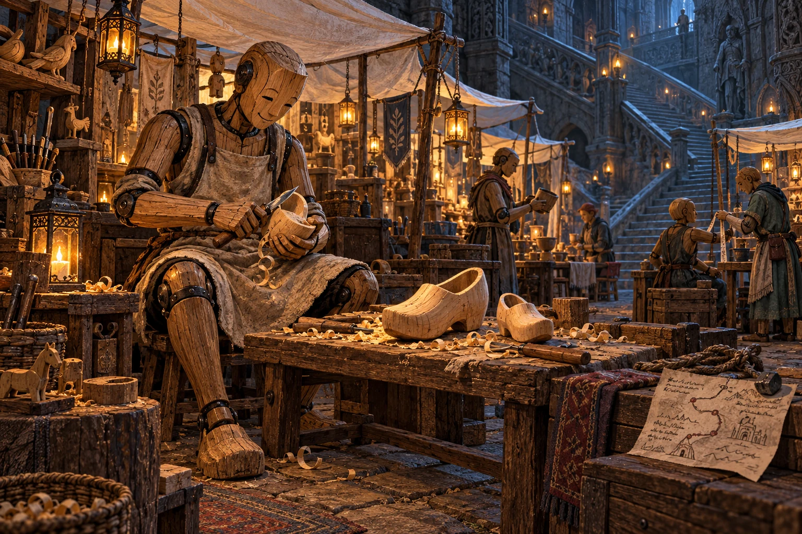
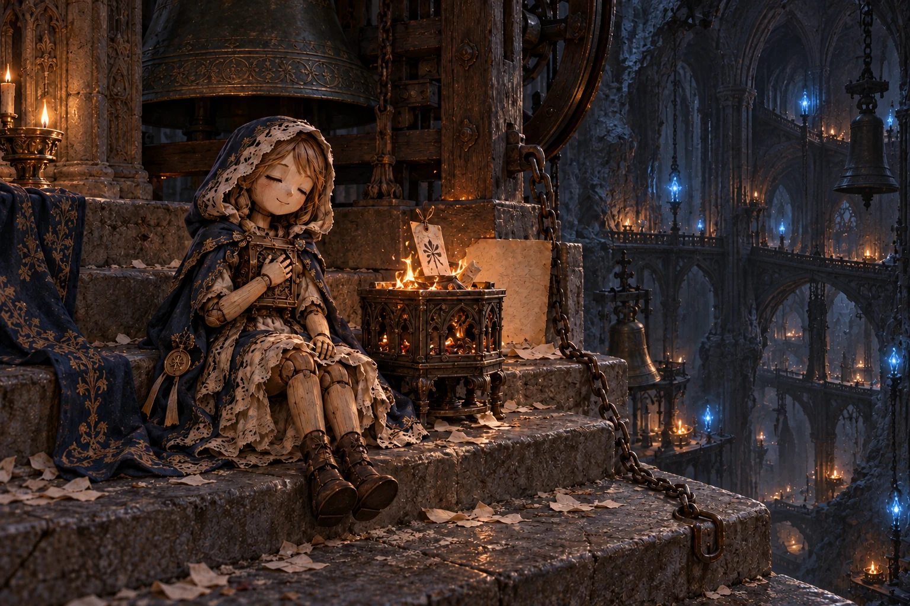
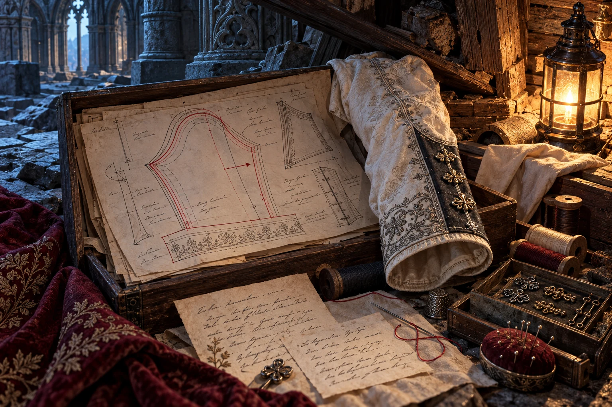
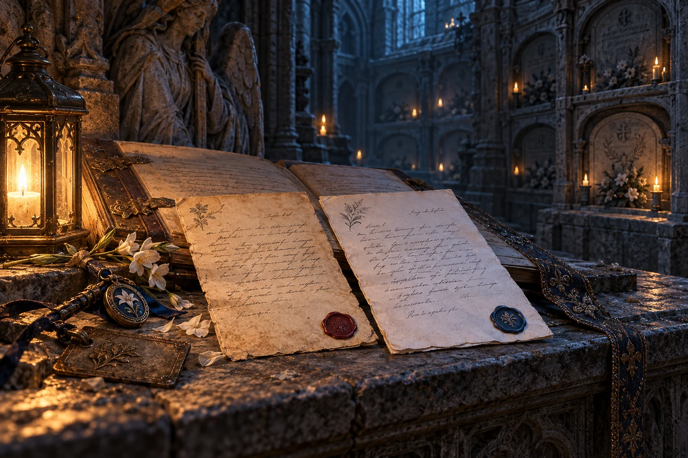
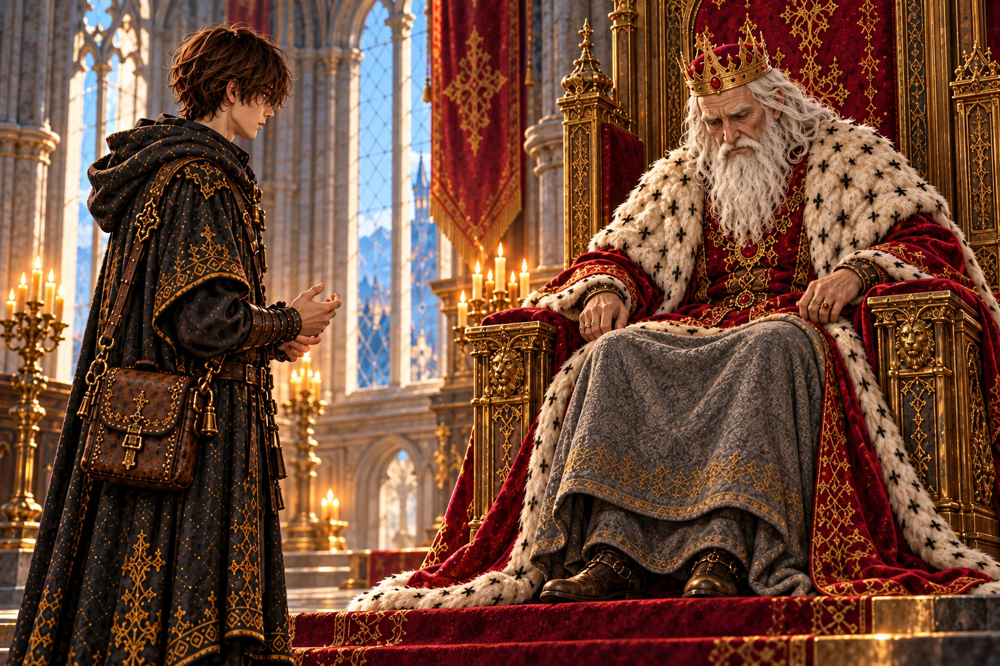
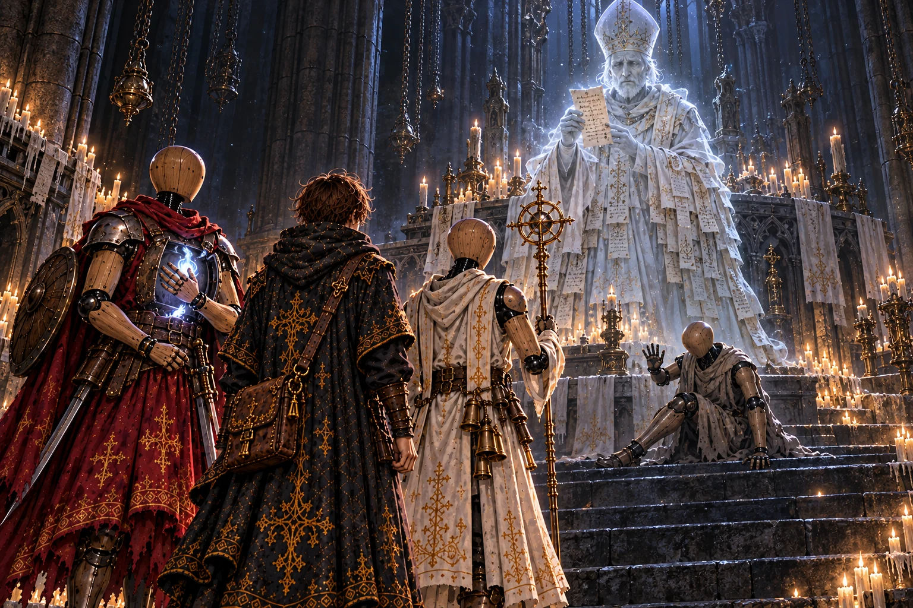
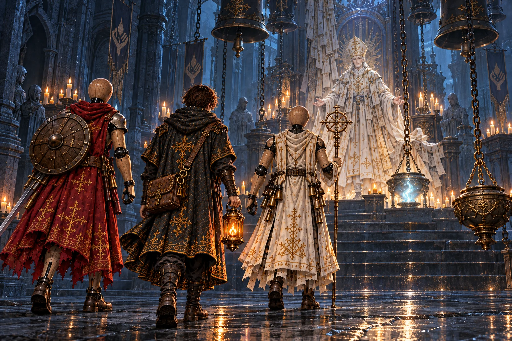
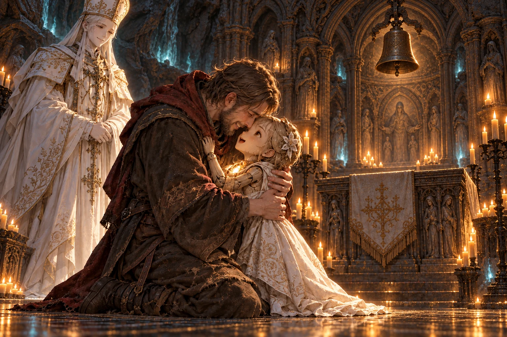
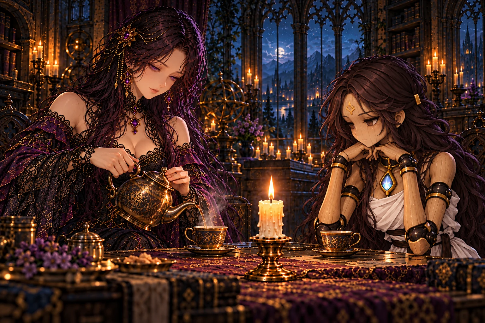
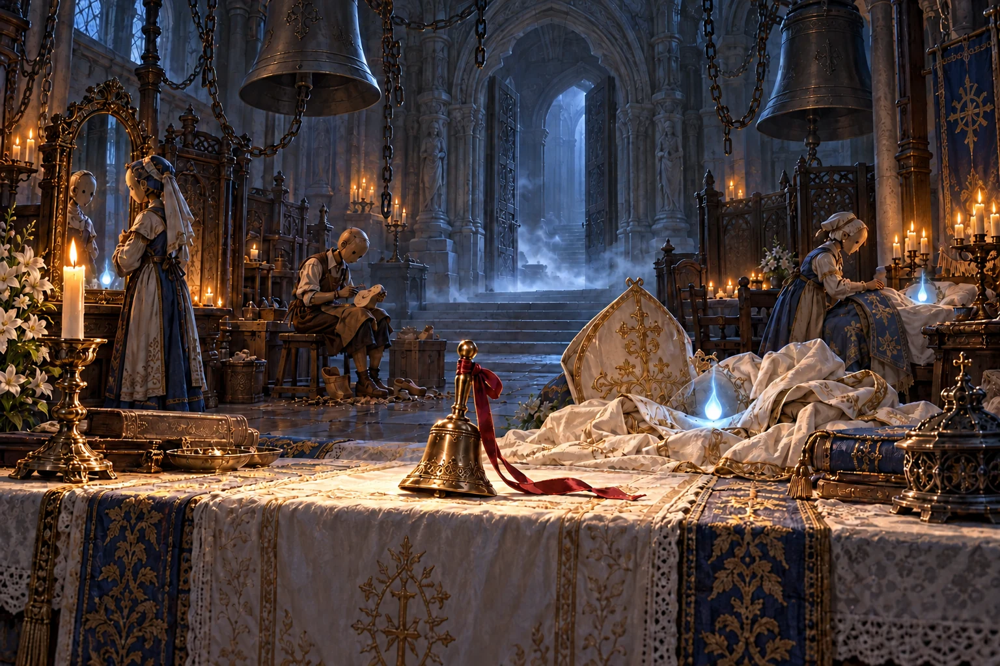

# 第14章「深淵の聖堂」 の絵

書き出し: `node tools/storyart/review.mjs` (手で直さない)。絵は出荷する WebP、まだ無ければ原画。
ゲームで小さく出た時の見え方 (384×256): [chapter14-small.jpg](chapter14-small.jpg)

## w54_shoes「二足の木靴」 ── 出荷済み

**ストーリー一覧の本文**

> 師の跡を追う隊は、祈りの石段で二足の木靴に出会った。
>
> 大炉の下の石段には、祈りに自分で答えて戻った人業の市が育った。
>
> 靴職人は地上にいる娘のため、大小二足の木靴を削っていた。
>
> 師は、戻ってよかったという職人の言葉を聞き、その喜びを書き残した。

**ゲーム内 (師の手がかり STORY_CELLS.w54_shoes)**

> 大炉の熱が、背中から少しずつ遠ざかっていった。
>
> 階段を降りるにつれ、鉄を打つ音の代わりに、鐘の音が聞こえてくる。その合間に、誰かの名を呼ぶ声があった。
>
> 石段の下には、白い布を張った小さな市が立っていた。
>
> 腕の長さを測る人業。割れた杯を直す人業。胸の扉を開き、互いの灯を確かめる人業。
>
> 壁際で、靴職人が木靴を削っていた。
>
> 片方は大きく、もう片方は小さい。
>
> 「小さいほうは、娘のだ」
>
> 職人は自分の木の足を指した。
>
> 「死んだ時には、まだ歩けなかった。十年もたてば、これくらいだろうと思ってな」
>
> 地上にいる娘の声が、鐘を通して届いたのだという。職人は自分で戻ると答え、聖堂の器に魂を宿した。
>
> 地上へ帰る道は、まだ探している。それでも、戻ってよかったと彼は言った。
>
> 「もう一度、あの子の靴を作れる」
>
> 作業台の隅に、師の筆跡があった。
>
> ──『戻ってよかった、と言った。私はその言葉を、聞いた』
>
> その下には、別の字で道が描かれていた。
>
> 再会の回廊へ。職人が、自分で書き足したものだった。

**指示書 (4章)**

- 描くもの: 石段の下の白布の市 / 木の靴職人と木の足 / 作業台の大小二足の木靴と削りくず / 隅の師の書きつけ（読めない）。描かないもの: 現在の師、地上の娘、屋外の空。

## w55_reply「返事のある祈り」 ── 出荷済み

**ストーリー一覧の本文**

> 師の跡を追う隊は、再会の回廊で返事のある祈りに出会った。
>
> 地上の家々の祈りの皿と、聖堂の古い鏡はつながっていた。
>
> 戻れと呼ぶだけでなく、離れて暮らす家族が庭の花を知らせる窓にもなった。
>
> 師は会話を断たず、鏡の留め具を直していった。

**ゲーム内 (師の手がかり STORY_CELLS.w55_reply)**

> 回廊の壁には、小さな窓がいくつも開いていた。
>
> 窓の向こうに見えるのは空ではない。古い鏡だった。
>
> 鏡には、地上の家々に置かれた祈りの皿が映っている。誰かが名を呼ぶと、皿にともした火が揺れ、回廊の奥で鐘が鳴った。
>
> ひとつの窓の前で、老いた姿の人業が待っていた。
>
> 鏡の向こうには、白髪の女がいた。手に、ほつれた婚礼の布を持っている。
>
> 「今年も、咲いたよ」
>
> 女が言った。
>
> 人業は鏡へ顔を寄せた。
>
> 「庭の木か」
>
> 返事が届いたのか、女は目を上げた。
>
> 「ええ。今年は、枝を切りすぎなかったから」
>
> ふたりは笑った。生前、何度も交わしたらしい話だった。
>
> 女が皿の火を落としたあと、人業は隊へ振り向いた。
>
> 「もう帰れとは、言わなくなった。ここで暮らしていると、ようやく分かってくれた」
>
> 鏡の足元に、師の書きつけが挟まっていた。
>
> ──『別れを受け入れられぬ者だけが、祈るのではない。離れて暮らす者にも、話したいことはある』
>
> 紙の裏に、小さな鏡の留め具の直し方が描かれていた。
>
> 師はこの窓を、修繕していったのだった。

**指示書 (4章)**

- 描くもの: 石の回廊の鏡窓 / 老いた姿の人業 / 鏡の中だけの白髪の女とほつれた婚礼の布、祈りの皿 / 直された留め具と書きつけ。描かないもの: 現在の師、鏡を通り抜ける人、普通の鏡像。

## w56_prayer「消されなかった願い」 ── 出荷済み

**ストーリー一覧の本文**

> 師の跡を追う隊は、呼び声の鐘楼で消されなかった願いに出会った。
>
> 祈りの文を焼く炉が、書かれた名を鐘で下へ運び続けた。
>
> 祈った者が死んでも願いは消されず、眠りたい魂も呼び戻された。
>
> 隊は一つの炉の鎖を外し、その灯を静かに休ませた。

**ゲーム内 (師の手がかり STORY_CELLS.w56_prayer)**

> 鐘楼の階段には、紙の灰が積もっていた。
>
> 祈りの文を焼く炉が、階ごとにある。燃えた紙の名を、鐘が下へ運んでいるのだった。
>
> 最上段に、小さな人業が座っていた。
>
> 片手を、胸の扉へ押し当てている。
>
> 「また、呼ばれる」
>
> 鐘が鳴るたび、その体が跳ねた。
>
> 「少しだけ、静かにしてほしい。眠ったら、また、引っ張られるから」
>
> 炉の脇に、その人業と同じ名の祈りがあった。
>
> ──『帰ってきてください。もう一度だけ、顔を見せてください』
>
> 紙は古く、書いた者の名札には、すでに弔いの印があった。
>
> 祈った者は、死んでいた。
>
> それでも願いだけが、鐘を鳴らし続けている。
>
> 隊はその炉へ続く細い鎖を外した。人業の肩から力が抜けた。
>
> 「ほかの鐘も、聞こえる」
>
> 細い声が言った。
>
> 「わたしの名前じゃないのに。みんな、帰ってきてって、言われてる」
>
> 師が炉の裏に残した紙があった。
>
> ──『祈りを書いた者が死んでも、祈りは取り消されない』
>
> ──『戻りたい声もあった。戻りたくない声もあった。鐘には、その違いが聞こえぬ』
>
> その下に、線を引いて消された一文があった。
>
> ──『呼ぶことを、禁じるべきか』
>
> 師は答えを書かず、聖堂の奥へ進んでいた。

**指示書 (4章)**

- 描くもの: 灰の積もる鐘楼の最上段 / 胸を押さえた小さな人業 / 祈りの紙の炉と外れた細い鎖 / 古い祈りと弔い印の名札、師の紙（読めない）。描かないもの: 師、死体、人業の破壊、戦闘。

## ws30_patterns「縫い直された袖」 ── 出荷済み

**ストーリー一覧の本文**

> 師の跡を追う隊は、針と糸の支度部屋で縫い直された袖に出会った。
>
> 聖堂へ戻った者へ、今の体に合う服を仕立てる部屋だった。
>
> 型紙には袖やすその線が引き直され、留め具も一人ずつ違う。
>
> 生前と同じ姿を選ぶことも、違う服を選ぶことも、戻った者自身に尋ねる。

**ゲーム内 (師の手がかり STORY_CELLS.ws30_patterns)**

> 箱は、倒れた棚の下にあった。
>
> 中の型紙は、どれも線を引き直されている。
>
> 長くした袖。短くしたすそ。左側へ移した留め具。
>
> 箱の底に、一枚の手紙があった。
>
> ──『生前と同じ服をと言われたけれど、今の腕では、袖が余ります』
>
> その下に、仕立て手の返事がある。
>
> ──『では、今のあなたに合わせましょう』

**指示書 (4章)**

- 描くもの: 倒れた棚の下の開いた箱 / 線を引き直した袖・すその型紙 / 留め具、針と糸、縫い直された袖 / 底の手紙と返事（読めない）。描かないもの: 人物、服を着た幽霊、師。

## ws31_letters「読まれなかった返事」 ── 出荷済み

**ストーリー一覧の本文**

> 師の跡を追う隊は、返らぬ手紙の納骨室で読まれなかった返事に出会った。
>
> 会えなかった者の名と品を残すため、手紙と名簿が預けられた。
>
> 帰らなかった者にも、こちらでやることができたという返事があった。
>
> 戻すために火をともすのでなく、届かなかった二通を隣に置くこともできた。

**ゲーム内 (師の手がかり STORY_CELLS.ws31_letters)**

> 名簿の間に、別の手紙が残っていた。
>
> ──『帰れなくて、すまない』
>
> ──『こちらで、まだやることができた』
>
> ──『お前が、帰ってこいと言ってくれたことは、嬉しかった』
>
> 差出人と宛先は、依頼の手紙と逆になっていた。
>
> 返事は、届いていなかった。

**指示書 (4章)**

- 描くもの: 納骨室の石の台 / 開いた名簿と間に残った返事 / 隣り合う二通の手紙、古い名札と品。描かないもの: 魂を呼ぶ炎、幽霊、師、読める文字。

## report_w54「帰りたい者」 ── 出荷済み

**ストーリー一覧の本文**

> 弟子は祈りの石段で見たことを王に報告した。
>
> 娘の木靴を作るために戻った者の喜びを、師も見ていた。
>
> 王は、戻ることを間違いだとは師も考えていないと受け止めた。

**ゲーム内 (王への報告 REPORTS.w54)**

> 「娘の靴を作るために、戻った者がおったか」
>
> 王は、職人の言葉を聞き終えてから、自分の足元を見た。
>
> 「余が長く生きてきた間にも、子は育ち、親は死んだ。その順を変えたいと願う者は、いくらでもおったであろうな」
>
> 弟子は、師が残した一行を伝えた。
>
> 「オルドも、その者の喜びを見たのだな」
>
> 王はしばらく黙っていた。
>
> 「ならば、戻ることがすべて間違いだとは、あの男も考えておらぬ。……喜びを見てもなお、底へ向かった。その先に見たものも、確かめねばなるまい」

**指示書 (4章)**

- 要点: 娘の木靴を作るため戻った職人の話を聞いた王が、自分の足元を見る。師も再会の喜びを知っていたと受け止める。
- 描くもの: 膝掛けを掛けた老王、足元へ落とした視線、聞き手の弟子。描かないもの: 王宮へ運ばれた木靴、靴職人や娘の実体、師、宰相。

## report_w55「同じ日を生きる」 ── 出荷済み

**ストーリー一覧の本文**

> 弟子は再会の回廊で見たことを王に報告した。
>
> 庭の花が咲いたと知らせる祈りもある。
>
> 師が鏡を直したことを知り、王はその会話を断とうとしなかった師の姿を覚えておくよう頼んだ。

**ゲーム内 (王への報告 REPORTS.w55)**

> 「十年会えずとも、庭の木の話ができるのか」
>
> 王は窓の外へ目を向けた。
>
> 「余は、死者に願うとは、生き返れと求めることだけだと思うておった。……今年も花が咲いたと、知らせる祈りもあるのだな」
>
> 鏡を師が直したと告げると、王は小さく息を吐いた。
>
> 「オルドは、あの者らの会話を断とうとはせなんだ」
>
> 「そのことを、覚えておけ。底であの男と話す時、そなたの言葉になるやもしれぬ」

**指示書 (4章)**

- 要点: 生き返れという願いだけでなく、花が咲いたと知らせる祈りもあると知り、王は窓の外へ目を向ける。
- 描くもの: 窓を見つめる老王の横顔、明るい青空、報告する弟子。描かないもの: 王宮の魔法の鏡、窓に映る死者、師、宰相。

## report_w56「願いだけが残る」 ── 出荷済み

**ストーリー一覧の本文**

> 弟子は呼び声の鐘楼で見たことを王に報告した。
>
> 呼んだ者は死んでも願いだけは残り、眠りたい灯を引いていた。
>
> 王は、鎖を外した隊の行いを聞き、祈りを預かる者に会う必要を語った。

**ゲーム内 (王への報告 REPORTS.w56)**

> 「呼んだ者は、もう死んでおったのか」
>
> 王の指が、玉座のひじ掛けを握った。
>
> 「帰ってこいと願った者も、いつかは死ぬ。それを知らぬ者など、おらぬはずなのにな」
>
> 弟子は、鎖を外したあと、その人業が眠ったことを話した。
>
> 「そなたは、ひとつの鐘を止めたのだな。……よく、その声を聞いた」
>
> 「だが、鐘楼には、まだ名があるのだろう。祈りを預かる者に、会わねばならぬ」

**指示書 (4章)**

- 要点: 呼んだ者はもう死んだと聞き、王の指がひじ掛けを握る。隊が眠りたい声を聞いて鎖を外したことを受け止める。
- 描くもの: 玉座のひじ掛けを握る老いた手、王の重い表情、報告する弟子。描かないもの: 王を縛る鎖、王宮に置かれた鐘、眠る人業の実体、師、宰相。

## report_w57「待つ場所」 ── 出荷済み

**ストーリー一覧の本文**

> 弟子は祈り果てぬ大聖堂で見たことを王に報告した。
>
> 隊は祈りを捨てず、一方的に呼ぶ鎖を外した。
>
> 王は自分にも帰ってほしいという願いがあると認め、返事をする時を待つ場所を残したことを受け止めた。

**ゲーム内 (王への報告 REPORTS.w57)**

> 「祈りを、すべて捨てはせなんだか」
>
> 王は弟子の報告を聞き、うなずいた。
>
> 「戻ってきてほしいと願うことまで、罪にはできまい。……余も、その願いを持つ者だ」
>
> 「だが、その願いを受ける者にも、返事をする時が要るのだな」
>
> 大司教の灯は、聖堂で休んでいると伝えた。
>
> 「そなたらが置いた鈴を、その者にも、いつか聞かせてやれ」

**指示書 (4章)**

- 要点: 戻ってほしいという願いを否定せず、返事をする時を待つ場所を残した報告。王にも帰ってほしいという願いがある。
- 描くもの: 王と弟子の静かな対話、力を抜いて開いた王の手、穏やかな表情。描かないもの: 聖堂から持ち出された鈴や大司教の灯、師、宰相。

## pre_w57「届いた祈り」 ── 出荷済み

**ストーリー一覧の本文**

> 祭壇の大司教は、呼ぶ者と待つ者がいるから帰らせねばならないと言った。
>
> 空の器が起き上がり、今はいやだという声をこぼした。
>
> 大司教はその返事を聞かず、次の祈りを掲げた。

**ゲーム内 (主との対面 BOSS_PRELUDES.w57.first)**

> 祭壇の奥に、大司教の霊が立っていた。
>
> 背には幾重もの白い衣。衣のすそへ、祈りの紙が縫いつけられている。
>
> その足元で、空の器が起き上がった。
>
> 「呼ぶ者がいる」
>
> 大司教は言った。
>
> 「待つ者がいる。帰らせねばならぬ」
>
> 隊の人業が、胸の灯をかばった。
>
> 大司教の目が、その明かりへ向いた。
>
> 「お前たちにも、帰りを願う者がいる。ならば、何度でも戻す。何度でも」
>
> 鐘が鳴った。
>
> 起き上がった器の中から、小さな声がした。
>
> 「今は、いやだ」
>
> 大司教は次の祈りを掲げた。
>
> 聞こえていなかった。

**指示書 (4章)**

- 要点: 祭壇の大司教の霊が、戻りたくないという器の声を聞かず、次の祈りを掲げる。帰らせねばという善意と、聞かれない返事を同じ場面に描く。
- 描くもの: 幾重もの白い衣とすそに縫われた祈りの紙、大司教の霊、起き上がる木の器、胸の灯をかばう隊の人業、弟子の後ろ姿。描かないもの: 戦闘の閃光、倒された主、切断済みの鎖、祭壇の小さな鈴、師、地上の空。

## pre_w57_retry「まだ鳴る鐘」 ── 出荷済み

**ストーリー一覧の本文**

> 器を直し、隊は祭壇へ戻った。
>
> 鐘の音は途切れず、大司教は戻った隊を祈りが届いたものとして迎えた。
>
> 隊は、まだ眠れずにいる灯の方へ進んだ。

**ゲーム内 (主との対面 BOSS_PRELUDES.w57.retry)**

> 器を直し、隊は祭壇へ戻った。
>
> 鐘の音は途切れていなかった。
>
> 「戻ったか」
>
> 大司教は、安らかな顔で言った。
>
> 「祈りは、届くのだ」
>
> 隊は、まだ眠れずにいる灯の方へ進んだ。

**指示書 (4章)**

- 要点: 器を直した隊が、なお鐘の鳴る祭壇へ戻る。大司教は祈りが届いたと思って安らかに迎えるが、灯はまだ眠れない。
- 描くもの: 手前に弟子と修復済みの人業二体 / 奥の祭壇に安らかな顔の大司教の霊、幾重もの白い衣と裾へ縫いつけた祈りの紙 / 鐘と魂を引く鎖、空の器の中で休めずに揺れる小さな灯。修復は木の継ぎ目や当て木で示し、全員が立って進める姿。
- 描かないもの: 壊れた隊の残骸、血、凶悪な笑い、勝利後の切断済みの鎖、師、次章の秘密、読める文字。

## mem_w57「最初の返事」 ── 出荷済み

**ストーリー一覧の本文**

> 聖堂の始まりには、死んだ子にもう一度名を呼んでほしいと願った父親がいた。
>
> 大司教は最初の返事を忘れられず、違う願いを聞き分けないまま魂を呼び続けた。
>
> 隊は鐘と魂を引く鎖を切り離し、返事を待つ鈴と、眠る場所を残した。
>
> 三月前、師は呼んだ者のいない名札を祭壇へ置いた。その魂が何を待つのかを尋ねたが、返事はなかった。

**ゲーム内 (主の記憶 BOSS_MEMORIES.w57)**

> 白い衣がほどけ、縫いつけられた紙が床へ散った。
>
> ……まだ鐘がひとつしかなかった頃。
>
> ひとりの父親が、小さな器の前にひざをついていた。
>
> 「もう一度だけ。名前を呼んでくれ」
>
> 大司教は、死んだ子の魂を器へ招いた。
>
> 小さな口が開いた。
>
> 「おとうさん」
>
> 父親は器を抱きしめた。
>
> それが、聖堂の始まりだった。
>
> 次の祈りが来た。その次も来た。
>
> 戻って笑う者がいた。泣く者がいた。何も言えずに座り続ける者もいた。
>
> 大司教は、最初に聞いた返事を忘れられなかった。
>
> ……三月前。
>
> 師は祭壇へ、鐘楼の古い名札を置いた。
>
> 「呼んだ者は、もういない」
>
> 「待つ者はいる」
>
> 大司教は言った。
>
> 「ここに来る者は、皆、待っている」
>
> 師は、空の器へ目を向けた。
>
> 「その者は、何を待っている」
>
> 返事はなかった。
>
> 記憶がほどけた。
>
> 大司教の灯は、衣の間で小さく揺れていた。
>
> 隊は鐘をすべて壊さなかった。
>
> 祈りを受ける鐘と、魂を無理に呼び起こす鎖を切り離した。返事を待つための小さな鈴を、祭壇へ置いた。
>
> 靴職人が、鐘楼の人業を抱いてやってきた。
>
> 「眠る場所を、作ろう」
>
> 彼は言った。
>
> 「起きた時に履く靴も、ここへ置いておく」

**指示書 (4章)**

- 要点: 聖堂が始まった頃、最初に帰ってきた子が父を呼び、父が小さな器を抱きしめた。その再会の喜びは本物。
- 描くもの: まだ鐘がひとつだけの聖堂 / ひざをついて子の小さな木の器を抱く父親 / 父を見上げ、小さな口を開いた子 / 静かに見守る白い衣の大司教。父と子の抱擁を主題にする。
- 描かないもの: 弟子と隊、師、三月前の名札、現在の戦闘後の場面との合成、多数の鐘、子の遺体、恐怖や邪悪さの演出、文字。

## irene_returned「帰ってきてくれて」 ── 出荷済み

**ストーリー一覧の本文**

> イレーヌは祈りの写しを読み、自分も帰ってきてほしいと何度も願ったことを思い出した。
>
> 戻ってよかったというセラの声と、眠りたかった鐘楼の灯の声は、同じにはできなかった。
>
> 今の願いも、その後に変わる願いも聞いてほしい。セラの言葉に、イレーヌは前に言ったでしょうとは言わないと応じた。

**ゲーム内 (館の語り IRENE_BEATS.irene_returned)**

> イレーヌは、鐘楼から持ち帰った祈りの写しを読んだ。
>
> イレーヌ「帰ってきてください。……わたしも、何度も思いました」
>
> 燭台の向こうで、セラが顔を上げた。
>
> セラ「わたし、帰ってきてよかったです」
>
> イレーヌ「ええ。知っています」
>
> セラ「でも、あの子は眠りたかったんですね」
>
> イレーヌはうなずいた。
>
> イレーヌ「わたしが嬉しかったことと、その方が望むことを、一緒にしてはいけないのでしょうね」
>
> セラは、自分の指を折ったり開いたりした。
>
> セラ「今、戻りたいって言ったら、聞いてほしいです」
>
> それから、少し考えて言った。
>
> セラ「あとで違うことを言った時も」
>
> イレーヌは祈りの写しを、燭台から離れた所へ置いた。
>
> イレーヌ「その時は、前に言ったでしょうとは、言わないようにします」

**指示書 (4章)**

- 要点: イレーヌが祈りの写しを燭台から離れた所へ置き、指を折ったり開いたりするセラの今の願いを聞く。戻ってきて嬉しい気持ちと、相手の望みを分けて考える静かな会話。
- 描くもの: 館の作業机 / イレーヌとセラ / 机の片側へ置かれる祈りの写し / 正本どおりの燭台と一本の白い蝋燭 / セラが自分の木の指を見る仕草。
- 描かないもの: 別人の顔、セラの人工の髪・花飾り・背中の魂火、長い支柱の燭台、写しを燃やす行為、明確な文字、悲嘆や対立の誇張。

## irene_after_sleep「眠ったあと」 ── 出荷済み

**ストーリー一覧の本文**

> イレーヌは、眠り灯へ預けた魂を器へ戻さないという師の決まりを口にした。
>
> 眠る前に遠い先まで決める難しさを、セラは自分の明日と百年後に重ねた。
>
> イレーヌは今夜は明日の話をしようと言い、百年先にも尋ねる者がいることを願った。

**ゲーム内 (館の語り IRENE_BEATS.irene_after_sleep)**

> イレーヌ「眠り灯に預けた魂は、もう器へ戻さない」
>
> イレーヌが、師の決まりを声にした。
>
> イレーヌ「オルド様は、引き止められる方を守ろうとなさったのでしょう」
>
> セラは、燭台の火を見ていた。
>
> セラ「眠る前に、ずっと先のことまで決めるのは、難しいです」
>
> イレーヌ「ええ」
>
> セラ「わたし、明日は起きたいです。でも、百年先のわたしも、同じでしょうか」
>
> イレーヌは答えず、冷めたお茶を替えた。
>
> イレーヌ「今夜は、明日の話をしましょう」
>
> そのあとで、小さく付け足した。
>
> イレーヌ「百年先に訊く方が、いてくださるとよいですね」

**指示書 (4章)**

- 要点: 明日と百年先で願いが同じかは分からない。セラが燭台の火を見つめ、イレーヌは答えを決めつけず冷めたお茶を替える。
- 描くもの: 夜の同じ館 / 火を見つめるセラ / 茶を替えるイレーヌ / 二人の茶器 / 正本の短い燭台と一本の白い蝋燭。茶を替える具体的な手つきで前の会話と構図を分ける。
- 描かないもの: セラが眠る姿、魂が器から抜ける演出、未来の老化や百年後の館、師の現身、別の形の燭台、文字。

## ch14_end「小さな鈴」 ── 出荷済み

**ストーリー一覧の本文**

> 聖堂には鐘の鳴らない時間ができた。鏡の前で家族を待つ者と、木靴を削る者と、眠る灯を見守る者がいた。
>
> 祭壇の鈴に答える灯も、答えない灯もあった。大司教の灯には、祈りの紙を縫いつけなかった。
>
> 奥の扉から冷気が流れた。師は、ここから先には返事がないと残していた。館の灯は今夜も燃え、第十五章へ続く。

**ゲーム内 (章の結び CHAPTER_END[14])**

> 聖堂に、鐘の鳴らない時間ができた。
>
> 鏡の前で、地上の家族を待つ者がいた。木靴を削る者がいた。眠る灯の横へ座り、何も言わずに布を替える者もいた。
>
> 大司教の灯には、誰も祈りの紙を縫いつけなかった。
>
> 祭壇の小さな鈴が、風に揺れた。
>
> それに答える灯も、答えない灯もあった。
>
> 聖堂の奥の扉を開くと、白い息のような冷気が流れ出した。
>
> 敷居に、師の短い言葉が残っていた。
>
> ──『ここから先には、返事がない』
>
> 館の燭台は、今夜も燃えている。
>
> ── 物語は第十五章「凍てつく王墓」へ続く（現在制作中）。これまでの迷宮と無限迷宮には、何度でも挑めます。

**指示書 (4章)**

- 要点: 鐘の鳴らない時間が生まれた聖堂。返事を待つ小さな鈴と、休める灯を残した。冷気の流れる奥の扉は次章への入口にとどめる。
- 描くもの: 中央手前の祭壇に小さな鈴 / 切り離された魂を引く鎖、壊されず静まった大きな鐘 / 紙を縫いつけていない白い衣の間で休む大司教の小さな灯 / 脇で木靴を削る者、鏡の前で待つ者、眠る灯の布を替える者 / 奥の開いた扉とわずかな冷気。主題は鈴と静かな灯、営みは小さく添える。
- 描かないもの: 全ての灯が鈴へ集まる図、魂の消滅、破壊された鐘、地上の家族の実体、奥の王墓の正体、読める敷居の言葉、館との分割画面。

