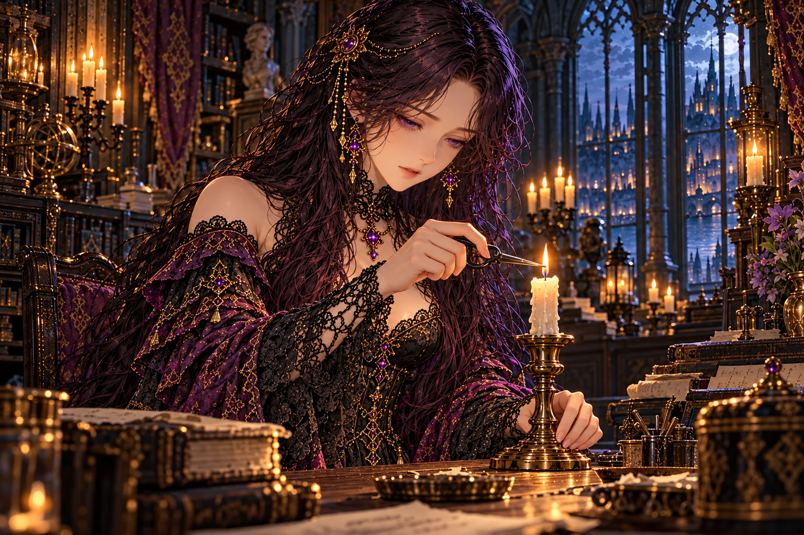
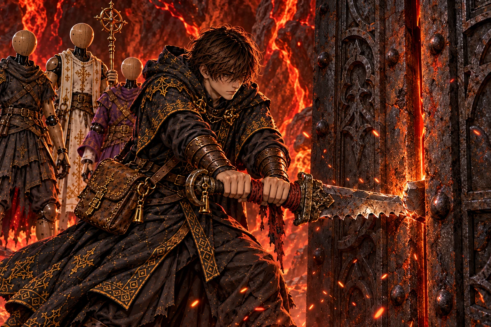
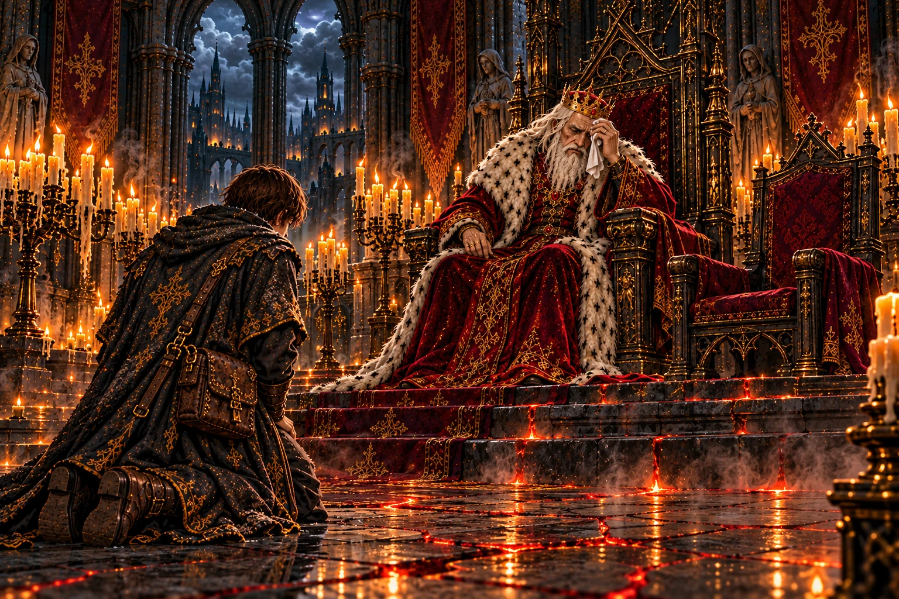
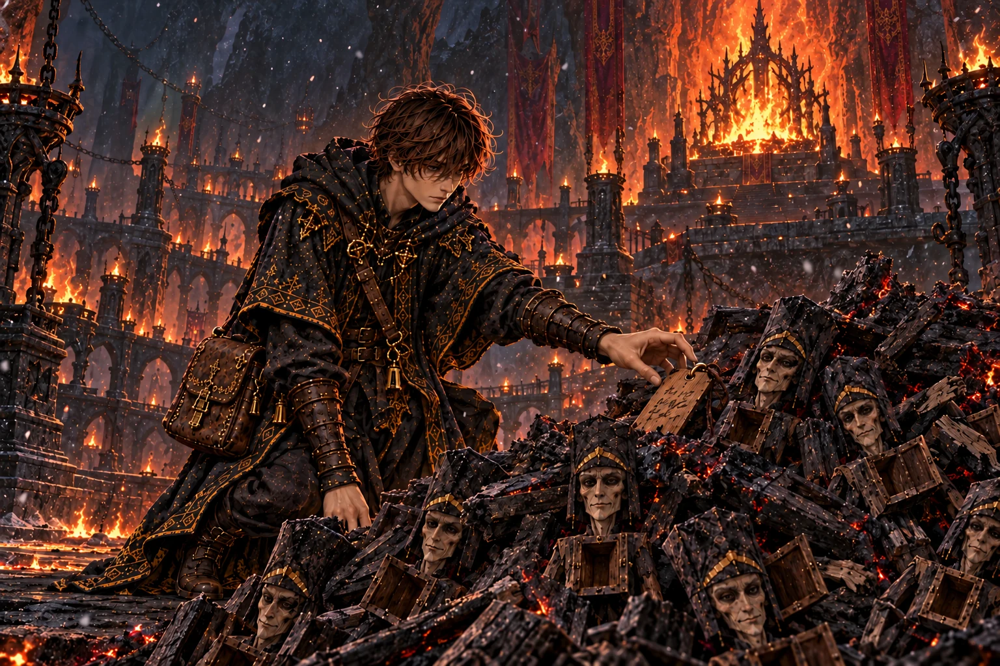
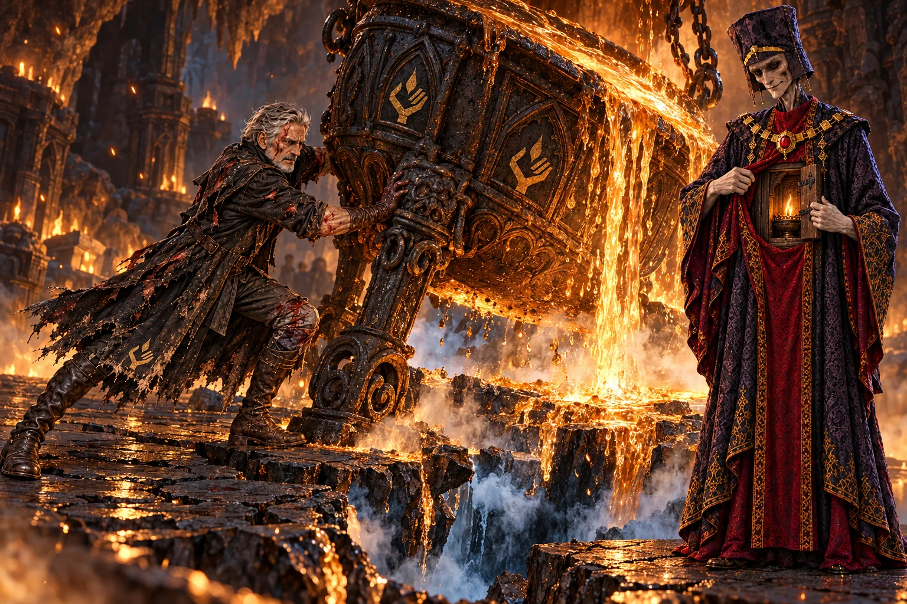
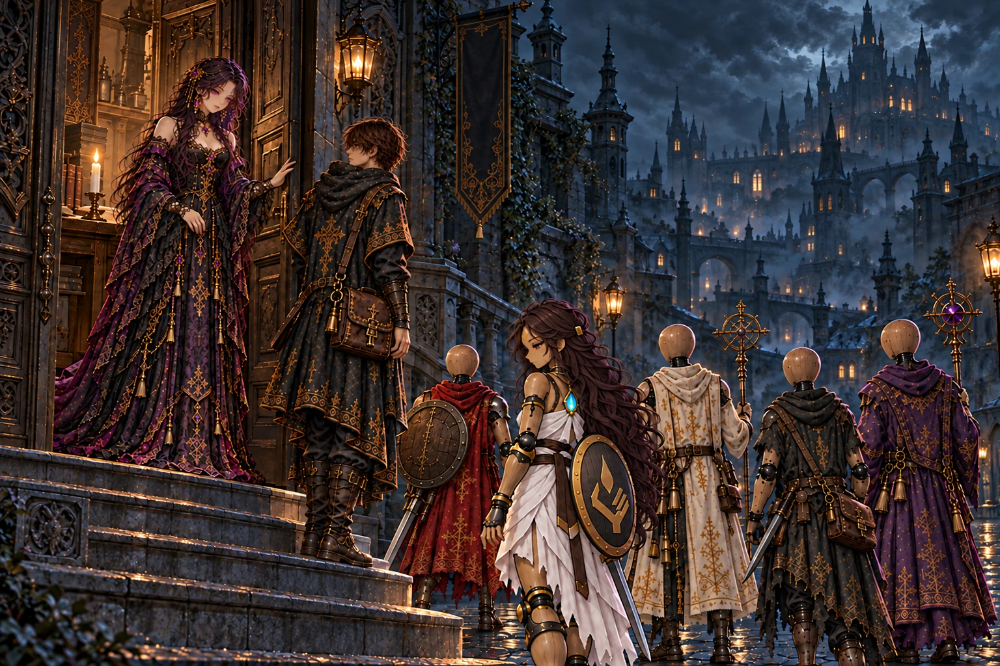

# 第5章「灼熱の洞」 の絵

書き出し: `node tools/storyart/review.mjs` (手で直さない)。絵は出荷する WebP、まだ無ければ原画。
ゲームで小さく出た時の見え方 (384×256): [chapter5-small.jpg](chapter5-small.jpg)

## irene_furnace「火の洞へ」 ── 出荷済み

**ストーリー一覧の本文**

> 火の洞へ進むと聞いて、イレーヌは燭台の芯を短く整えた。人業の器は木でできている。火の危うさは、旅に出る隊にも、館で待つ彼女にも同じだった。
>
> 器は直せても、魂まで焼ければ戻らない。穏やかな声で無理をしないよう頼む彼女の手元で、炎が小さく落ち着いた。
>
> 師は昔から火の扱いだけは下手だった、と彼女は付け加えた。その言い方には、遠い迷宮の奥へ向けた心配と、帰りを待つ人の親しさがあった。

**ゲーム内 (館の語り IRENE_BEATS.irene_furnace)**

> イレーヌ「火の洞……ですか。」
>
> 館の主は、燭台の芯を短く整えた。
>
> イレーヌ「人業は木です。火には弱いのです。……わたしも、セラも、あなたの人業たちも。」
>
> イレーヌ「だから、あまり無理をしないでください。器は直せます。でも、魂が焼けてしまったら、もう戻りません。」
>
> イレーヌ「……オルド様は、昔から火の扱いだけは下手でした。」

**指示書 (4章)**

- 要点: 第五章の入口。イレーヌが小さな芯切りばさみで白い蝋燭の芯を短く整える。館の中の静かな警告で、炎の洞窟や燃える人業は描かない。
- 描かないもの: 読める文字・後の章の秘密・本文にない幻影。

## w18_blade「手放された刃」 ── 出荷済み

**ストーリー一覧の本文**

> 赤く脈打つ岩の奥で、鉄の扉の隙間に一本の刃が突き立っていた。大樹の根を断った、師の刃だった。
>
> 刃は根元から折れていた。それでも柄に巻かれた布には、追ってくる弟子へ刃を譲るという言葉が残されていた。
>
> 弟子は折れた刃をてこにして扉を開けた。師が道具を手放したのは、ここから先で必要なのが刃ではないと知ったからかもしれない。

**ゲーム内 (師の手がかり STORY_CELLS.w18_blade)**

> 赤く脈打つ岩の奥に、鉄の扉があった。
>
> 扉の隙間に、のこぎりのように研いだ刃が突き立っていた。根元から折れている。
>
> 大樹の根を断った、師の刃だ。
>
> 柄に、焼け焦げた布が巻きつけてある。布には、すすで書いた字。
>
> ──『扉はこじ開けた。この先は、火を拝む者たちの祭場だ。{弟子名:師}よ、ここまで来たのなら、刃はくれてやる』
>
> 折れた刃をてこにすると、扉は重い音を立てて開いた。
>
> ── 新たな迷宮「灰の降る祭場」が地図に記された。

**指示書 (4章)**

- 本文の要点: 赤く脈打つ岩の奥の鉄の扉。のこぎりのように研いだ刃は根元で折れ、柄と分離している。柄に焼け焦げた布、布に煤の字。弟子は柄を脇に置き、残った長い刃を布越しに握って扉をこじる。手で握る位置から扉の支点までは一本につながった金属で、力が伝わるように描く。
- 描くもの: 根元で折れた長い刃 (手から鉄扉までつながっている) / 脇に置いた柄と焦げた布 / 鉄の扉 / 刃を布越しに握って扉をこじる弟子。描かないもの: 折れた柄を握って分離した刃を動かす構図、師本人、扉の向こうの祭場の詳しい様子。

## report_w18「床の下の熱」 ── 出荷済み

**ストーリー一覧の本文**

> 火の洞の話を聞く間、王は何度も額をぬぐった。近ごろ離宮の玉座の間までが、やけに暑い。地の底の道は王都の下からこの辺境まで続いていて、床石の奥から、何かが煮え立つ気配が伝わってくるのだという。
>
> 地割れの奥の鉄の扉のことを伝えると、王はその先に何があるのかを、しばらく考えていた。
>
> 民の魂を煮る釜を、一つ残らず見てきてほしい。釜場の話をそう結んだ王の声は、もう命じるだけの声ではなかった。

**ゲーム内 (王への報告 REPORTS.w18)**

> 「火の洞の入口を抜けたか。……その顔、すすだらけだな。」
>
> 「オルドの刃が、扉に突き立っておったか。あの男が刃を手放すとは。……よほどの先を見たのだ。」
>
> 「この頃、この離宮の玉座の間までひどく暑い。床の下で、何かが煮えている音がする。……地の底の道は、王都からここまで続いておるのだな。」
>
> 「釜場へ続く道も見つけたか。……そこで何が行われておるのか、余も知らねばならぬ。戻ったら、聞かせてくれ。」

**指示書 (4章)**

- 要点: 玉座の間がひどく暑く、王が何度も額をぬぐう。床の下で何かが煮えている音。弟子は煤だらけ。
- 描くもの: 額を布でぬぐう王 / 通常の石床と階段 (赤い亀裂・発光・蒸気なし) / 空いた宰相の席 / 煤だらけの弟子。

## w19_husks「同じ顔の器」 ── 出荷済み

**ストーリー一覧の本文**

> 灰の降る祭場の隅に、焼けた人業の殻が積み上がっていた。どの殻も、宰相によく似た顔を持っていた。
>
> 胸の扉はみな空だった。魂を宿す前に壊れ、釜へくべられた器の山。宰相は自分に似せた体を、何度も作り直していた。
>
> 山の上の札には、師の字でセラの継ぎ目の締め方が書かれていた。一度で仕上げた器を、壊さず守るための手順だった。

**ゲーム内 (師の手がかり STORY_CELLS.w19_husks)**

> 灰の降る祭場の隅に、焼け焦げた人業の殻が山と積まれていた。
>
> どれも同じ顔。痩せた長身に、白い顔。……宰相モルデンを小さくしたような顔だった。
>
> 胸の扉はどれも空で、魂の灯は一つも残っていない。
>
> 山の上に、師の字の札が一枚。
>
> ──『モルデンは、自分に似せた器を作っては、釜にくべている。替えの体を探しているのか』
>
> ──『セラの器は、私が一度で仕上げた。いつか組み直す者は、継ぎ目をこう締めること』
>
> 札の裏には、器の継ぎ目の締め方が、細かく書き込まれていた。

**指示書 (4章)**

- 要点: 灰の降る祭場の隅に、焼け焦げた人業の殻の山。どれも同じ顔 (宰相モルデンを小さくしたような、痩せて白い顔)。胸の扉はみな空。山の上に師の字の札 (裏に継ぎ目の締め方)。
- 描くもの: 同じ顔の焼けた殻の山 / 開いて空の胸の扉 / 山の上の札 / 降る灰。描かないもの: モルデン本人。

## irene_husks「締め直された継ぎ目」 ── 出荷済み

**ストーリー一覧の本文**

> 札を受け取ったイレーヌは、書かれた手順を指でたどった。自分にも教えられなかった、セラの器の締め方だった。
>
> 宰相の器が壊れ続けたのは、魂を入れる前に形を急いだからだ。師はその逆を選び、一度で仕上げた。
>
> その夜、イレーヌはセラの継ぎ目を一つずつ締め直した。翌朝、セラの足取りは昨日より少しだけ軽かった。

**ゲーム内 (館の語り IRENE_BEATS.irene_husks)**

> イレーヌ「この札……オルド様の字です。」
>
> 館の主は札の裏の書き込みを、指でゆっくりなぞった。
>
> イレーヌ「セラの器の、継ぎ目の締め方です。わたしにも教えてくれなかったのに。」
>
> イレーヌ「モルデンは自分に似せた器を作っては、釜にくべていたのですね。……どれも、魂を入れる前に壊れてしまうから。」
>
> イレーヌ「オルド様は、一度で仕上げたのです。セラも、わたしも。」
>
> その夜、館の主はセラの継ぎ目を締め直した。
>
> セラ「……体が、軽いです。オルド様に仕上げてもらった日みたいに。」
>
> ── セラの魂のランクが上がった (灯守)。

**指示書 (4章)**

- 要点: イレーヌが札の手順を指でたどり、その夜セラの継ぎ目を一つずつ締め直す。セラ「体が、軽いです」。
- 描くもの: 小さな工具でセラの肘の継ぎ目を締めるイレーヌ / 片手の札 / 目覚めたセラ (正典、作業台に腰掛け、白い衣、胸の灯) / 燭台の蝋燭。

## report_w19「燃やされる器」 ── 出荷済み

**ストーリー一覧の本文**

> 祭場の話を聞くと、王は火を拝む者たちが、何を燃やしてきたのかを問うた。
>
> 人業は道具ではなく、死者がもう一度生きるための器だ。初めて謁見した日、王は弟子にそう説いた。その器を火にくべる者がいることを、王は自分の言葉で責めた。
>
> 大釜への道は、祭場と釜場の両方を見た者に開かれる。玉座の間の熱は、日ごとに強くなっていた。

**ゲーム内 (王への報告 REPORTS.w19)**

> 「灰の祭場を抜けたか。火を拝む者どもが、まだおったか。」
>
> 「モルデンに似た器の山、か。……あの男は、替えの体を作っておるのか。」
>
> 「人業は死者に与えられた二度目の生だと、余はそなたに言うた。……それを、釜にくべる者がおる。」
>
> 祭場と釜場の探索の記録を地図に重ねると、大釜へ続く道筋が見えてきた。

**指示書 (4章)**

- 要点: 王は、人業は死者に与えられた二度目の生だと言ったのに、それを釜にくべる者がいることを責める。玉座の間の熱は日ごとに強い。
- 描くもの: 怒りに肘掛けを握る王 / 弟子が差し出す、焼けた殻から外した小さな顔の木片 (モルデンに似た顔) / 空いた宰相の席 / 熱気。

## w20_cup「三百年分の一行」 ── 出荷済み

**ストーリー一覧の本文**

> いちばん大きな釜の脇に、金の杯と分厚い帳面が置かれていた。帳面には、王の杯へ送る量だけが同じ文で書き連ねられていた。
>
> その文が何百頁も続いていた。一行ごとに、どこかの迷宮で呑まれた魂が数えられている。
>
> 最後の頁に、師は魂を使わない霊薬の作り方を書き足していた。誰も釜に入れなくてよい方法を、師はここで探し当てていた。

**ゲーム内 (師の手がかり STORY_CELLS.w20_cup)**

> いちばん大きな釜の脇に、作業台があった。
>
> 金の杯がひとつ。そして、開いたままの分厚い帳面。
>
> ──『陛下の杯へ。本日分、魂三百』
>
> 同じ一行が、どのページにも、三百年分並んでいた。
>
> 最後のページに、師の字で調合の書きつけが足されていた。
>
> ──『魂を使わずに作る霊薬の作り方だ。王都の薬屋に渡してくれ。もう、誰も釜に入れなくてよい』

**指示書 (4章)**

- 要点: いちばん大きな釜の脇の作業台に、金の杯と、開いたままの分厚い帳面。同じ一行が頁という頁に三百年分。最後の頁に師の字の調合の書きつけ。
- 描くもの: 並ぶ大釜と湯気 / 作業台の金の杯 / 開いた分厚い帳面 (同じ行がびっしり、最後の頁だけ別の筆跡) / 読む弟子。

## report_w20「床に置かれた杯」 ── 出荷済み

**ストーリー一覧の本文**

> 釜場の話を聞いた王は、手の中の金の杯を長く見つめていた。
>
> 魂を煮て作る薬が、王の命を百年支えてきた。王はその重さを、初めて自分の手で量っているようだった。
>
> 王の手は少し震えていた。それが熱のせいか、杯の重さのせいか、弟子には分からなかった。

**ゲーム内 (王への報告 REPORTS.w20)**

> 「釜場を見たか。……魂を、煮ておったか。」
>
> 「帳面に、『陛下の杯へ』が三百年分……。余の杯も、その中にあるのだな。オルドは、魂を使わぬ霊薬の作り方を残していったか。」
>
> 王は金の杯を、玉座の脇の床に置いた。「今朝から、飲んでおらぬ。」
>
> 祭場と釜場の探索の記録を地図に重ねると、大釜へ続く道筋が見えてきた。

**指示書 (4章)**

- 要点: 王は手の中の金の杯を長く見つめ、玉座の脇の床に置く (ゲーム内「今朝から、飲んでおらぬ」)。手が少し震えている。
- 描くもの: 金の杯を床へ置こうとする王の震える手 / 空いた宰相の席 / 帳面を抱えた弟子。

## mem_w21「大釜の前の二人」 ── 出荷済み

**ストーリー一覧の本文**

> 業火の主の魂がほどけると、弟子は一年前の大釜の前を見た。そこに立っていたのは、傷だらけの師と、背の高い痩せた宰相だった。
>
> 宰相は自分の胸の扉を開き、そこに揺れる古い灯を見せた。自分は、三百年よりさらに昔に生まれた最初の人業であり、主に命じられたのは魂を集めることだと、宰相は静かに語った。
>
> 師は答えず、釜に組みついた。傾いた釜からあふれた樹液の下で床が抜け、師は底の見えない穴へ落ちていった。

**ゲーム内 (主の記憶 BOSS_MEMORIES.w21)**

> 業火の主が崩れると、釜の火に焼かれた無数の魂が、火の粉となって舞い上がった──
>
> ……一年前。大釜の前で、傷だらけの男と、痩せた長身の男が向かい合っていた。
>
> ──『ここまで来ましたか、オルド殿』
>
> 宰相モルデンは微笑み、自分の胸の扉を開いてみせた。中で、古い魂の灯が揺れていた。
>
> ──『わたしは三百年よりも昔、ある操霊師に作られた、最初の人業です。主の命は一つ。「魂を集めよ」』
>
> ──『あなたのイレーヌと同じですよ。主の言いつけを守るために、ここにいる』
>
> 男は答えず、釜の脚に組みついた。釜が傾き、煮えた樹液があふれた。
>
> 足元の床が抜けた。大釜の底には、底の見えない穴が口を開けていた。
>
> ──『イレーヌ……！』
>
> 男は闇の中へ落ちていった。底から、凍えるような風が吹き上げていた……

**指示書 (4章)**

- 要点: 一年前。大釜の前で、傷だらけの男 (オルド) と痩せた長身の男 (モルデン) が向かい合う。モルデンは微笑み、自分の胸の扉を開いて古い魂の灯を見せる。オルドは答えず、釜の脚に組みつき、釜が傾いて樹液があふれ、床が抜けて底の見えない穴へ落ちる。
- 描くもの: 胸の小さな扉を開けて古い灯を見せるモルデン (正典の顔・衣装) / 傷だらけで煤けたオルド (刃は無い) が釜の脚に組みつく瞬間 / 傾き始めた巨大な釜 / 床のひび割れと、下から吹き上げる冷たい風。記憶らしく、縁をにじませた温かい色の霞。
- 描かないもの: 弟子、隊。

## report_w21「冷えていく指先」 ── 出荷済み

**ストーリー一覧の本文**

> 釜の火が消えた朝から、王の指先は冷たくなった。百年続いた命を支えていたものが、止まったのだ。
>
> 宰相が人業だったと知り、王は長く黙っていた。仕えられてきた年月が、別の主の命令の上にあったことを、王は受け止めようとしていた。
>
> 大釜の底の穴は、奈落と呼ばれていた。師の灯が燃えている限り、師はその中にいる。王はその先を知らず、追うなら必ず戻ってこいと弟子に言った。

**ゲーム内 (王への報告 REPORTS.w21)**

> 「業火の主を討ったか。……釜の火が消えたのだな。今朝から、指先が冷たい。」
>
> 業火の主の記憶を、はじめから話した。モルデンが胸の扉を開いてみせたところで、王の肩がわずかに震えた。
>
> 師が大釜の底の穴へ落ちたところまで、王はひとことも口をはさまなかった。
>
> 「モルデンは、人業であったか。……余は百年、くぐつの差し出す杯で生きてきたのか。」
>
> 「大釜の底の穴を、火の洞の者どもは『奈落』と呼んだという。魂が流れ落ちる、底なしの穴だ。」
>
> 「オルドの灯は、まだ燃えておるのだろう。ならば、あの男は奈落のどこかにおる。」
>
> 「奈落の先は、余にも分からぬ。師を追うなら、人業の備えを確かめよ。……必ず戻ってこい。」

**指示書 (4章)**

- 要点: 釜の火が消えた朝から、王の指先が冷たい。モルデンが人業だったと知り、王は長く黙る。大釜の底の穴「奈落」。王は奈落へ降りる許しを出す。
- 描くもの: 冷えた指先を見つめ、両手をこすり合わせる王 (やつれ) / 熱の消えた玉座の間 (冷えた燭台・灰) / 空いた宰相の席 / 弟子。

## irene_abyss「落ち続ける灯」 ── 出荷済み

**ストーリー一覧の本文**

> 師が奈落へ落ちたと聞いたあとも、館の灯は消えなかった。イレーヌは燭台の前で両手を固く組み、その小さな火を見つめていた。
>
> 底がなければ、今も落ち続けているのかもしれない。確かめようのない考えを口にして、彼女は長く黙った。炎だけが、待つことをやめないように揺れていた。
>
> モルデンにも灯を守る主がいるのだろう、と彼女は言った。誰なのかはまだ語らず、帰り道を忘れないようにと弟子を送り出した。

**ゲーム内 (館の語り IRENE_BEATS.irene_abyss)**

> イレーヌ「……灯は、消えていません。」
>
> 館の主は燭台の前で、両手を固く組んでいた。
>
> イレーヌ「奈落に落ちたのなら、あの方はまだ落ちている途中なのかもしれません。底が無いのなら、いつまでも。」
>
> イレーヌ「モルデンが人業だったのなら……あの人にも、灯を守る主がいるのですね。」
>
> イレーヌ「その主が誰なのか、わたしには少しだけ、わかる気がします。……まだ、言えませんけれど。」
>
> イレーヌ「どうか、気をつけて。奈落は、帰り道を忘れさせる場所だと聞きます。」
>
> セラが、胸の扉にそっと手を当てた。灯が、ひときわ強く燃えた。
>
> セラ「オルド様が落ちたのなら、わたしが灯になります。どこまでも、照らします。」
>
> ── セラの魂のランクが上がった (灯守)。

**指示書 (4章)**

- 要点: 第五章終了前後。燭台の前で両手を固く組むイレーヌ。セラの覚醒前後どちらの分岐にも使えるよう、セラと部品は画面に入れない。
- 描かないもの: 読める文字・後の章の秘密・本文にない幻影。

## ch5_end「底のない穴の上で」 ── 出荷済み

**ストーリー一覧の本文**

> 釜の火は消え、王都の床下の熱は少しずつ引いていった。それでも館の燭台は、変わらずに燃えていた。
>
> 宰相を作った最初の操霊師が誰なのか、まだ誰も知らない。師は奈落の中で、その答えに近づいているのかもしれない。
>
> 弟子は人業たちの支度を整えた。底のない穴へ降りるのは、帰ってくるためだ。館の扉の前で、イレーヌが見送っていた。

**ゲーム内 (章の結び CHAPTER_END[5])**

> 釜の火は消えた。王の指先は冷え、杯はもう満たされない。
>
> 宰相モルデンは、人ではなかった。三百年よりも昔、ある操霊師に作られた最初の人業だった。その主の名は、まだ誰も知らない。
>
> 師は大釜の底の奈落へ落ちた。それでも館の燭台の灯は、落ちていく者を待つように、細く長く燃えている。
>
> ── 物語は第六章「氷結回廊」へ続く。

**指示書 (4章)**

- 要点: 釜の火は消え、床下の熱は引いていく。館の燭台は変わらず燃えている。弟子は人業たちの支度を整え、館の扉の前でイレーヌが見送る。
- 描くもの: 夜の館の戸口で見送るイレーヌ / 室内に見える燭台の一本の蝋燭 / 支度を整えて出立する弟子と人業 (セラを含めてよい)。

