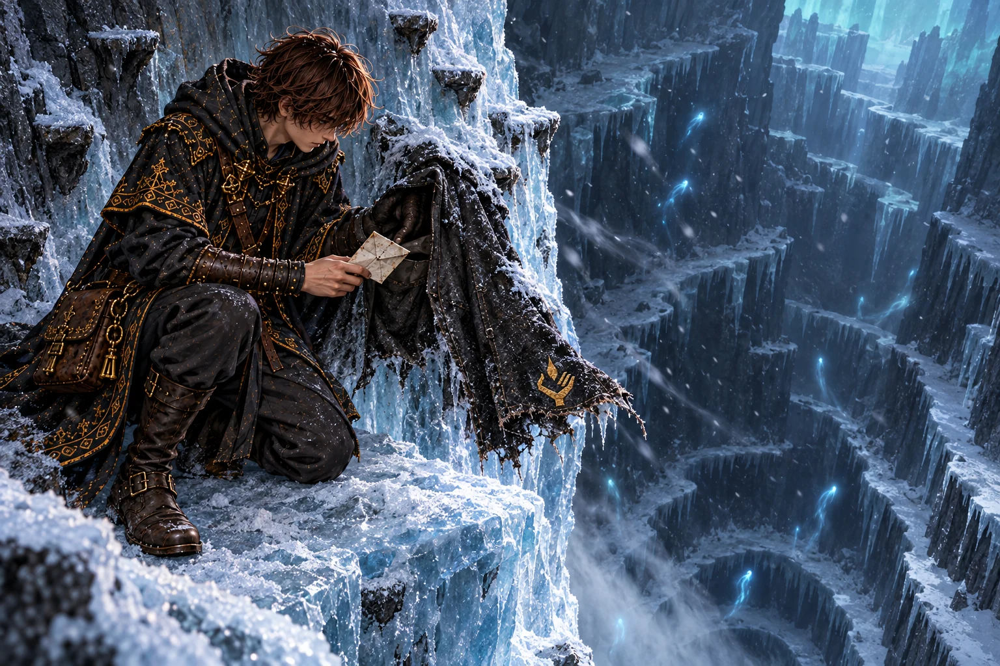
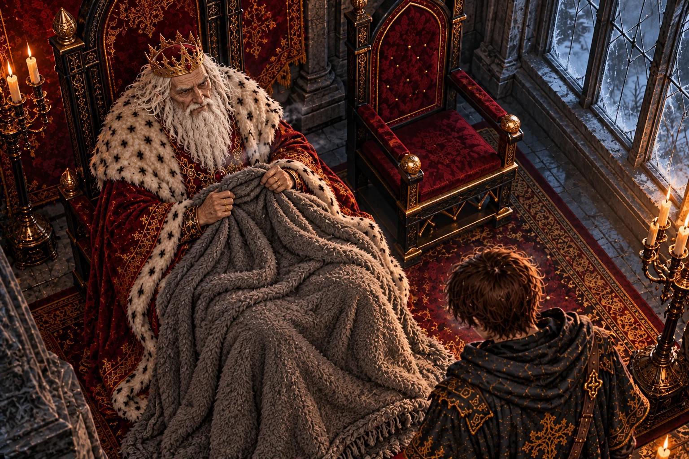
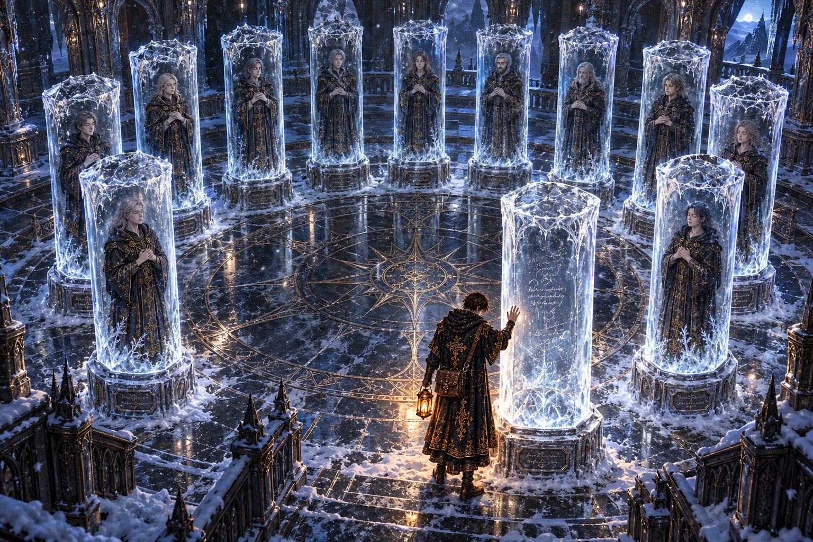
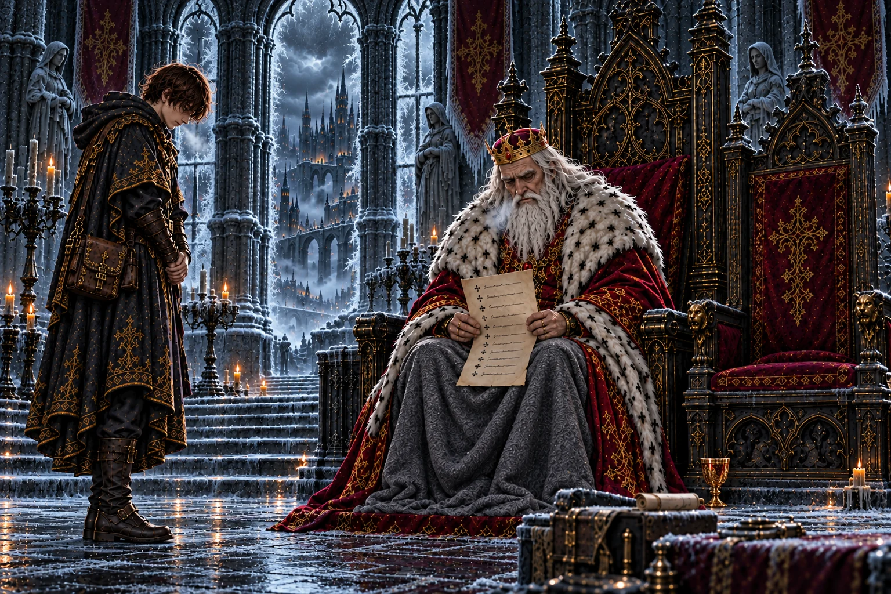
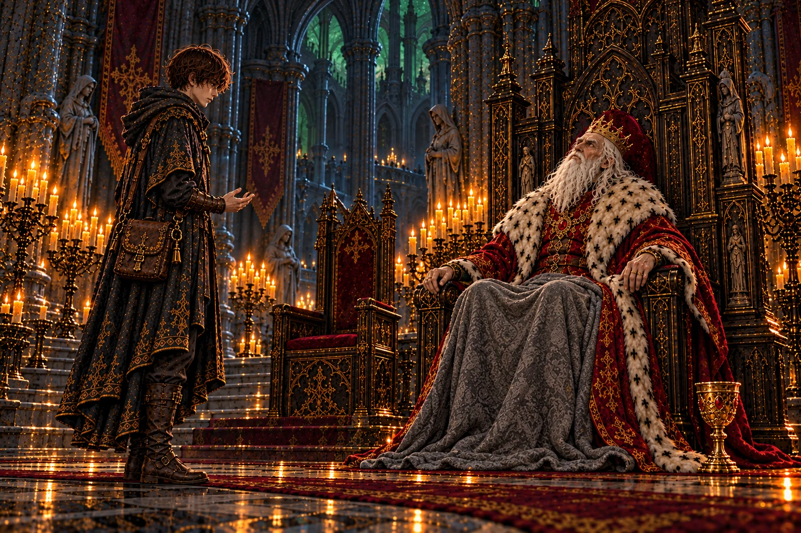
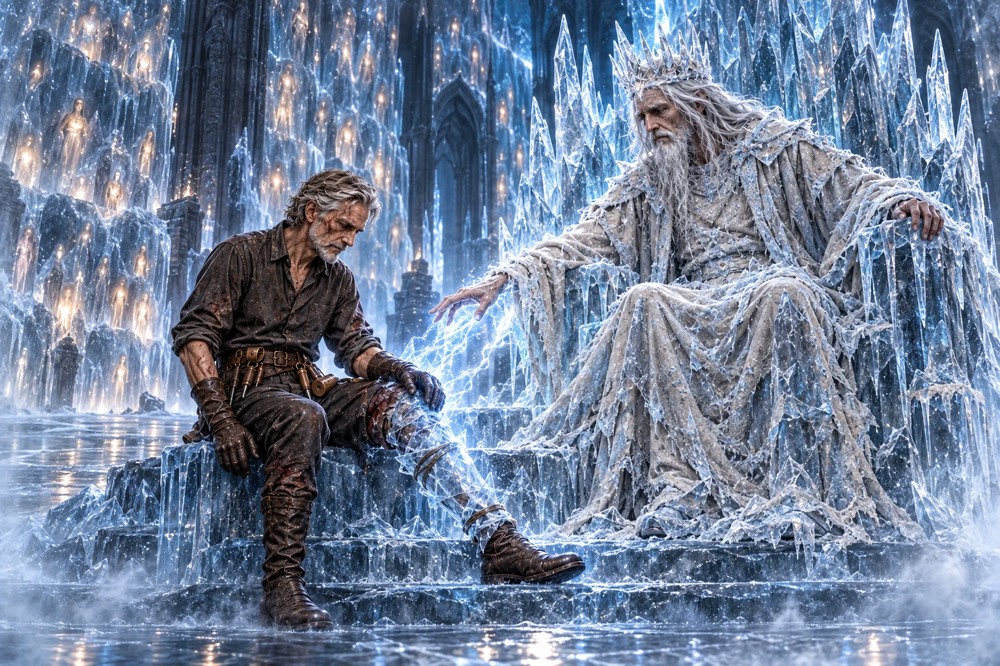
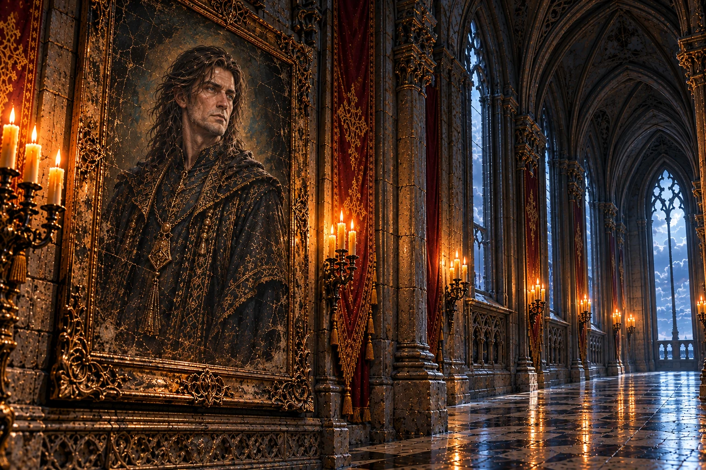
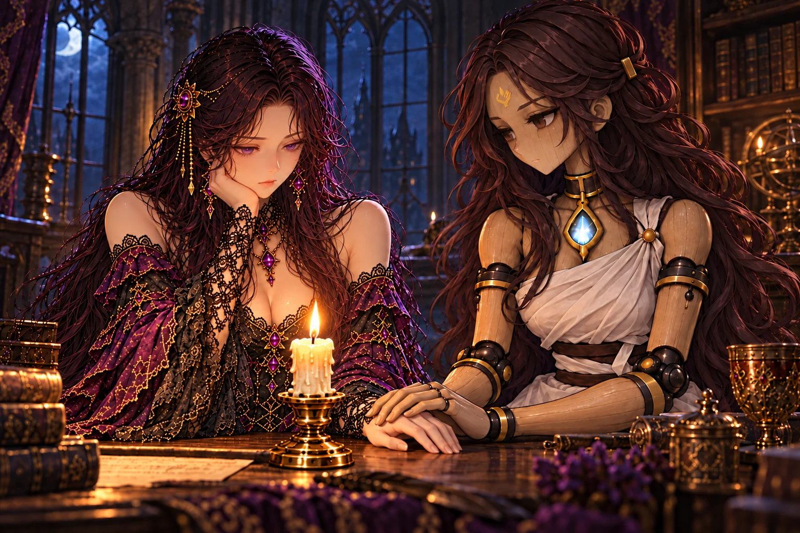
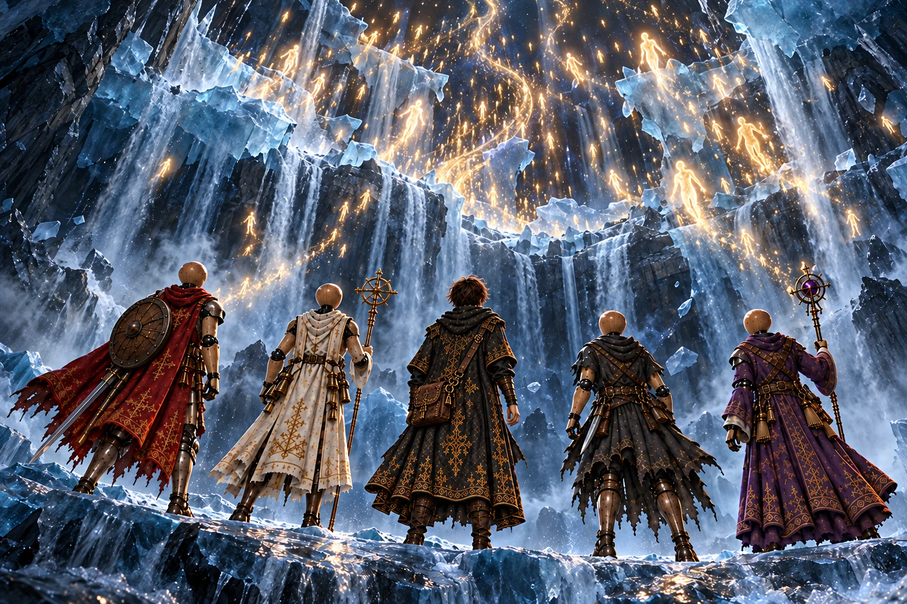

# 第6章「氷結回廊」 の絵

書き出し: `node tools/storyart/review.mjs` (手で直さない)。絵は出荷する WebP、まだ無ければ原画。
ゲームで小さく出た時の見え方 (384×256): [chapter6-small.jpg](chapter6-small.jpg)

## w22_coat「風が受け止めたもの」 ── 出荷済み

**ストーリー一覧の本文**

> 大釜の底の穴を、弟子は綱と氷の棚を頼りに降りた。下から吹き上げる風が、何度も外套の裾を頭の上までめくり上げた。
>
> 張り出した氷の棚に、黒い外套が半ば呑まれて凍りついていた。裂けた裾だけが風にはためき、そこに縫い取られた灯を掌に載せた手の印が、弟子の目の高さで揺れていた。
>
> 内ポケットの紙は、指で温めてようやく開いた。落ちる途中で風に受け止められたこと。脚を折ったこと。袖から腕を抜いて、外套をここに置いていくこと。短い文の最後に、氷の下に人がいる、とだけあった。
>
> 外套のあった壁から、石で削った足がかりが奥へ続いていた。どれも浅く、間隔がそろっていない。片脚で体を支えながら削ったのだと、弟子には分かった。

**ゲーム内 (師の手がかり STORY_CELLS.w22_coat)**

> 風の吹き上げる氷の棚に、黒い布が凍りついていた。
>
> 旅の外套だ。裾に、灯を掌に載せた手の刺しゅう。
>
> 外套は氷に半ばのまれ、裂けた裾だけが、下からの風にはためいている。袖は、腕を抜いた形のまま凍りついていた。
>
> 内ポケットに、凍った書きつけが一枚。
>
> ──『落ちる途中で、風に受け止められた。脚を折った。気を失っているうちに、外套が氷に縫いつけられた。この脚では、はがせない。外套は、氷に預けていく』
>
> ──『あとから来る者へ。裾の印を目じるしに残していく。風の当たらない奥へ行く。氷の下に、人がいる。それも、ひとりではない』
>
> 外套のあった氷の壁から、石で削った足がかりが、奥へと続いていた。
>
> ── 新たな迷宮「凍れる操霊師の間」が地図に記された。

**指示書 (4章)**

- 要点: 奈落の壁から張り出す氷の棚。下から風が吹き上げる。黒い旅の外套が氷に半ば呑まれて凍りつき、裂けた裾 (灯を掌に載せた手の刺しゅう) だけが下からの風にはためく。内ポケットに凍った書きつけ。外套のあった壁から、石で削った足がかりが奥へ続く。

## report_w22「寒い玉座の間」 ── 出荷済み

**ストーリー一覧の本文**

> 離宮の玉座の間は、火の気が失せたように冷えていた。王は膝掛けを胸もとまで引き寄せ、氷棚の話に耳を傾けた。
>
> 脚を折ってなお、石で足場を削って奥へ進んだ。そのくだりで、王の口もとがわずかにゆるんだ。昔から、そういう男だったのだろう。
>
> 氷棚の奥には、まだ洞窟が続いている。王は止めなかった。寒さにこわばった指で、続きを見てくるよう弟子を促しただけだった。

**ゲーム内 (王への報告 REPORTS.w22)**

> 「奈落の壁に、氷の棚が……。底なしの穴にも、足場があったか。」
>
> 「オルドの外套が凍りついておった、と。……脚を折って、それでも先へ進んだか。」
>
> 王は膝掛けを引き寄せた。釜の火が消えてから、玉座の間がひどく冷えるという。
>
> 「氷棚の奥の洞窟への道を開かせよう。底の冷たさを、余の代わりに見てこい。」

**指示書 (4章)**

- 要点: 釜の火が消えてから玉座の間がひどく寒い。王は膝掛けを引き寄せながら聞く。師が脚を折っても先へ進んだと聞いて、かすかに笑う。

## w23_names「空けてあった柱」 ── 出荷済み

**ストーリー一覧の本文**

> 広間の奥で、隊の灯が氷の柱に映りこんだ。数えると十二本。輪になって立つ柱のうち十一本に、人が閉じこめられていた。
>
> 目を閉じ、胸の前で手を組んだ顔は、眠っているようにしか見えない。弟子は柱の根元の名を一つずつ読み、捨て砦の牢壁で同じ名をなぞった指の冷たさを思い出した。
>
> 十二本めだけが空だった。根元にはヴェルナーの名。内側の氷には、師の字が細く残っていた。牢を抜けた人の場所を、誰かが空けたまま待っていたのだ。

**ゲーム内 (師の手がかり STORY_CELLS.w23_names)**

> 広間の奥に、太い氷の柱が十二本、輪になって立っていた。
>
> 十一本の柱の中に、人がいる。目を閉じ、手を胸の前で組んだまま、凍っている。
>
> 柱の根元に、名が刻まれていた。……捨て砦の地下牢の壁に、爪で刻まれていたのと同じ名だ。
>
> 王がこの百年のあいだに牢へ入れた、十二人の操霊師だ。
>
> 十二本めの柱だけが空だった。刻まれた名は、ヴェルナー。牢を抜け、底の森の小屋で死んだ、師の師。
>
> 空の柱の内側に、師の字があった。
>
> ──『先生の場所が、空けてあった。……誰かが、落ちてくる者を受け止めている』

**指示書 (4章)**

- 要点: 広間の奥に太い氷の柱が**十二本、輪になって**立つ。十一本の中に人 (王家の操霊師たち、男女) が、目を閉じ手を胸の前で組んだまま凍っている。根元に名が刻まれる。**十二本めだけが空**で、ヴェルナーの名と、内側に師の字。
- 描くもの: 輪になった十二本 (数えられること) / 十一人の凍った操霊師 / 一本だけ空の柱の前に立つ弟子。

## report_w23「済まされていなかった処刑」 ── 出荷済み

**ストーリー一覧の本文**

> 柱の中の十一人の話をしても、王はすぐには口を開かなかった。膝掛けの上で組んだ指に、少しずつ力がこもっていった。
>
> 牢へ送ったのは自分だ、と王は言った。済んだと告げられた処刑を、王は一度も確かめなかった。十一人は刑場ではなく、奈落の闇へ投げこまれていたのだ。
>
> それでも、誰ひとり底までは落ちなかった。落ちてくる者を受け止めた手がある。その手の持ち主の名を、王はまだ知らなかった。

**ゲーム内 (王への報告 REPORTS.w23)**

> 「凍れる操霊師の間を抜けたか。」
>
> 「十一人……。余が牢に入れた、十二人のうちの十一人か。」
>
> 王は肘掛けを握りしめた。「モルデンは『処刑は済ませました』と申した。……奈落へ投げ込んだのだな。」
>
> 「広間も氷窟も見たそなたになら、大回廊への道を開かせよう。」

**指示書 (4章)**

- 要点: 王は長く黙る。十二人を牢に入れたのは自分。宰相は「処刑は済ませました」と報告していた。実際は奈落へ投げこまれていた。

## w24_aurora「天井の星」 ── 出荷済み

**ストーリー一覧の本文**

> 氷窟の天井いっぱいに、極光が揺れていた。弟子が灯を下げて見上げると、光は細かな粒の集まりで、粒の一つひとつが息をするように瞬いていた。
>
> 落ちきれずに氷へ閉じこめられた魂。そう気づいた時、足元の氷が急に重く感じられた。床には石で押さえた紙があり、師の字が、この氷は誰かが張った堤なのだと告げていた。
>
> 紙を裏返すと、凍った骸から魂の残火を取り出す手順が、小さな図と一緒に描かれていた。弟子は紙を畳み、天井の光をもう一度見上げた。

**ゲーム内 (師の手がかり STORY_CELLS.w24_aurora)**

> 氷窟のいちばん奥で、天井いっぱいに極光がゆらめいていた。
>
> よく見ると、光は細かな粒でできていた。ひとつひとつが、ゆっくりと瞬いている。……魂だ。
>
> 落ちてきた魂が、底まで落ちきらずに、天井の氷に閉じこめられている。
>
> 氷の床に、石で押さえた紙が一枚。師の字だった。
>
> ──『この氷は堤だ。誰かが、魂が底へ落ちていくのを止めている。三百年も』
>
> ──『堤は、もう長くはもたない。氷の奥の玉座へ行く』
>
> 紙の裏には、凍った骸から魂の残火を掘り出すこつが、細かく書き込まれていた。

**指示書 (4章)**

- 要点: 氷窟の天井いっぱいの極光は、細かな粒 (落ちきらずに氷に閉じこめられた魂) でできていて、ひとつひとつ瞬く。氷の床に石で押さえた師の紙。

## report_w24「落ちきらなかった魂」 ── 出荷済み

**ストーリー一覧の本文**

> 地の底に星空のような光があったと聞いて、王は玉座の間の高い天井を見上げた。そこには黒ずんだ梁しかない。
>
> 王の杯へ届いた魂は、底へ落ちきる前に釜で煮られた。けれど釜を逃れて、氷に受け止められた魂もあった。
>
> 王はその話を、救いとして聞きたがっているようだった。弟子はうなずきも、首を振りもしなかった。大回廊への支度が、もう待っていた。

**ゲーム内 (王への報告 REPORTS.w24)**

> 「極光の氷窟か。……地の底に、空の光があったか。」
>
> 「光の粒が、魂だと。氷の堤が、魂が底へ落ちるのを止めておる、と。……三百年も、誰が。」
>
> 「余の命をつないだ魂は、底へ落ちる前に釜で煮られた。落ちきらずに済んだ魂も、おったのだな。」
>
> 「広間も氷窟も見たそなたになら、大回廊への道を開かせよう。」

**指示書 (4章)**

- 要点: 地の底に空の光があったと聞き、王はしばらく天井を見上げる。釜を逃れ、氷に受け止められた魂もあったことを、少し救いのように聞く。

## mem_w25「氷の玉座の前で」 ── 出荷済み

**ストーリー一覧の本文**

> 凍王が砕けると、氷の奥にしまわれていた記憶がほどけた。三百年前、王家に初めて仕えた操霊師イザークは、宰相の胸の扉の中に、古い灯を見てしまった。
>
> あれは人ではない、人業だ。その訴えは誰にも届かなかった。だからイザークは、ただひとりで奈落の闇へ下り、下からの風を自分の体ごと凍らせて、落ちていく魂をせき止める堤になった。
>
> 一年前、その玉座の段に、脚を折った師が腰を下ろしていた。凍王は折れた脚を氷で固めながら、魂を灯に変える術は一門にしか伝わらないこと、最初の操霊師はその一門の祖であることを語った。師は礼を言い、堤のさらに下の暗がりへ降りていった。

**ゲーム内 (主の記憶 BOSS_MEMORIES.w25)**

> 氷結回廊の主──凍王が砕けると、氷に閉じこめられていた無数の魂が、ひとつずつ、静かにほどけていった──
>
> ……三百年前。王家に最初に仕えた操霊師イザークは、宰相モルデンの胸の扉の中に、古い灯を見た。
>
> ──『あれは人ではない。人業だ。それも、我らの一門の作り方だ』
>
> 誰も信じなかった。イザークはひとり奈落へ降り、吹き上げる風を凍らせて、魂の落ちていく穴に氷の堤を張った。自分ごと。
>
> ……一年前。脚を折った男が、氷の玉座の前に座っていた。
>
> ──『あんたが、受け止めてくれたのか』
>
> ──『落ちてくる者は、みな受け止めた。王に捨てられた操霊師たちも。お前もだ、オルド』
>
> ──『魂を灯に変える術は、我らの一門にしか伝わらぬ。最初の操霊師は、我らの一門の祖だ。名は……とうに、氷が食った』
>
> 凍王は男の折れた脚を、氷で固めてやった。
>
> ──『世話になった。……答えは、もっと下にあるようだ』
>
> 解けた氷の水が流れ落ちる、さらに下の沼へ。男の足音が氷の下へ消えるまで、凍王は玉座から見送っていた。

**指示書 (4章)**

- 要点: 三百年前、イザークは宰相の胸の扉に古い灯を見つけ、誰にも信じられず、奈落へ降りて吹き上げる風を凍らせて堤を張った (自分ごと)。一年前、脚を折った男 (オルド) が氷の玉座の前に座り、凍王が折れた脚を氷で固めてやる。
- 描くもの: 氷の玉座に半ば埋まった凍王イザーク / 玉座の段に腰を下ろし、折れた脚を氷で固めてもらうオルド (外套なし、シャツ) / 氷の堤 (魂の光を閉じこめた氷の壁)。記憶らしい霞。
- 描かないもの: 弟子。

## report_w25「回廊の肖像」 ── 出荷済み

**ストーリー一覧の本文**

> イザークという名を聞いて、王は王都の宮の回廊に掛かる、古い肖像を思い出した。病で死んだと伝えられる、王家の最初の操霊師だった。
>
> その人は病に倒れたのではなく、氷の中で三百年、落ちてくる魂を受け止めていた。王が牢へ送った十一人も、堤が解けてようやく還っていった。
>
> 王は冷えた両手を組み、その知らせを確かめるように、何度も握り直した。解けた水は、さらに下へ落ちていく。師はその先にいる。

**ゲーム内 (王への報告 REPORTS.w25)**

> 「凍王を鎮めたか。……氷の堤が、解けたのだな。」
>
> 三百年前、宰相の正体に気づいた操霊師が、自分ごと奈落を凍らせた。凍王の記憶をそう話すと、王はしばらく目を閉じていた。
>
> 「イザーク……。この離宮の回廊に、肖像が一枚だけ掛けてある。王家に最初に仕えた操霊師だ。病で死んだと伝わっておった。」
>
> 「十一人の魂も、ほどけたか。……余が牢に入れた者たちが、ようやく還れる。」
>
> 王は膝掛けの上で、冷えた両手を組んだ。
>
> 「解けた氷の水は、さらに下へ流れ落ちると申したな。オルドは、その先におるのだろう。」

**指示書 (4章)**

- 要点: イザークの名を聞いて、王はこの離宮の回廊に一枚だけ掛かる肖像のことを話す (病で死んだと伝わる、最初の王家の操霊師)。十一人の魂も還った。王は冷えた手を組む。

## irene_lineage「同じ作り方の灯」 ── 出荷済み

**ストーリー一覧の本文**

> 最初の操霊師が師の一門の祖だと伝えると、イレーヌは燭台の前に腰を下ろし、炎から目を離さなくなった。
>
> 魂を灯にする術は、師から彼女ひとりに伝えられたものだ。館の灯も、セラの胸の灯も、宰相の胸の灯も、根をたどれば同じ一つの術に行き着く。
>
> それでも、と彼女は芯を整えながら言った。同じ流れから生まれても、どの灯を守るかは自分で決められます。セラがその手に、木の手をそっと重ねた。

**ゲーム内 (館の語り IRENE_BEATS.irene_lineage)**

> イレーヌ「最初の操霊師は、オルド様の一門の祖……。」
>
> 館の主は燭台の灯を、長いあいだ見つめていた。
>
> イレーヌ「わかる気がする、と申し上げましたね。魂を灯に変える術は、オルド様から、わたしだけが教わりました。」
>
> イレーヌ「この灯も、セラの胸の灯も、同じ作り方なのです。モルデンの胸の灯も、きっと。」
>
> イレーヌ「わたしとモルデンは、同じ一門の手から生まれたのかもしれません。」
>
> イレーヌ「それでも、わたしの主はオルド様です。この灯は、わたしが守ります。」
>
> セラが、イレーヌの手にそっと自分の手を重ねた。
>
> セラ「わたしも、守ります。同じ灯ですから。」

**指示書 (4章)**

- 要点: 最初の操霊師が師の一門の祖だと聞き、イレーヌは燭台の灯を長く見つめる。この灯もセラの胸の灯もモルデンの胸の灯も同じ作り方。それでも主は師。セラがイレーヌの手に自分の手を重ねる。

## ch6_end「解けていく堤」 ── 出荷済み

**ストーリー一覧の本文**

> 氷の堤は、音もなく崩れていった。三百年せき止められていた光の粒が群れになって昇り、奈落の闇に細い川を描いた。
>
> 解けた水は滝になって、さらに暗い底へ落ちていく。祖のこと、宰相のこと。問いの続きは、その水の行き先にあった。
>
> 館に戻ると、弟子は持ち帰った師の外套を衣掛けに掛けた。燭台の炎が、乾いていく黒い布を下から温めるように照らしていた。

**ゲーム内 (章の結び CHAPTER_END[6])**

> 氷の堤は解け、十一人の操霊師の魂は、ようやく還っていった。
>
> 最初の操霊師は、師の一門の祖だった。宰相モルデンは、その最初の人業。
>
> 師は凍王に脚を固めてもらい、解けた氷の水が流れ落ちる、さらに下の沼へ。その夜、館の燭台の灯は、氷を映したように青みを帯びて燃えた。
>
> ── 物語は第七章「毒沼」へ続く。

**指示書 (4章)**

- 要点: 氷の堤が解け、閉じこめられていた魂がようやく還っていく。解けた水はさらに下の沼へ流れ落ちる。
- 描くもの: 崩れ解けていく氷の壁 / 光の粒が群れになって上へ昇っていく / 解けた水が滝になって暗い下へ落ちる / それを見上げる弟子と隊。

