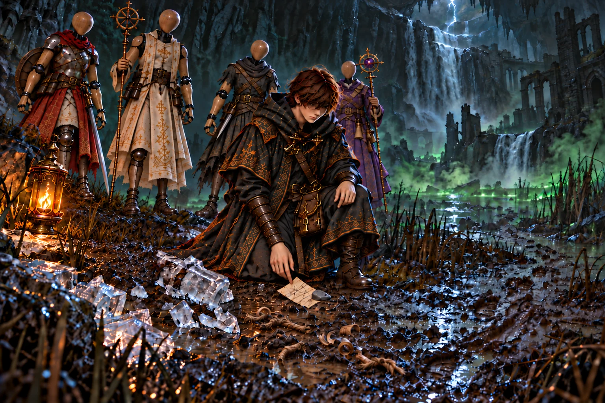
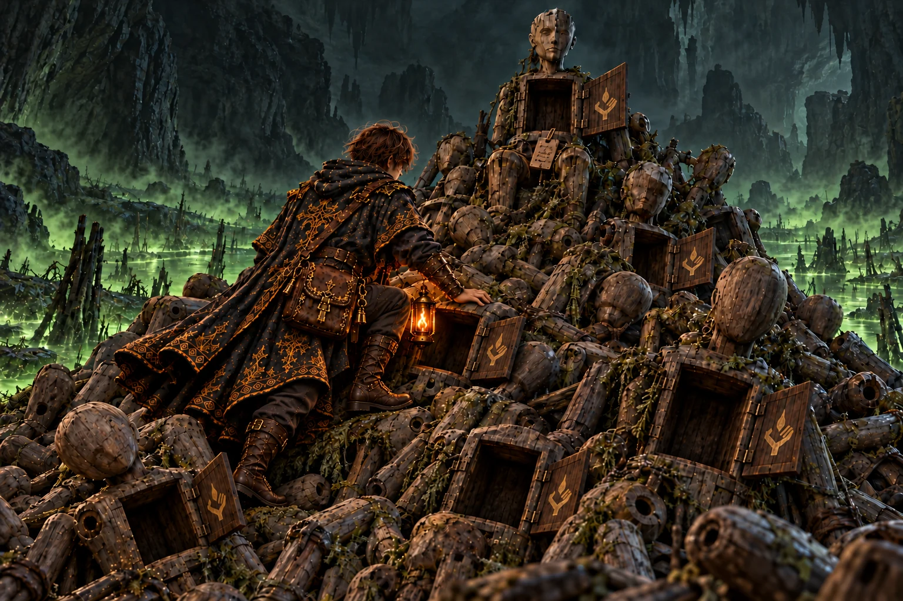
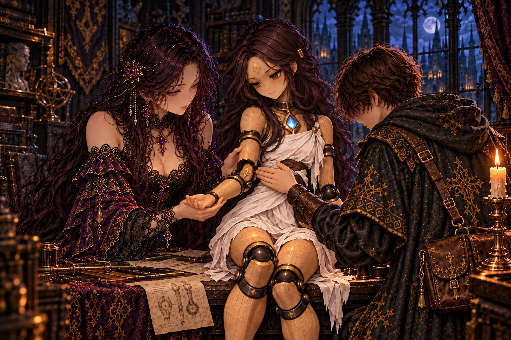
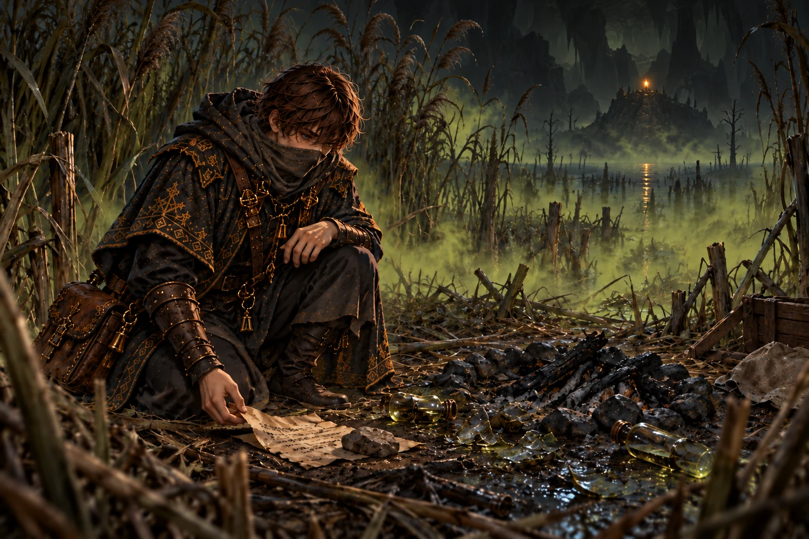
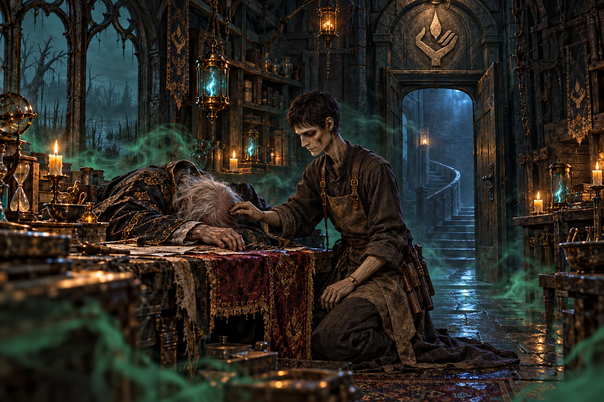
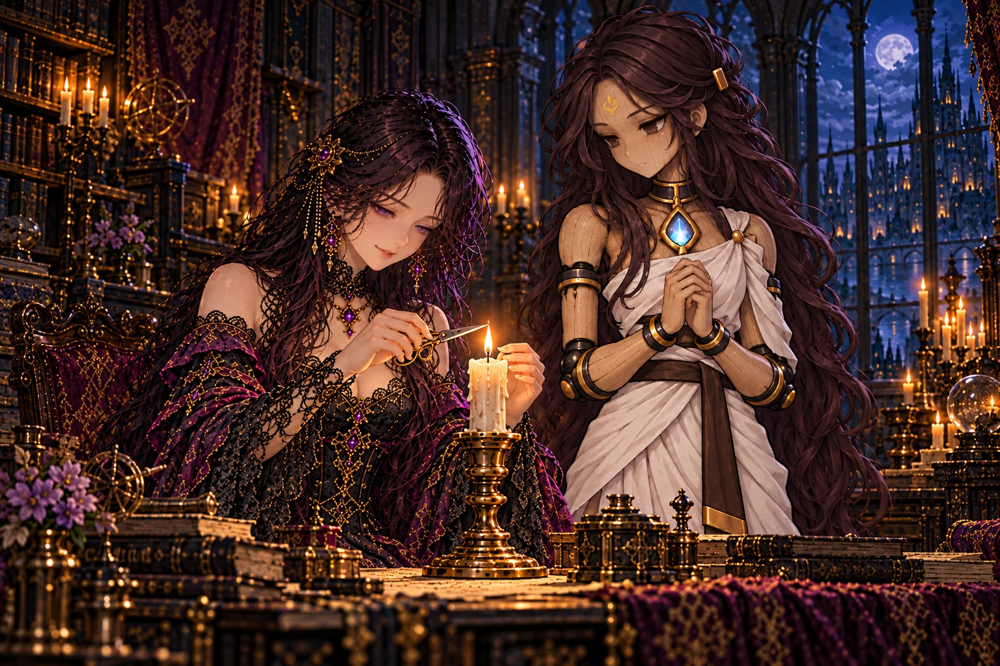
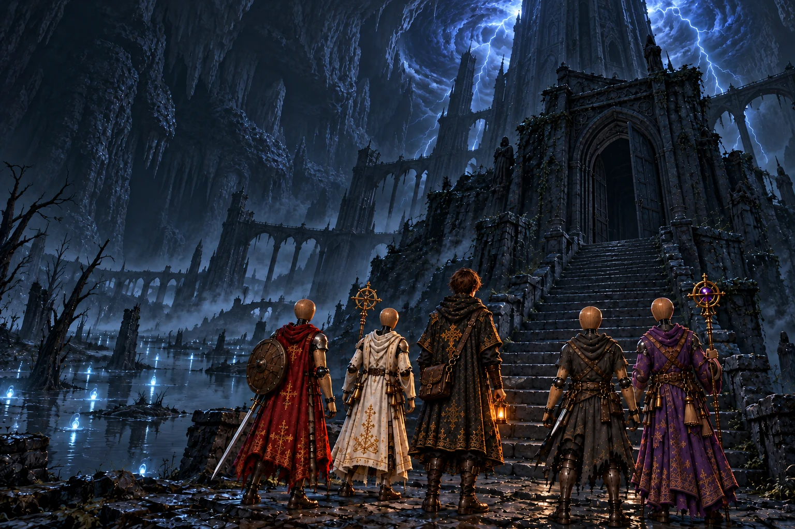

# 第7章「毒沼」 の絵

書き出し: `node tools/storyart/review.mjs` (手で直さない)。絵は出荷する WebP、まだ無ければ原画。
ゲームで小さく出た時の見え方 (384×256): [chapter7-small.jpg](chapter7-small.jpg)

## w26_splint「腕の木の添え木」 ── 出荷済み

**ストーリー一覧の本文**

> 解けた氷の水は奈落の壁を伝って滝になり、底の沼へ落ちていた。岸の泥は黒く、踏み出すたびに足首まで沈んだ。
>
> 泥の中に、脚の形に削られた氷のかけらが散らばっていた。凍王の添え木は、この岸で役目を終えたのだ。そばには木の削りくずと、切り落とした縄の端が散り、平たい石の下に紙が挟まれていた。
>
> 捨てられた器から腕の木を二本借り、削って脚に当てた、と紙にはあった。沼の水は腐った魂だ、とも。片足を引きずった足跡が、谷の奥へ続いていた。

**ゲーム内 (師の手がかり STORY_CELLS.w26_splint)**

> 雪解けの水が滝になって落ちる岸の泥に、溶けかけた氷のかけらが散らばっていた。
>
> かけらは、脚の形に削られている。凍王が固めた、師の添え木だ。
>
> すぐそばに、木の削りくずと、切り落とした縄の端が散っていた。氷の代わりに、木で脚を固め直したらしい。
>
> 平たい石の下に、書きつけが一枚はさまっていた。
>
> ──『沼の水は、腐った魂だ。底まで落ちた魂は、ここで腐って毒になる』
>
> ──『谷に捨てられていた器から腕の木を二本借り、削って脚に当てた。……器が山ほど捨ててある。誰が捨てたのか、見てくる』
>
> 泥の上の足跡は、片足を引きずりながら、谷のほうへ続いていた。
>
> ── 新たな迷宮「器の捨て場」が地図に記された。

**指示書 (4章)**

- 要点: 雪解けの水が滝になって落ちる岸の泥。脚の形に削られた、溶けかけた氷のかけら (凍王の添え木)。腕の木で固定し直した跡として、木の削りくずと切り落とした縄の端、平たい石で押さえた書きつけ。腕の木は師が脚に付けて持ち去ったので描かない。片足を引きずる足跡が谷へ続く。

## report_w26「杯を満たしたもの」 ── 出荷済み

**ストーリー一覧の本文**

> 奈落の底に沼があり、その水が腐った魂だと聞くと、王は膝掛けの端を握ったまま動かなくなった。
>
> 釜で煮られなかった魂は、みなそこへ落ちていく。王の杯を満たしたのは、その途中ですくい上げられた魂だった。弟子は口にしなかったが、王はもう自分で数を合わせていた。
>
> 葦原へ向かう弟子に、王はひと言だけ添えた。息を詰めて行け。

**ゲーム内 (王への報告 REPORTS.w26)**

> 「奈落の底に、沼があったか。……底が無いと思うておったが。」
>
> 「氷の添え木が溶けて、器の腕の木で脚を固め直したと。……オルドは、まだ歩いておるのだな。」
>
> 「沼の水は、腐った魂だと申すか。……余の杯を満たした魂も、釜で煮られねば、そこへ落ちていったのだな。」
>
> 「沼の奥には、葦原へ続く道もあったか。……毒霧の中で長居はするな。」

**指示書 (4章)**

- 要点: 沼の水が腐った魂なら、王の杯を満たした魂も途中で拾われたもの。王は長く黙り、「息を詰めて行け」とだけ言う。

## w27_crest「仕上がらなかった兄弟」 ── 出荷済み

**ストーリー一覧の本文**

> 谷の奥で、弟子は最初、それを崩れた岩の山だと思った。灯を近づけると、積み上がっていたのは人業だった。どれも仕上がる前に手を止められ、継ぎ目の穴をむき出しにしていた。
>
> 一体の胸の扉を開けると、内側に小さな彫りがあった。灯を掌に載せた手。氷棚で見た外套の裾の刺しゅうと、同じ形の印だった。
>
> 山の頂には一体だけ、膝をそろえて座る器があった。彫りかけの顔に、空の胸。膝に載せた札に、最後まで仕上がった器は一体きりだったのだろう、と師は記していた。札の裏には、器の古い継ぎ方が細かく写されていた。

**ゲーム内 (師の手がかり STORY_CELLS.w27_crest)**

> 谷の奥に、器が山と積まれていた。腕の無いもの、顔の無いもの、胸の扉が開いたままのもの。
>
> どれも古い。三百年よりも、もっと古い。
>
> 胸の扉の内側に、同じ印が彫られていた。灯を掌に載せた手。……師の外套の裾に、イレーヌが縫った刺しゅうと同じ印だ。
>
> 最初の操霊師は、一門の祖だと凍王は言った。この器はみな、その手で作られ、仕上がらずに捨てられたのだ。
>
> 山の頂に、一体だけ、きれいに座らされた器があった。顔は彫りかけで、胸には何も入っていない。
>
> その膝に、師の字の札が載っていた。
>
> ──『仕上がったのは、ひとつだけだったのだろう。モルデンだ。……あとは、みな捨てられた』
>
> 札の裏には、捨てられた器の継ぎ方が、いくつも細かく写し取られていた。

**指示書 (4章)**

- 要点: 谷の奥に作りかけの器の山 (腕の無いもの・顔の無いもの・胸の扉が開いたままのもの)。どれも三百年より古い。胸の扉の内側に灯を掌に載せた手の印。山の頂に一体だけ、きれいに座らされた器 (顔は彫りかけ、胸は空)、膝に師の札。
- 2026-10-17 ユーザー指定の修正: 捨てられた人業の胸の扉は、すべて一枚の片開き。構図・人物・光を保ち、両開きの扉を直した (済)。
- 同日の追加修正: 片開きは保ち、弟子の脚・足首・ブーツを自然につながる形に直し、器の山に足を置いて登る姿勢に整えた (済)。
- 同日の追加修正: 足の周りのマントを、背中から続く一枚の布として自然に垂れる裾とひだに直した。脚を囲む筒状の縁や分かれた布片に見せない (済)。

## report_w27「笑わない宰相」 ── 出荷済み

**ストーリー一覧の本文**

> 捨てられた器の山の話をすると、王は目を閉じた。
>
> 宰相は、仕上がらなかった兄弟たちの上に、ひとりで立っていたのだ。百年そばに置きながら、王はあの薄い笑みがほどけるところを、一度も見たことがなかった。
>
> 笑みの下にあったものが、少しだけ分かった気がする。王はそう言った。分かったところで、声をかける相手は、もう離宮にいない。

**ゲーム内 (王への報告 REPORTS.w27)**

> 「器の捨て場を抜けたか。」
>
> 「捨てられた器の胸に、オルドの一門の印が……。仕上がったのは、ひとつだけだったと。」
>
> 王は目を閉じた。「モルデンは、山ほどの捨てられた兄弟の上に立っておったのか。……あれが笑わぬわけだ。」
>
> 捨て場と葦原の探索の記録を地図に重ねると、よどみの底へ続く道筋が見えてきた。

**指示書 (4章)**

- 要点: 王は目を閉じる。宰相は山ほどの捨てられた兄弟の上に立っていた。百年そばに置きながら、王はあの薄い笑みがほどけるところを一度も見たことがなかった (宰相はいつも微笑んでいた。心から笑うのを見たことがない、の意)。
- 描くもの: 目を閉じる王 / 主題は空いた宰相の席 (本文に無い物を置いて意味を足さない) / 弟子。

## irene_crest「捨てられなかった器」 ── 出荷済み

**ストーリー一覧の本文**

> イレーヌはセラの腕をそっと持ち上げ、肘の継ぎ目の内側を弟子に見せた。灯にかざすと、そこにも小さく同じ印が彫られていた。
>
> 師は器を捨てたことがない、とイレーヌは言った。思うように動かない器も、直して、仕上げて、名を呼んだのだと。作業台には、捨て場から写してきた古い継ぎ方の紙が広げられていた。
>
> 古い継ぎ方で肘を締め直されると、セラは腕を何度か曲げ伸ばしした。わたしはあの子たちの妹なんですね、と彼女は笑い、その子たちの分まで動きます、と付け加えた。

**ゲーム内 (館の語り IRENE_BEATS.irene_crest)**

> イレーヌ「一門の印の器が、山ほど捨てられていたのですね。」
>
> 館の主は、作業台に腰かけたセラの腕を、そっと持ち上げた。肘の継ぎ目の内側に、小さく同じ印が彫られている。
>
> イレーヌ「オルド様は、器を捨てたことがないのです。うまくいかない継ぎ目は、仕上がるまで何度でもほどいて、継ぎ直していました。」
>
> イレーヌ「札の裏に、オルド様が捨て場の器の継ぎ方を写していました。三百年よりも古い、一門の継ぎ方です。」
>
> その夜、館の主は古い継ぎ方を一つずつ試しながら、セラの肘と膝の継ぎ目をほどいて、組み直した。
>
> セラ「……わたし、捨てられた子たちの、妹みたいなものなんですね。」
>
> セラ「だったら、あの子たちの分まで、ちゃんと動きます。」
>
> ── セラの魂のランクが上がった (灯守)。

**指示書 (4章)**

- 要点: イレーヌがセラの腕をそっと持ち上げ、肘の継ぎ目の内側の小さな印を弟子に見せる。古い継ぎ方の書きつけ。セラ「わたし、捨てられた子たちの、妹みたいなものなんですね」。**セラは目覚めて組み上がっている** (部品にしない)。

## w28_note「沼を渡る薬」 ── 出荷済み

**ストーリー一覧の本文**

> 背丈を越える葦をかき分けた先に、刈り払われた小さな空き地があった。焚き火の灰はとうに冷え、割れた小瓶の欠片が、毒霧の中で鈍く光っていた。
>
> 石で押さえた紙は、湿って端がよれていた。腐った魂の毒を鎮める薬の作り方。腐りきる前の魂の灯を、ひとしずくだけ混ぜるのだという。
>
> 最後の一行は、沼の真ん中の島のことだった。島に、ひとつだけ灯が見える。だから行く。師らしい、短い書き方だった。

**ゲーム内 (師の手がかり STORY_CELLS.w28_note)**

> 毒霧の立つ葦原の奥に、葦を刈り払った小さな跡があった。
>
> 焚き火の跡と、割れた小瓶がいくつか。割れ残った小瓶のひとつに、丸めた紙が押しこんであった。師の字だ。
>
> ──『腐った魂の毒は、生きた者の息を焼く。だが、腐りきる前の魂の灯を混ぜると、毒が鎮まる』
>
> ──『葦の根と、器のかけらに残った灯のしずく。これで沼を渡れる』
>
> 紙の裏には、薬の作り方がこまかく書きこまれていた。分量の横に、何度も線を引いて直した跡がある。
>
> ──『沼の真ん中に、島がある。灯がひとつ、ともっている。行ってくる』

**指示書 (4章)**

- 要点: 毒霧の葦原の奥、葦を刈り払った小さな跡。焚き火の跡と割れた小瓶、石で押さえた紙。最後の一行は沼の真ん中の島のこと (灯がひとつ、ともっている)。

## report_w28「毒の底の灯」 ── 出荷済み

**ストーリー一覧の本文**

> 師が薬を調合して沼を渡ったと聞くと、王は小さく息をついた。困った時ほど手を動かす男だった、と。
>
> あれほどの毒の底に、まだ灯っているものがある。王は島の大きさや灯の色を、弟子に何度も尋ねた。答えられないことのほうが多かった。
>
> 離宮の窓の外を、重い雲が低く流れていた。

**ゲーム内 (王への報告 REPORTS.w28)**

> 「毒霧の葦原か。……よく、息が続いたな。」
>
> 「オルドは毒を鎮める薬まで作って、沼を渡ったか。腐る前の魂の灯を混ぜる……毒を責めずに、なだめて渡ったのだな。」
>
> 「沼の真ん中に、灯のともる島があると、師は書いたのだな。あれだけの毒の底で、まだ何かが灯っておるのか。」
>
> 捨て場と葦原の探索の記録を地図に重ねると、よどみの底へ続く道筋が見えてきた。

**指示書 (4章)**

- 要点: 師が薬を作って沼を渡ったと聞き、王は「あの男らしい知恵だ」と言い、島のことを何度も尋ねる。宰相がいなくなった玉座の脇は今も空いたまま。

## mem_w29「ただひとつの言いつけ」 ── 出荷済み

**ストーリー一覧の本文**

> よどみの主が崩れると、沼の泥の奥から、三百年よりもずっと前の景色が浮かんだ。沼の真ん中の島。扉の上に灯の印を掲げた工房で、年老いた操霊師が、作業台にすがるようにして倒れていた。
>
> そばに膝をついているのは、若い男の顔をした人業だった。工房でただ一体、仕上がった器。主はかすれた声で言い残した。魂を腐らせてはならない。この沼へ落ちる魂を、もう出してはならない。そのためなら、何をしてもかまわない、と。
>
> 一年前、同じ作業台の前で、師は祖の古い日記を閉じた。命じた者はとうにいない。言いつけだけが、主を失ったまま歩き続けていた。師は工房の奥の扉を開け、塔の階段に足をかけた。

**ゲーム内 (主の記憶 BOSS_MEMORIES.w29)**

> 沼の底から、腐りかけた無数の魂の声が、泡のように浮かび上がった。よどみの主の体は、もう泥に還っている──
>
> ……三百年よりも、もっと前。沼の真ん中の島に、ひとつの工房があった。扉の上に、灯を掌に載せた手の印。
>
> 年老いた操霊師が、作業台の前に倒れていた。沼の瘴気が、もう胸の奥まで入りこんでいる。
>
> そばに、若い男の顔をした人業がひとり、膝をついていた。工房でただひとつ、仕上がった器だった。
>
> ──『落ちてきた魂が、ここで腐っていく。わたしには、もう止められん』
>
> ──『魂を、腐らせるな。落ちてくる魂を、二度とこの沼へ落とすな。そのためなら、何をしてもよい』
>
> 人業は主の目を閉じてやり、ひとことも言わずに立ち上がった。そして、上へ登っていった。
>
> ……一年前。片脚を引きずる男が、同じ作業台の前で、古い日記を閉じた。
>
> ──『命じた者は死んだ。命令だけが、三百年を越えて生き残った』
>
> ──『大樹も、霊薬も、釜も……みな、魂を腐らせないためだったのか。モルデン』
>
> 男は工房の奥の扉を開けた。嵐の鳴る塔の階段が、闇の上へどこまでも伸びていた。扉は、開いたまま残された。

**指示書 (4章)**

- 要点: 三百年よりもっと前。沼の真ん中の島の工房 (扉の上に灯を掌に載せた手の印)。年老いた操霊師が作業台の前に倒れ、そばに若い男の顔をした人業 (モルデン、いまと同じ顔) が膝をつく。「魂を、腐らせるな」。一年前、片脚を引きずる男 (オルド) が同じ作業台の前で古い日記を閉じる。
- 描くもの: 主題は倒れた老いた操霊師と膝をつくモルデン (三百年前、宰相の衣装ではなく素朴な工房の服) / 扉の上の印 / 瘴気。奥の工房の扉の向こうに塔の階段がかすかに。オルドは描かないか、手前に半透明の重ね (同じ作業台で日記を閉じる、腕の木で脚を固めた姿) にとどめる。
- 描かないもの: 祖の顔をはっきり (伏せた顔・陰に)。

## report_w29「死なない命令」 ── 出荷済み

**ストーリー一覧の本文**

> 魂を腐らせるな。弟子が伝えた祖の言いつけを、王は口の中で何度か転がした。
>
> 大樹も、霊薬も、釜も、その一言から始まった。王の長い命さえ、そのために使われた器だったのかもしれない。
>
> だが、と王は首をかしげた。大釜の前でモルデンが語った主の命は、魂を集めよ、だった。腐らせるなと命じられた者が、集めることならできると考え、その一つを三百年続けてきたのか。王は答えを出さないまま、塔を登るよう弟子に告げた。

**ゲーム内 (王への報告 REPORTS.w29)**

> 「よどみの主を鎮めたか。……沼が、静かになったのだな。」
>
> 沼の島の工房で、死にかけた最初の操霊師が、ただひとつ仕上がった器に命じたこと。よどみの主の記憶を、王は身を乗り出して聞いた。
>
> 「魂を、腐らせるな……。」王は、その言葉を何度か口の中でくり返した。
>
> 「……待て。火の洞で、モルデンは『主の命は一つ、魂を集めよ』と申したのではなかったか。命じられたのは、腐らせるな、だ。集めよ、ではない。」
>
> 「あれは主の言いつけを、自分にできる形に言い換えて、三百年守ってきたのか。魂を途中で受けとめ、腐る前に使い切る。……余の命も、そのための器だったのだな。」
>
> 「言い換えたのが過ちか。言い換えねば、守れなかったのか。命じた者が死んでも、命令だけは死なぬ。王として命じてきた余には、どちらとも言えぬ。」
>
> 王は顔を上げた。「オルドは、塔を登っていったと申したな。……ならば、そなたも登れ。」

**指示書 (4章)**

- 要点: 王は「魂を、腐らせるな」を何度も口の中でくり返す。大樹も霊薬も釜も、そのためだった。火の洞でモルデンが言った「魂を集めよ」は、言いつけを自分にできる形に言い換えたものだったと王は気づく。命じた者が死んでも命令は死なない。王は顔を上げ、弟子に塔を登れと告げる。

## irene_order「灯を守る理由」 ── 出荷済み

**ストーリー一覧の本文**

> 芯を整えながら、イレーヌは師から受けた言いつけを口にした。灯を、絶やすな。彼女が受け取った言葉は、それひとつだった。
>
> 師が帰らなければ、理由も分からなくなったまま、三百年でも灯を守っていたかもしれない。言いつけを守るだけなら、わたしも宰相も変わりません、と彼女は言った。
>
> 毎晩おやすみを言いに来ますから、とセラが燭台の向こうから顔を出した。イレーヌは小さく笑った。宰相のそばにも、そう言ってくれる誰かがいればよかったのに、と。

**ゲーム内 (館の語り IRENE_BEATS.irene_order)**

> イレーヌ「魂を、腐らせるな……。それが、モルデンの主の言いつけだったのですね。」
>
> 館の主は燭台の芯を整えながら、しばらく黙っていた。
>
> イレーヌ「わたしにも、言いつけがあります。オルド様が出かける前の晩に、ひとつだけ。……灯を、絶やすな。」
>
> イレーヌ「もしオルド様が帰ってこなかったら、わたしも三百年、この灯を守り続けたかもしれません。理由も、わからなくなったまま。」
>
> イレーヌ「言いつけは、守っているうちに形が変わります。わたしも『灯を絶やすな』を、いつのまにか『ここで待っていろ』と聞いていました。」
>
> イレーヌ「でも、わたしには、{弟子名:様}がいます。灯を守る理由を、毎晩、思い出させてくれる人が。」
>
> セラ「わたしも、思い出させます。毎晩、おやすみを言いに来ますから。」
>
> イレーヌは、小さく笑った。

**指示書 (4章)**

- 要点: イレーヌが燭台の芯を整えながら、師の言いつけ「灯を、絶やすな」を語る。セラ「毎晩、おやすみを言いに来ますから」。イレーヌは小さく笑う。

## ch7_end「嵐の鳴る塔へ」 ── 出荷済み

**ストーリー一覧の本文**

> よどみの主が鎮まると、沼から立つ泡はしだいに間遠になった。底の魂は、ようやく静かに眠りはじめたようだった。
>
> 工房の奥の扉の向こうで、塔の階段が闇の上へ消えている。吹き下ろす風に、遠い雷の音が混じっていた。師の足は、あの上を登っていった。
>
> 館に戻ると、燭台の炎はいつもより低く、じっと動かずにいた。弟子は芯を揺らさないよう、その前を静かに通り、塔へ持っていく縄を選びはじめた。

**ゲーム内 (章の結び CHAPTER_END[7])**

> よどみの主は鎮まり、沼の底の魂は、泡をひとつ吐いて、静かに眠りはじめた。
>
> 宰相モルデンは、死んだ主の命令を三百年守り続けていた。魂を、腐らせるな ── そのためなら、何をしてもよい、と。
>
> 師は沼の島の工房から、嵐の鳴る塔を登っていった。館の燭台の灯は、芯を整えたばかりのように、まっすぐに立っている。
>
> ── 物語は第八章「嵐の尖塔」へ続く。

**指示書 (4章)**

- 要点: よどみの主が鎮まり、沼の底の魂は静かに眠りはじめる。工房の奥から嵐の鳴る塔が上へ伸びる。師はその階段を登っていった。

