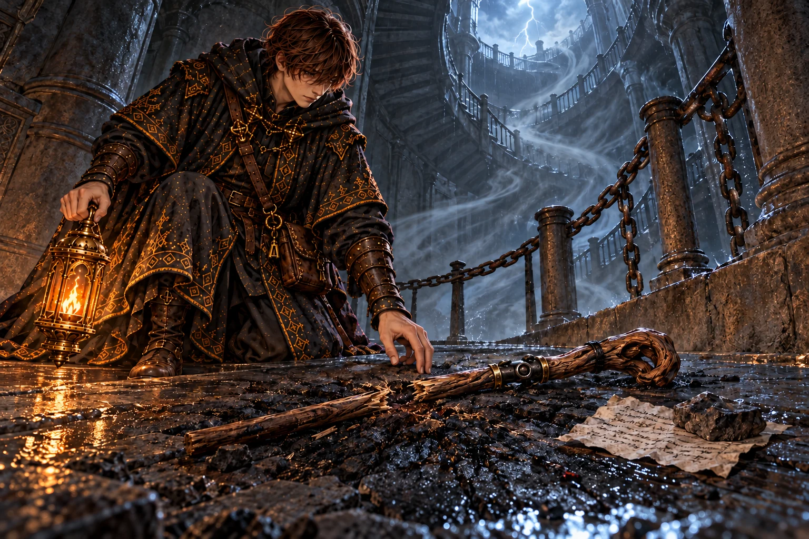
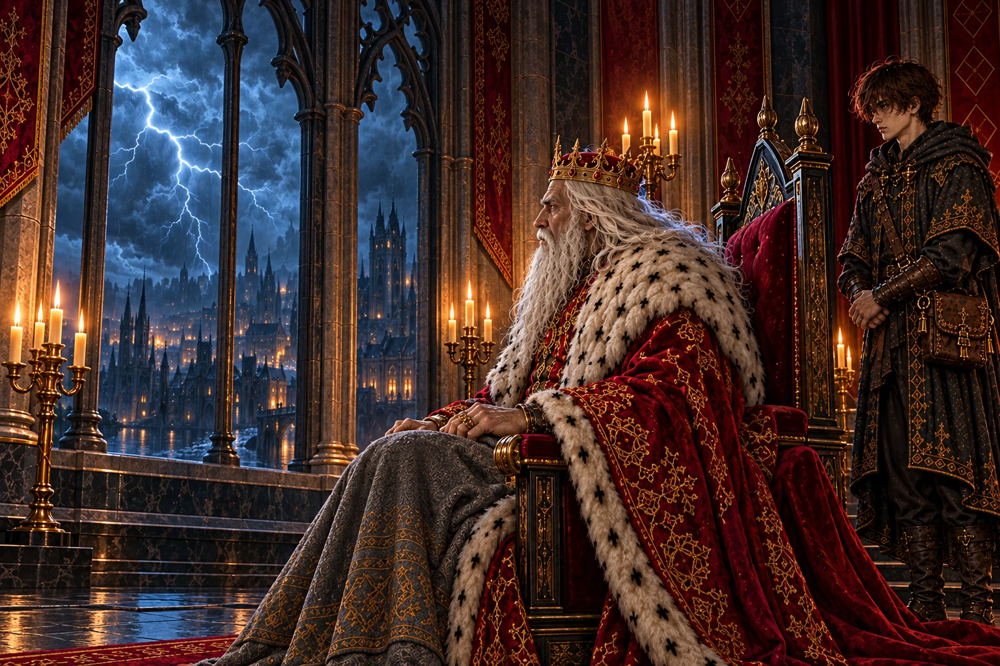
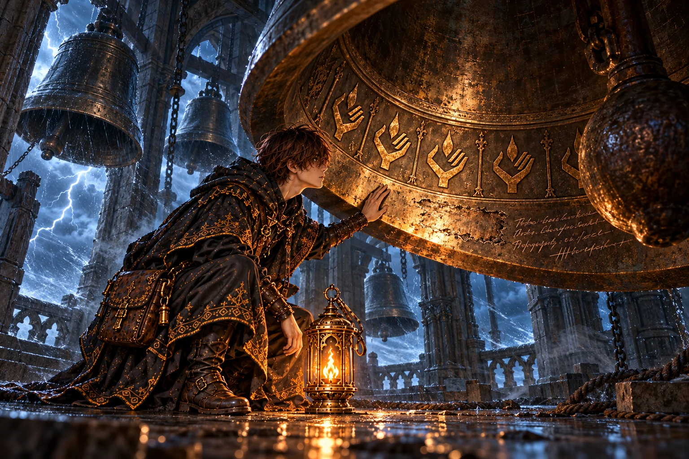
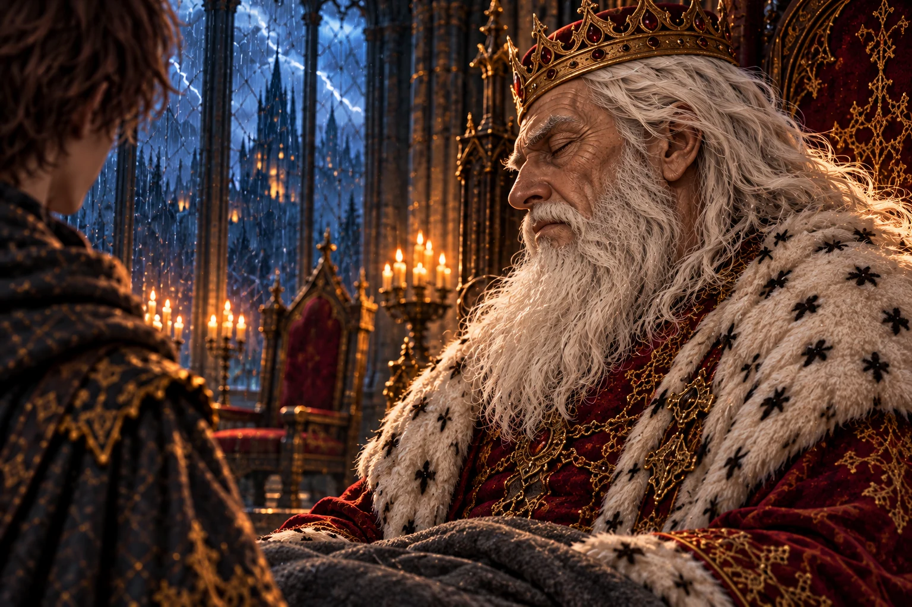
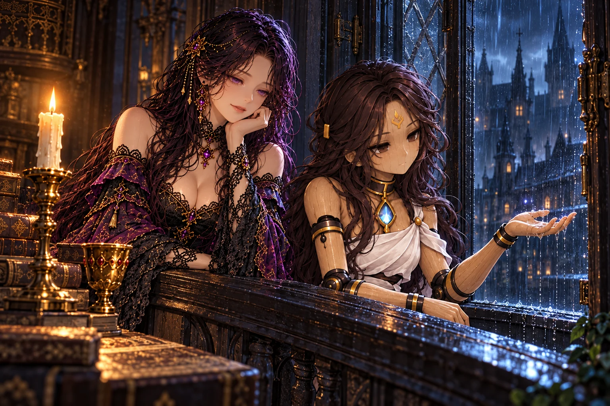
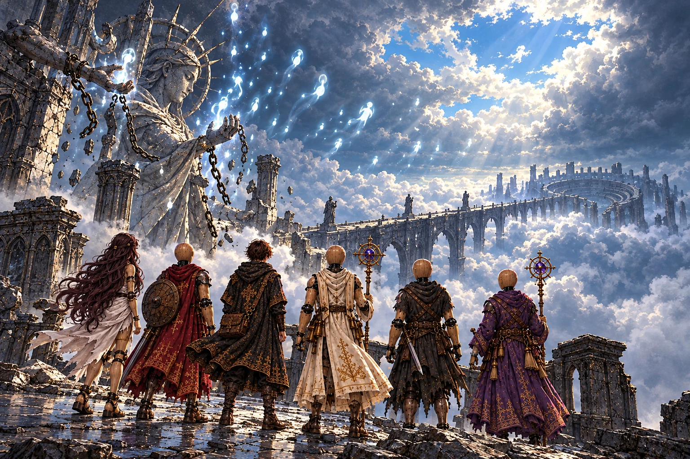

# 第8章「嵐の尖塔」 の絵

書き出し: `node tools/storyart/review.mjs` (手で直さない)。絵は出荷する WebP、まだ無ければ原画。
ゲームで小さく出た時の見え方 (384×256): [chapter8-small.jpg](chapter8-small.jpg)

## w30_stick「雷にくれてやった杖」 ── 出荷済み

**ストーリー一覧の本文**

> 沼の島の工房の奥から、螺旋階段が奈落の縦穴を上へ伸びていた。吹き抜けを風が鳴りながら昇り、隊の外套をまとめて上へ引っぱった。
>
> 踊り場の床が、雷に打たれて黒く焦げていた。焦げ跡のまん中に、半ばで折れた木の杖。握りの少し下に、人業の腕の継ぎ目。脚の添え木だった腕の木を、師はいつのまにか杖に削り直していたのだ。
>
> 石で押さえた紙によれば、この塔は落ちた魂を空へ送り返すための煙突だという。見上げると、手すりの鎖のさびが、手の形にこすれて上へ続いていた。

**ゲーム内 (師の手がかり STORY_CELLS.w30_stick)**

> 螺旋階段の踊り場の床が、黒く焦げていた。雷の落ちた跡だ。
>
> 焦げ跡のまん中に、木の杖が一本、半ばで折れて転がっていた。
>
> 握りの下に、人業の腕の継ぎ目が残っている。沼の岸で、師が脚を固めた腕の木だ。添え木を削って、杖にしたのだ。
>
> 杖の握りに、細く巻いた書きつけが縛りつけてあった。
>
> ──『この塔は、煙突だ。底へ落ちてくる魂を、上へ送り返すための』
>
> ──『風は、魂の流れだ。風の鳴るほうへ登れば、頂に着く。杖は、雷に持っていかれた』
>
> 手すりの鎖に、手でつかんだ跡が点々と続いていた。上へ、上へ。
>
> ── 新たな迷宮「嵐を鳴らす鐘楼」が地図に記された。

**指示書 (4章)**

- 要点: 螺旋階段の踊り場の床が雷で黒く焦げる。焦げ跡のまん中に、半ばで折れた木の杖 (握りの下に人業の腕の継ぎ目)。石で押さえた書きつけ。手すりの鎖に、手でつかんだ跡が上へ続く。吹き抜けを下から風が鳴りながら昇る。

## report_w30「鳴りやまぬ雷」 ── 出荷済み

**ストーリー一覧の本文**

> 地の底の沼から空へ向かって、塔が伸びている。その話を、王は窓の外の雲を見ながら聞いた。
>
> 王の知るこの百年、空が晴れきった日は一度もなかった。夏が来るたび雷が鳴り、人々はそれを天の機嫌だと言い合った。鳴らしていたのは、地の底から伸びる塔だったのだ。
>
> 外壁の回廊は雷が落ちやすい。王は弟子の外套の焦げ跡に目を留め、気をつけて行けと言った。

**ゲーム内 (王への報告 REPORTS.w30)**

> 「塔か。……奈落の底から、上へ伸びる塔があったか。」
>
> 「オルドは杖を雷に焼かれて、それでも鎖を伝って登っていったか。……あの男の体は、もう無事な所のほうが少なかろう。」
>
> 「余の知るこの百年、この国の空はいつも重かった。雷の鳴らぬ夏を、余は知らぬ。……その塔が鳴らしておったのか。」
>
> 「塔の外壁をめぐる回廊への道を開かせよう。雷に気をつけよ。」

**指示書 (4章)**

- 要点: 王の知るこの百年、この国の空はいつも重く、雷の鳴らない夏は一度もなかった。その雷を鳴らしていたのが地の底の塔。

## w31_bell「空へ還る鐘」 ── 出荷済み

**ストーリー一覧の本文**

> 塔の中ほどまで登ると、頭上に大鐘がいくつも吊られていた。嵐が吹き抜けるたび、綱を引く者もいないのに、鐘はそろって鳴り響いた。
>
> いちばん大きな鐘は、床すれすれまで下ろされていた。内側の縁を一門の印がぐるりと巡り、その下の銘は、鐘が鳴るごとに魂がひとつ空へ還ると語っていた。続きの文字は、刃物で削り取られていた。
>
> 削り跡の下に、師が書き足していた。三百年鳴り続けて、なぜ嵐はやまないのか。弟子は鐘の内側に手を当て、まだ残っている震えを指先で数えた。

**ゲーム内 (師の手がかり STORY_CELLS.w31_bell)**

> 鐘楼のいちばん大きな鐘が、床すれすれまで下ろされていた。風が吹き抜けるたび、低くうなる。
>
> 鐘の内側の縁に、浮き彫りの印がぐるりと並んでいる。灯を掌に載せた手 ── 一門の印だ。
>
> 印のあいだに、古い字で銘が彫られていた。
>
> ──『この鐘が鳴るたび、ひとつの魂が空へ還る』
>
> 銘の続きは、削り取られていた。その下に、師の字で書き足してある。
>
> ──『三百年、鐘は鳴りっぱなしだ。……還っているのなら、なぜ嵐がやまない』

**指示書 (4章)**

- 要点: 塔の中ほどに大鐘がいくつも吊られ、誰も撞かないのに鳴る。いちばん大きな鐘が床すれすれまで下ろされ、内側の縁に一門の印がぐるりと浮き彫り。銘の続きは削り取られ、その下に師の書き足し。

## report_w31「同じ問い」 ── 出荷済み

**ストーリー一覧の本文**

> 鐘の銘の話を聞くと、王は目を閉じ、遠い音に耳を澄ますような顔をした。
>
> 魂が還っているのなら、なぜ空は重いままなのか。師が鐘に書き残した問いを、王は自分の問いのようにくり返した。
>
> 鐘楼と回廊、その両方を見てくれば頂へ行ける。王はそう約束し、答えはそこで聞こう、と言った。

**ゲーム内 (王への報告 REPORTS.w31)**

> 「鐘楼を抜けたか。……塔の中で、鐘が鳴っておったと。」
>
> 「鐘に、オルドの一門の印が……。鳴るたびに、魂がひとつ空へ還る、と。」
>
> 王は耳を澄ますように目を閉じた。「還っているのなら、なぜ嵐がやまぬ。……オルドと同じことを、余も思う。」
>
> 「鐘楼も回廊も見たそなたになら、頂への道を開かせよう。」

**指示書 (4章)**

- 要点: 鐘の銘の話を聞いて、王は耳を澄ますように目を閉じる。還っているのなら、なぜ嵐はやまないのか。

## irene_bell「鐘の節」 ── 未着手 (指示あり)

_(絵はまだ無い)_

**ストーリー一覧の本文**

> 弟子が写してきた鐘の銘を読みながら、イレーヌは小さく節をつけて口ずさんだ。弟子の知らない、低くゆるやかな節だった。
>
> 師が器の継ぎ目を締めながら、よく口ずさんでいた節だという。鐘の鳴り方を話すと、彼女の手が止まった。同じ節だった。
>
> セラもその節を知っていた。眠る前に、師が歌ってくれたのだと。遠い昔に、一門の誰かが鐘の音を歌へ移したのだろう。燭台の炎が、歌の拍に合わせるように小さく揺れた。

**ゲーム内 (館の語り IRENE_BEATS.irene_bell)**

> イレーヌ「鐘の銘を、写してきてくださったのですね。」
>
> 館の主は写しを読みながら、小さく節をつけて、何かを口ずさんだ。
>
> イレーヌ「オルド様が、器の継ぎ目を締めながら、よくこの節を口ずさんでいたのです。どこで覚えたのか、聞いても教えてくれませんでした。」
>
> イレーヌ「鐘の鳴り方と、同じ節です。一門の誰かが、ずっと昔に、鐘の音を歌にしたのでしょう。」
>
> セラ「わたしも知っています。眠る前に、オルド様が歌ってくれました。」
>
> セラ「……空へ還る歌、だったんですね。」
>
> イレーヌ「オルド様は、この節を口ずさみながら、どんな魂を還したかったのでしょう。……一度、聞いてみればよかった。」

**指示書 (4章)**

- 要点: イレーヌが鐘の銘の写しを読みながら、小さく節をつけて口ずさむ。師が継ぎ目を締めながら口ずさんでいた節。セラ「わたしも知っています。眠る前に、オルド様が歌ってくれました」。

## w32_rod「雷よけの巻き方」 ── 未着手 (指示あり)

_(絵はまだ無い)_

**ストーリー一覧の本文**

> 塔の外壁をめぐる回廊は、吹きさらしだった。行き止まりの手すりに銅の線がぐるぐると巻かれ、壁の割れ目から塔の内側へ引きこまれていた。
>
> 壁の浅いくぼみに、雨を避けて小さく畳んだ紙が差しこまれていた。雷は、縛られた魂の火だ。頂にある何かが、昇ろうとする魂を押さえつけている。師の字は、いつもより大きく傾いていた。
>
> 裏には、人業の継ぎ目に銅を巻くやり方が絵で描かれていた。弟子はその場で隊の一体の肘に銅を巻き、次の雷が手すりを走り抜けるのを見届けた。

**ゲーム内 (師の手がかり STORY_CELLS.w32_rod)**

> 回廊の行き止まりで、鉄の手すりに銅の線がぐるぐると巻きつけてあった。
>
> 銅の線は、手すりから壁の割れ目へ、さらに塔の内側へと引きこまれている。落ちた雷を、塔の中へ逃がす仕掛けだ。
>
> 壁のくぼみに、雨に濡れないよう畳んだ紙が一枚。師の字だった。
>
> ──『雷は、縛られた魂の火だ。頂で何かが、魂を上へ行かせまいとしている』
>
> ──『雷よけの巻き方を書いておく。銅は、器の継ぎ目に一巻きでいい』
>
> 紙の裏には、人業の継ぎ目に銅の線を巻くやり方が、絵つきで細かく書かれていた。

**指示書 (4章)**

- 要点: 塔の外壁をめぐる回廊の行き止まり。鉄の手すりに銅の線がぐるぐる巻かれ、壁の割れ目から塔の内側へ引きこまれる。壁のくぼみに、雨に濡れないよう畳んだ紙 (裏に、人業の継ぎ目に銅を巻くやり方の絵)。

## report_w32「地の底に吸われる雷」 ── 未着手 (指示あり)

_(絵はまだ無い)_

**ストーリー一覧の本文**

> 雷の回廊の話を聞くと、王は捨て砦の大手門を思い出した。百年やまない雷雨の降る門だ。
>
> 雷は天から落ちていたのではない。地の底へ吸いこまれていたのだ。砦の兵たちの頭上で鳴り続けた雷も、あの塔に呼ばれていたのかもしれない。
>
> 王は窓辺に寄り、低い雲の腹が白く光るのを、黙って眺めていた。

**ゲーム内 (王への報告 REPORTS.w32)**

> 「雷の落ちる回廊か。……よく、焼かれずに戻った。」
>
> 「雷は、縛られた魂の火だと。頂で何かが、魂を上へ行かせまいとしておる……。」
>
> 「捨て砦の大手門で、オルドは『雷は落ちるのではない。吸われるのだ』と書き残したな。……あの雷雨を絶やさず降らせておったのは、その塔の嵐でもあったか。」
>
> 「鐘楼も回廊も見たそなたになら、頂への道を開かせよう。」

**指示書 (4章)**

- 要点: 王は捨て砦の大手門の雷雨を思い出す。雷は地の底に吸われていた。宰相のいない玉座の脇で、王は窓の外の雲を見ている。

## mem_w33「縛られた魂」 ── 未着手 (指示あり)

_(絵はまだ無い)_

**ストーリー一覧の本文**

> 嵐の主が崩れると、弟子は塔を建てる二人を見た。老いた操霊師と、若い男の顔をした人業。落ちてきた魂を空へ帰すために、二人は一つずつ石を積んでいた。
>
> 主が倒れたあと、人業はひとりで頂の灯台に火をともした。魂は空へ昇り、やがて雨になって奈落へ降り、底の沼でまた腐った。人業は火を消し、鎖の腕をもつ像を頂に並べた。昇ろうとする魂は像に縛られ、塔のまわりで渦を巻いた。
>
> 一年前、杖を失った師が鎖を頼りに頂へ這い上がり、拾った石で像のひとつを打ち割った。縛られていた光がひとつ、雲の上へ抜けていった。腐るのは、巡りを止めたせいではないのか。師はそうつぶやき、雷雲の切れ間に架かる石の橋へ歩き出した。

**ゲーム内 (主の記憶 BOSS_MEMORIES.w33)**

> 最後の雷が鳴りやんだ。渦を巻いていた無数の魂が、ひとつずつ鎖をほどかれて、雲の上へ昇っていく──
>
> ……三百年よりも、もっと前。年老いた操霊師が、若い男の顔をした人業と並んで、塔の石を積んでいた。
>
> ──『落ちてきた魂を、空へ還す。この塔は、そのための煙突だ。頂の灯台に火が入れば、魂は迷わず昇っていける』
>
> 灯台に火が入る前に、主は沼の島で倒れた。
>
> 人業はひとりで頂へ登り、灯台に火を入れた。魂の光が、雲を抜けて空へ昇っていった。
>
> その夜、雨が降った。雨は奈落を落ちて、底の沼へ注いだ。……雨の一粒一粒に、空へ還したはずの魂が宿っていた。
>
> ──『還しても、雨になって落ちてくる。落ちれば、腐る』
>
> 人業は灯台の火を消し、頂のまわりに、鎖の腕をもつ像を並べた。昇っていく魂は像に縛られ、塔のまわりを渦巻いて、嵐になった。
>
> ……そして、一年前。杖を失った男が、手すりの鎖を頼りに、頂へはい上がってきた。
>
> 男は像のひとつを、拾った石で叩き割った。縛られていた魂がひとつ、雲の上へ抜けていった。
>
> ──『巡りを止めたから、腐るのではないか。……モルデン。お前の主は、何を見て「腐らせるな」と言ったのだ』
>
> 雷雲の切れ間に、長い石の橋が見えた。橋の向こうに、すり鉢の形をした古い石の観客席が、黒く沈んでいた。
>
> ──『主の生まれた町は、あの橋の向こうか』

**指示書 (4章)**

- 要点: 頂の、火のない大きな灯台。そのまわりに鎖の腕をもつ像 (魂縛りの像) が輪になり、昇る魂を縛って塔のまわりで渦巻かせ、嵐にしている。一年前、杖を失った男 (オルド) が手すりの鎖を頼りに這い上がり、像のひとつを拾った石で叩き割る。縛られていた魂がひとつ雲の上へ抜ける。雷雲の切れ間に長い石の橋、その向こうにすり鉢の形の古い観客席が黒く沈む。
- 描くもの: 火のない灯台 / 鎖の腕の像の輪と渦巻く魂の嵐 / 像を石で割るオルド (腕の木で固めた脚、杖なし) / 抜けていく一つの魂 / 雲の切れ間の石の橋と観客席。
- 描かないもの: 弟子。灯台に火を入れたモルデンの姿 (この絵では描かない)。

## report_w33「百年目の青空」 ── 未着手 (指示あり)

_(絵はまだ無い)_

**ストーリー一覧の本文**

> 嵐の主が鎮まった朝、離宮の窓の外に、雲ひとつない空が広がった。王の知るこの百年で、初めての青空だった。捨て砦の大手門に降り続けた雷雨も、やんだという。
>
> 還しても戻る。戻れば腐る。だから縛るしかなかった。宰相の選んだ道を、王は窓辺に立ったまま、一つずつ確かめるように言葉にした。
>
> 解かれた魂も、いずれは雨になって沼へ落ちる。王はそれも分かったうえで、青い空から目を離さなかった。オルドは、その逆を確かめに行ったのだろう。橋の向こうへ行け、と王は弟子に告げた。

**ゲーム内 (王への報告 REPORTS.w33)**

> 「嵐の主を鎮めたか。……今朝、この空が晴れた。王都からも、同じ報せが届いた。余の知るこの百年で、初めての青空だ。」
>
> 「捨て砦からも報せが来た。大手門の雷雨が、止んだそうだ。」
>
> 空へ還した魂が、雨になって落ちてきたこと。モルデンが像を並べて、魂を塔に縛ったこと。話し終えても、王は窓から目を離さなかった。
>
> 「還しても戻ってくる。戻れば腐る。……だから縛った、か。縛られた魂が、この国の空を重くしておったのだな。」
>
> 「この青空は、解かれた魂の昇っていった跡だ。……その魂も、いずれ雨となって沼へ落ちるのであろう。モルデンが三百年おそれたのは、それだ。」
>
> 「オルドは、巡りを止めたから腐るのではないかと言うたか。……あの男は、モルデンとは逆の答えを探しに行ったのだな。」
>
> 「橋の向こうへ行け、オルドの弟子よ。」

**指示書 (4章)**

- 要点: 嵐の主が鎮まった朝、この空が晴れる (王都からも同じ報せ)。王の知るこの百年で初めての青空。捨て砦の大手門の雷雨も止んだ。王は窓の外の青い空から目を離さない。解かれた魂もいずれ雨となって沼へ落ちる、と王はモルデンのおそれを口にする。「橋の向こうへ行け」。
- 描くもの: **朝の澄んだ青空** と差しこむ陽の光 / 窓辺に立って空を見上げる、やつれた王 / 空いた宰相の席 / 弟子。

## irene_rain「雨の音」 ── 出荷済み

**ストーリー一覧の本文**

> その夜、ロアダルに静かな雨が降った。雷の気配はなく、屋根を打つ音だけが館を包んでいた。イレーヌは窓を細く開けた。
>
> 雨の夜には、師も必ず窓を開けたという。魂が帰ってくる音だ、と言って。セラが窓辺に並び、手のひらで雨粒を受けた。
>
> 空へ昇った魂が雨になって降ってくるのなら、この雨の中にもいる。イレーヌにはそれが、懐かしい足音のように聞こえた。燭台の灯は、雨音に合わせて小さく揺れていた。

**ゲーム内 (館の語り IRENE_BEATS.irene_rain)**

> その夜、ロアダルにも雨が降った。嵐ではない、静かな雨だった。
>
> 館の主は窓を少しだけ開けて、雨の音を聞いていた。
>
> イレーヌ「オルド様は、雨の夜は必ず窓を開けました。『魂が帰ってくる音だ』と言って。」
>
> イレーヌ「空へ還った魂は、雨になって、また降ってくるのですね。……だとしたら、この雨の中にも。」
>
> イレーヌ「モルデンは、落ちてくる雨が怖かったのでしょうか。わたしには、懐かしい音にしか聞こえないのです。」
>
> セラが窓辺に並んで、手のひらで雨粒を受けた。
>
> セラ「つめたい。……でも、なんだか、おかえりって言いたくなります。」
>
> 燭台の灯が、雨の音に合わせるように、小さく揺れた。

**指示書 (4章)**

- 要点: その夜、ロアダルにも静かな雨 (嵐ではない)。イレーヌは窓を少しだけ開けて雨の音を聞く。セラが窓辺に並び、手のひらで雨粒を受ける。燭台の灯が雨の音に合わせて小さく揺れる。

## ch8_end「雲の向こうの橋」 ── 出荷済み

**ストーリー一覧の本文**

> 頂の像から鎖が落ち、縛られていた魂が、ほどけた糸のように雲の上へ昇っていった。重かった雲が裂け、その隙間から青がのぞいた。
>
> 還せば雨になって腐る。だから縛る。宰相がそう決めた道と、止めたから腐るのではないかという師の問い。鎖を解かれた魂も、いつかは雨になって沼へ降りていく。その先がどうなるのかは、まだ誰も確かめていない。
>
> 頂の端から、雷雲の向こうへ長い石の橋が伸び、その先にすり鉢の形の古い観客席が黒く沈んでいた。館に戻ると、燭台の炎は、窓から差す昼の光に溶けそうなほど淡く見えた。

**ゲーム内 (章の結び CHAPTER_END[8])**

> 塔に縛られていた魂は鎖をほどかれ、雲を抜けて空へ昇っていった。この国の空を覆っていた重い雲が切れ、青空がのぞいた。
>
> 空へ還した魂は、雨になって沼へ落ち、また腐った。それを見た宰相モルデンは、昇る魂を塔に縛った。解かれた魂は、いつかまた雨になるのだろうか。
>
> 師は頂から、雷雲の向こうへ架かる石の橋を渡っていった。橋の先には、古い闘技場の跡が沈んでいる。館の窓辺で、燭台の灯が雨の音に合わせて揺れている。
>
> ── 物語は第九章「闘技場跡」へ続く。

**指示書 (4章)**

- 要点: 塔に縛られていた魂は鎖をほどかれ、雲の上へ昇っていく。王都の上の重い雲が切れ、青空がのぞく。頂から、雷雲の向こうへ長い石の橋が架かり、橋の先に古い闘技場の跡が沈んでいる。
- 描くもの: 鎖のほどけた像と、昇っていく魂の光 / 切れた雲と青空 / 長い石の橋とその先の沈んだ観客席 / 頂の端に立つ弟子と隊。

