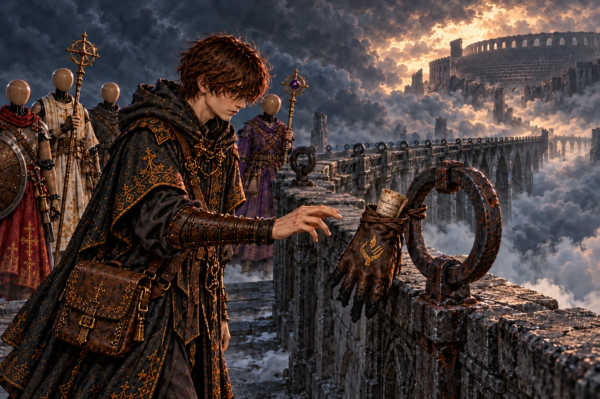
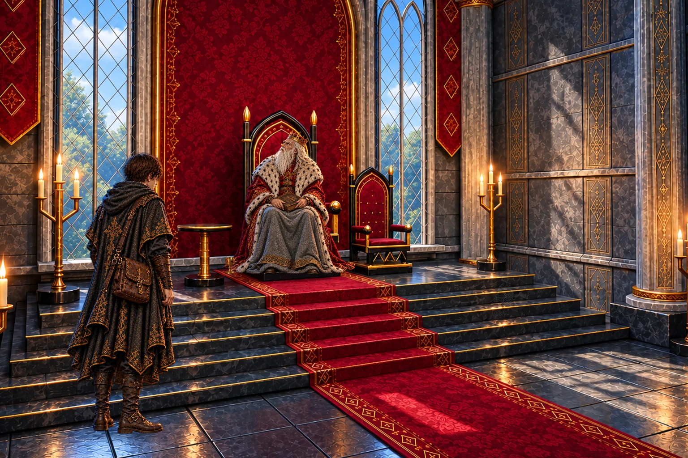
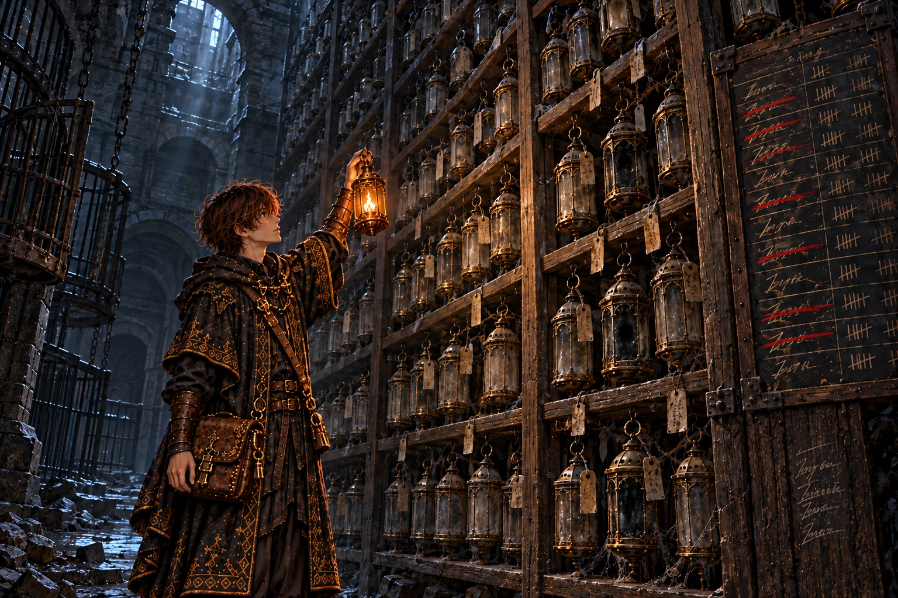

# 第9章「闘技場跡」 の絵

書き出し: `node tools/storyart/review.mjs` (手で直さない)。絵は出荷する WebP、まだ無ければ原画。
ゲームで小さく出た時の見え方 (384×256): [chapter9-small.jpg](chapter9-small.jpg)

## w34_glove「置いていった手袋」 ── 出荷済み

**ストーリー一覧の本文**

> 尖塔の頂から、雷雲の上へ長い石の橋が伸びていた。欄干には、かせをつなぐ鉄の輪が、霧の向こうまで同じ間を置いて並んでいる。
>
> 橋のなかほどで、輪の一つに、焦げた革の手袋が片方だけくくりつけてあった。甲にはイレーヌの縫った灯の印。指先は雷よけの銅に焼かれて、縮れて固くなっていた。
>
> 手袋の中に丸めた紙があった。かつて囚人たちは、この橋を渡って闘技場へ送られたという。橋の先の雲の切れ間に黒い観客席がそびえ、誰もいないはずの町から、かすかな歓声が流れてきた。

**ゲーム内 (師の手がかり STORY_CELLS.w34_glove)**

> 石橋のなかほどで、欄干の鉄の輪に、焦げた革の手袋が片方だけ結びつけてあった。
>
> 灯を扱うための、指先の厚い手袋。甲の縫い目に、小さな刺しゅう ── 灯を掌に載せた手。外套の裾と同じ、イレーヌの針目だ。師の手袋だ。
>
> 指先が黒く焼けて、縮れている。塔の雷よけを巻くときに、手を焼いたのだろう。
>
> 手袋の中に、丸めた書きつけが押しこんであった。
>
> ──『欄干の輪は、かせをつなぐ輪だ。この橋は、囚人を闘技場へ送るための道だった』
>
> ──『手袋は置いていく。もう指が入らん。……橋の先から、歓声が聞こえる。誰もいないはずの町から』
>
> 橋の先、灰色の雲の切れ間に、すり鉢の形の観客席が黒くそびえていた。
>
> ── 新たな迷宮「闘獣の檻」が地図に記された。

**指示書 (4章)**

- 要点: 雷雲の上に伸びる長い石橋。欄干に枷をつなぐ鉄の輪がどこまでも並ぶ。橋のなかほどの輪に、焦げた革の手袋が片方だけ結ばれている (甲に灯の印の刺しゅう、指先は焼けて縮れる)。手袋の中に丸めた書きつけ。橋の先、雲の切れ間に、すり鉢の形の観客席が黒くそびえる。
- 描くもの: 欄干の輪に結ばれた焦げた手袋 / 枷の輪の列 / 手袋を手に取る弟子 / 遠くの観客席。描かないもの: 師本人。

## report_w34「空の上の町」 ── 出荷済み

**ストーリー一覧の本文**

> 空の上に橋が架かっていたと聞いて、王は窓の外の青空を振り返った。百年見上げてきた雲の、さらに上の話だった。
>
> 王家の年代記のいちばん初めに、雲の上の町のことが一行だけ記されているという。歓声のやむことのない町。王は長く、それを子ども向けの昔話だと思っていた。
>
> 観客席へ向かう弟子に、王は、歓声にあまり耳を貸すなと言った。聞こえる声が、いつも生きている者の声とは限らない。

**ゲーム内 (王への報告 REPORTS.w34)**

> 「雲の上に、橋が……。百年、晴れぬ空を見上げてきた余が、その上に橋が架かっておったとは知らなんだ。」
>
> 「囚人を闘技場へ送るための橋であったと。……オルドは手を焼きながら、それでも渡っていったか。」
>
> 「王家の年代記の最初のページには、『空の上に、歓声の絶えぬ町があった』とだけ書いてある。……おとぎ話だと思っておった。」
>
> 「闘技場の観客席への道を開かせよう。誰もいない町の歓声に、耳を貸しすぎるな。」

**指示書 (4章)**

- 要点: 百年晴れぬ空を見上げてきた王は、その上に橋があったと知らなかった。年代記の最初の頁「空の上に、歓声の絶えぬ町があった」。

## w35_lamps「番号の灯籠」 ── 出荷済み

**ストーリー一覧の本文**

> 闘技場の床下には、獣の檻と通路が入り組んでいた。いちばん奥の檻を抜けると、天井まで届く棚が現れた。手のひらに載るほどの古い灯籠が、何百と下がっている。
>
> どの灯籠にも番号の札。棚の端の板には、闘士の名と勝ち負けの数が並んでいる。十を越えて負けた名には赤い線が入り、その灯籠だけ、ガラスが内側から黒く濁っていた。
>
> 棚の柱に、師が書き足していた。この灯の作り方は、一門のものと同じだ。いや、こちらのほうが古い。弟子は濁ったガラスを指でなぞり、館の燭台の白いろうを思い浮かべた。

**ゲーム内 (師の手がかり STORY_CELLS.w35_lamps)**

> 檻の通路の奥に、天井まで届く棚が並んでいた。棚には、手のひらほどの古い灯籠が、何百と吊るされている。
>
> 灯籠の一つひとつに、番号の札。棚の端には、闘士の名と、勝ちと負けの数を書いた板が掛けてある。
>
> どの灯籠も、火は消えている。だがガラスの内側にこびりついたすすは、師のランタンの中のすすと同じ色をしていた。
>
> 負けの数が十を越えた名には、赤い線が引かれていた。その灯籠だけ、ガラスが黒く濁っている。
>
> 棚の柱に、師の字で書き足してあった。
>
> ──『倒れた闘士の魂を灯籠に入れ、新しい体に移して、また戦わせた。……灯の作り方が、一門と同じだ』
>
> ──『いや、こちらが先だ。一門の灯は、ここで生まれたのだ』

**指示書 (4章)**

- 要点: 闘技場の床下の檻の奥。天井まで届く棚に、番号の札のついた手のひらほどの古い灯籠が何百と吊るされる。棚の端に闘士の名と勝ち負けの数の板。負けが十を越えた名には赤い線、その灯籠だけガラスが黒く濁る。棚の柱に師の書き足し。
- 描くもの: 灯籠の棚 (火は消えている) / 黒く濁った灯籠 / 名と勝ち負けの板 / 棚を見上げる弟子。

## report_w35「使い回された魂」 ── 未着手 (指示あり)

_(絵はまだ無い)_

**ストーリー一覧の本文**

> 灯籠の棚の話を聞いて、王は、それは人業の作り方とよく似ているのではないかと尋ねた。弟子はうなずくしかなかった。
>
> 倒れた者の魂を取り出し、別の器に移して、また立たせる。王は膝の上で自分の手を開き、自分も同じことをしてきたのだろう、と低く言った。
>
> 窓の外の空は、もう重くなかった。それでも王は、その日の報告が終わるまで顔を上げなかった。

**ゲーム内 (王への報告 REPORTS.w35)**

> 「獣の檻を抜けたか。……檻の扉は、みな内側から破られておったと。」
>
> 「倒れた闘士の魂を灯籠に入れ、新しい体で戦わせた……。人業の作り方と、同じではないか。」
>
> 王は自分の手を見つめた。「魂を使い回して、生き永らえる。……余も、同じことをしてきたのかもしれぬ。」
>
> 「檻も観客席も見たそなたになら、闘技場の砂の上への道を開かせよう。」

**指示書 (4章)**

- 要点: 灯籠の棚の話を聞いた王は、人業の作り方と同じではないかと言い、自分の手を見つめる。「余も、同じことをしてきたのかもしれぬ」。

## w36_nook「灯番の子」 ── 未着手 (指示あり)

_(絵はまだ無い)_

**ストーリー一覧の本文**

> 観客席のいちばん下、石段の裏に、子どもがやっと横になれるほどのすき間があった。すり切れた毛布に、木の椀。壁を埋める小さな刻み目は、指折り数えた日々の数だった。
>
> 毛布の上には、手のひらに収まる木の人形が寝かされていた。胸の浅いくぼみで、灯籠のガラスの破片が光っている。壁の端には子どもの手で彫った灯を掌に載せた手の絵があり、その下の名前は削られて読めなかった。
>
> そばの石の上に、師が人形を写した絵と書きつけが残されていた。ここで寝起きしていたのは、灯籠の世話をさせられた子だという。壁の印をこの子が彫ったのなら、と弟子は考えかけ、その先を言葉にしないまま毛布を元のように整えた。

**ゲーム内 (師の手がかり STORY_CELLS.w36_nook)**

> 観客席のいちばん下、石段の裏の狭いすき間に、小さな寝床が作られていた。
>
> すり切れた毛布と、木の椀がひとつ。壁には、日を数えたらしい刻み目が、何列も並んでいる。
>
> 毛布の上に、手のひらに乗るほどの木の人形が置かれていた。胸に小さなくぼみが彫られ、灯籠のガラスのかけらがはめこんである。
>
> 壁の刻み目の端に、子どもの手で彫った絵があった。灯を掌に載せた手 ── 一門の印と、同じ形だ。
>
> 絵の下に、名前らしい字が彫られていたが、削り取られて読めない。
>
> 毛布の端に、師の書きつけが一枚はさんであった。表には、人形を写した細かな絵。裏に、師の字。
>
> ──『灯籠の世話をさせられていた子どもが、ここで寝起きしていた。灯番の子だ』
>
> ──『この子は、この人形の胸に、何を入れたかったのだろう。……そして、どこへ行ったのだろう』

**指示書 (4章)**

- 要点: 観客席のいちばん下、石段の裏の狭いすき間に小さな寝床。すり切れた毛布、木の椀、壁に日を数えた刻み目が何列も。毛布の上に、胸のくぼみに灯籠のガラスのかけらをはめこんだ手のひらほどの木の人形。壁の端に子どもが彫った「灯を掌に載せた手」の絵と、削り取られた名前。毛布の端に、人形を写した絵と師の字の書きつけ (イレーヌの語り irene_firstdoll の写し絵)。
- 描くもの: 狭い寝床 / 刻み目の壁 / 小さな木の人形 / 子どもの彫った印 / かがみこむ弟子。描かないもの: 子ども本人。

## report_w36「玉座と観客席」 ── 未着手 (指示あり)

_(絵はまだ無い)_

**ストーリー一覧の本文**

> 試合が終わっても、観客は誰ひとり席を立たない。その話を、王は黙って聞いた。
>
> 観客席の下に、一門の印を彫った子どもの寝床があったと聞いても、王は眉ひとつ動かさなかった。驚くことに、疲れてしまったのかもしれない。
>
> 玉座の上から百年、民を見下ろしてきた自分は、あの観客と何が違うのか。王はそう問い、答えを待たずに窓の外へ目をやった。

**ゲーム内 (王への報告 REPORTS.w36)**

> 「亡き観客の階段席か。……試合が終わっても、誰も席を立たぬと。」
>
> 「観客席の下に、子どもの寝床があったか。灯籠の世話をさせられた子が、壁にオルドの一門の印を彫っておった、と……。」
>
> 「余は百年、玉座から民を眺めてきた。……あの観客たちと、何が違ったであろうな。」
>
> 「檻も観客席も見たそなたになら、闘技場の砂の上への道を開かせよう。」

**指示書 (4章)**

- 要点: 試合が終わっても席を立たない観客の話を、王は黙って聞く。「余は百年、玉座から民を眺めてきた。あの観客たちと、何が違ったであろうな」。王は空いた宰相の席を見る。

## irene_firstdoll「最初の人形」 ── 未着手 (指示あり)

_(絵はまだ無い)_

**ストーリー一覧の本文**

> 師が書き写してきた人形の絵を、イレーヌは作業台に置いたまま、長いこと見つめていた。胸に、灯籠のガラスをはめこんだ小さな人形。
>
> 一門の印と同じ形を、灯番の子は壁に彫っていた。灯を戦わせるためではなく、手のひらで包んでおくための絵に見えた。イレーヌはその線を指でなぞった。
>
> セラが自分の胸の扉に手を当てた。その夜、イレーヌは絵を手本に、セラの胸の継ぎ目を締め直した。あったかい、とセラは言った。

**ゲーム内 (館の語り IRENE_BEATS.irene_firstdoll)**

> イレーヌ「観客席の下に、子どもの寝床があったのですね。」
>
> 館の主は、持ち帰った師の写し絵を、灯にかざして見ていた。手のひらほどの人形の絵。胸のくぼみに、灯籠のガラスのかけら。
>
> イレーヌ「一門の印と同じ絵を、その子は壁に彫っていたのですね。灯を、手のひらで包む絵。」
>
> イレーヌ「その子は、灯籠の中の魂を守りたかったのでしょう。戦わせるためではなく、ただ、包んでおくために。」
>
> セラが、自分の胸の扉にそっと手を当てた。
>
> セラ「わたしの胸の灯も、同じ形の手に包まれているんですね。」
>
> その夜、館の主は写し絵を手本に、セラの胸の扉の継ぎ目へ、細いのみを一つずつ当てていった。
>
> セラ「……あったかい。最初の子も、きっとこうだったんですね。」
>
> ── セラの魂のランクが上がった (灯守)。

**指示書 (4章)**

- 要点: 師が書き写してきた人形の絵を、イレーヌが長いあいだ見る (胸のくぼみに灯籠のガラス)。セラが自分の胸の扉に手を当てる。その夜、イレーヌは人形の絵を手本にセラの胸の継ぎ目を締め直す。「あったかい」。

## mem_w37「十三度目の灯」 ── 未着手 (指示あり)

_(絵はまだ無い)_

**ストーリー一覧の本文**

> 闘技場の支配者が崩れると、弟子は雲の上の町の昔を見た。砂の上で倒れた闘士の魂は灯籠に移され、翌朝には新しい体で、また砂の上に立たされた。
>
> 灯籠に油を差し、ガラスを拭くのは、身寄りのない子どもの役目だった。その子といちばん仲のよかった闘士は、移し替えのたびに何かを失い、やがて子の名を、それから自分の名を忘れた。十三度目、灯籠ごと黒く濁って、砂の真ん中の穴へ捨てられた。休ませてもらえない魂は、腐っていく。
>
> その夜、子は棚を倒し、帳面を抱えて橋へ逃げた。こぼれた魂の火が町を焼き、燃え落ちる貴賓席で、金の仮面の興行主は自分の魂を灯籠に移した。一年前、灰の観客席でこの記憶に触れた師は、捨てられた魂の行き先を確かめに、穴の底へ降りていった。

**ゲーム内 (主の記憶 BOSS_MEMORIES.w37)**

> 背の輪に吊るされていた小さな灯が、ひとつ、またひとつと消えていく。空になった鎧が、乾いた音を立てて砂に崩れた。灯が消えるたびに、誰かの名を呼ぶような小さな声がした──
>
> ……三百年よりも、ずっと前。雲の上の町は、闘技場の歓声で一日が始まり、歓声で一日が終わった。
>
> 倒れた闘士の魂は灯籠に入れられ、新しい体に移されて、翌日また砂の上に立った。何度でも。町の人々は、死なない闘士に金を賭けた。
>
> 灯籠の世話は、親のいない子どもの仕事だった。灯番の子は棚の灯籠を磨きながら、一つひとつに名前で話しかけた。
>
> いちばん仲のよかった闘士が、十一度目に倒れて戻ってきた時、灯籠の中の魂は、もう子どもの名を呼ばなかった。
>
> 十二度目には、自分の名も忘れていた。十三度目に、灯籠のガラスが黒く濁った。濁った灯籠は、闘技場の真ん中の穴へ捨てられた。
>
> ──『魂は、休ませないと腐るんだ。……みんな、腐らせてる』
>
> その夜、灯番の子は灯籠の棚を倒し、灯の作り方を書いた帳面を抱いて、橋を渡って逃げた。棚からこぼれた魂の火が、町じゅうに燃え広がった。
>
> 焼け落ちる貴賓席で、興行主は自分の魂を灯籠に移し、空っぽの鎧に収めた。──『試合は、終わらせぬ』
>
> ……一年前。手に火傷を負った男が、灰の積もった観客席に、ひとりで座っていた。
>
> ──『巡りを止めたから腐るのではない。休ませずに使い続けるから、腐るのだ』
>
> ──『祖は、それを知っていた。だから「腐らせるな」と言った。……モルデン。お前は魂を休ませずに使い続けている。祖が逃げ出した、この町と同じことを』
>
> 男は砂の上へ降り、闘技場の真ん中に口を開けた穴をのぞきこんだ。濁った灯籠を捨てた穴だ。底から、かすかに、たくさんの声がした。
>
> ──『捨てられた魂は、どこへ行った』
>
> 男が去ったあと、穴の縁に結んだ縄梯子だけが、いつまでも小さく揺れていた。

**指示書 (4章)**

- 要点: 三百年よりずっと前の雲の上の町。倒れた闘士の魂は灯籠に入れられ、新しい体で翌日また砂の上に立つ。灯籠の世話は親のいない子どもの仕事 (灯番の子)。いちばん仲のよかった闘士の灯籠が十三度目に黒く濁り、闘技場の真ん中の穴へ捨てられる。その夜、子は棚を倒して帳面を抱いて逃げ、こぼれた魂の火が町を焼く。焼け落ちる貴賓席で、金の仮面の興行主が自分の魂を灯籠に移す。
- 描くもの: 燃え上がる闘技場の町 / 倒れた灯籠の棚とこぼれる魂の火 / 帳面を抱いて橋へ逃げる小さな子どもの後ろ姿 / 貴賓席の金の仮面の興行主。描かないもの: 弟子・師。子どもの顔 (後ろ姿で)。

## report_w37「休みのない百年」 ── 未着手 (指示あり)

_(絵はまだ無い)_

**ストーリー一覧の本文**

> 三百年よりも昔から続いた試合が、ようやく終わった。灯籠で魂を使い回した町の話を、王は自分の手を見つめながら聞いた。
>
> 霊薬に支えられた王の百年も、魂を休ませずに使い続けた百年だった。灯番の子は友の魂を救おうとして棚を倒し、こぼれた火で生まれた町を焼いた。そして宰相は、その祖の言いつけのために、祖が逃げ出した町と同じことを続けている。
>
> 穴の底へ行け、と王は言った。それから少し間を置いて、人業たちにはきちんと休みを取らせるように、と付け加えた。

**ゲーム内 (王への報告 REPORTS.w37)**

> 「闘技場の支配者を討ったか。……三百年より昔から続いた試合を、そなたが終わらせたのだな。」
>
> 灯籠で魂を使い回した町。棚を倒して逃げた灯番の子と、その火で焼けた町。支配者の記憶を話すあいだ、王は自分の手を見つめていた。
>
> 「休ませずに使い続けるから、腐る……。余の百年も、休みのない百年であった。霊薬で、魂を休ませずに使い続けてきたのだ。」
>
> 「祖は、魂を救おうとして、町をひとつ焼いたのだな。……正しいと信じてしたことが、誰かを焼く。王の座にいれば、いやでも覚える。」
>
> 「モルデンは主の言いつけを守ろうとして、主が逃げ出した町と同じことをしておる。……哀れとも、愚かとも、余には言えぬ。」
>
> 「オルドは穴の底へ降りたか。捨てられた魂の行き先を探しに。」
>
> 「行け、オルドの弟子よ。……だが、そなたの人業は、よく休ませよ。」

**指示書 (4章)**

- 要点: 三百年より昔から続いた試合が終わった。王は自分の手を見ながら聞く。「余の百年も、休みのない百年であった。霊薬で、魂を休ませずに使い続けてきた」。祖は魂を救おうとして町を焼いた、と王は言う。「そなたの人業は、よく休ませよ」。

## irene_rest「休む灯」 ── 未着手 (指示あり)

_(絵はまだ無い)_

**ストーリー一覧の本文**

> 魂は、休ませないと腐る。イレーヌはその言葉を小さくくり返しながら、眠りについた人業たちの胸の灯を、一体ずつのぞいて回った。
>
> 師はどれほど急ぐ時でも、迷宮から戻った器を、灯が落ち着くまで次へ出さなかった。館に伝わるその決まりは、祖が灯番の子だった頃から、一門に受け継がれてきたものだったのかもしれない。
>
> わたしたちは、ちゃんと休みます、とセラが言った。あなたも、ですよ。イレーヌはそう言って、弟子の手もとの灯を、自分の手で落とした。

**ゲーム内 (館の語り IRENE_BEATS.irene_rest)**

> イレーヌ「魂は、休ませないと腐る……。」
>
> 館の主は、並んで眠る人業たちの胸の灯を、ひとつずつ見て回った。
>
> イレーヌ「オルド様は、どんなに急ぐ時でも人業を休ませました。迷宮から戻った器は、灯が落ち着くまで、決して次へ出さなかったのです。」
>
> イレーヌ「魂の安定度、とわたしたちは呼んでいます。……あれは、オルド様が祖から受け継いだ、いちばん大事な言いつけだったのですね。」
>
> イレーヌ「……わたしも、オルド様がいなくなってから、一晩も休んでいませんでした。灯の番を代わってくれる人が、いなかったので。」
>
> セラ「じゃあ、今夜はわたしが灯の番をします。イレーヌも、休んでください。」
>
> イレーヌは少し迷ってから、うなずいた。
>
> イレーヌ「あなたも、ですよ。……今夜は、もうお休みください。」

**指示書 (4章)**

- 要点: 「魂は、休ませないと腐る」。イレーヌが並んで眠る人業たちの胸の灯をひとつずつ見て回る。イレーヌも師がいなくなってから一晩も休んでいなかった。セラ「今夜はわたしが灯の番をします」。イレーヌ「あなたも、ですよ」。

## ch9_end「捨てられた魂の行き先」 ── 未着手 (指示あり)

_(絵はまだ無い)_

**ストーリー一覧の本文**

> 支配者が崩れると、闘技場を満たしていた歓声がふっと途切れた。輪になって吊られた灯が、ひとつ、またひとつと、眠るように消えていった。
>
> 静まり返った灰の観客席に囲まれ、砂の真ん中に、濁った灯籠を捨てた穴が口を開けていた。底は見えない。冷たい風だけが、ゆっくりと吹き上がってくる。
>
> 館に戻った夜、燭台の炎は、すきま風もないのにわずかに下へ傾いていた。弟子は灯籠を一つ提げられるだけの紐を、荷に足した。

**ゲーム内 (章の結び CHAPTER_END[9])**

> 闘技場の歓声はやみ、支配者の背の輪の灯は、ひとつ残らず静かに消えた。
>
> 一門の祖は、魂を使い回す町の灯番の子だった。休ませずに使えば、魂は腐る。それを知った子は町を逃げ、逃げる時に、町を焼いた。
>
> 師は闘技場の真ん中の穴へ、捨てられた魂の行き先を探しに降りていった。館の燭台の灯は、休むように小さくなり、明け方にはまた元の高さに戻っていた。
>
> ── 物語は第十章「地底大空洞」へ続く。

**指示書 (4章)**

- 要点: 闘技場の歓声はやみ、支配者の背の輪の灯はひとつ残らず静かに消える。闘技場の砂の真ん中に、濁った灯籠を捨てた底の見えない穴が口を開けている。師はその底へ降りていった。
- 描くもの: 静まり返った灰の観客席 / 砂の真ん中の深い穴 / 穴の縁に立って底をのぞく弟子と隊。

