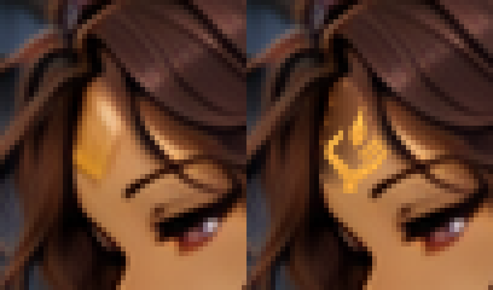
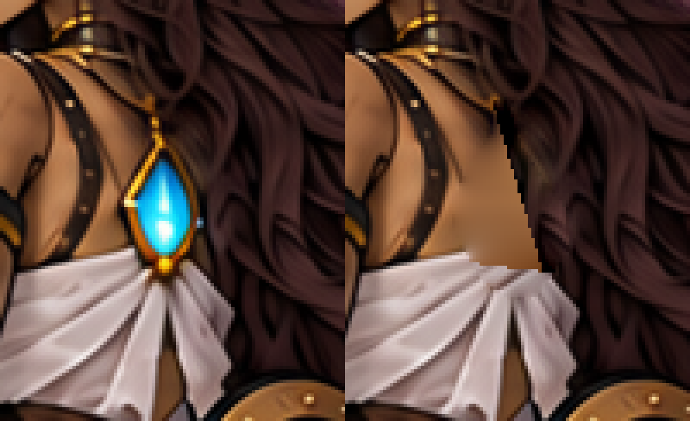
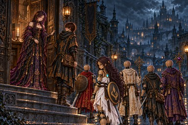

# ch5_end：セラの額の印と背中の灯を修正

引き継ぎ時点：**PR #965でユーザー承認・mainへマージ済み**。以下は候補保存時の制作・検証記録。

PR #961の承認・mainマージ後に次の修正を実装する指示に従い、START_HERE.mdの次の1枚、ch5_end（A-25）を修正した。途中の追記「セラの背中の光っているものは本来胸にあるものなので、背中には付けないで」も反映。ユーザー確認待ちであり、今回の候補は承認済みを意味しない。

## 額の印

正本 [sigil.png](../../../../docs/art/story-refs/sigil.png) の輪郭を抽出して、横顔の額の面と小さい金の印へ合成。角張った掌、左親指1本、右の平行な指3本、短い手首、独立した涙形の炎1つを正本からそのまま縮小・回転した。4倍の作業解像度で13×19相当・−8度に変換し、髪際や眉に重ならない位置を選んだ。

左が修正前、右が採用候補（12倍の最近傍拡大）。

原寸部分：[修正前](before-detail.png)／[採用候補](candidate-detail.png)。[配置した形を白地で確認](placed-shape-12x.png)できる。横顔の額の小さい印なので、細部は縮小画像では読みにくく、原寸部分と拡大で確認する。WebPも[12倍拡大](shipped-detail-12x.png)で照合済み。

候補1は髪際へ重なっていたため[不採用として保存](candidate-1-rejected.png)。原画を保持したまま木面に限って補修し、額内へ収まる位置・寸法・傾きへ調整してから採用した。

## 背中の青白い灯

背中の魂火と金枠・取り付け部分を除去。周囲の木肌・髪・白布の続きとして補修した。胸側に新しい灯は追加していない。黒い首飾り、肩関節、衣装の周囲の線、盾の印と背景の旗は保持。

左が修正前、右が採用候補（5倍拡大）。

原寸部分：[修正前](before-back-detail.png)／[採用候補](candidate-back-detail.png)。WebPも[5倍拡大](shipped-back-detail-5x.png)で照合済み。

| 修正前・384×256 | 採用候補・384×256 |
|---|---|
|  |  |

## 保存・検証

- 額：x801〜815、y502〜525（15×24）内の212画素。
- 背中：x862〜894、y587〜644（33×58）内の1169画素。
- 合計1381画素。**2領域外・盾・旗のRGBは修正前と完全一致**。
- 現在原画：[chapter5/ch5_end.png](../../chapter5/ch5_end.png)。
- 今回の修正前：[fixes/ch5_end-sigil-back-python-before.png](../../fixes/ch5_end-sigil-back-python-before.png)。以前の修正前記録は上書きしていない。
- [採用候補](candidate.png)、[正本の透明輪郭](reference-extracted.png)、[配置した印](placed-crest.png)、[額の補修範囲](removal-mask.png)、[背中の補修範囲](back-removal-mask.png)。
- [verification.json](verification.json)：入力と結果のSHA-256、寸法・位置・変更画素数・採否。
- [make_candidate.py](make_candidate.py)：Pillow・NumPy・SciPyが必要。`python3 art/story-review/sigil-audit/composite-ch5-end/make_candidate.py` で今回保存した修正前と正本から候補を再現する。入力ハッシュが異なれば停止し、指定した2領域外・盾・旗の画素一致も検査する。現在原画へは書き込まない。修正前や不採用候補を現在原画として使わない。

採否ごとにtrack.updateで進捗・現在ハッシュを保存。A-25に背中の灯を除くユーザー指示を記録し「(済)」を付け、build.pyでこの1枚だけWebPへ変換、第五章の確認ページ・縮小見本を更新。登録（場面115枚・由来38枚）、指示書と本文、読み物124場面の検査はすべて合格。

現在は修正不要131枚、修正・確認済み5枚、修正保留8枚、要確認9枚。盾の印の配置は根拠不足で要確認のまま、形や位置を推測では変更していない。irene_restの脚・胸など、ほかの原画は変更していない。次の修正保留はirene_husks（A-26）。
