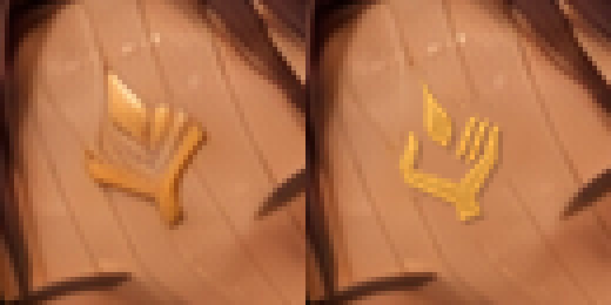
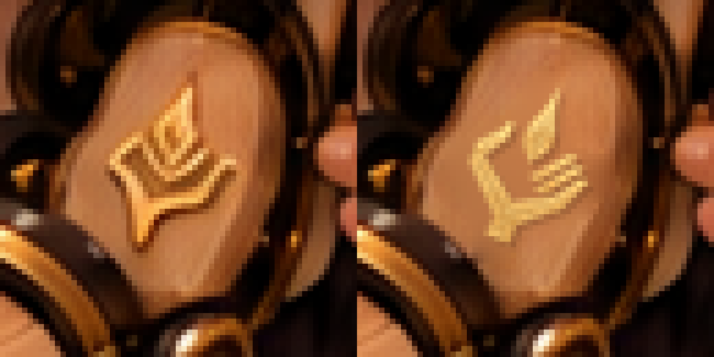
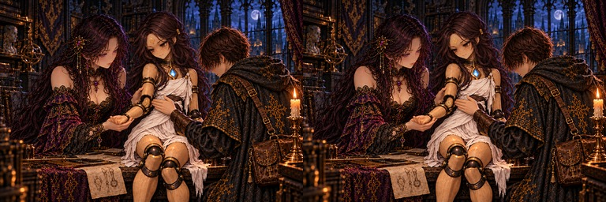
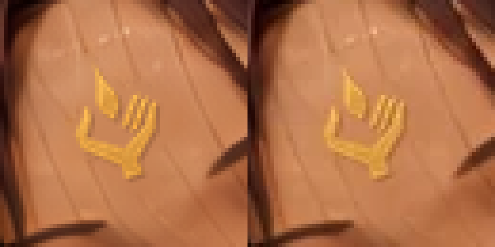
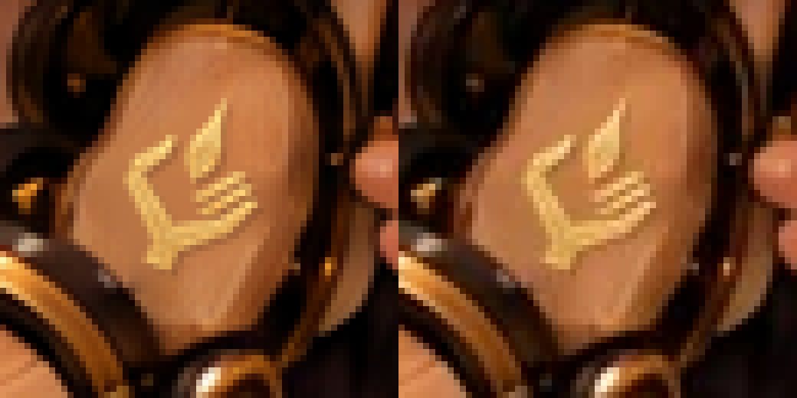

# irene_crest（A-28）：額と肘内側の一門の印

PR [#988](https://github.com/KotaroTao/DOS/pull/988) の承認・mainマージ・Pages公開確認後、最新main `1dbb8a60` から作業。今回の1枚はユーザー確認・mainへのマージ待ち。

現在原画 `art/story-review/chapter7/irene_crest.png` を新規編集の入力に使用。本文と指示書A-28が指定する、額と肘内側の既存の印だけを修正した。形の基準は `docs/art/story-refs/sigil.png`。描き直しや画像生成は行わず、金色から正本の輪郭を抽出した。

旧印と近くの陰を境界色からラプラス補間で除去し、正本の金の濃淡を保って合成。額は20度、肘は−22度回転し、それぞれの面・寸法・金色へ合わせた。左親指1本、右の平行な指3本、角張った掌、短い手首、独立した涙形の炎1つを両方で確認。人物の実際の手指と印の指を区別し、顔・目・髪・肘の位置・手指・関節の金の縁・胸の灯を保持した。

## 比較

いずれも左が修正前、右が採用候補。







以下は左がPNG原画、右が出荷WebP。両方の印について右指3本と独立した炎が保持されていることを目視確認。





## 検査と再現

- 原寸1536×1024。変更1,261画素（額662、肘599）。
- 額の許可領域 `(752,185)–(792,230)`、肘の許可領域 `(723,499)–(762,541)`（右下を含まない）。2領域外1,569,426画素のRGBは修正前と完全一致。
- [validation.json](validation.json)：修正前・正本・再現候補・採用原画・WebPのSHA-256、各変更範囲、領域外一致、153枚の現在ハッシュ照合。
- [build-log.txt](build-log.txt)：`python3 tools/storyart/build.py` 成功。WebP変換、登録、指示書、読み物の検査を通過。
- 開始時と採用後の153枚ハッシュがすべてprogress.jsonと一致。承認済みの7枚は再編集していない。

```bash
python3 art/story-review/sigil-audit/composite-irene-crest/make_candidate.py
python3 art/story-review/sigil-audit/composite-irene-crest/verify.py
```

要Pillow・NumPy・SciPy。再現スクリプトは今回保存した [修正前](../../fixes/irene_crest-sigil-python-before.png) と正本のハッシュに固定し、現在原画へ書き込まない。過去のbefore/・rejected/・候補・古い部分参照を新規編集の入力に使っていない。

track.pyで進捗保存。修正・確認済み8枚（うち今回の1枚は承認待ち）、修正保留5枚、要確認9枚、修正不要131枚。要確認9枚、ch5_endの盾、irene_restの開いた蓋の金の図形は、配置根拠・視認性不足という既存の理由で保留。irene_restの脚・胸も保持。

[第七章の確認ページ](../../review/chapter7.md) ／ [縮小の見本](../../review/chapter7-small.jpg)
