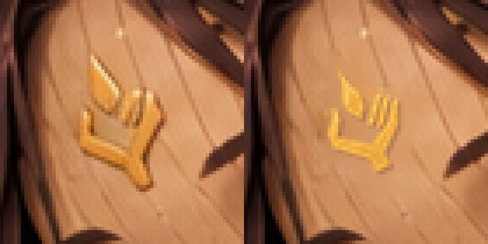
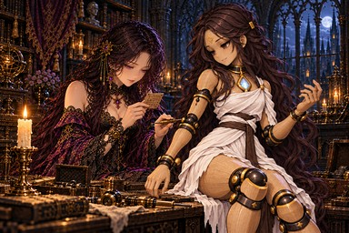

# irene_husks：セラの額の印を正本へ修正

PR #965の承認・mainマージ後に次の修正を実装するユーザー指示に従い、START_HERE.mdの次の1枚、irene_husks（A-26）をPython局所合成で修正した。今回の候補は採用し、ユーザー確認待ち。承認済みを意味しない。

正本 [sigil.png](../../../../docs/art/story-refs/sigil.png) の輪郭を抽出し、角張った掌・左親指1本・右の平行な指3本・短い手首・独立した涙形の炎1つをそのまま小さい金の印にした。23×32相当の印を4倍の作業解像度で25度回転してから縮小し、額の傾きに合わせた。旧杯状の印のごく近くの木肌だけを周囲から補間し、金色の調子と小さい浮き彫りの陰を合わせている。

## 比較

左が修正前、右が採用候補（8倍の最近傍拡大）。

原寸部分：[修正前](before-detail.png)／[採用候補](candidate-detail.png)。[配置した輪郭の白地での拡大](placed-shape-8x.png)でも形を確認できる。WebPも[8倍拡大](shipped-detail-8x.png)で照合済み。

| 修正前・384×256 | 採用候補・384×256 |
|---|---|
|  |  |

## 変更範囲・保存・検証

変更は **x912〜940、y149〜192（29×44）内の742画素だけ**。範囲外のRGBは修正前と完全一致する。イレーヌの額・髪飾り、セラの顔・目・髪・白い衣装・胸側の灯、手や関節の金の縁を保持した。胸の灯を背中へ付ける変更はない。

- 現在原画：[chapter5/irene_husks.png](../../chapter5/irene_husks.png)。
- 今回の修正前：[fixes/irene_husks-sigil-python-before.png](../../fixes/irene_husks-sigil-python-before.png)。以前の修正前記録は上書きしていない。
- [採用候補](candidate.png)、[正本から抽出した透明輪郭](reference-extracted.png)、[配置した印](placed-crest.png)、[旧印の除去範囲](removal-mask.png)、[木肌補修後](cleaned-detail.png)。
- [verification.json](verification.json)：入力と結果のSHA-256、位置・寸法・変更画素数・採否。
- [make_candidate.py](make_candidate.py)：Pillow・NumPy・SciPyが必要。`python3 art/story-review/sigil-audit/composite-irene-husks/make_candidate.py` で今回保存した修正前と正本から候補を再現する。入力のハッシュが変われば停止し、額の範囲外の画素一致も検査する。現在原画へは書き込まない。修正前や過去の不採用候補を現在原画として使わない。

照合・採用後にtrack.updateで進捗と現在ハッシュを保存し、A-26に「(済)」を付けた。build.pyで原画1枚だけWebPへ変換し、第五章の確認ページ・縮小見本を更新。登録（場面115枚・由来38枚）、指示書と本文、読み物124場面の検査はすべて合格。保存した修正前から再生成した候補は採用原画とバイト単位で一致し、153枚の進捗ハッシュも一致した。

現在は修正不要131枚、修正・確認済み6枚、修正保留7枚、要確認9枚。ch5_endの額・背中の修正はPR #965で承認・mainへマージ済み。irene_restの脚・胸を含め、ほかの原画は変更していない。次の修正保留はirene_lineage（A-27）。
