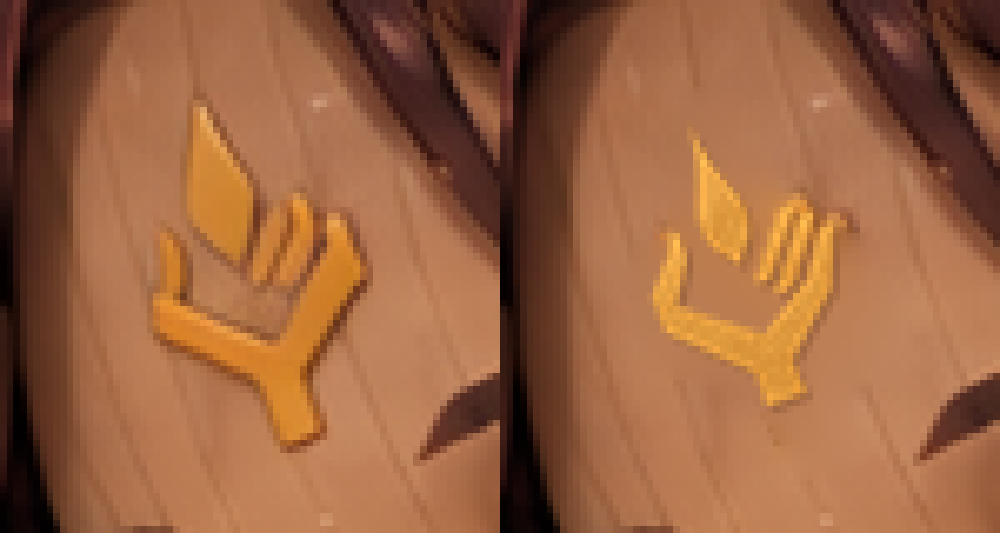
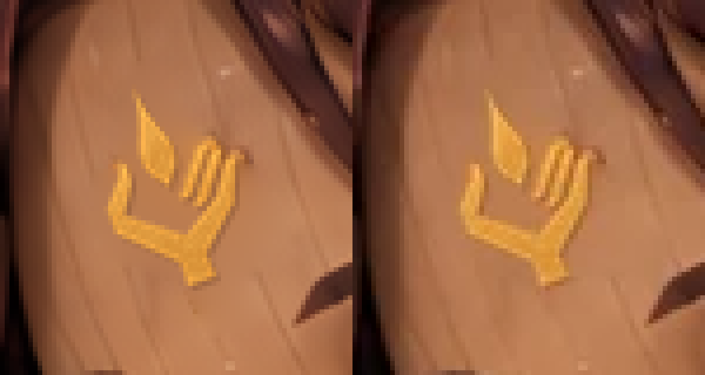

# irene_lineage（A-27）：額の一門の印

最新main `9831d711` から作業。対象は現在原画 `art/story-review/chapter6/irene_lineage.png` のセラの額だけ。ユーザーの確認・mainへのマージ待ち。

旧印は杯状の掌と上向きの短い突起だった。正本 `docs/art/story-refs/sigil.png` の金色から輪郭を抽出し、額の傾きへ20度回転して金色・小さい寸法へ合わせた。輪郭の描き直しや画像生成は行っていない。角張った掌、左親指1本、右の平行な指3本、短い手首、上に独立した涙形の炎1つを確認した。

旧印と近くの陰は領域の境界色からラプラス補間で除去。正本の金の濃淡を保持して局所合成した。顔・目・髪・手・胸の灯は保持。隠れた関節内側への印の追加は行わない。

## 比較

左が修正前、右が候補（採用原画）。




左がPNG原画、右が出荷WebP。WebPでも右指3本と独立した炎を目視確認。



## 検査と再現

- 原寸1536×1024。変更1,344画素。変更範囲は `(950,157)–(990,218)`（右下を含まない）。
- 許可領域 `(944,156)–(992,218)` の外側1,569,888画素でRGBが完全一致。
- [validation.json](validation.json)：入力・正本・候補・採用原画・WebPのSHA-256、領域外一致、153枚の現在ハッシュ照合。
- [build-log.txt](build-log.txt)：`python3 tools/storyart/build.py` 成功。WebP変換、登録、指示書、読み物の検査を通過。
- 開始時の153枚照合でmainの更新があったirene_reveal・report_w04は現在原画を384×256と本文で再確認し、修正不要の判定とハッシュをtrack.pyで更新。画像は変更しない。

```bash
python3 art/story-review/sigil-audit/composite-irene-lineage/make_candidate.py
python3 art/story-review/sigil-audit/composite-irene-lineage/verify.py
```

要Pillow・NumPy・SciPy。再現スクリプトは今回保存した修正前 [irene_lineage-sigil-python-before.png](../../fixes/irene_lineage-sigil-python-before.png) と正本のSHA-256に固定し、現在原画へ書き込まない。初回編集はprogress.jsonのmasterの現在原画を確認してから保存した今回の修正前を使用した。過去の候補・古い部分参照は入力に使っていない。

進捗はtrack.pyで保存。修正・確認済み7枚（うち今回の1枚は承認待ち）、修正保留6枚、要確認9枚、修正不要131枚。承認・マージ済み6枚は再編集していない。要確認9枚、ch5_endの盾、irene_restの開いた蓋の金の図形は配置根拠不足・視認性不足という既存の理由で保留。irene_restの脚・胸を含め、今回以外の原画は保持。

[第六章の確認ページ](../../review/chapter6.md) ／ [縮小の見本](../../review/chapter6-small.jpg)
