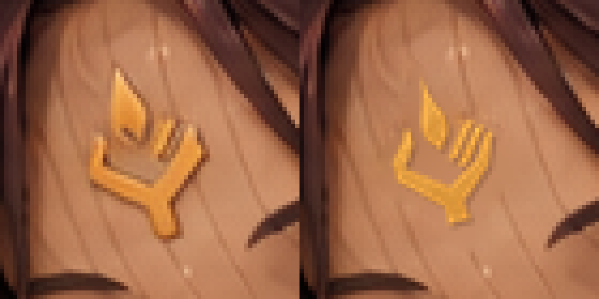
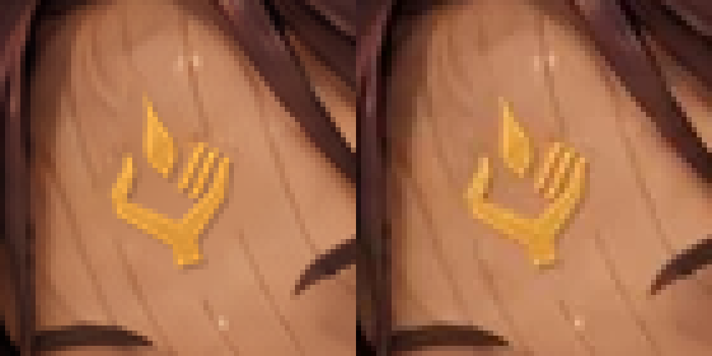

# irene_order（A-29）：額の一門の印

PR [#990](https://github.com/KotaroTao/DOS/pull/990) をユーザー指示でmainへマージし、Pages公開成功・公開サイトの版一致を確認。最新main `388cac00` から今回の作業を行った。この1枚はユーザー確認・mainへのマージ待ち。

現在原画 `art/story-review/chapter7/irene_order.png` のセラの額の旧印だけを修正。旧印は杯状の掌・上向きの短い突起だった。正本 `docs/art/story-refs/sigil.png` の金色から輪郭を抽出し、15度回転して額の傾き・既存の小さい寸法・金色へ合わせた。形の描き直し・画像生成は行っていない。

旧印と近くの陰は境界色からラプラス補間で除去。正本の金の濃淡を保持して合成し、角張った掌、左親指1本、右の平行な指3本、短い手首、独立した涙形の炎1つを確認。イレーヌの額、セラの顔・目・髪・手を組む姿勢・胸の灯を保持し、隠れた関節内側へ印を追加しない。

## 比較

左が修正前、右が採用候補。




左がPNG原画、右が出荷WebP。WebPも拡大で右指3本と独立した炎の保持を目視確認。



## 検査と再現

- 原寸1536×1024、変更806画素。変更範囲 `(924,139)–(958,185)`（右下を含まない）。
- 額の許可領域 `(921,137)–(960,186)` の外側1,570,953画素のRGBは修正前と完全一致。
- [validation.json](validation.json)：修正前・正本・候補・採用原画・出荷WebPのSHA-256、領域外一致、153枚の現在ハッシュ照合。
- [build-log.txt](build-log.txt)：`python3 tools/storyart/build.py` 成功。変更1枚のWebP変換、登録・指示書・読み物の検査が通過。
- 開始時と採用後、153枚の現在ハッシュがprogress.jsonとすべて一致。承認済み8枚を再編集していない。

```bash
python3 art/story-review/sigil-audit/composite-irene-order/make_candidate.py
python3 art/story-review/sigil-audit/composite-irene-order/verify.py
```

要Pillow・NumPy・SciPy。再現スクリプトは今回の現在原画から保存した [修正前](../../fixes/irene_order-sigil-python-before.png) と正本のハッシュに固定し、現在原画へ書き込まない。過去の候補・before/・rejected/・古い部分参照は新規編集の入力に使用しない。

進捗はtrack.pyで保存。修正・確認済み9枚（今回の1枚は承認待ち）、修正保留4枚、要確認9枚、修正不要131枚。要確認9枚、ch5_endの盾、irene_restの開いた蓋の金の図形は配置根拠・視認性不足の既存の理由で保留。irene_restの脚・胸も保持。次はirene_rain（A-30）。

[第七章の確認ページ](../../review/chapter7.md) ／ [縮小の見本](../../review/chapter7-small.jpg)

PR #990のマージ時にはmain更新による自動生成のstatus.mdの衝突をbuild.pyで解消。A-28のPNG・WebPは承認時と同一であることを確認した。mainで更新されたw06_rollは本文と384×256で再確認し、修正不要の判定と現在ハッシュだけ更新。
