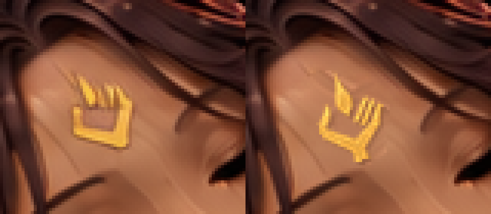
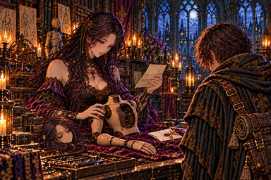

# irene_torso：許可されたPython局所合成の1枚試作

引き継ぎ時点：**PR #959でユーザー承認・mainへマージ済み**。以下は候補保存時の制作・検証記録。

ユーザーの「Pythonによる局所合成を許可します。まずirene_torsoの1枚を修正してPRを作ってください」に従った修正。A-23のセラの額だけを変更し、今回の候補を採用した。ユーザー確認待ちであり、承認済みを意味しない。ほかの10枚は今回の作業対象外。

正本 [sigil.png](../../../../docs/art/story-refs/sigil.png) の金色部分から輪郭を抽出した。掌・親指・3本の右指・短い手首・独立した涙形の炎は描き直さず、額の大きさと傾きに合わせて縮小・18度回転し、金色の調子と小さな陰を合わせた。旧印のごく近くの木肌は周囲の色の補間と近傍の細かな質感で補った。

変更範囲は原寸1536×1024の **x330〜356、y717〜748（27×32ピクセル）内の659画素**。範囲外のRGBは修正前と完全一致する。イレーヌの額・髪飾り、セラの顔・目・髪、胴・腕・手・関節、構図・背景には変更がない。隠れた腕の内側への追加はしない。

## 比較

左が修正前、右が修正後。8倍の最近傍拡大は、形と指の隙間の確認用。

| 修正前・384×256 | 採用候補・384×256 |
|---|---|
|  |  |

原寸部分：[修正前](before-detail.png)／[採用候補](candidate-detail.png)。WebPの圧縮後も[8倍拡大](shipped-detail-8x.png)で照合済み。

## 保存・再現・検証

- 現在原画：[chapter3/irene_torso.png](../../chapter3/irene_torso.png)。
- 今回の修正前：[fixes/irene_torso-sigil-python-before.png](../../fixes/irene_torso-sigil-python-before.png)。以前のirene_torso-before.pngは上書きしていない。
- [採用候補](candidate.png)、[正本から抽出した透明輪郭](reference-extracted.png)、[旧印の除去範囲](removal-mask.png)、[補った木肌の部分](cleaned-detail.png)。
- [verification.json](verification.json)：正本・修正前・修正後・WebPのSHA-256、座標、変更画素数、採否。
- [make_candidate.py](make_candidate.py)：Pillow・NumPy・SciPyが必要。リポジトリルートで `python3 art/story-review/sigil-audit/composite-irene-torso/make_candidate.py` を実行すると、保存した今回の修正前と正本だけから候補を再現する。入力のハッシュが異なれば停止し、現在原画へは書き込まない。修正前や過去の候補を現在原画と取り違えない。

候補を拡大・全体で照合してから原画へ反映し、track.updateでprogress.json・progress.mdと現在ハッシュを保存、A-23に「(済)」を付けた。`python3 tools/storyart/build.py` でこの1枚だけWebPへ変換し、第三章の確認ページと縮小見本を更新。登録（場面115枚・由来38枚）、指示書と本文、読み物124場面の検査はすべて合格。

現在は修正不要131枚、修正・確認済み3枚、修正保留10枚、要確認9枚。irene_restの脚・胸の修正を含め、ほかの原画は保持している。
