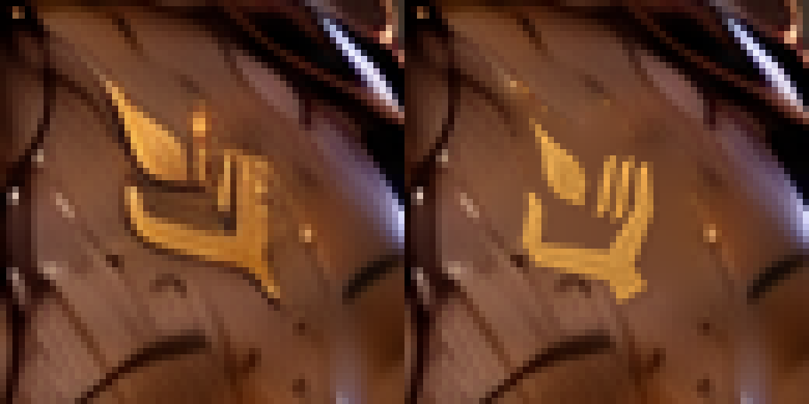
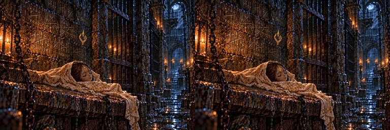
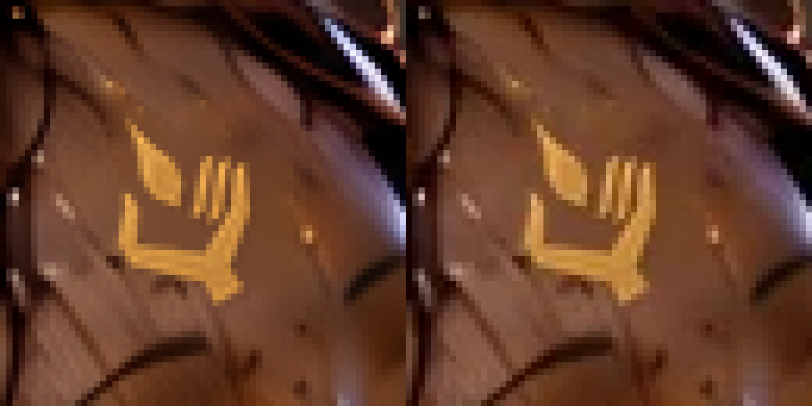
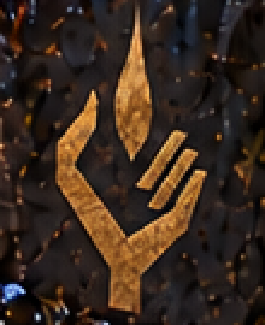

# lore_w07（A-34）：額の一門の印、壁の印は保持

PR [#997](https://github.com/KotaroTao/DOS/pull/997) をユーザー指示でmainへマージ。直後のmain更新によりその公開実行はキャンセルされたため、[後続版のPages公開成功](https://github.com/KotaroTao/DOS/actions/runs/38623938046) と公開サイトの版 `507e3f00dbd9` を確認し、コミット比較が `ahead`（#997のマージを含む）であることを検証した。

main `3d25f624` から作業開始し、後続main `507e3f00` も取り込み。今回の1枚はユーザー確認・mainへのマージ待ち。

現在原画 `art/story-review/dungeons/lore_w07.png` の布に包まれたセラの頭の額だけを修正。正本 `docs/art/story-refs/sigil.png` の金色から輪郭を抽出し、30度回転して額の傾き・既存の小さい寸法・控えめな金色へ合わせた。形の描き直し・画像生成は行っていない。

旧印と近くの陰は境界色からラプラス補間で除去し、正本の金の濃淡を保持して合成。角張った掌、左親指1本、右の平行な指3本、短い手首、独立した涙形の炎1つを確認。壁の印は元から正本の基準に合うため保持し、顔・目・髪・布・牢の構図・光も保持した。

## 比較

左が修正前、右が採用候補。





左がPNG原画、右が出荷WebP。WebPでも右指3本と独立した炎の保持を拡大で目視確認。



保持した壁の印。壁の原画RGBは修正前と完全一致。



## 検査と再現

- 原寸1536×1024、変更800画素。変更範囲 `(654,521)–(690,563)`（右下を含まない）。
- 額の許可領域 `(652,519)–(691,564)` の外側1,571,109画素のRGBは修正前と完全一致。
- 壁の印の領域 `(600,225)–(710,360)` のRGBも別途比較し、完全一致。
- [validation.json](validation.json)：修正前・正本・再現候補・採用原画・WebPのSHA-256、領域外一致、壁の保持、153枚の現在ハッシュ照合、前PRの公開確認。
- [build-log.txt](build-log.txt)：`python3 tools/storyart/build.py` 成功。変更1枚のWebP変換、登録・指示書・読み物の検査が通過。
- 開始時・後続main取り込み時・採用後、153枚の現在ハッシュがprogress.jsonとすべて一致。承認済み12枚を再編集していない。

```bash
python3 art/story-review/sigil-audit/composite-lore-w07/make_candidate.py
python3 art/story-review/sigil-audit/composite-lore-w07/verify.py
```

要Pillow・NumPy・SciPy。再現スクリプトは今回の現在原画から保存した [修正前](../../fixes/lore_w07-sigil-python-before.png) と正本のハッシュに固定し、現在原画へ書き込まない。過去の候補・before/・rejected/・古い部分参照は新規編集の入力に使用していない。

進捗はtrack.pyで保存。修正・確認済み13枚（今回の1枚は承認待ち）、修正保留0枚、要確認9枚、修正不要131枚。引き継ぎの7枚は今回の候補まで修正・確認済み。要確認9枚、ch5_endの盾、irene_restの開いた蓋の金の図形は配置根拠・視認性不足の既存の理由で保留。irene_restの修正済みの脚・胸も保持。

[由来の確認ページ](../../review/dungeons.md) ／ [縮小の見本](../../review/dungeons-small.jpg)
