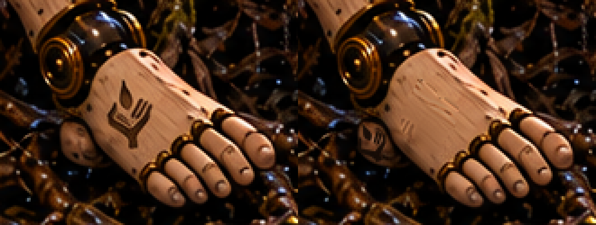
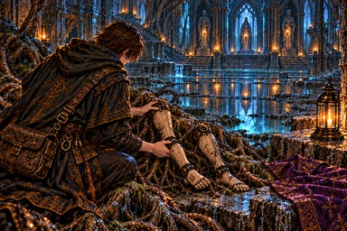

# w16_legs：足の甲の印を内くるぶし近くへ移す

引き継ぎ時点：**PR #961でユーザー承認・mainへマージ済み**。以下は候補保存時の制作・検証記録。

ユーザーの実行指示に従い、A-24の1枚だけをPython局所合成で修正。足の甲の旧印を除き、黒鉄の足首関節に接して露出している内側の木面に、正本の小さい暗い印を配置した。採用した候補はユーザー確認待ちで、承認済みを意味しない。

正本 [sigil.png](../../../../docs/art/story-refs/sigil.png) の金色部分から輪郭を抽出し、その形を描き直さず暗い彫りの色へ変換。18×25相当の小さい印を4倍の作業解像度で25度回転して縮小し、指間の隙間を保った。甲の旧印の範囲は周囲の色を補間し、同じ足の近傍の細かな木肌を補っている。

## 位置と比較

左が修正前、右が採用候補。足指や黒鉄関節の形はそのまま。平らな足の甲には印を残していない。

[位置の説明図](position-guide-4x.png) の青枠は甲の旧印除去、緑枠は関節横の露出した側面の小さい印。説明図の枠は原画には入っていない。

| 修正前・384×256 | 採用候補・384×256 |
|---|---|
|  |  |

原寸部分：[修正前](before-detail.png)／[採用候補](candidate-detail.png)。側面の12倍拡大：[修正前](before-ankle-12x.png)／[採用候補](candidate-ankle-12x.png)。原画の暗い木面と区別して形を確認するため、[同じ縮小・回転後の輪郭を白地で確認](placed-shape-12x.png)できる。角張った掌、左の親指1本、右の平行な指3本、短い手首、独立した涙形の炎1つを照合した。

圧縮後も[WebPの足の4倍拡大](shipped-detail-4x.png)・[側面の12倍拡大](shipped-ankle-12x.png)を照合済み。縮小では小さい暗い印の細部は読みにくいため、形の確認には原寸部分と拡大を用いる。

## 変更範囲・保存・検証

- 旧印除去：x837〜868、y769〜811（32×43）内の858画素。
- 新しい側面の印：x812〜830、y792〜815（19×24）内の232画素。
- 合計1090画素。**この2領域外のRGBは修正前と完全一致**。脚・足・足指・関節・根・弟子の姿勢と形を保持した。
- 現在原画：[chapter4/w16_legs.png](../../chapter4/w16_legs.png)。
- 今回の修正前：[fixes/w16_legs-sigil-python-before.png](../../fixes/w16_legs-sigil-python-before.png)。以前の修正前記録は上書きしていない。
- [採用候補](candidate.png)、[不採用候補1](candidate-1-rejected.png)、[正本から抽出した輪郭](reference-extracted.png)、[配置した印](placed-crest.png)、[旧印の除去範囲](removal-mask.png)、[木肌補修後](cleaned-detail.png)。候補1は側面の右指3本の隙間を判別しにくく不採用。原画を保持したまま寸法・解像・濃さを調整して最終候補を作った。
- [verification.json](verification.json)：座標、画素数、各入力と結果のハッシュ、採否。
- [make_candidate.py](make_candidate.py)：Pillow・NumPy・SciPyが必要。`python3 art/story-review/sigil-audit/composite-w16-legs/make_candidate.py` で今回の保存した修正前と正本から候補を再現する。入力ハッシュが変われば停止し、指定した2領域外の変化も検査する。現在原画へは書き込まない。修正前と不採用候補を現在原画として使わない。

採否ごとにtrack.updateでprogress.json・progress.mdと現在ハッシュを保存。A-24に「(済)」を付け、build.pyでこの1枚だけWebPへ変換し、第四章の確認ページと縮小見本を更新。登録（場面115枚・由来38枚）、指示書と本文、読み物124場面の検査はすべて合格した。

現在は修正不要131枚、修正・確認済み4枚、修正保留9枚、要確認9枚。irene_torsoはPR #959で承認・mainへマージ済み。irene_restの脚・胸の修正を含め、ほかの原画は変更していない。次の保留はSTART_HERE.mdの順ではch5_end（A-25）。
