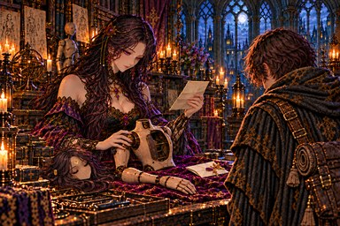
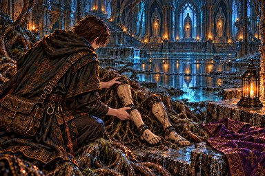
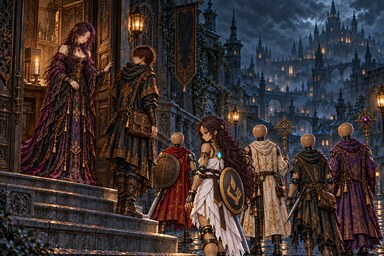
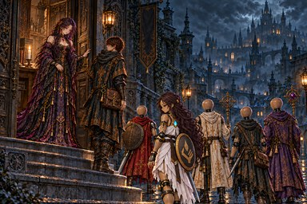
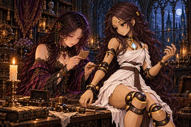
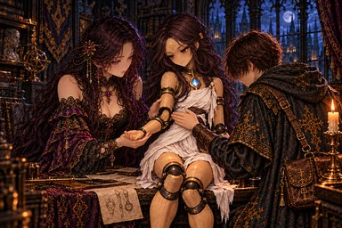
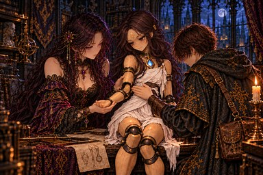
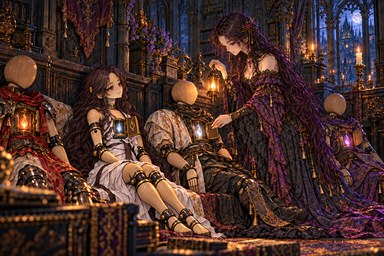
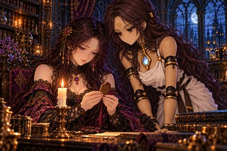

# 一門の印：11枚の再編集候補の照合記録

PR #953の引き継ぎをmain `d4353e92` から再開。PR前にmain `4b8c1521` も取り込み、原画の追加更新は0枚。153枚すべての現在原画ハッシュを照合し、記録との差は0枚。下記11枚をSTART_HERE.mdの順に原寸1536×1024で1枚ずつimagegenへ入力した。

正本は `docs/art/story-refs/sigil.png`。入力の形参照はその既存切り出し `sigil-reference-tight.png` 1枚。最初の2枚は対象＋正本切り出し、残り9枚は対象人物を特定する小さな部分参照1枚も追加した。顔・衣装の追加参照は用いず、image_request_too_largeは発生していない。Pythonは確認用の縮小・切り出し・記録とbuild.pyだけに用い、原画の合成・加工はしていない。

**採用0枚。11候補すべて不採用。** 額の旧杯状／炎状の形や足の甲の印が残り、局所修正の基準を満たさない。原画と出荷WebPはすべて保持し、指示書へ新しい「(済)」は付けていない。irene_restの脚と胸の既存修正を保持。修正不要131枚、修正・確認済み2枚、修正保留11枚、要確認9枚のまま。各採否の直後にtrack.updateでprogress.json・progress.md・現在ハッシュを保存した。

要確認9枚の理由は[進捗](../progress.md)に保持。ch5_endの盾、irene_restの開いた蓋などの要確認箇所にも推測で印を追加・削除・移動していない。

候補原寸は[不採用候補](../rejected/resume/)に保存。**candidateは現在原画ではない。** 原画はattempts.jsonのmaster列を使用する。再開順は[START_HERE.md](../START_HERE.md)。入力・ハッシュ・確認座標・採否は[attempts.json](attempts.json)、現在本文と指示は各brief.md。

| 順 | 対象 | 現在原画（384×256） | 不採用候補（384×256） | 必要部分（現在／候補） |
|---|---|---|---|---|
| 1 | [irene_torso](irene_torso-brief.md) |  |  | [現在](irene_torso-current-detail.png)／[候補](irene_torso-candidate-detail.png) |
| 2 | [w16_legs](w16_legs-brief.md) |  |  | [現在](w16_legs-current-detail.png)／[候補](w16_legs-candidate-detail.png) |
| 3 | [ch5_end](ch5_end-brief.md) |  |  | [現在](ch5_end-current-detail.png)／[候補](ch5_end-candidate-detail.png) |
| 4 | [irene_husks](irene_husks-brief.md) |  |  | [現在](irene_husks-current-detail.png)／[候補](irene_husks-candidate-detail.png) |
| 5 | [irene_lineage](irene_lineage-brief.md) |  |  | [現在](irene_lineage-current-detail.png)／[候補](irene_lineage-candidate-detail.png) |
| 6 | [irene_crest](irene_crest-brief.md) |  |  | [現在](irene_crest-current-detail.png)／[候補](irene_crest-candidate-detail.png) |
| 7 | [irene_order](irene_order-brief.md) |  |  | [現在](irene_order-current-detail.png)／[候補](irene_order-candidate-detail.png) |
| 8 | [irene_rain](irene_rain-brief.md) |  |  | [現在](irene_rain-current-detail.png)／[候補](irene_rain-candidate-detail.png) |
| 9 | [irene_rest](irene_rest-brief.md) |  |  | [現在](irene_rest-current-detail.png)／[候補](irene_rest-candidate-detail.png) |
| 10 | [irene_names](irene_names-brief.md) |  |  | [現在](irene_names-current-detail.png)／[候補](irene_names-candidate-detail.png) |
| 11 | [lore_w07](lore_w07-brief.md) |  |  | [現在](lore_w07-current-detail.png)／[候補](lore_w07-candidate-detail.png) |

irene_crestの肘内側：[現在](irene_crest-current-elbow.png)／[不採用候補](irene_crest-candidate-elbow.png)。

検証：`python3 tools/storyart/build.py` は変更原画0枚、場面115枚・由来38枚の登録、指示書と本文、読み物124場面の検査に合格。
