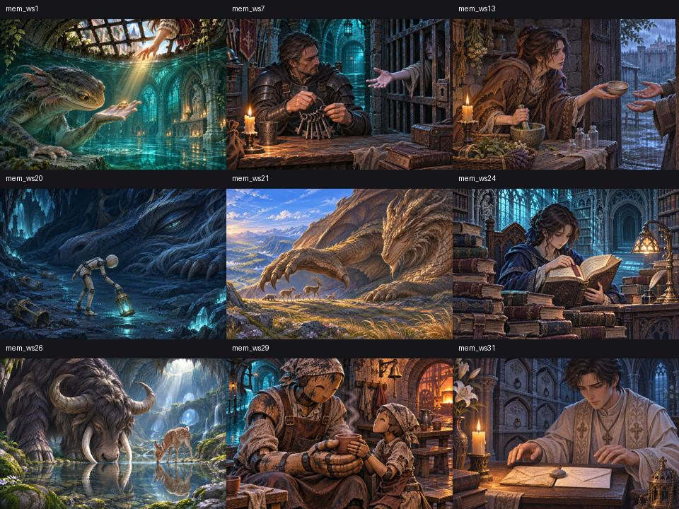

# 主の記憶の統合

2026-11-07 ユーザー依頼。宿敵の再戦を廃止し、全24主の記憶を初回討伐後とストーリー一覧へ統合。

本編第九章の舞台「闘技場跡」と、その迷宮・物語は維持する。既存15場面の専用絵は維持し、寄り道9場面の本文と専用絵を追加。旧再戦の短編16件は初回記憶へ移設した。

| 主 | 場面 | 記憶の題 | 専用絵 |
|---|---|---|---|
| 骸の修道院長 | mem_w03 | 止められても進んだ人 | [確認](../../art/story/chapter1/mem_w03.webp) |
| 坑道の主 | mem_w05 | 師が残した帰り道 | [確認](../../art/story/chapter1/mem_w05.webp) |
| 砦の主 | mem_w09 | 砦を捧げた書状 | [確認](../../art/story/chapter2/mem_w09.webp) |
| 霧の森の主 | mem_w13 | 魂の流れを登る師 | [確認](../../art/story/chapter3/mem_w13.webp) |
| 沈める神官王 | mem_w17 | 水の底の戴冠 | [確認](../../art/story/chapter4/mem_w17.webp) |
| 業火の主 | mem_w21 | 大釜の前の二人 | [確認](../../art/story/chapter5/mem_w21.webp) |
| 氷結回廊の主 | mem_w25 | 氷の玉座の前で | [確認](../../art/story/chapter6/mem_w25.webp) |
| よどみの主 | mem_w29 | ただひとつの言いつけ | [確認](../../art/story/chapter7/mem_w29.webp) |
| 嵐の尖塔の主 | mem_w33 | 縛られた魂 | [確認](../../art/story/chapter8/mem_w33.webp) |
| 闘技場の支配者 | mem_w37 | 十三度目の灯 | [確認](../../art/story/chapter9/mem_w37.webp) |
| 宰相モルデン | mem_w41 | 階段の前のふたり | [確認](../../art/story/chapter10/mem_w41.webp) |
| 大書庫の主 | mem_w45 | 終わりの頁 | [確認](../../art/story/chapter11/mem_w45.webp) |
| 王家の廟の主 | mem_w49 | もう、よい | [確認](../../art/story/chapter12/mem_w49.webp) |
| 溶鉄炉の主 | mem_w53 | 明日の鎚 | [確認](../../art/story/chapter13/mem_w53.webp) |
| ふいごの鬼 | mem_ws29 | ひと息の長さ | [確認](../../art/story/chapter13/mem_ws29.webp) |
| 水路の主 | mem_ws1 | 待ち続けた指輪 | [確認](../../art/story/chapter1/mem_ws1.webp) |
| 鉄房の看守長 | mem_ws7 | 最後の鍵 | [確認](../../art/story/chapter2/mem_ws7.webp) |
| 疫病のリッチ | mem_ws13 | 薬を待つ手 | [確認](../../art/story/chapter7/mem_ws13.webp) |
| 大空洞の主 | mem_ws20 | 灯籠を拾う足音 | [確認](../../art/story/chapter10/mem_ws20.webp) |
| 化石竜 | mem_ws21 | 岩になる前の空 | [確認](../../art/story/chapter10/mem_ws21.webp) |
| 禁書の巨像 | mem_ws24 | 閉じなかった本 | [確認](../../art/story/chapter11/mem_ws24.webp) |
| 原初の獣 | mem_ws26 | 追われなかった朝 | [確認](../../art/story/chapter12/mem_ws26.webp) |
| 深淵の聖堂の主 | mem_w57 | 最初の返事 | [確認](../../art/story/chapter14/mem_w57.webp) |
| 賛美歌の司祭 | mem_ws31 | 二通の手紙 | [確認](../../art/story/chapter14/mem_ws31.webp) |

## 既存記録の扱い

- 踏破・主の討伐・記憶の読了・旧再戦の記憶のいずれかの記録があれば、その主の記憶をストーリーから閲覧可能。未討伐の記憶は伏せる。
- 閲覧・再閲覧で戦闘・報酬の再付与や物語の進行は起こさない。既読の記録だけを更新する。
- 旧再戦中の記録は従来の復帰処理で隊と行き先を戻す。クラウド戦闘の中断処理も保持する。
- 取得済みの首級の強化・戦績・勲章の保存IDは維持。達成不能になった再戦勲章の次の目標は表示しないが、達成済み・未受領の報酬は受領可能。首級の再戦による追加強化は終了する。
- 旧記録の追加エピソードをまとめて強制再生せず、街のストーリーから読めるようにする。

## 検証

`python3 tools/storyart/build.py`（変換・登録・指示書・読み物検査）、`python3 tools/journal/boss-memories-browser.py`（24主の初回・中断・再討伐、旧セーブ、再戦廃止と帰還、390/1280pxの再閲覧）、`node tools/progression/check.mjs`、`node tools/cloud/cancel-check.mjs`。

酒場の心得は `t_rematch1`・`t_rematch2` を更新し、`t_boss_memories` を追加。イレーヌの `h_rematch` も新しい案内へ変更。
