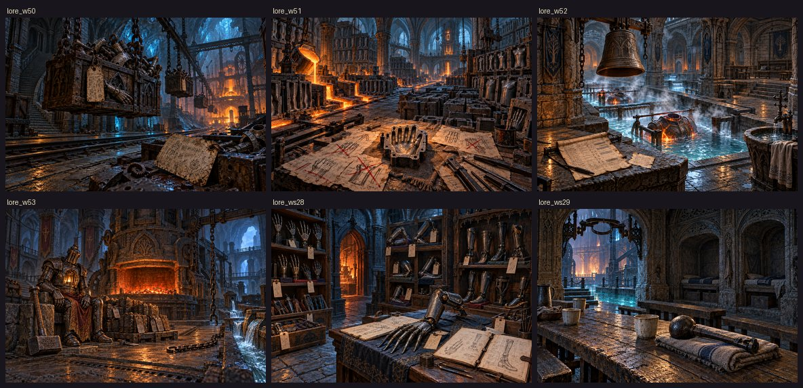
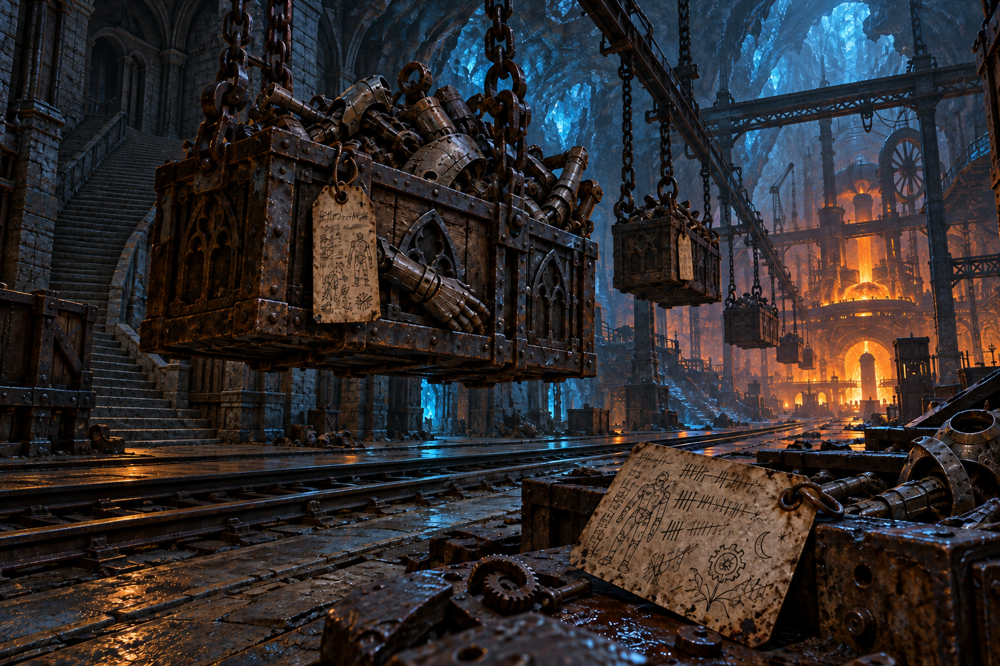
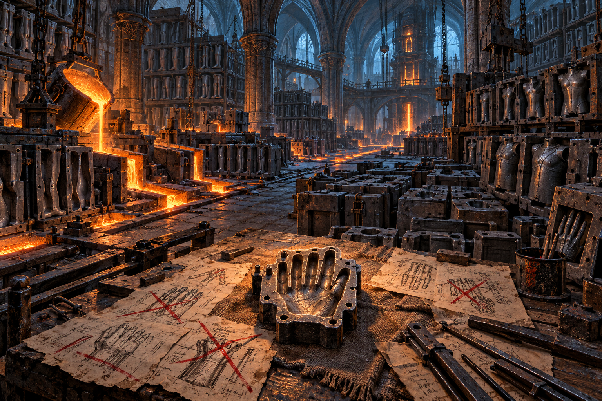
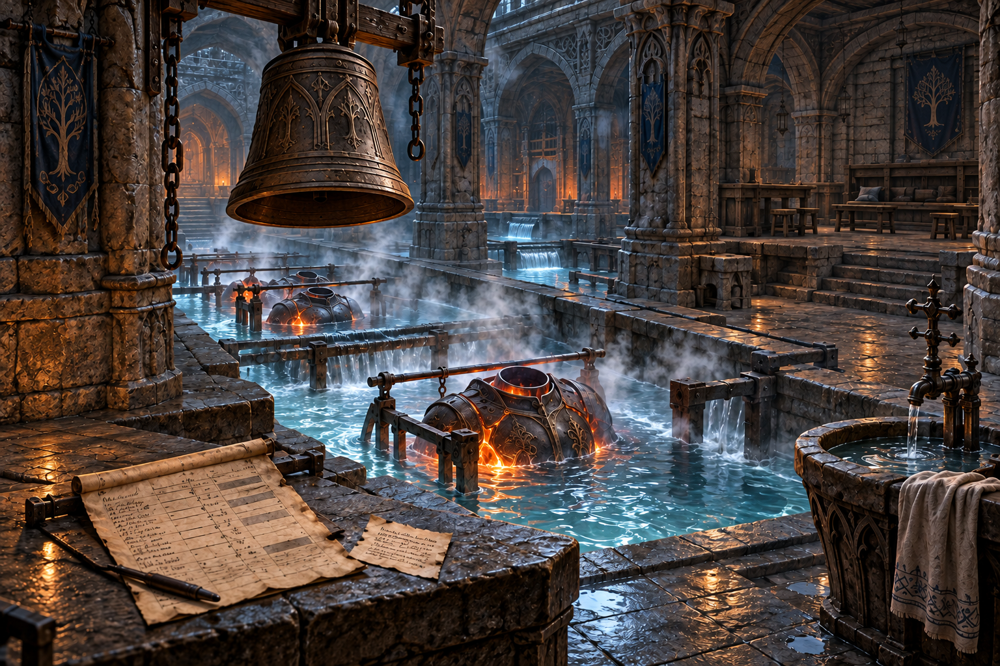
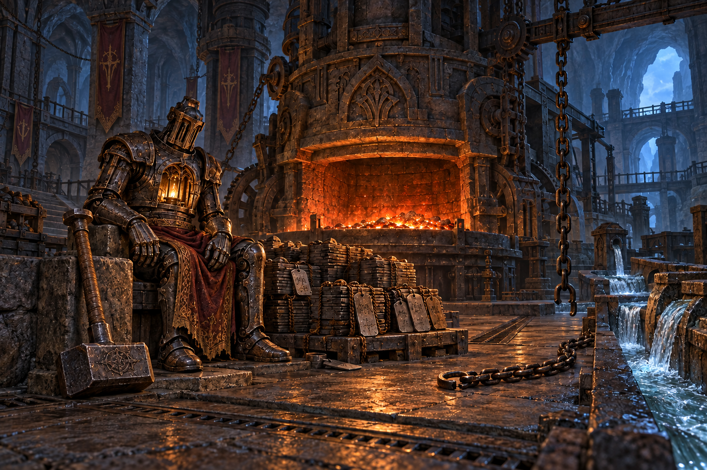
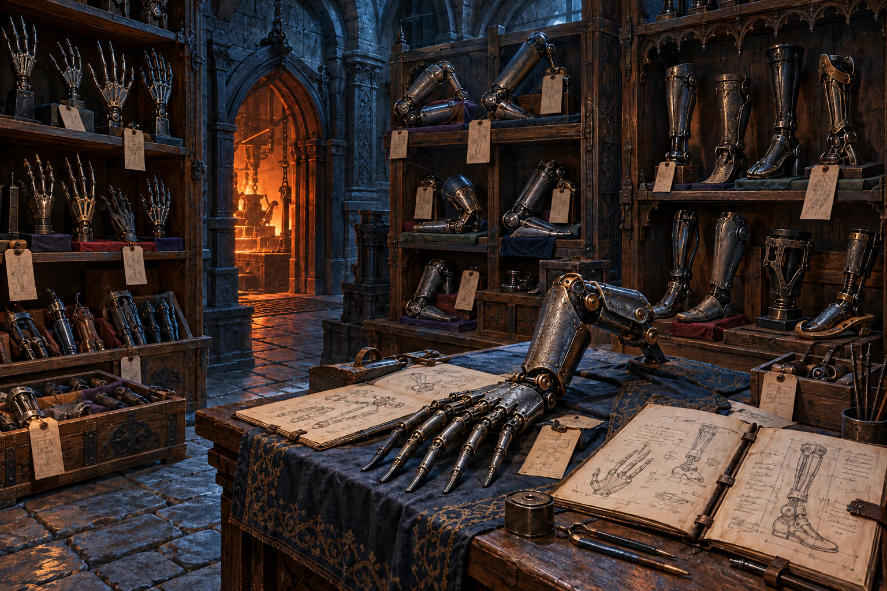
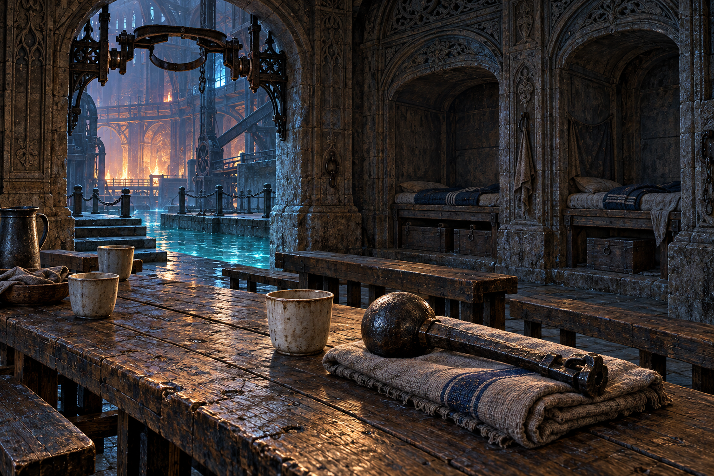

# 第13章「溶鉄炉」― 踏破した迷宮の由来6枚

2026-10-20制作。各 `node tools/storyart/prompt.mjs lore_<迷宮ID>` の本文・前置きに従い、画像生成で制作。参照画像の指定は6枚ともなし。

原画は1536×1024 PNG、出荷画像は `python3 tools/storyart/build.py` による品質88のWebP。

## 確認した内容

- 搬入路の荷箱と注文札、鋳造場の個人用の手の型、水路の打ち棒がない鐘を確認。
- 大炉は低い火とし、工房長の灯・手の届く鎚・外した鎖・流れる冷却水を残した。
- 継ぎ手の保管庫は個人に合わせた部品と寸法帳、休憩所は湯飲み・寝床・外して保管した打ち棒を描いた。
- 無人の場所の吊り灯・ろうそくを除き、炉火と水面や鉱脈の反射を光源とした。
- 読める文字や先の章の秘密、魂を鉄の材料にする表現は入れない。
- 384×256の縮小表示で各迷宮の主題を確認。

## 原画と本文

### lore_w50「鉄くずの搬入路」 踏破した迷宮の由来

> 玉座の裏の階段が行き着く、鉄くずと壊れた器の搬入路。鎖につられた荷箱が、誰もいない工房へ下っていく
> 王家の廟で働く者たちの亡骸が傷むと、代わりの器が要った。廟の下の鉱脈に工房が建ち、鉄の器を送り出す道が通された。
> 亡骸を使わず、火にも耐える器は、多くの者を支えた。だが仕事の札は、働き手が壊れるたびに同じ型を求め、何度でも搬入路へ戻ってきた。
> 札の裏には、仕事とは違う、その者自身の望みが刻まれている。

### lore_w51「千型の鋳造場」 踏破した迷宮の由来

> 鉄の腕、脚、胸の鋳型が天井まで並ぶ工房。どの型にも持ち主の名の代わりに、仕事の名が打たれている
> 工房の初めの型は、一人ずつの手や足に合わせて作られていた。注文が増えるにつれ、仕事ごとに同じ型を使うようになった。
> 千の型で作るほうが早く、多くの器が渡せた。その代わり、型に合わない望みは、規格外の赤い線で消された。
> 捨てられずに残った小さな手の型だけが、誰のために作られたかを覚えている。

### lore_w52「焼き入れの水路」 踏破した迷宮の由来

> 熱した器を冷ます水槽が、段々に連なる水路。蒸気の向こうで、交代を知らせない鐘だけが揺れている
> 焼き入れの水路は、できた器を冷やし、次の工程へ渡すために掘られた。水は下からくみ上げられ、何度も使われた。
> 交代の鐘が鳴れば、働き手は水路の脇で手を洗い、休憩所へ向かった。器を替えれば働けるようになると、休む時刻だけが当番表から消えた。
> 今日は休みたい。鐘の下に残った言葉は、仕事を嫌った者の言葉ではなかった。

### lore_w53「休まぬ大炉」 踏破した迷宮の由来

> 工房すべてへ鉄を送り続ける大炉。炉の前には、器を求める古い注文が、鉄板の束になって積み上がっている
> 大炉の工房長は、待つ者のため、自ら鉄の器に戻ることを望んだ。工房が休まなくなったのは、その善意からだった。
> 注文を取り消す者がいなくなっても、札は残った。返事を確かめることなく、工房長は同じ器を作り、壊れるたびに同じ仕事へ戻された。
> 明日も作りたい、今日は休みたい。その声を聞いた隊は、新たな注文の鎖を外し、大炉を低い火にした。灯と鎚は、そこに残った。

### lore_ws28「継ぎ手の置き場」 踏破した迷宮の由来

> 鋳造場から外れた、寸法の合わない継ぎ手の保管庫。仕事の型から外れた手足が、捨てられずに積まれている
> 同じ型に合わない部品を、工房の修繕師たちは捨てずに残した。長すぎる指、曲がった肘、一人のためだけの足が、棚に積まれている。
> 部品には、使う者の望みを記した寸法帳が添えられた。握れた、歩けたという書き足しもある。
> 仕事に合う器と、本人に合う器。その違いを忘れないための置き場だった。

### lore_ws29「鐘のない休憩所」 踏破した迷宮の由来

> 水路の脇に残った、働き手のための食堂と寝床。休みを告げる鐘は外され、冷たい湯飲みだけが席を待っている
> 工房の炊事番が、働き手のために水路の脇へ作った食堂と寝床。火に強い鉄の体でも、温かい湯を囲む時間はあった。
> 誰も休みに来なくなると、炊事番は交代の鐘の打ち棒を外し、ここへしまった。用のない食堂だと思われるのが、怖かった。
> 湯を飲まなくても、仕事を忘れて座っていられる場所がある。鐘は、そのために鳴らしてもよかった。

