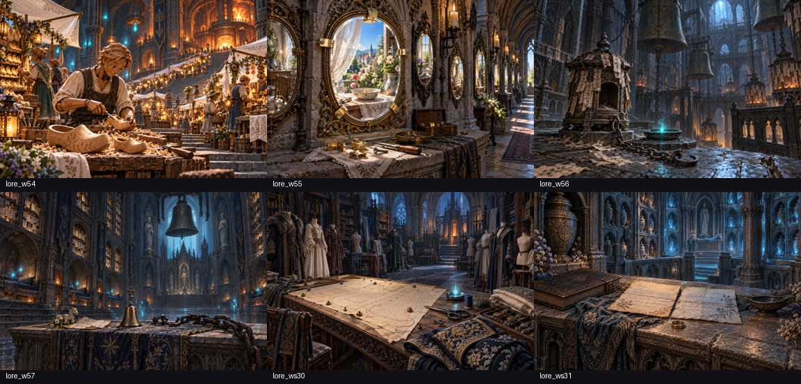

# 第十四章 ― 迷宮の由来6枚

2026-10-22制作。各 `node tools/storyart/prompt.mjs lore_<迷宮ID>` の本文・前置きに従い画像生成。参照画像の指定は全6枚なし。原画は1536×1024 PNG、出荷は `python3 tools/storyart/build.py` の品質88 WebP。制作時の依頼は [prompts.md](prompts.md)。

- w54 祈りの石段：地下の白布の市、戻った靴職人、地上の娘のための大小の木靴。初稿にいた娘と屋外の空は修正済み（初稿は lore_w54-before.png）。
- w55 再会の回廊：祈りの皿と地上の庭を映す鏡、修理した留め具。
- w56 呼び声の鐘楼：祈りの紙の炉、鳴り続ける鐘、外した一つの鎖と休む灯。
- w57 祈り果てぬ大聖堂：祈りの紙、切り離した鎖、返事を待つ鈴と休む場所。
- ws30 針と糸の支度部屋：袖・すその線を引き直した型紙と異なる留め具、選べる衣。
- ws31 返らぬ手紙の納骨室：隣に置いた二通の手紙、名簿と遺品、火のない皿。

384×256で主題・読める文字がないことを確認。後の章の秘密は描かず、本文は変更しない。酒場の心得は既存の画像表示の説明の範囲内なので変更なし。
