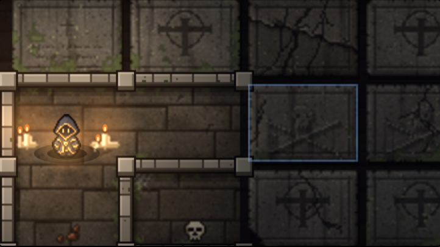
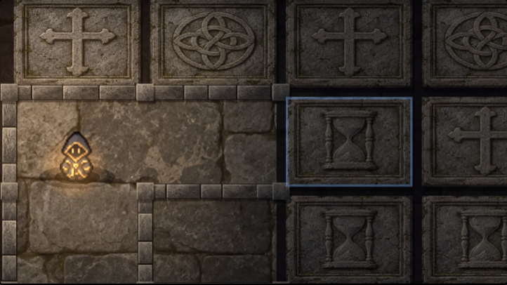

# 地下墓地の石材 — 拡大表示向け原画

「忘れられた地下墓地」(w01、B1F〜B5F) の床・墓石・壁を、描き下ろしの石材へ置き換える。
拡大表示とタップ移動は維持し、彫刻・面取り・ひび・石の粒子を原画に持たせる。
人物・宝箱・階段などの絵は従来のまま。ここは提案の手順1〜2の範囲。

[実画面の比較](review/index.html) · [操作・描画の確認結果](review/checks.json)

| 修正前 | 修正後 |
|---|---|
|  |  |

比較画面は同じ乱数の種で作った盤面を使用する。床と壁を見やすくするため、確認用に左下の一部のマスを開けている。実際の初期配置のスクリーンショットは `review/initial-mobile.png`。

## 素材

- `crypt-materials-master.png`: 1536×1024。上段の512×512の3区画が十字・環状の紋・砂時計の墓石。右下が壁用石材。左下と中央下の床候補は制作見本として残すがゲームでは使わない。
- `crypt-floor-master.png`: 1536×1024。敷石を連続して描いた一枚の床。鏡合わせや反復で模様が現れないよう、盤面の縦横比に合わせて切り出す。
- 原画はいずれも画像生成で描き下ろし。中立的な照明の石材とし、ゲーム側で角灯・蝋燭・闇を重ねる。
- ゲームへ出荷するのは `art/dungeon/crypt-materials.webp` と `crypt-floor.webp`。原画・見本・検査ツールは公開配置から除外される。

## 描画

`src/cryptpaint.js` が素材を遅延取得する。両方の取得が完了するまでは既存の手続き描画を使い、完了後に画像を使ったキャッシュへ切り替える。取得失敗・寸法不正でも探索を止めない。

床と墓石は論理座標の3倍で焼き、壁も同じ密度で合成する。めくる蓋の切り出し座標にも密度を適用し、拡大前の解像度へ落とさない。床・墓石のキャッシュは2組まで。遊びの乱数は消費せず、彫刻の違いはマスの中身を示さない。

## 再変換・確認

```bash
bash tools/crypt/build.sh
python3 -m http.server 8000
# 別の端末。PlaywrightとChromiumを用意して実行する。
node tools/crypt/verify.cjs
```

Playwrightが別の場所にある場合は `NODE_PATH` にその `node_modules` を指定する。サーバーのURLは `CRYPT_REVIEW_URL` で変更できる。

確認対象: 読み込み遅延・失敗時の旧描画、読込完了時の切り替え、同じ階の再描画と乱数の保持、タップとめくり、ドラッグ、全体表示、地下墓地全5階、他の迷宮、画面幅320/375/390/600px・PC。横向きでは既存の縦向き案内を維持する。

`checks.json` の時間はローカルのヘッドレスChromiumでの描画呼び出しの測定値。実機のフレームレートを保証する数値ではない。
