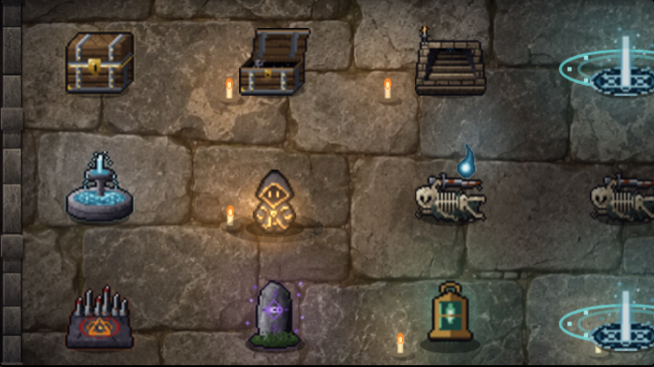
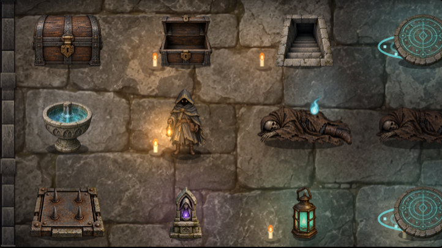

# 地下墓地の人物・小物 — 手順3

忘れられた地下墓地（w01、B1F〜B5F）の人物と小物を、床・墓石・壁に合う高解像度の絵へ更新する。

[素材と装いの一覧](review/gallery.png) · [スマホ画面](review/after-mobile.png) · [初期配置](review/initial-mobile.png) · [検査結果](review/checks.json)

| 変更前 | 変更後 |
|---|---|
|  |  |

比較は同じ種の盤面に小物を配置した確認用画面。初期配置は別に記録した。

## 原画と出荷物

透過PNGを画像生成で描き下ろし、WebPへ変換する。原画と確認画像は公開配置から除外する。

- `props-a-master.png`（1536×1024）: 閉じた宝箱、開いた空箱、下り階段、泉、遺体、帰還の印。
- `props-b-master.png`（1536×1024）: 罠、祭壇、手帳、主の扉、魂火、角灯。手帳は未使用。師の手がかりには角灯を使い、窓の火だけ青緑へ着色する。
- `walker-master.png`（1254×1254）: 下・上・左・右を向く探索者。暗いフード、金の縁取り、革の装具、角灯を共通に描く。
- 出荷物: `art/dungeon/crypt-props-a.webp`・`crypt-props-b.webp`・`crypt-walker.webp`、合計約1.1MiB。

切り出し範囲は `src/cryptactors.js` の `CRYPT_PROP_FRAMES` と方向別の枠で管理する。固定の等分割ではなく、実際の透過境界に合わせる。

## 描画と状態

画像は独立して読み込む。未到着・取得失敗・寸法不正の素材は従来のスプライトで描き、他の素材の表示を妨げない。

外套7色と縁取り4色は元の陰影を残して着色する。角灯と透過は保持し、装いのキャッシュは3組まで。4方向、移動の揺れ、浮遊と足元の影を維持し、同じマスの小物が見えるよう人物の位置と大きさを調整する。

宝箱は開封後に空箱になる。遺体は残り、魂を持ち帰るまでは魂火を添える。泉は飲んだ後も空の鉢として残る。罠・出来事・手がかりは既存の解決状態に従う。階段・帰還の印・主の扉も既存の条件で選ぶ。未発見の内容は描かず、魔物・セーブ形式・遊びの乱数は変更しない。死体・泉は全迷宮で状態を描き分ける。

## 再変換と確認

```bash
bash tools/crypt/build-actors.sh
python3 -m http.server 8000
# 別の端末で実行（PlaywrightとChromiumが必要）。
node tools/crypt/verify-actors.cjs
```

Playwrightが別の場所にある場合は `NODE_PATH` を指定する。確認用の状態アクセスは検査時の配信にだけ追加し、ゲームには出荷しない。

確認対象: 読込遅延・全画像失敗・一部失敗、未発見と解決済みの状態、外套と縁取り28組、透過と角灯の保持、4方向のタップ移動、ドラッグ・全体表示・浮遊・小物との同居、幅320/390/600/1280px、他の迷宮、遊びの乱数とキャッシュ上限。ローカルChromiumでの検査であり、実機の速度測定ではない。


## 死体の種類・空の泉・ポップアップの統一

[現在の14種一覧](states-review/popup-gallery.png) · [盤面](states-review/board.png) · [偉大なる死体の選択画面](states-review/corpseGreat-popup.png) · [検査結果](states-review/checks.json)

追加原画 `props-c-master.png`（1536×1024、透過PNG）は、顔をフードで隠し、片腕を投げ出して力尽きた冒険者・偉大なる鎧の人物・乾いた泉・風化した骨を別々に描いた。元の素材集を参照して画像生成し、`crypt-props-c.webp`（約337KiB）として出荷する。手順3当初の比較画像は以前の記録として保持する。

- 死体は `corpseGreat` を優先し、次に `corpseWarm`、どちらもなければ風化した死体を描く。回収・調査後も同じ姿が残り、魂火だけが消える。全長は探索者の身長と同じ基準を維持する。
- 泉は `cleared` で空の鉢へ切り替える。再度飲めず、オート移動の未解決対象にも戻らない。回復量・呪い・使用回数は変更しない。
- 共通のスプライト差し替え口で、作成済み14種のポップアップ・通知・行動ボタンを盤面と同じ切り出しに統一する。元の装備用の差し替えも維持する。画像到着後は開いているポップアップも更新され、取得失敗時は旧絵を表示する。

| 場所・種類 | 現在の対応 |
|---|---|
| 地下墓地の人物、宝箱開閉、階段、主の扉、帰還陣、罠、出来事、師の角灯、魂火 | 高解像度素材 |
| 全迷宮の死体3種類、泉・空の泉 | 高解像度素材、状態差分あり |
| 上記小物14種のポップアップ・通知 | 高解像度素材に統一 |
| 他迷宮の床・壁・人物、死体・泉以外の盤面小物 | 地下墓地用素材の展開は未対応 |
| 魂の残火・金貨・危険表示・守衛・入口 | 汎用5種も高解像度化済み（下記） |
| 魔物 | 今回の高解像度小物素材への置き換え対象外 |

```bash
node tools/crypt/verify-states.cjs
# 従来の操作・装いの確認画像を一時フォルダへ出す場合
CRYPT_REVIEW_OUT=/tmp/crypt-actors-review node tools/crypt/verify-actors.cjs
```

あたたかい死体は、眠っているような仰向け・組んだ手の姿を改め、顔の見えないフードと崩れた姿勢、折れた短剣で探索中の死を示す。変更前の原画は `fixes/props-c-before-hidden-face.png` に保持。


## 汎用アイコンと魂火の中央配置

[汎用5種と小さい通貨表示](common-review/common-gallery.png) · [遺体中央の魂火](common-review/soul-centered.png) · [魂の残火のポップアップ](common-review/ember-popup.png) · [検査結果](common-review/checks.json)

`props-d-master.png`（1536×1024、透過PNG）は、既存の質感を参照して画像生成した魂の残火・金貨・危険印・守衛・入口の旗の原画。出荷は `crypt-props-d.webp`（約339KiB）。残火は青い魂火と区別できる橙色の炎と燃える欠片、金貨は古い金貨の山、危険印は毒・熱・雷などに共通で使える三角の警告板として描く。守衛は顔の隠れた兜と槍・盾、入口は塔の紋のある赤い旗を維持する。

通知・ポップアップの共通差し替えに5種を追加し、合計19種を原画化。小さな残火と金貨の表示も同じ原画から切り出した `crypt-ember.webp`・`crypt-gold.webp` を使う（各6KiB未満、96px以内）。表示枠や数字の間隔は変更しない。いずれも `build-actors.sh` で再生成できる。

死体の魂火は従来の右寄せを取り除き、遺体中央を基準に小さく揺れる。光源も中央へ合わせる。駒と遺体が同じマスにいる時は、遺体を右へ寄せた分だけ魂火と光源も寄せる。大きさは元のまま、動きを減らす設定では中央で静止する。

確認: `node tools/crypt/verify-common.cjs`。通常・同居時の魂火と光源の中央位置、汎用5種類の原画描画、小さい通貨表示、320/390/1280px、遅延・取得失敗時のポップアップ、ゆらめきありの描画を確認する。

## 遺体の壁越え修正

遺体3種を `corpses-seated-master.png` の座り姿へ更新。立っている探索者と同じ体の比率で膝を曲げ、上体を起こしている。左から風化・あたたかい・偉大なる遺体。出荷画像は `art/dungeon/crypt-corpses-seated.webp`。元の `props-c` は空の泉に引き続き使う。

横幅をマスの高さから決める処理をやめ、マス幅の76%（探索者と同居する時は50%）を上限にする。縦横比を変形せず、左右の壁に余白を残す。魂火・回収状態・選択画面の3種の区別は維持する。表示のみの修正のため、酒場の心得の変更はない。

確認: [壁際の盤面](seated-review/board.png) · [選択画面一覧](seated-review/popup-gallery.png) · [検査結果](seated-review/checks.json)。幅320/390/600/1280px、拡大/全体、探索者との同居で、遺体3種の実描画矩形がマス内に収まることを検査した。再確認は `CRYPT_STATES_OUT=docs/art/crypt/actors/seated-review node tools/crypt/verify-states.cjs`。
