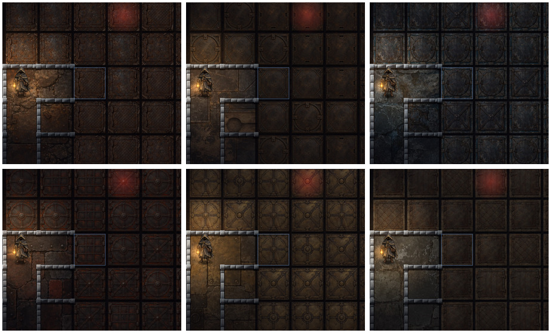

# 第十三章「溶鉄炉」の探索素材

本筋 w50〜w53 と寄り道 ws28/29、全6迷宮・65階に専用の床・未踏の蓋3種・壁材を適用する。

| 迷宮 | 素材 |
|---|---|
| 鉄くずの搬入路（w50） | さびた鉄板、鎖のすれ跡、鉄くずの残る石床 |
| 千型の鋳造場（w51） | 青銅の留め金、鋳型の跡を残す鉄床 |
| 焼き入れの水路（w52） | 青灰色の石、冷えた鉄、白い水のしみ |
| 休まぬ大炉（w53） | 焼けた黒鉄、赤茶色の耐火れんが、細かな灰 |
| 継ぎ手の置き場（ws28） | 真ちゅう色の金具、継ぎ目、部品蔵のすれた鉄板 |
| 鐘のない休憩所（ws29） | 冷たい灰緑の石床、端に残るわらと水のしみ |

画像生成による原画12枚は、このフォルダの `<ID>-materials-master.png` と `<ID>-floor-master.png`。各1536×1024px。素材集の上段は蓋3種、右下は壁材。床は別原画の一枚の連続面を切り出し、反転・反復しない。蓋に下段の床が混ざらないよう、w51=472・w52=496・w53=504・ws29=500pxの切り出し高を設定（w50/ws28は512px）。

制作指示は、真上からの正投影・文字や記号なし・人物なし・境界のない3列2段の素材集、床は分割のない連続した一面とした。鋳型や継ぎ手は器を作る工房の部材で、魂を鉄の材料として描かない。蓋の形は中身と無関係。人物・小物は共通原画、熱い床・焼き入れの水・荷の落とし口は既存の仕掛け表示を重ねる。

配信は品質88のWebP12枚、計6.60MiB。原画・制作記録・確認画像は公開物に含めない。公開物は約369MiB。`sw.js` のASSETSに全12枚を登録し、キャッシュ版は `dos-dev` を維持。酒場の心得 `t_forge_stonework` を追加。

再生成・確認:

```sh
bash tools/crypt/build-dungeons.sh w50 w51 w52 w53 ws28 ws29
python3 -m http.server 8000 --bind 127.0.0.1
NODE_PATH=/opt/codex/runtimes/cua/lib/node_modules CRYPT_REVIEW_OUT=docs/art/dungeons/review-chapter13 node tools/crypt/verify-dungeons.cjs w50 w51 w52 w53 ws28 ws29
```

最新main（85912301、戦闘背景・出撃画面・依頼人肖像を含む）との統合後もローカルChromiumで141項目成功。対象全65階と地下墓地、320/390/600/1280px幅、横向き、取得失敗・片方の失敗・寸法不正・遅延、タップ・蓋めくり・ドラッグ・全体表示、遊びの乱数保持、蓋が中身を示さないこと、危険な床、対象外の迷宮、キャッシュ上限を確認。実機での速度測定は含まない。JS構文・差分の空白・画像寸法・ASSETSの全ファイルの存在と新規画像の重複登録がないことも確認。

検査結果: [checks.json](review-chapter13/checks.json)。下の見本は左上から w50 / w51 / w52 / w53 / ws28 / ws29。


