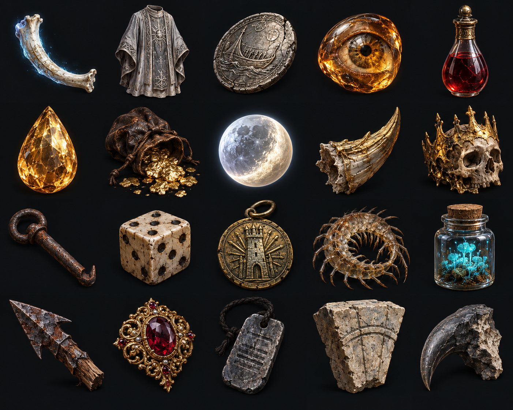

# 奉納品41〜60

src/catalog/misc.js の収集品の並び（1始まり）。原画は5列×4行、左上から右へ順に対応する。原画から各枠を切り出し、320×320のWebPで出荷する。

41. 誓いのあばら骨 — `m_oath_rib`
42. 屍灰織りの祭服 — `m_ash_woven_vestment`
43. 冥府の渡し賃 — `m_ferrymans_fee`
44. 黄金に焼かれた眼 — `m_gold_seared_eye`
45. 竜に挑んだ者の血 — `m_challenger_blood`
46. 竜の涙石 — `m_dragon_tear_stone`
47. 竜金のこぼれ袋 — `m_hoard_flake_pouch`
48. 死者を送る月の玉 — `m_mourning_moon_orb`
49. 古竜の砕け角 — `m_elder_horn_shard`
50. 王冠ごと溶けた頭の骨 — `m_crown_fused_skull`
51. 足かせの留め針 — `m_rusted_shackle_pin`
52. 囚人の骨サイコロ — `m_prisoners_dice`
53. 看守長の印 — `m_warden_signet`
54. 地虫の抜け殻 — `m_centipede_husk`
55. 光りこけの小瓶 — `m_phosphor_moss_jar`
56. 攻城戦の矢じり — `m_siege_arrowhead`
57. 城守りの妻の飾り留め — `m_chatelaine_brooch`
58. 傭兵の認識札 — `m_mercenary_tag`
59. 城壁を支えた石 — `m_battlements_keystone`
60. 石像鬼の欠け爪 — `m_gargoyle_chip`

