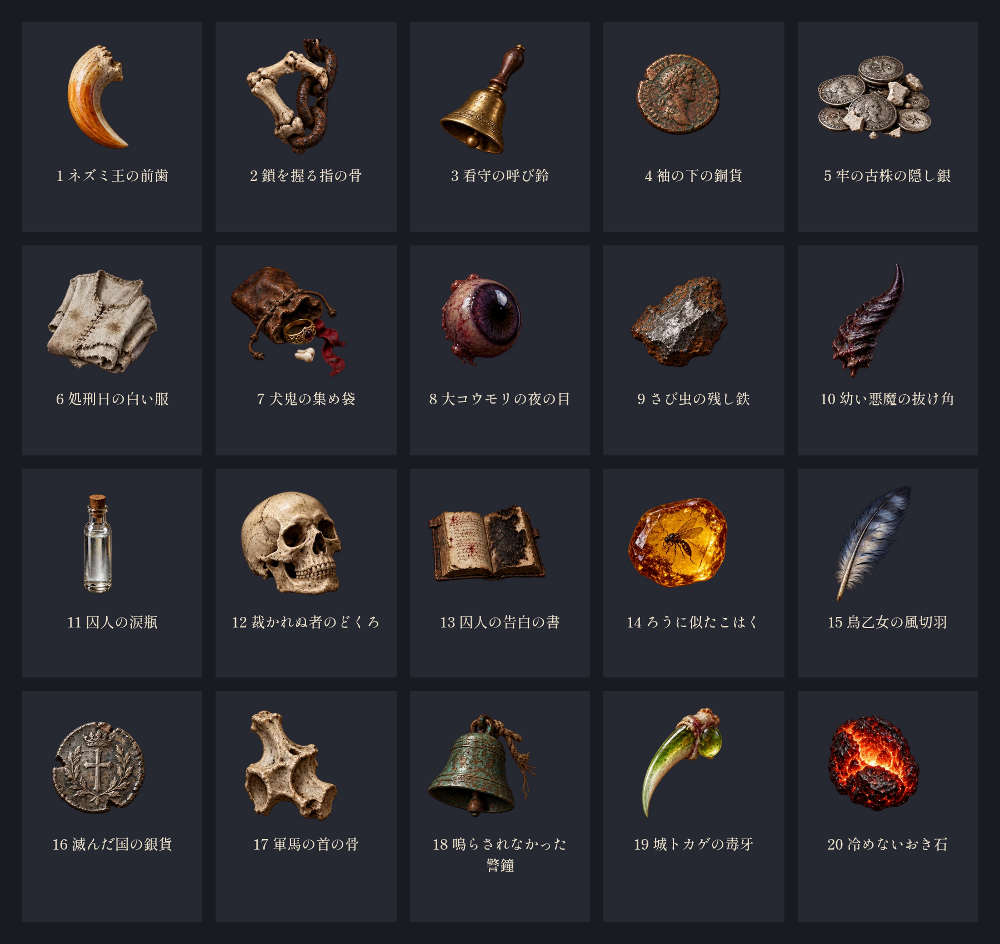
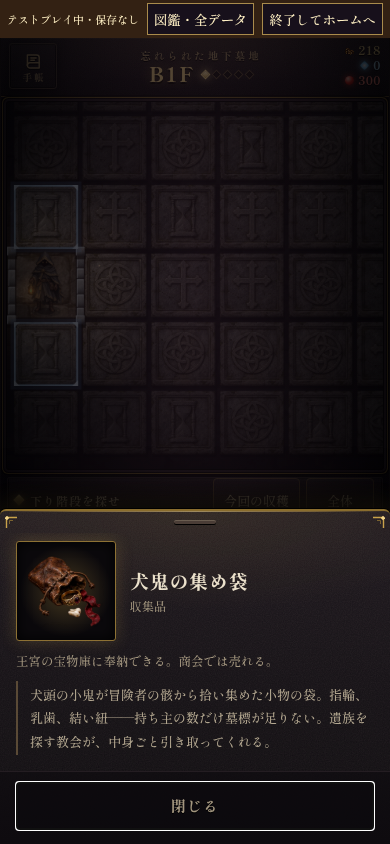

# 奉納品1〜20

`src/catalog/misc.js` の登録順。原画は `01-20-master.png`、出荷用は `art/offerings/<id>.webp` (320×320、透過)。原画を各品ごとに切り出し、余白を付けてWebPに変換。

1. ネズミ王の前歯 — `m_rat_king_tooth`
2. 鎖を握る指の骨 — `m_chained_finger`
3. 看守の呼び鈴 — `m_gaoler_bell`
4. 袖の下の銅貨 — `m_bribe_copper`
5. 牢の古株の隠し銀 — `m_unlisted_cell_key`
6. 処刑日の白い服 — `m_execution_shroud`
7. 犬鬼の集め袋 — `m_kobold_keepsake`
8. 大コウモリの夜の目 — `m_bat_night_eye`
9. さび虫の残し鉄 — `m_rust_worm_iron`
10. 幼い悪魔の抜け角 — `m_imp_milk_horn`
11. 囚人の涙瓶 — `m_tear_bottle`
12. 裁かれぬ者のどくろ — `m_unjudged_skull`
13. 囚人の告白の書 — `m_gaol_confession`
14. ろうに似たこはく — `m_candle_amber`
15. 鳥乙女の風切羽 — `m_harpy_pinion`
16. 滅んだ国の銀貨 — `m_lost_realm_silver`
17. 軍馬の首の骨 — `m_warhorse_neckbone`
18. 鳴らされなかった警鐘 — `m_silent_alarm`
19. 城トカゲの毒牙 — `m_wall_lizard_fang`
20. 冷めないおき石 — `m_undying_ember`

確認: Chromiumで全20点の描画と残り88点の対象外を確認。スマホ幅390pxの品の詳細で表示を確認。画像取得を全失敗させても元の絵で探索画面が起動し、JavaScript例外なし。構文・既存108点の固有絵・SWの配信ファイル存在も検査済み。

再出力: `python3 tools/offerings/export.py` (Pillow・NumPy・SciPy・Nodeが必要)。
