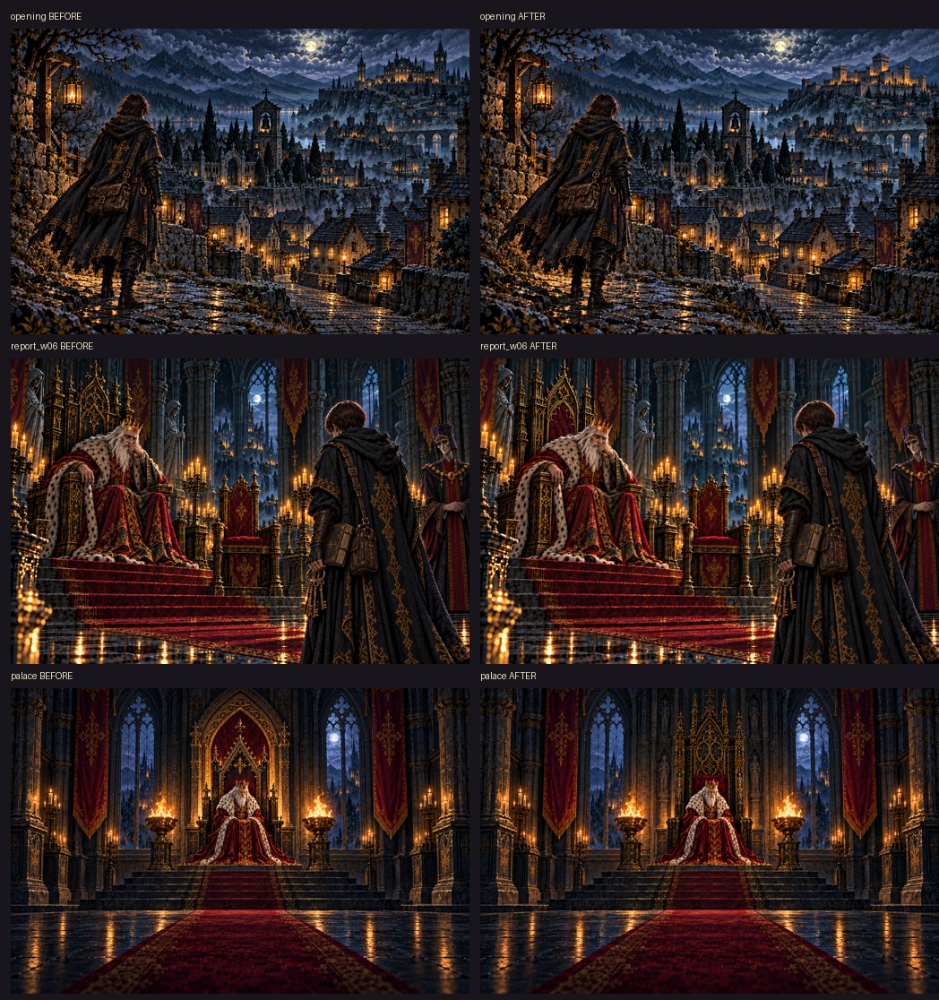

# 王宮のデザイン統一

2026-10-16。王宮を描く既存の原画を比較し、造りの違いが明確な3枚を修正した。外観は街の昼夜パノラマ、玉座の間は既存の制作依頼が参照する第三章 `report_w12` に合わせた。

| 修正した絵 | 変更 |
|---|---|
| 序章「師のいない街へ」 | 岩山の城を、街のパノラマと共通の四角い塔・段状の城壁・中央の角塔へ |
| 第二章「守れと命じ、迎えなかった」 | 丸い天蓋を黒と金の細長い尖頭アーチ形の玉座へ |
| 通常の王宮背景 | 大きな別体の天蓋を取り除き、物語と共通の黒と金の玉座へ |

視点や構図が違うことと、建物の造りが違うことを分けて確認した。王と弟子の動作、杯や膝掛け、宰相の在席、章ごとの空模様は各場面に従う。百年前の王国、地底の廃都、凍王の玉座、王家の廟は別の場所として扱う。

共通基準は [制作指示書2-5](../codex-story-art-brief.md#2-5-王宮の建築を統一する基準)。`prompt.mjs` は玉座の間の全50場面（未制作の第十二章も含む）に共通の建築指示と `report_w12` を付け、序章の外観には街のパノラマを付ける。場面を増やす際も `illustration.setting === "throne"` を用いる。基準を人物や小道具と同じ指示書から読むため、二重管理しない。

## 確認

- `python3 tools/storyart/build.py`: 変更した物語原画2枚のみをWebPへ変換。登録・制作指示・読み物159場面の検査に合格。
- `python3 tools/townart/build.py --only palace` と `--check`: 王宮背景を変換し、登録・原画の整合を確認。
- 玉座の間50場面への建築指示・参照画像の付与、凍王や王家の廟・館への非適用を確認。
- 物語本文・ゲームの規則・保存データは変更しない。酒場の心得の追加・更新は対象外。

物語の確認ページ: [序章](../../../art/story-review/review/chapter0.md) / [第二章](../../../art/story-review/review/chapter2.md)。縮小の見本: [序章](../../../art/story-review/review/chapter0-small.jpg) / [第二章](../../../art/story-review/review/chapter2-small.jpg)。

実際の物語UIでの表示（390×844 / 744×1000）:

| 画像 | スマホ | タブレット |
|---|---|---|
| 王宮背景 | [表示](palace-390.png) | [表示](palace-744.png) |
| 街への道 | [表示](opening-390.png) | [表示](opening-744.png) |
| 第二章の報告 | [表示](report_w06-390.png) | [表示](report_w06-744.png) |

実行時エラー・読み込み結果: [checks.json](checks.json)。変更前の原画は `art/story-review/fixes/` および `docs/art/town/refs/` に保存。
