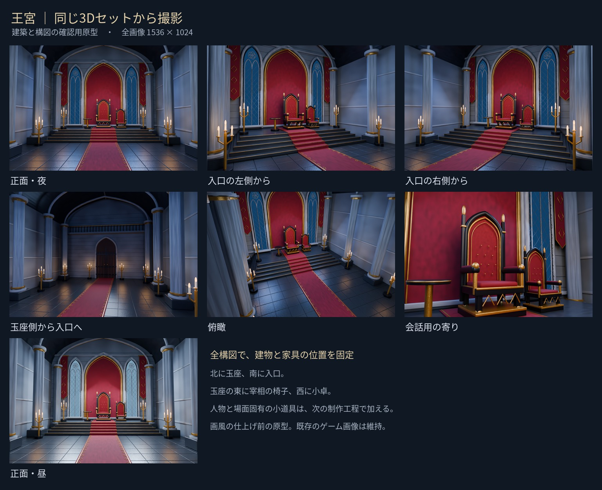

# 王宮・玉座の間の3D撮影セット

2026-10-23制作。王宮の背景を同じ建物から撮影できるようにするための原型。
既存の [正面基準画](../palace-front.png) の配色と家具配置をもとに、新しく立体化した。
原画の彫刻や装飾を完全に再現した完成イラストではなく、建築・構図を固定する制作資料。
今回、ゲーム内の画像・本文・画像登録には変更を加えていない。

その後、ユーザーの依頼により [DOS画風の完成背景7枚](finished/README.md) を制作。
以下の画像とBlender原本は、完成背景のもとになった3D原型として保持している。

## 確認用画像



| 構図 | 画像 | 用途 |
|---|---|---|
| 正面 | [front.png](front.png) | 全体の配置。中央の通路から玉座を見る |
| 左斜め | [left.png](left.png) | 入口の左側から玉座を見る |
| 右斜め | [right.png](right.png) | 入口の右側から玉座を見る。左右反転ではなく別のカメラ |
| 逆方向 | [reverse.png](reverse.png) | 玉座の側から南の入口を見る |
| 俯瞰 | [high.png](high.png) | 入口側の高い位置から床と家具の配置を見る |
| 会話 | [audience.png](audience.png) | 玉座の近くへ寄った会話用の構図 |
| 昼の正面 | [front-day.png](front-day.png) | 同じ建物・カメラで窓光を変えた比較用差分 |

画像は1536×1024。夜6構図と昼1構図を同じジオメトリから撮影する。
人・杯・地図・手記など、場面によって変わるものは置いていない。

## 固定したもの

- 北に王の玉座、南に両開きの入口。入口上に小さな回廊。
- 王の玉座の東に宰相の小さな椅子、西に丸い小卓。
- 五段の階段と壇、金の縁が付いた深紅の中央通路。
- 玉座の左右の尖頭窓、外側の深紅の旗、束ね柱、天井のリブ。
- 灰色の石、黒い磨き石、黒鉄、古い金、深紅の織物。

座標は X=東、Y=北、Z=上、単位m。家具の座標と全カメラは
[cameras.json](cameras.json) と `.blend` 内に記録している。
人物の追加では床をZ=0、壇上をZ=1として大きさと足元を合わせる。

## 開く・再撮影する

Blender 4.3以降で [palace.blend](palace.blend) を開く。
`camera-front` など6台のカメラが保存されている。カメラを切り替えても家具は動かない。
人物の仮模型を置けば、座面・視線・手渡し位置を検討できる。
すべての制作物は `docs/` 配下に置き、公開サイトの容量には加えない。

リポジトリのルートで実行する（Blender以外のPythonパッケージは不要）。

```bash
# 原型の作り直しと夜の全構図の撮影
blender -b -t 8 --python tools/storyart/palace-set.py -- --width 1536 --samples 48

# 保存した原型から右斜めだけ再撮影。原型は上書きしない
blender -b docs/art/story-refs/palace-3d/palace.blend -t 8 \
  --python tools/storyart/palace-set.py -- --reuse --views right --samples 48

# 同じ原型の昼の正面。夜の原型・画像は保持する
blender -b docs/art/story-refs/palace-3d/palace.blend -t 8 \
  --python tools/storyart/palace-set.py -- --reuse --views front --day --samples 48
```

制作スクリプト: [tools/storyart/palace-set.py](../../../../tools/storyart/palace-set.py)。
乱数の種・家具・カメラ・光源を固定し、外部テクスチャに依存しない。

この環境のBlenderにはOpenImageDenoiseが含まれないため、確認画像には
外部のOIDN 1.4.3（Pythonラッパー `oidn==0.2.1`）を使用した。
線形HDRのレンダーノイズだけを除去し、建物の描き直しは行わない。
同じ手順を使う場合は、任意の一時ディレクトリへ導入する。
ライブラリ本体はリポジトリへ含めない。

```bash
python3 -m pip install --target /tmp/dos-palace-oidn 'oidn==0.2.1'
blender -b docs/art/story-refs/palace-3d/palace.blend -t 8 \
  --python tools/storyart/palace-set.py -- --reuse --width 1536 --samples 12 \
  --oidn-path /tmp/dos-palace-oidn
```

外部OIDNを使わない場合は、上の通常コマンドでサンプル数を増やして撮影できる。

夜6構図と昼の正面が揃った後、`python3 tools/storyart/palace-review.py` で
7枚の形式を検査して一覧を作り直す（要Pillow、日本語フォントは `--font` で指定可）。

## ストーリーの絵へ使う際の注意

最初に、この原型の建物と構図を採用するか確認する。
採用後、必要な構図だけをDOSの既存画風に仕上げ、背景の完成素材として確定する。
AIへ3D画像を渡すだけでは、建築の厳密な一致は保証されない。
柱・窓・椅子・段数・家具の位置を照合し、仕上げ済み背景を場面ごとに再生成しない。

人物を重ねる場合は、接地影、座面との接触、椅子・机による前後の隠れ方を調整する。
寄り・中景・全景を組み合わせ、全場面を同じ正面構図にしない。
画風の仕上げと人物合成は今回の原型制作には含めていない。
現行の第一章の絵に旧 `palace-fixed.mjs` を再適用するものではない。
