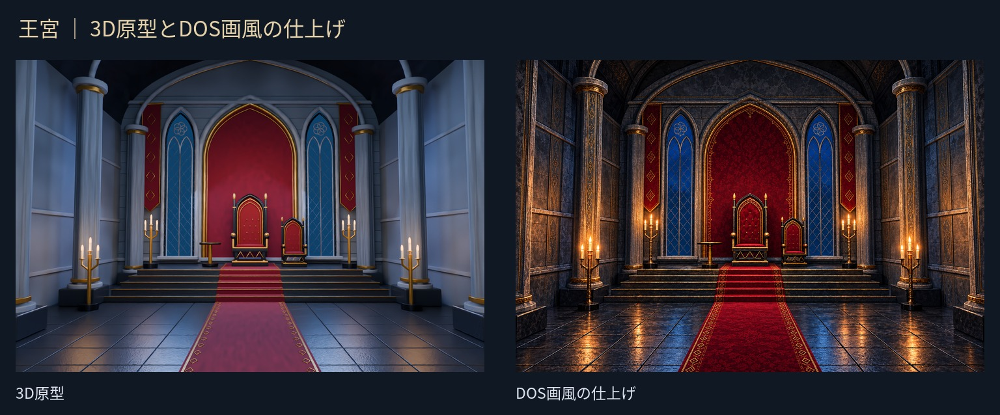
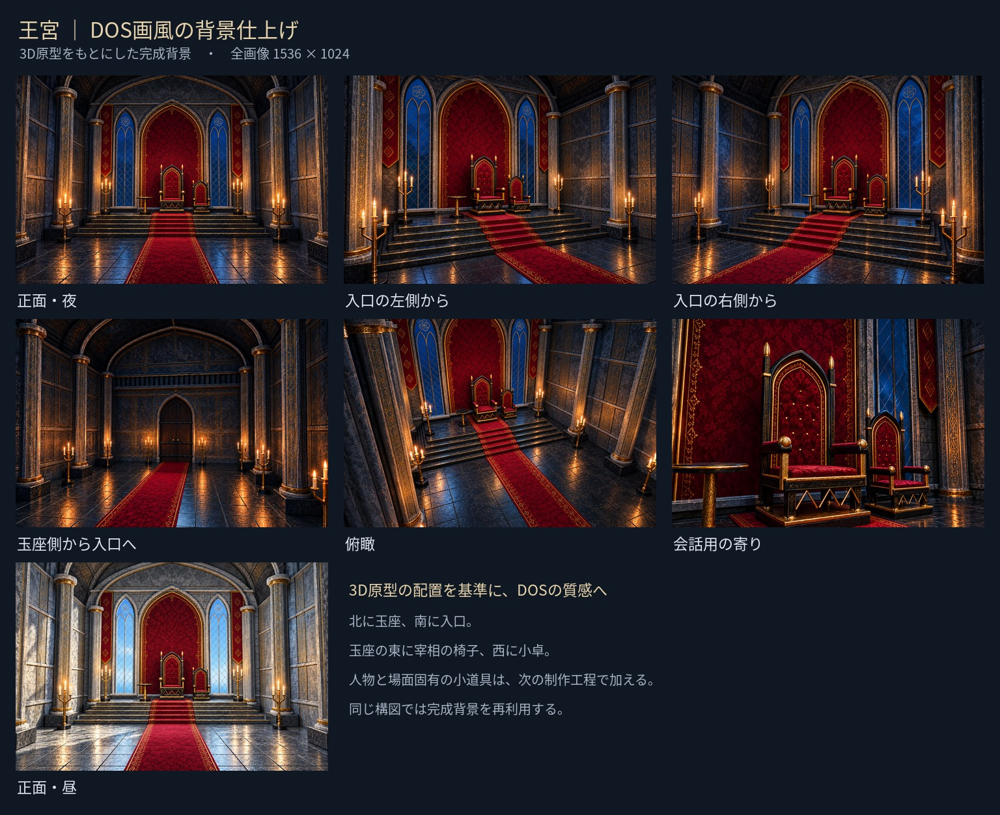

# 王宮・DOS画風の完成背景

2026-10-23、ユーザーの「DOSの画風に仕上げて」に基づき制作。
[3D原型](../README.md) の各カメラの構図を基準に、画像生成ツールで7枚を仕上げた。
正面は既存の [王宮基準画](../../palace-front.png) を画風の参照にし、
ほかの視点は完成した正面を共通の材質・配色・装飾の参照にしている。



## 全画像



| 構図 | 完成背景 | もとにした3D画像 |
|---|---|---|
| 正面・夜 | [front.png](front.png) | [原型](../front.png) |
| 左斜め | [left.png](left.png) | [原型](../left.png) |
| 右斜め | [right.png](right.png) | [原型](../right.png) |
| 入口方向 | [reverse.png](reverse.png) | [原型](../reverse.png) |
| 俯瞰 | [high.png](high.png) | [原型](../high.png) |
| 会話用の寄り | [audience.png](audience.png) | [原型](../audience.png) |
| 正面・昼 | [front-day.png](front-day.png) | [原型](../front-day.png) |

全7枚、1536×1024 PNG。人物や場面固有の杯・地図・手記は置かない。
暗い灰色の石、黒鉄と古い金、深紅の織物、細かな石肌・彫刻・刺しゅう、
青い窓光と暖かなろうそくの反射を共通にした。
昼の正面は完成した夜の正面を編集し、装飾と構図を保ちながら光と窓外の空色を変えた。

## 確認したこと

- 原型と並べ、玉座・東の宰相の椅子・西の小卓、窓・柱・通路・階段の大きな配置を目視確認。
- 入口方向の初稿に余分な赤い旗が加わったため、元の3D画像を参照して旗を除去。
  [初稿](candidates/reverse-added-banners.png) は制作記録として保存。
- 人物・文字・雪氷なし。昼の正面は青空と明るい昼光を確認。
- 7枚のサイズ、RGB形式、画像の読み込みを道具で検査。

AI仕上げのため、彫刻や織物の細かな柄は視点間で完全には一致しない。
3Dの形状制約を数値で強制した画像ではなく、原型の配置を目視照合した仕上げ画。
各シーンでは、この完成背景を固定素材として使い、同じ構図の背景を毎回再生成しない。
人物・接地影・小道具・前後の隠れ方を場面ごとに加える。

Blender原本は建築原型のまま保持している。完成画像の装飾が3Dのテクスチャとして
反映されたわけではないため、別の角度を追加する際は原型を撮影し、この正面と照合して仕上げる。
ゲームへの画像差し替え・登録は今回行っていない。

## 制作記録と一覧の再作成

[production.json](production.json) に参照画像・生成指示・入口方向の修正指示と画像ハッシュを保存。
確認用の一覧と正面の比較画像は、リポジトリのルートで次のコマンドから作る。

```bash
python3 tools/storyart/palace-review.py --finished
```

Pillowと日本語フォントが必要。フォントの場所は `--font` で指定できる。
