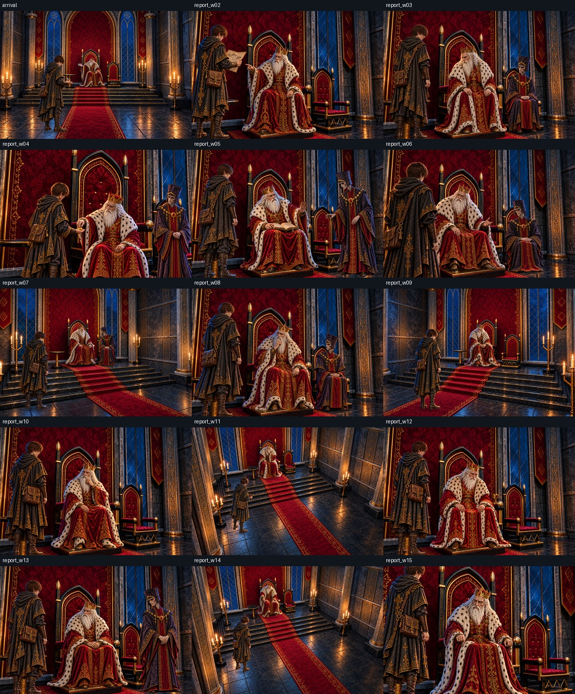
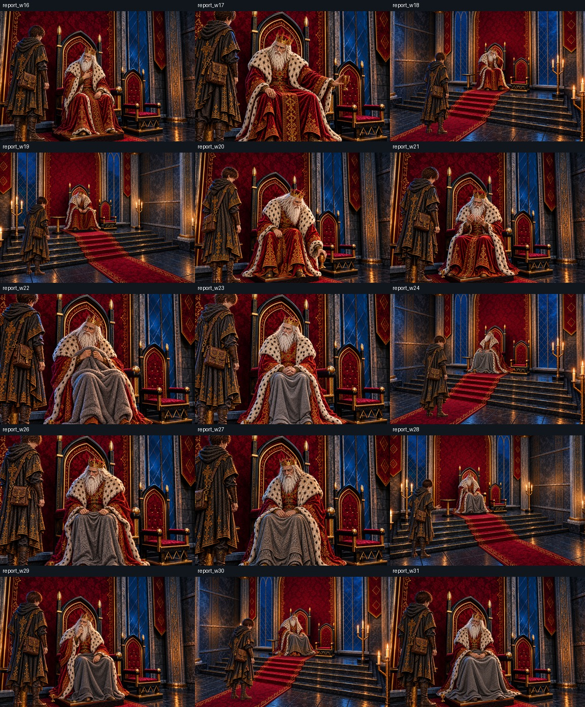
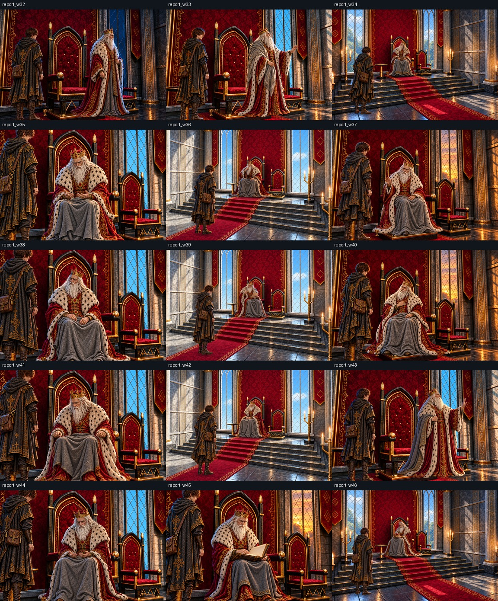
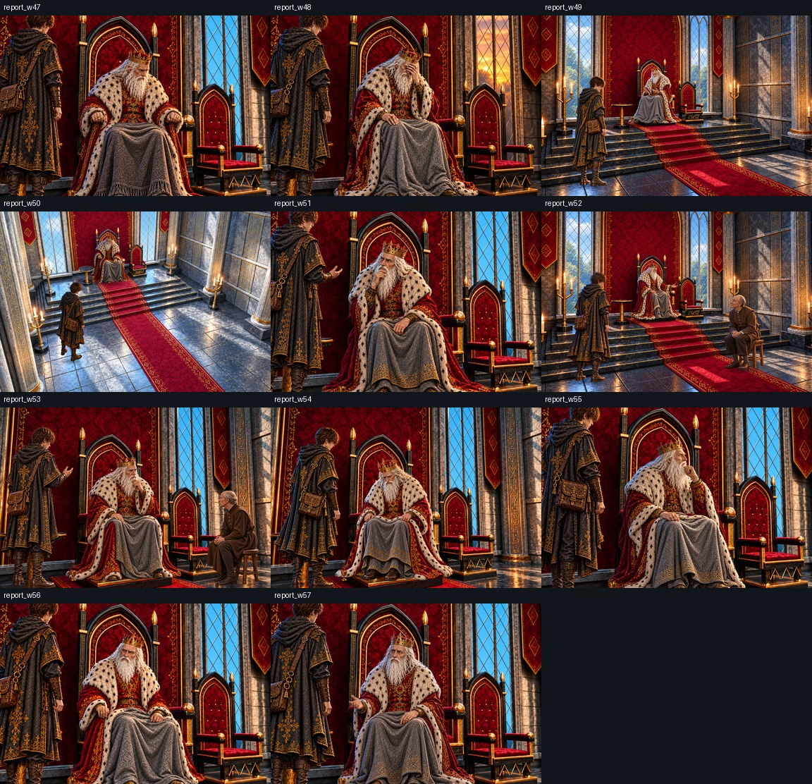

# 固定背景版・比較と原寸の確認

左が修正前、右が再制作。原寸リンクは1536×1024。各一覧の1枠は384×256。

| 場面 | 原寸 | 修正前後 | 背景 | 切り抜き x,y,w,h | 背景拡縮率 |
|---|---|---|---|---|---|
| `arrival` | [原寸](../../../../art/story-review/prologue/royal-audience.png) | [比較](comparisons/arrival-before-after.jpg) | [固定背景](../../../../docs/art/story-refs/palace-3d/finished/front.png) | `[200, 200, 1200, 800]` | 1.2800 |
| `report_w02` | [原寸](../../../../art/story-review/chapter1/report_w02.png) | [比較](comparisons/report_w02-before-after.jpg) | [固定背景](../../../../docs/art/story-refs/palace-3d/finished/audience.png) | `[0, 0, 1536, 1024]` | 1.0000 |
| `report_w03` | [原寸](../../../../art/story-review/chapter1/report_w03.png) | [比較](comparisons/report_w03-before-after.jpg) | [固定背景](../../../../docs/art/story-refs/palace-3d/finished/audience.png) | `[0, 0, 1536, 1024]` | 1.0000 |
| `report_w04` | [原寸](../../../../art/story-review/chapter1/report_w04.png) | [比較](comparisons/report_w04-before-after.jpg) | [固定背景](../../../../docs/art/story-refs/palace-3d/finished/audience.png) | `[0, 150, 1200, 800]` | 1.2800 |
| `report_w05` | [原寸](../../../../art/story-review/chapter1/report_w05.png) | [比較](comparisons/report_w05-before-after.jpg) | [固定背景](../../../../docs/art/story-refs/palace-3d/finished/audience.png) | `[0, 0, 1536, 1024]` | 1.0000 |
| `report_w06` | [原寸](../../../../art/story-review/chapter2/report_w06.png) | [比較](comparisons/report_w06-before-after.jpg) | [固定背景](../../../../docs/art/story-refs/palace-3d/finished/audience.png) | `[0, 0, 1536, 1024]` | 1.0000 |
| `report_w07` | [原寸](../../../../art/story-review/chapter2/report_w07.png) | [比較](comparisons/report_w07-before-after.jpg) | [固定背景](../../../../docs/art/story-refs/palace-3d/finished/left.png) | `[200, 200, 1200, 800]` | 1.2800 |
| `report_w08` | [原寸](../../../../art/story-review/chapter2/report_w08.png) | [比較](comparisons/report_w08-before-after.jpg) | [固定背景](../../../../docs/art/story-refs/palace-3d/finished/audience.png) | `[0, 0, 1536, 1024]` | 1.0000 |
| `report_w09` | [原寸](../../../../art/story-review/chapter2/report_w09.png) | [比較](comparisons/report_w09-before-after.jpg) | [固定背景](../../../../docs/art/story-refs/palace-3d/finished/right.png) | `[200, 200, 1200, 800]` | 1.2800 |
| `report_w10` | [原寸](../../../../art/story-review/chapter3/report_w10.png) | [比較](comparisons/report_w10-before-after.jpg) | [固定背景](../../../../docs/art/story-refs/palace-3d/finished/audience.png) | `[0, 0, 1536, 1024]` | 1.0000 |
| `report_w11` | [原寸](../../../../art/story-review/chapter3/report_w11.png) | [比較](comparisons/report_w11-before-after.jpg) | [固定背景](../../../../docs/art/story-refs/palace-3d/finished/high.png) | `[200, 200, 1200, 800]` | 1.2800 |
| `report_w12` | [原寸](../../../../art/story-review/chapter3/report_w12.png) | [比較](comparisons/report_w12-before-after.jpg) | [固定背景](../../../../docs/art/story-refs/palace-3d/finished/audience.png) | `[0, 0, 1536, 1024]` | 1.0000 |
| `report_w13` | [原寸](../../../../art/story-review/chapter3/report_w13.png) | [比較](comparisons/report_w13-before-after.jpg) | [固定背景](../../../../docs/art/story-refs/palace-3d/finished/audience.png) | `[0, 0, 1536, 1024]` | 1.0000 |
| `report_w14` | [原寸](../../../../art/story-review/chapter4/report_w14.png) | [比較](comparisons/report_w14-before-after.jpg) | [固定背景](../../../../docs/art/story-refs/palace-3d/finished/high.png) | `[200, 200, 1200, 800]` | 1.2800 |
| `report_w15` | [原寸](../../../../art/story-review/chapter4/report_w15.png) | [比較](comparisons/report_w15-before-after.jpg) | [固定背景](../../../../docs/art/story-refs/palace-3d/finished/audience.png) | `[100, 150, 1200, 800]` | 1.2800 |
| `report_w16` | [原寸](../../../../art/story-review/chapter4/report_w16.png) | [比較](comparisons/report_w16-before-after.jpg) | [固定背景](../../../../docs/art/story-refs/palace-3d/finished/audience.png) | `[0, 0, 1536, 1024]` | 1.0000 |
| `report_w17` | [原寸](../../../../art/story-review/chapter4/report_w17.png) | [比較](comparisons/report_w17-before-after.jpg) | [固定背景](../../../../docs/art/story-refs/palace-3d/finished/audience.png) | `[100, 150, 1200, 800]` | 1.2800 |
| `report_w18` | [原寸](../../../../art/story-review/chapter5/report_w18.png) | [比較](comparisons/report_w18-before-after.jpg) | [固定背景](../../../../docs/art/story-refs/palace-3d/finished/right.png) | `[200, 200, 1200, 800]` | 1.2800 |
| `report_w19` | [原寸](../../../../art/story-review/chapter5/report_w19.png) | [比較](comparisons/report_w19-before-after.jpg) | [固定背景](../../../../docs/art/story-refs/palace-3d/finished/left.png) | `[200, 200, 1200, 800]` | 1.2800 |
| `report_w20` | [原寸](../../../../art/story-review/chapter5/report_w20.png) | [比較](comparisons/report_w20-before-after.jpg) | [固定背景](../../../../docs/art/story-refs/palace-3d/finished/audience.png) | `[0, 0, 1536, 1024]` | 1.0000 |
| `report_w21` | [原寸](../../../../art/story-review/chapter5/report_w21.png) | [比較](comparisons/report_w21-before-after.jpg) | [固定背景](../../../../docs/art/story-refs/palace-3d/finished/audience.png) | `[0, 0, 1536, 1024]` | 1.0000 |
| `report_w22` | [原寸](../../../../art/story-review/chapter6/report_w22.png) | [比較](comparisons/report_w22-before-after.jpg) | [固定背景](../../../../docs/art/story-refs/palace-3d/finished/audience.png) | `[100, 150, 1200, 800]` | 1.2800 |
| `report_w23` | [原寸](../../../../art/story-review/chapter6/report_w23.png) | [比較](comparisons/report_w23-before-after.jpg) | [固定背景](../../../../docs/art/story-refs/palace-3d/finished/audience.png) | `[100, 150, 1200, 800]` | 1.2800 |
| `report_w24` | [原寸](../../../../art/story-review/chapter6/report_w24.png) | [比較](comparisons/report_w24-before-after.jpg) | [固定背景](../../../../docs/art/story-refs/palace-3d/finished/right.png) | `[200, 200, 1200, 800]` | 1.2800 |
| `report_w26` | [原寸](../../../../art/story-review/chapter7/report_w26.png) | [比較](comparisons/report_w26-before-after.jpg) | [固定背景](../../../../docs/art/story-refs/palace-3d/finished/audience.png) | `[100, 150, 1200, 800]` | 1.2800 |
| `report_w27` | [原寸](../../../../art/story-review/chapter7/report_w27.png) | [比較](comparisons/report_w27-before-after.jpg) | [固定背景](../../../../docs/art/story-refs/palace-3d/finished/audience.png) | `[100, 150, 1200, 800]` | 1.2800 |
| `report_w28` | [原寸](../../../../art/story-review/chapter7/report_w28.png) | [比較](comparisons/report_w28-before-after.jpg) | [固定背景](../../../../docs/art/story-refs/palace-3d/finished/left.png) | `[200, 200, 1200, 800]` | 1.2800 |
| `report_w29` | [原寸](../../../../art/story-review/chapter7/report_w29.png) | [比較](comparisons/report_w29-before-after.jpg) | [固定背景](../../../../docs/art/story-refs/palace-3d/finished/audience.png) | `[0, 0, 1536, 1024]` | 1.0000 |
| `report_w30` | [原寸](../../../../art/story-review/chapter8/report_w30.png) | [比較](comparisons/report_w30-before-after.jpg) | [固定背景](../../../../docs/art/story-refs/palace-3d/finished/right.png) | `[200, 200, 1200, 800]` | 1.2800 |
| `report_w31` | [原寸](../../../../art/story-review/chapter8/report_w31.png) | [比較](comparisons/report_w31-before-after.jpg) | [固定背景](../../../../docs/art/story-refs/palace-3d/finished/audience.png) | `[0, 0, 1536, 1024]` | 1.0000 |
| `report_w32` | [原寸](../../../../art/story-review/chapter8/report_w32.png) | [比較](comparisons/report_w32-before-after.jpg) | [固定背景](../../../../docs/art/story-refs/palace-3d/finished/audience.png) | `[0, 0, 1536, 1024]` | 1.0000 |
| `report_w33` | [原寸](../../../../art/story-review/chapter8/report_w33.png) | [比較](comparisons/report_w33-before-after.jpg) | [固定背景](../../../../docs/art/story-refs/palace-3d/finished/variants/audience-day.png) | `[0, 0, 1536, 1024]` | 1.0000 |
| `report_w34` | [原寸](../../../../art/story-review/chapter9/report_w34.png) | [比較](comparisons/report_w34-before-after.jpg) | [固定背景](../../../../docs/art/story-refs/palace-3d/finished/variants/left-day.png) | `[200, 200, 1200, 800]` | 1.2800 |
| `report_w35` | [原寸](../../../../art/story-review/chapter9/report_w35.png) | [比較](comparisons/report_w35-before-after.jpg) | [固定背景](../../../../docs/art/story-refs/palace-3d/finished/variants/audience-day.png) | `[100, 150, 1200, 800]` | 1.2800 |
| `report_w36` | [原寸](../../../../art/story-review/chapter9/report_w36.png) | [比較](comparisons/report_w36-before-after.jpg) | [固定背景](../../../../docs/art/story-refs/palace-3d/finished/variants/right-day.png) | `[200, 200, 1200, 800]` | 1.2800 |
| `report_w37` | [原寸](../../../../art/story-review/chapter9/report_w37.png) | [比較](comparisons/report_w37-before-after.jpg) | [固定背景](../../../../docs/art/story-refs/palace-3d/finished/variants/audience-evening.png) | `[0, 0, 1536, 1024]` | 1.0000 |
| `report_w38` | [原寸](../../../../art/story-review/chapter10/report_w38.png) | [比較](comparisons/report_w38-before-after.jpg) | [固定背景](../../../../docs/art/story-refs/palace-3d/finished/variants/audience-day.png) | `[100, 150, 1200, 800]` | 1.2800 |
| `report_w39` | [原寸](../../../../art/story-review/chapter10/report_w39.png) | [比較](comparisons/report_w39-before-after.jpg) | [固定背景](../../../../docs/art/story-refs/palace-3d/finished/variants/right-day.png) | `[200, 200, 1200, 800]` | 1.2800 |
| `report_w40` | [原寸](../../../../art/story-review/chapter10/report_w40.png) | [比較](comparisons/report_w40-before-after.jpg) | [固定背景](../../../../docs/art/story-refs/palace-3d/finished/variants/audience-evening.png) | `[0, 0, 1536, 1024]` | 1.0000 |
| `report_w41` | [原寸](../../../../art/story-review/chapter10/report_w41.png) | [比較](comparisons/report_w41-before-after.jpg) | [固定背景](../../../../docs/art/story-refs/palace-3d/finished/variants/audience-day.png) | `[100, 150, 1200, 800]` | 1.2800 |
| `report_w42` | [原寸](../../../../art/story-review/chapter11/report_w42.png) | [比較](comparisons/report_w42-before-after.jpg) | [固定背景](../../../../docs/art/story-refs/palace-3d/finished/variants/right-day.png) | `[200, 200, 1200, 800]` | 1.2800 |
| `report_w43` | [原寸](../../../../art/story-review/chapter11/report_w43.png) | [比較](comparisons/report_w43-before-after.jpg) | [固定背景](../../../../docs/art/story-refs/palace-3d/finished/variants/audience-day.png) | `[0, 0, 1536, 1024]` | 1.0000 |
| `report_w44` | [原寸](../../../../art/story-review/chapter11/report_w44.png) | [比較](comparisons/report_w44-before-after.jpg) | [固定背景](../../../../docs/art/story-refs/palace-3d/finished/variants/audience-day.png) | `[100, 150, 1200, 800]` | 1.2800 |
| `report_w45` | [原寸](../../../../art/story-review/chapter11/report_w45.png) | [比較](comparisons/report_w45-before-after.jpg) | [固定背景](../../../../docs/art/story-refs/palace-3d/finished/variants/audience-evening.png) | `[100, 150, 1200, 800]` | 1.2800 |
| `report_w46` | [原寸](../../../../art/story-review/chapter12/report_w46.png) | [比較](comparisons/report_w46-before-after.jpg) | [固定背景](../../../../docs/art/story-refs/palace-3d/finished/variants/left-day.png) | `[200, 200, 1200, 800]` | 1.2800 |
| `report_w47` | [原寸](../../../../art/story-review/chapter12/report_w47.png) | [比較](comparisons/report_w47-before-after.jpg) | [固定背景](../../../../docs/art/story-refs/palace-3d/finished/variants/audience-day.png) | `[100, 150, 1200, 800]` | 1.2800 |
| `report_w48` | [原寸](../../../../art/story-review/chapter12/report_w48.png) | [比較](comparisons/report_w48-before-after.jpg) | [固定背景](../../../../docs/art/story-refs/palace-3d/finished/variants/audience-evening.png) | `[100, 150, 1200, 800]` | 1.2800 |
| `report_w49` | [原寸](../../../../art/story-review/chapter12/report_w49.png) | [比較](comparisons/report_w49-before-after.jpg) | [固定背景](../../../../docs/art/story-refs/palace-3d/finished/variants/left-day.png) | `[200, 200, 1200, 800]` | 1.2800 |
| `report_w50` | [原寸](../../../../art/story-review/chapter13/report_w50.png) | [比較](comparisons/report_w50-before-after.jpg) | [固定背景](../../../../docs/art/story-refs/palace-3d/finished/variants/high-day.png) | `[200, 200, 1200, 800]` | 1.2800 |
| `report_w51` | [原寸](../../../../art/story-review/chapter13/report_w51.png) | [比較](comparisons/report_w51-before-after.jpg) | [固定背景](../../../../docs/art/story-refs/palace-3d/finished/variants/audience-day.png) | `[100, 150, 1200, 800]` | 1.2800 |
| `report_w52` | [原寸](../../../../art/story-review/chapter13/report_w52.png) | [比較](comparisons/report_w52-before-after.jpg) | [固定背景](../../../../docs/art/story-refs/palace-3d/finished/variants/left-day.png) | `[200, 200, 1200, 800]` | 1.2800 |
| `report_w53` | [原寸](../../../../art/story-review/chapter13/report_w53.png) | [比較](comparisons/report_w53-before-after.jpg) | [固定背景](../../../../docs/art/story-refs/palace-3d/finished/variants/audience-day.png) | `[0, 0, 1536, 1024]` | 1.0000 |
| `report_w54` | [原寸](../../../../art/story-review/chapter14/report_w54.png) | [比較](comparisons/report_w54-before-after.jpg) | [固定背景](../../../../docs/art/story-refs/palace-3d/finished/variants/audience-day.png) | `[0, 0, 1536, 1024]` | 1.0000 |
| `report_w55` | [原寸](../../../../art/story-review/chapter14/report_w55.png) | [比較](comparisons/report_w55-before-after.jpg) | [固定背景](../../../../docs/art/story-refs/palace-3d/finished/variants/audience-day.png) | `[100, 150, 1200, 800]` | 1.2800 |
| `report_w56` | [原寸](../../../../art/story-review/chapter14/report_w56.png) | [比較](comparisons/report_w56-before-after.jpg) | [固定背景](../../../../docs/art/story-refs/palace-3d/finished/variants/audience-day.png) | `[100, 150, 1200, 800]` | 1.2800 |
| `report_w57` | [原寸](../../../../art/story-review/chapter14/report_w57.png) | [比較](comparisons/report_w57-before-after.jpg) | [固定背景](../../../../docs/art/story-refs/palace-3d/finished/variants/audience-day.png) | `[100, 150, 1200, 800]` | 1.2800 |
