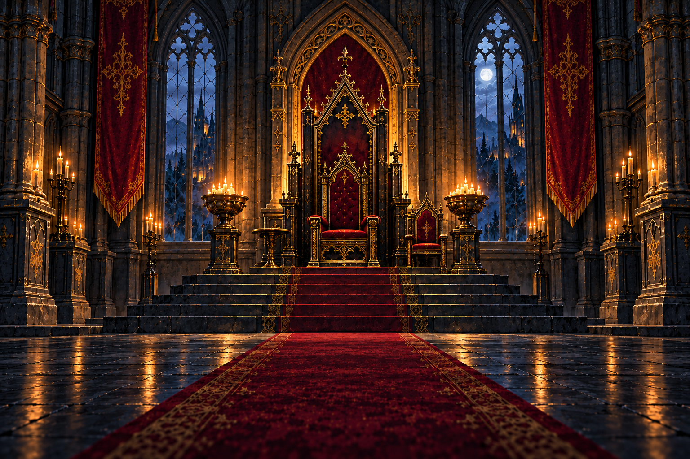
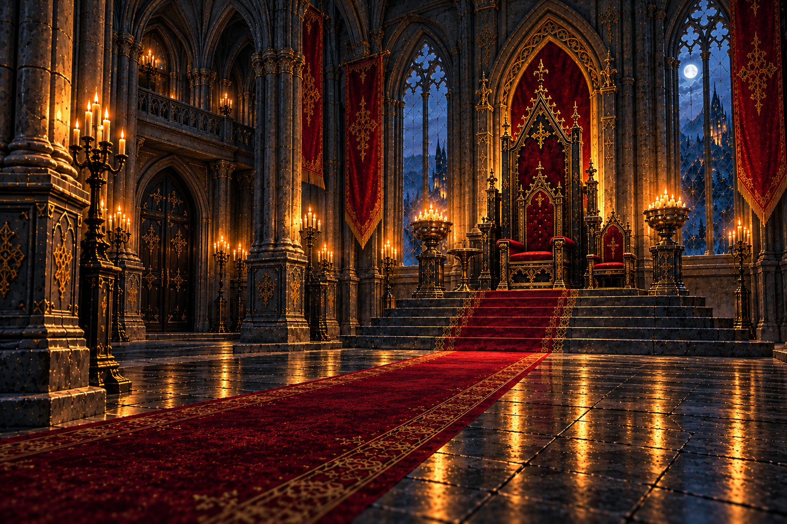
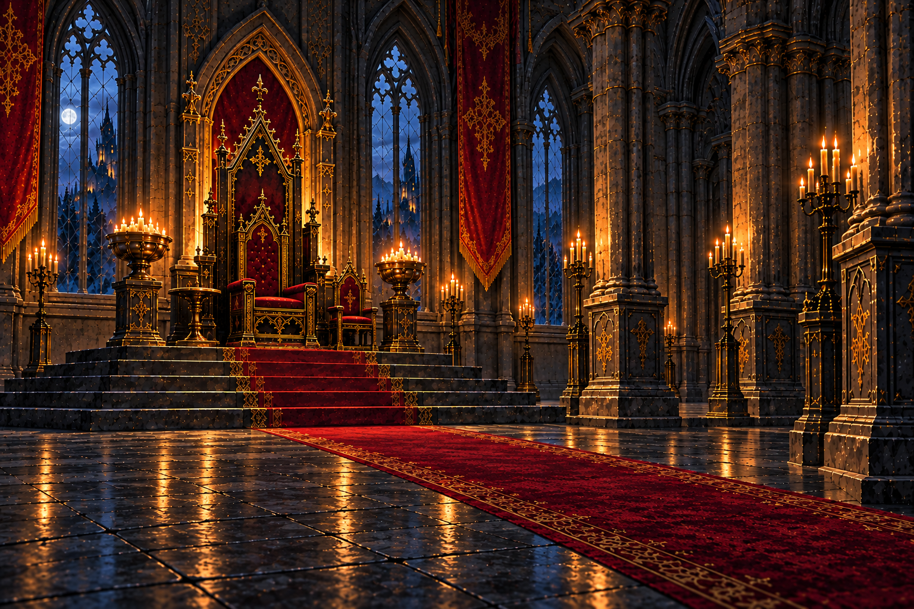
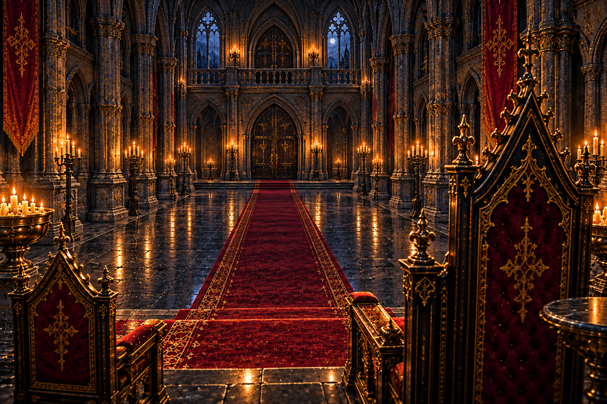
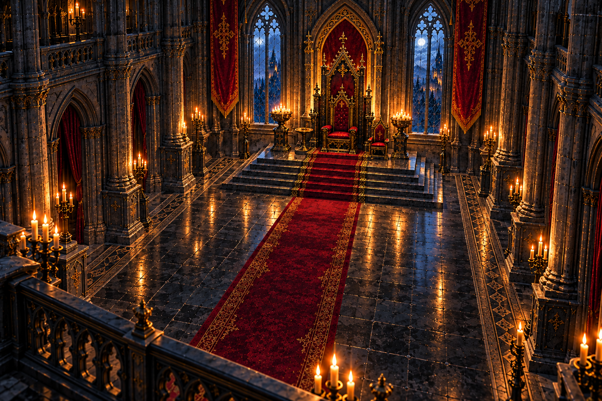

# 王宮内部・5視点の確認

2026-10-19制作。今後の王宮関連イラストの建築・家具・材質・配色の基準。

北を玉座、南を入口とする。正面から見て右 (東) に宰相の小さな椅子、左 (西) に丸い小卓。人物や物語固有の品は、各場面の本文に従って加える。照明は夜景の見本であり、「百年目の青空」以降の昼景では明るい空にする。

## 1. 正面

中央通路から玉座を見る主基準。

[原寸PNG](../palace-front.png)

## 2. 左斜め

入口の左側から玉座へ。通路が左手前から奥へ続く。

[原寸PNG](../palace-left.png)

## 3. 右斜め

入口の右側から玉座へ。通路が右手前から奥へ続く。

[原寸PNG](../palace-right.png)

## 4. 逆方向

玉座側から入口へ。手前の大きな背が玉座、小さな椅子が宰相の席。

[原寸PNG](../palace-reverse.png)

## 5. 俯瞰

入口側の上階から床・通路・玉座の位置を見る。

[原寸PNG](../palace-high.png)

## 確認と使い方

5視点で玉座・宰相の小さな椅子・小卓の相対位置、赤い中央通路、黒鉄と金、深紅の布、灰色の石を確認。文字・人物・雪氷なし。右斜めは初稿が左斜めに近かったため、右手前から通路が伸びる構図で再生成した。

生成画の細かな装飾・柱間・窓外の景色まで厳密な建築図として一致するものではない。家具の位置・玉座の形は正面を主基準にし、ほかはアングルと見え方の補助に使う。

[基準一覧と制作指示](../README.md#王宮内部の基準-2026-10-19)
