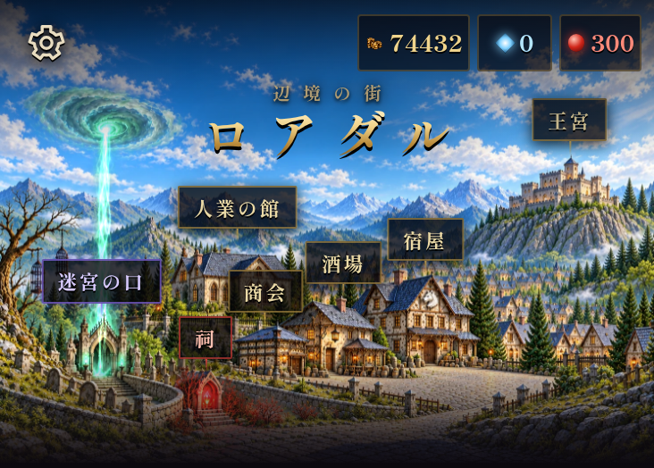
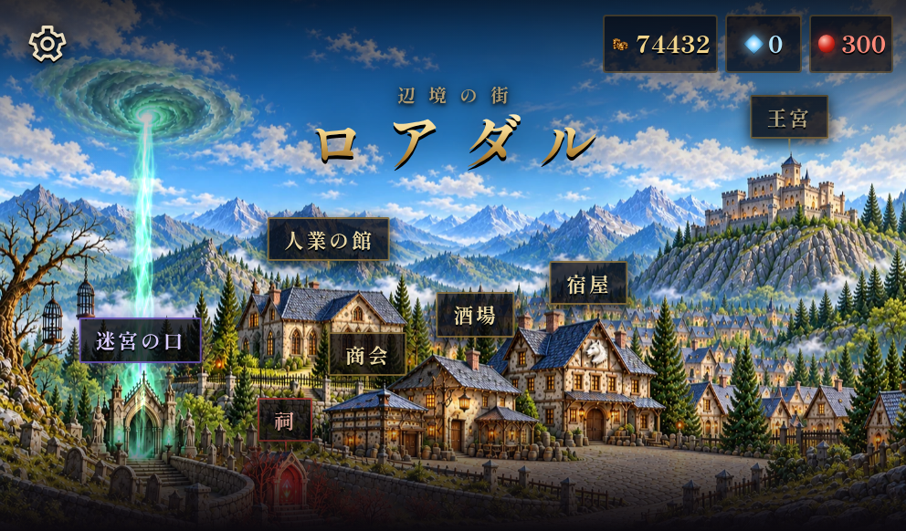

# ロアダルの青空

「百年目の青空」（`report_w33`）を王に報告した後、ホーム画面上部の街を昼景へ切り替える。報告前は従来の夜景を表示する。

原画は [panoramaDay.png](../panoramaDay.png)（1489×1056、生成時の解像度を維持）、出荷は `art/town/panoramaDay.webp`（品質90、約563KB）。既存の夜景を参照して、建物・墓地・石畳・施設の構図を保ちながら、青空と白い雲、山や街へ差す昼光を描いた。月・星・雷を出さない。門の魂光と祠の紅い光は残す。原画には文字・署名・UIを入れていない。

昼景は夜景とは別のcanvasを保持する。王への報告で条件が変わった時と施設から戻った時に、報告済みの状態に合う絵を選ぶ。画像読み込み失敗時も、青空のドット絵へ戻し、施設の札の座標を再計算する。

| スマホ 390×844 | タブレット 744×1000 |
|---|---|
|  |  |
| [全画面](town-390.png) | [全画面](town-744.png) |

[報告前の夜景](night-390.png) / [昼景の読み込み失敗時](fallback-day.png) / [確認結果](checks.json)

Chromiumで報告前後の表示切り替え、全7施設の札の操作と王宮から街への復帰、報告済みの進行状態からの表示、7施設の札の座標と文字の重なり、昼景の読み込み失敗時を確認した。両画面幅でブラウザ例外は0件。再現用スクリプトは `tools/townart/review-blue-sky.py`。先に `python3 -m http.server 8000` を起動して実行する。

`python3 tools/townart/build.py --only panoramaDay` が変換・台帳・SW登録を生成する。`--check` は夜景・昼景の原画とWebPも照合する。
