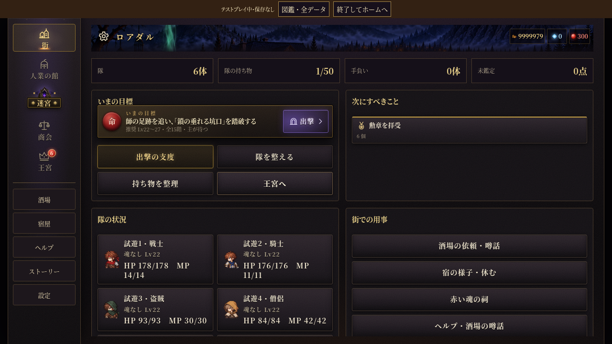
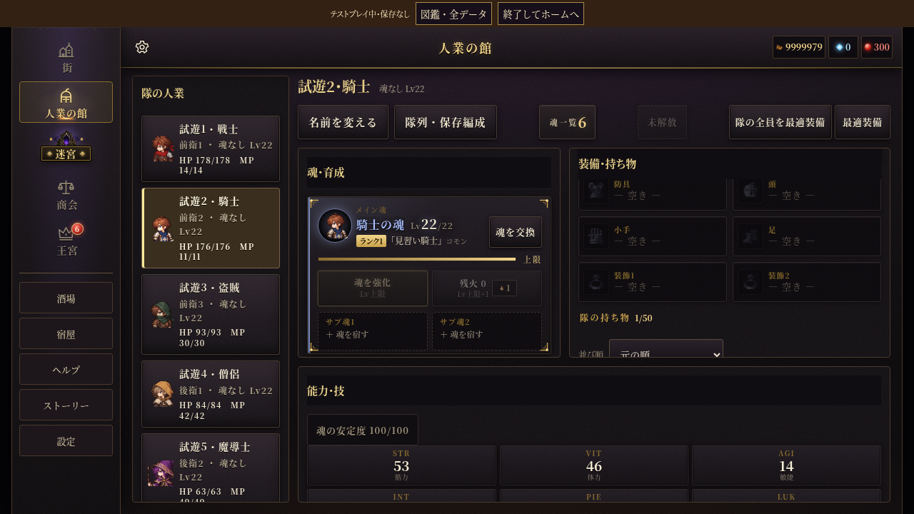
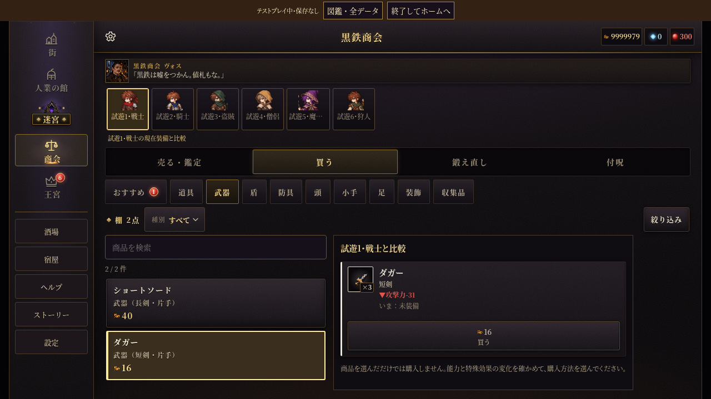
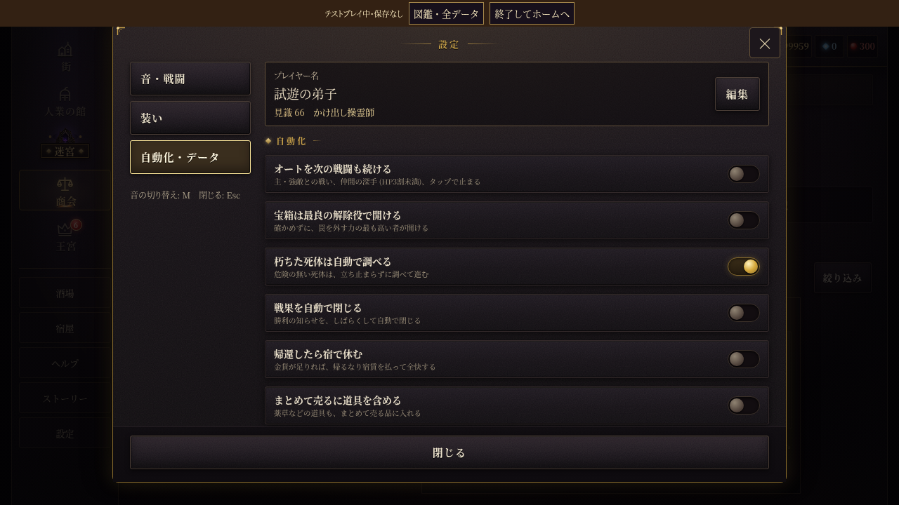
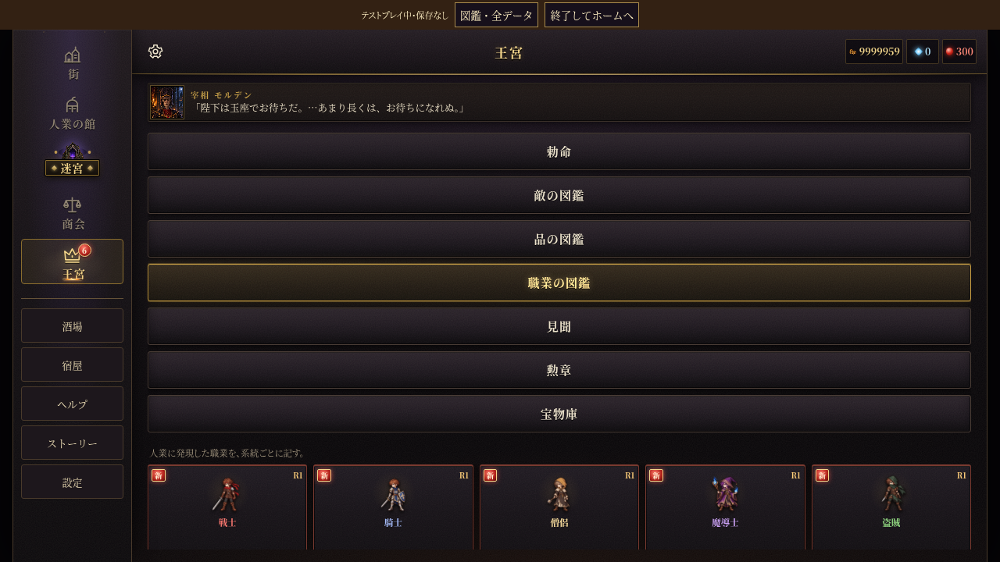
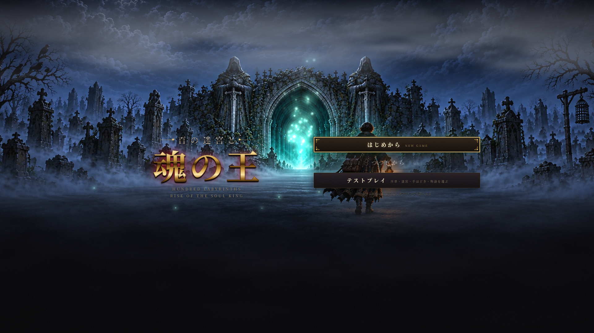
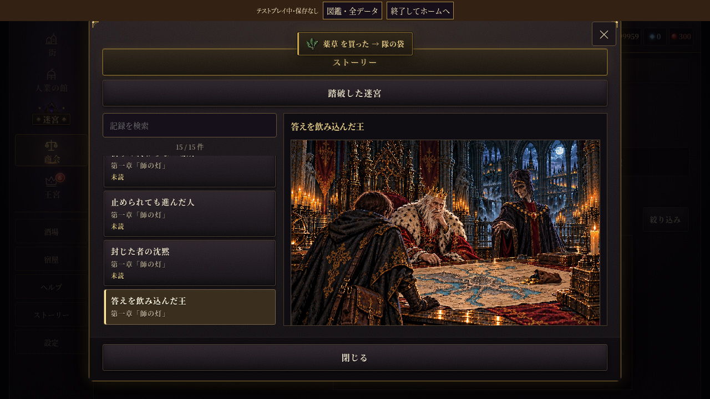

# PC向けの画面

幅1100px以上・高さ600px以上で、主ポインターがマウス相当、かつタッチ非対応の端末に適用する。スマホ・タブレット・狭いウィンドウは従来の配置を保つ。

街では隊の状態・目的・用事をまとめ、左の施設メニューから移動できる。館は人業一覧を左に、魂・装備・能力を右に同時表示する。名前変更・隊列・最適装備は上の操作帯にまとめた。商会は在庫検索と購入者の装備比較、物語・心得は検索付きの一覧と本文を左右に置く。選択するだけでは品を買わず、購入は既存のボタンで確定する。設定と王宮も左で分類を直接選べる。探索中は隊・記録・図鑑・収穫・読み物を上のボタンから開ける。

チュートリアル中の街・館・王宮は従来の誘導を使い、未解放の機能や未読の物語を先に開放しない。物語は表示した項目だけ既読になる。館は人業を切り替えても各欄のスクロール位置を保ち、入り直すと先頭から表示する。開いた読み物の選択は窓を狭めても保つ。共通ウィンドウの×は既存の取消と同じ動作。施設や検索一覧は上下キー・Home・Endでも移動できる。

見本は試遊用の記録。街・館・商会・設定は1280×720、タイトルは1920×1080、物語は1280×720。外部フォントを使わない検証環境で撮影したもの。

## 街

## 人業の館

## 商会

## 設定

## 王宮

## タイトル

## 物語詳細

## 確認方法

`python3 -m http.server 8000` で起動してから、`python3 tools/layout/desktop-screens-check.py` を実行する。既定の比較元は前回のPC全画面対応版（089f0664）。`DOS_TEST_BASELINE` で比較元のコミットを指定できる。`DOS_TEST_URL` でサーバーのURLも変更できる。

タッチ端末は変更前のCSS・関連UIモジュールを読み込んだページと画面寸法を比較する。PCでは各施設・シート25画面、タイトル2種、会話・序幕・職業一覧、上下キー・Esc・確認の取消を検証する。`DOS_TEST_SCOPE=pc` はタッチ端末の比較を省き、`DOS_TEST_SCOPE=scenes` は会話などの追加検証だけを行う。

`python3 tools/layout/desktop-check.py` では既存の探索・戦闘の配置と狭い窓への切り替えも確認する。検証用HTMLの起動監視だけ60秒に延長し、外部フォントの取得を省く。本体の起動監視・保存・ゲームの進行や計算は変更しない。

`python3 tools/layout/desktop-controls-check.py` で3種類のPC解像度の検索・選択・実際の購入・設定・王宮を操作する。ウィンドウ幅切替で人業・所持金・装備・乱数が変わらないこと、読み物の選択保持、探索の直接ボタンと戦闘への移行も確認する。
