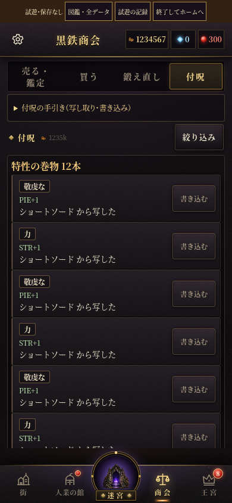
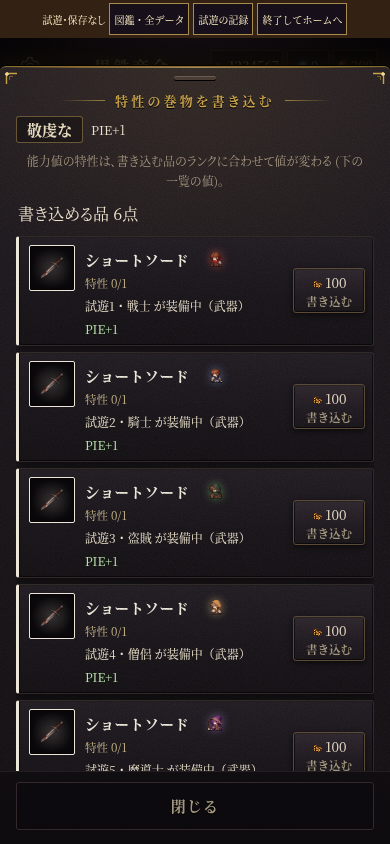
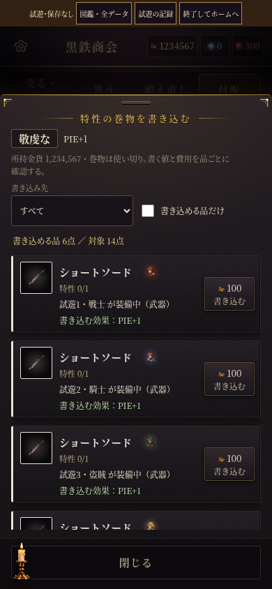

# 商会「付呪」の問題点と改善

2026-10-20。費用計算・特性の性能・枠・書き込み/写し取り/消去・保存の処理は既存の窓口を使用する。

| 現在の画面で確認した問題 | 改善 |
| --- | --- |
| 巻物が多いと、後ろの「特性の付いた品」が下に埋もれる。 | 一覧を「すべて」「巻物を書き込む」「品から写し取る・消す」に切り替える。用途ごとに直接探せる。 |
| 袋・装備中・棚の品が同じ一覧に並び、特性の検索以外に探す手段がない。 | 品の場所で絞り込み、既存の特性名/効果の絞り込みと併用。件数は表示数/全件数を示す。練習中は条件で品を隠さない。 |
| 書き込み先も全員の装備と袋の品が並び、スクロールすると巻物や見出しが画面外へ流れる。 | 装備中・共有の袋・人業別で絞る。巻物・所持金・対象選択・閉じるを固定し、候補一覧だけをスクロール。低い横向きでは選択欄を詰める。 |
| 金貨不足でも「書き込める品」に数えられ、押して初めて不足が分かる。 | 金貨不足も実行できない理由に含めて件数を算出し、理由を候補に表示。実行ボタンは無効。「書き込める品だけ」で除外し、0件でもチェックを外せる。 |
| 上書き前の効果や低下は、確認画面へ進むまで分からない。 | 候補の時点で変更前/変更後の効果と低下の注意を表示。最後の上書き確認・低下警告も維持。 |
| 写し取りでは大きな品の絵と特性の操作が先に並び、品が消える説明は末尾にある。 | 品の絵と名前を小さな見出しにまとめ、品の消失・ほかの特性を失う注意を操作より先に表示。写し取りと、品を残して特性だけ消す操作を区別する。 |
| 金貨/買値/書き込み費用がkで丸められ、袋の品は「持ち物」としか分からない。 | 全桁を表示し、共有の袋・装備者・棚を明示。装備中/ロックなど、写し取れない理由は一覧にも表示する。 |

## 画面

同じ検査用データ（巻物12本、装備中6点、袋の特性つき装備8点、棚1点）で比較。

| 一覧：変更前 | 一覧：変更後 |
| --- | --- |
|  |  |

| 書き込み先：変更前 | 書き込み先：変更後 |
| --- | --- |
|  |  |

用途・場所で絞った[品の一覧](sources-390.png)、[上書き前後の表示](overwrite-390.png)、[写し取り前の注意](extract-390.png)。この3枚は回帰検査用の別データ。PCの比較画面は[こちら](overwrite-1440.png)。

## 検証

- `python3 tools/enchant/layout-browser-check.py`：320×568・390×844・844×390・768×1024・1440×900。用途/場所・書き込み先・未鑑定保護・上書きの低下・閲覧/確認取消での金貨/巻物/品/乱数/実績の不変・不足時0件・候補内スクロール・写し取りの確定と条件維持を実操作で確認。
- `python3 tools/enchant/filter-browser-check.py`：既存の即時特性検索・AND/OR・解除・条件記憶・長文折り返し・練習。画像準備後に街の描画を切り替える現行仕様に合わせ、検査用の品が届くまで待つ処理を追加。期待値は変更しない。
- `python3 tools/enchant/browser-check.py`：実課金・消費・能力反映・満杯への上書き・取消・低下警告・5種類の状態異常・通常の保存読込。
- `python3 tools/enchant/tutorial-check.py`：練習の写し取り/書き込み・取消・保存再開・金貨0/袋満杯・通常資産の保全。
- `python3 tools/prologue/tutorial-scroll-check.py`：付呪を含む手ほどきのタッチスクロール。
- `python3 tools/enchant/item-detail-browser-check.py`、`shop-scroll-browser-check.py`、`appraisal-scroll-browser-check.py`：品の詳細・購入・鑑定からの写し取り、保護と取消、二重消費の拒否。
- `python3 tools/shop/leave-filter-browser-check.py`：商会内での特性条件の保持と、商会を離れた際の解除。
- `node tools/journal/check.mjs`、全264 JSファイルの `node --check`、`git diff --check`。

ヘルプ `enchant` と仕様の正本 `CLAUDE.md` を更新。酒場の心得 `t_enchant_list` を追加。

## 特性の絞り込みの効果表示（同日追記）

候補が特性名だけで、効果の説明は検索用の内部データにしかなかったため、候補を名前と効果の2段表示に変更。能力値の増加だけでなく、号令の対象・継続ターン・発動回数などもその場で読める。数値違いは同じ特性の候補にまとめ、重複しない効果を最大3例と残りの例数で示す。省いた例も検索対象にする。館・購入でも共通の部品を使う。

画面：[数値違いの例](filter-effects-390.png)・[働きの説明](filter-behavior-390.png)。

`tools/enchant/filter-browser-check.py` に、説明の表示・例の集約・省略例の検索・長文の折り返しを追加。既存のAND/OR・解除・条件保持・練習とあわせて確認する。商会・館の共通部品は `tools/shop/character-filter-browser-check.py` と `tools/shop/effect-search-browser-check.py` でも確認。心得 `t_enchant_filter` を更新。

共通部品の確認結果：特性検索は320/390/844/1280px、購入の効果検索は390/320/844pxで通過。館・個別比較の検査は390/320/844pxで通過し、1024pxでは「別の者のおすすめが混入」で停止する。変更前のmainの `gearfilter.js` を使っても同じ停止を再現したため、この表示修正の範囲では変更していない。
