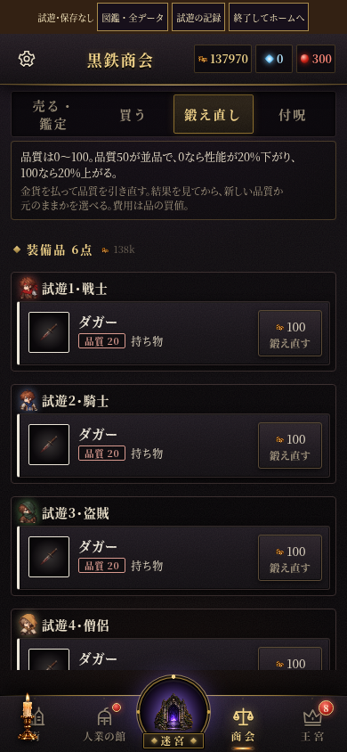
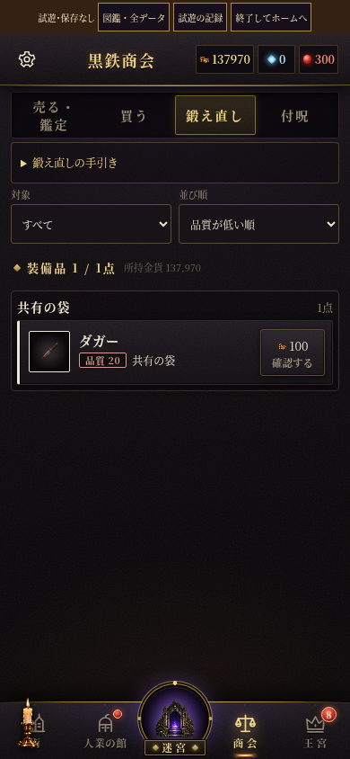

# 商会「鍛え直し」の問題点と改善

2026-10-20。品質の抽選・性能・費用の計算は既存処理を使用する。

| 確認した問題 | 改善 |
| --- | --- |
| 全人業の `items` が共有の袋を指すため、袋の同一品が人数分重複する。6人・袋1点で6点と表示された。 | 装備中は隊→控えでまとめ、共有の袋は別枠で一度だけ表示。件数も実物の数にする。 |
| 袋の品が各人業の私物として表示される。 | 一覧・詳細とも「共有の袋」と表示。装備者は全員の装備欄から調べる。 |
| 対象の絞り込みと並べ替えがなく、長い一覧から探す必要がある。 | すべて・装備中・共有の袋・人業別を選択でき、枠内を品質の昇順／降順・名前順にする。0件でも対象を戻せる。 |
| 店主の台詞と常時展開した説明で、小さい画面の一覧が狭い。 | 手引きを折りたたみ、スマホ・低い横向きでは店主の台詞を省く。一覧内をスクロールする（高さ500px以下は既存の商会内スクロール）。 |
| 金貨の省略表記、一覧の制限理由、抽選後の更新が不十分。 | 費用・所持金を全桁表示。金貨不足や魂の記憶などの理由を表示し、抽選・品質採用時に一覧全体を更新。 |
| 一覧の「鍛え直す」が即課金に見える。 | 一覧は「確認する」とし、詳細で実行して初めて課金。 |
| 比較の元／候補が明示されず、再抽選が採用・保留の間に挟まる。 | 元／引いた品質と性能の見出しを付け、採用・元のままを横並びに、再課金する「もう一度」をその下に分ける。 |
| 再抽選が失敗した場合にも候補を先に消す。 | 抽選に成功してから候補を置換。金貨不足でも採用・元のままを選べる。 |

## 画面

同じ条件（6人・装備なし・共有の袋にダガー1点）で比較。

| 変更前（同じ1点を6回表示） | 変更後（共有の袋の1点） |
| --- | --- |
|  |  |

結果画面（別の検査用データ。品質20→90）：[スマホ](result-390.png)・[PC](result-1440.png)。

## 検証

- `python3 tools/shop/reforge-browser-check.py`：320×568・390×844・844×390・768×1024・1440×900。共有袋の重複、未鑑定保護、控え、対象／並び、閲覧で金貨・乱数を変えないこと、実際の課金、再抽選・保留・採用・閉じる・金貨不足、装備者の能力差、全人業不在、結果ボタンの画面内配置と横はみ出しを確認。
- `node tools/weaponpower/check.mjs`：全758武器と185条件の模擬戦を通過。
- 全264 JSファイルの `node --check`、`git diff --check`。
- 既存の `tools/inventory/equipment-compare-browser.py` は「同じ追加特性の効果量を区別」で停止する。今回変更した鍛え直しの検査に進む前の期待値であり、`origin/main` の `reforge.js` に戻しても同じ停止を再現。今回の修正範囲では変更していない。

仕様の正本は `CLAUDE.md` の「UI 構造」。追加した酒場の心得は `t_forge_list`。
